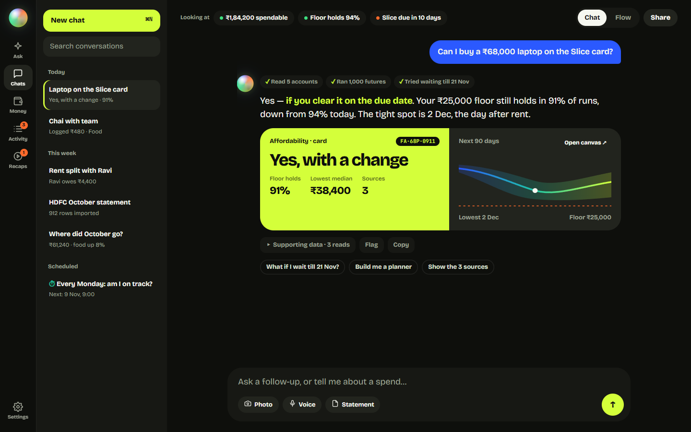
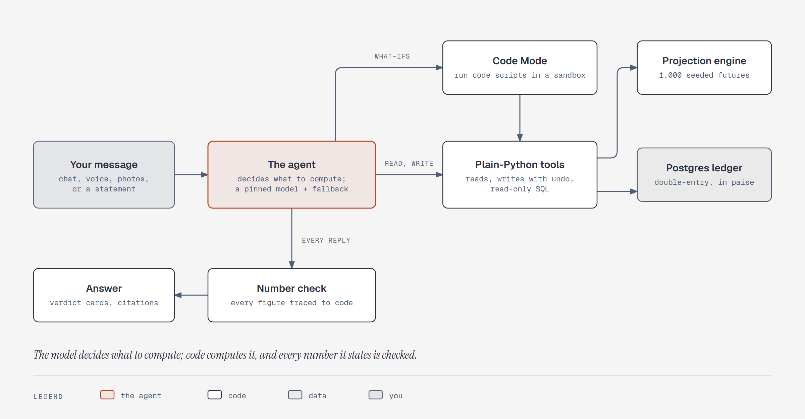

<p align="center">
  
</p>

<h1 align="center">Arno</h1>

<p align="center">
  A self-hosted personal finance agent for India. It keeps your accounts, cards, loans, and goals
  in a double-entry ledger on your own machine, and answers questions about your money in chat.
</p>

<p align="center">
  <a href="LICENSE"></a>
  <a href="https://github.com/Joy9001/Arno/actions/workflows/ci.yml"></a>
  
</p>

<p align="center">
  
  <br>
  <sub>Interface design comp; the figures are illustrative.</sub>
</p>

Arno was called Fin-Agent until November 2026. Older links, issues, and backups use that name.

## What you can ask

Chat in English, Hindi, or Hinglish, by text or voice.

| You say | Arno does |
|---|---|
| "Can I buy a ₹68,000 laptop on the Slice card?" | Simulates 16,384 versions of the coming months from your own history and answers yes, yes with a change, or no, with the probability of staying above your floor |
| "Where did October go?" | Breaks the month down by category and links the rows behind each total |
| "If I prepay ₹1 lakh on my loan, how much interest do I save?" | Writes a short Python script over your data, runs it in a sandbox, and shows you the script |
| "Paid ₹480 for chai with the team, Ravi owes me half" | Logs the spend and Ravi's share at once, with undo |
| "Every Sunday, tell me what I spent on food" | Schedules a read-only question that answers into your inbox |
| A photo of a receipt or a UPI screenshot | Turns it into one transaction and keeps the image |

It also sends reminders for bills, EMIs, and card dues, and reconciles bank and card statements
through a review screen. Reading rows out of a statement file is being rebuilt, so statement import
is not available yet. It never moves money, never sees a statement password, and never recommends
an investment.

## How it works

<p align="center">
  
</p>

- The model decides what to compute, and code computes it. Every number in a reply has to come
  from a tool return or a script the agent ran in an isolated sandbox.
- Affordability verdicts come from a seeded projection in plain Python. "Yes" means at least a 90%
  chance your balance stays above your floor, with no goal slipping and no bill missed.
- One Postgres database holds the whole state, on a vendored copy of
  [pgledger](https://github.com/pgr0ss/pgledger). Money is stored in integer paise.
- Text from statements and payee notes is treated as data. Wide changes (a category rule for every
  past row, archiving, settings) wait for your tap on a confirm card; everyday writes are instant
  and undoable.

The [architecture guide](docs/arno/architecture.md) and [tool reference](docs/arno/specs/tools.md)
go deeper. Decisions live in [`plan.md`](docs/arno/plan.md).

## Install

You need Docker with Compose and an encrypted disk (BitLocker, LUKS, or FileVault), which is what
protects the database at rest. To use Arno from your phone, the host also needs
[Tailscale](https://tailscale.com).

```bash
git clone https://github.com/Joy9001/Arno.git && cd Arno
cp .env.example .env      # fill in the secrets and your chat model; .env.example explains each
docker compose pull api db   # the published images
docker compose up -d
docker compose logs api   # prints a one-time enrollment link and a QR code
```

Tracing is off by default. To turn it on, start the optional Phoenix service with
`docker compose --profile obs up -d`, fill in the four `PHOENIX_*` secrets in `.env`, and set
`OTEL_EXPORTER_OTLP_ENDPOINT=http://phoenix:6006`.

Open <http://localhost:8000>, follow the link, and create a passkey. Tell Arno your balances,
salary day, and card dues, and it can answer from the first conversation. To try it on sample data
first, run `docker compose exec api arno demo seed` on an empty instance.

For phone access, run `tailscale serve --bg 8000` on the host, then set `ARNO_RP_ID` and
`ARNO_RP_ORIGIN` in `.env` to the `ts.net` address it prints.

> [!WARNING]
> Keep `RESTIC_PASSWORD` somewhere other than this machine. The daily backups are encrypted with
> it, and without it they can't be read.

The [self-hosting guide](docs/arno/operations/self-hosting.md) covers the rest: models (cloud or
local Ollama), what each provider receives, ports, backups and restore, updates, and
[upgrading from Fin-Agent](docs/arno/operations/legacy-upgrades.md#upgrade-from-fin-agent).

<details>
<summary>The <code>arno</code> command</summary>

Inside Compose, prefix each command with `docker compose exec api`. Restore is the exception: the
default backups volume is root-owned, so it takes the form shown in the list.

```bash
arno migrate                    # apply pending SQL migrations
arno export --format json       # json, csv, or sql
arno setup                      # print a fresh enrollment link
arno passkeys reset             # delete every passkey and session, then reopen setup
arno demo seed                  # load the synthetic persona into an empty instance
docker compose run --rm --no-deps --user root api arno restore   # newest backup, verified
```

</details>

## Security and privacy

- Compose publishes only on `127.0.0.1`, and Tailscale provides HTTPS. Nothing faces the public
  internet.
- One user signs in with a passkey. Exports and passkey changes ask for the passkey again.
- The agent's SQL runs as a read-only database role with a two-second timeout and no access to
  auth tables.
- There are no analytics. Traces, when you turn them on, stay on the host in Phoenix. Only the
  model calls you configure leave the machine, and with local models nothing does.

The [security posture](docs/arno/operations/self-hosting.md#security-and-privacy-posture) and
[what leaves the host](docs/arno/operations/self-hosting.md#what-leaves-the-host) list what each
provider receives and keeps.

## Develop

Python 3.14 with [uv](https://docs.astral.sh/uv/); the web app uses Node 24 with pnpm.

```bash
uv sync --dev
docker compose up -d db                       # Postgres on 127.0.0.1:5433
uv run arno migrate && uv run arno serve
pnpm --dir web install && pnpm --dir web dev  # Vite proxies /api to the API
```

Tests need a scratch database whose name ends in `_test`, and they can never call a model.
[`AGENTS.md`](AGENTS.md) lists the checks for each kind of change, and
`uv tool install pre-commit && pre-commit install` runs them as git hooks.

## Status

0.2.0 is the first release under the Arno name. `plan.md` counts the project as
[shipped](docs/arno/plan.md#what-shipped-means) once someone else installs it from the docs alone
and after four weeks of daily use. The [completion checklist](docs/arno/completion-checklist.md)
tracks what's left. India is the only country implemented; everything India-specific is in
`src/arno/india/`.

## License

Arno is [MIT licensed](LICENSE). Dependency licenses are checked by hand, and no GPL, AGPL,
SSPL, or Elastic code ships in the Arno image; the optional Phoenix service is Elastic 2.0 and
runs outside it.
The double-entry core is [pgledger](https://github.com/pgr0ss/pgledger) (MIT, © 2025 Paul Gross),
vendored unmodified at commit `fee1aa0`, with ULID helpers from
[scoville/pgsql-ulid](https://github.com/scoville/pgsql-ulid) (BSD-3-Clause, © 2021 Scoville). No
endorsement is implied. Full notices are in [`THIRD_PARTY_NOTICES.md`](THIRD_PARTY_NOTICES.md).
