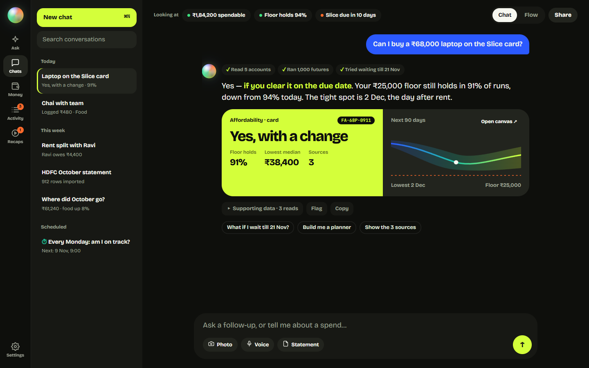

<p align="center">
  
</p>

<h1 align="center">Arno</h1>

<p align="center">
  A self-hosted personal finance agent for India. It keeps your accounts, cards, loans, and goals
  in a double-entry ledger on your own machine, and answers questions about your money in chat.
</p>

<p align="center">
  <a href="LICENSE"></a>
  <a href="https://github.com/Joy9001/Arno/actions/workflows/ci.yml"></a>
  
</p>

<p align="center">
  
  <br>
  <sub>Interface design comp; the figures are illustrative.</sub>
</p>

Arno was called Fin-Agent until November 2026. Older links, issues, and backups use that name.

## What you can ask

Chat in English, Hindi, or Hinglish, by text or voice.

| You say | Arno does |
|---|---|
| "Can I buy a ₹68,000 laptop on the Slice card?" | Simulates 1,000 runs of the coming months and answers yes, yes with a change, or no, with the probability of staying above your floor |
| "Where did October go?" | Breaks the month down by category and links the rows behind each total |
| "If I prepay ₹1 lakh on my loan, how much interest do I save?" | Writes a short Python script over your data, runs it in a sandbox, and shows you the script |
| "Paid ₹480 for chai with the team, Ravi owes me half" | Logs the spend and Ravi's share at once, with undo |
| "Every Sunday, tell me what I spent on food" | Schedules a read-only question that answers into your inbox |
| A photo of a receipt or a UPI screenshot | Turns it into one transaction and keeps the image |

It also imports bank and card statements (PDF, spreadsheet, or text, password-protected or not),
learns each new layout once, and sends reminders for bills, EMIs, and card dues. It never moves
money, never sees a statement password, and never recommends an investment.

## How it works

<p align="center">
  
</p>

- The model decides what to compute, and code computes it. Every number in a reply has to come
  from a tool return or a script the agent ran; a number check flags any that don't.
- Affordability verdicts come from a seeded projection in plain Python. "Yes" means at least a 90%
  chance your balance stays above your floor, with no goal slipping and no bill missed.
- One Postgres database holds the whole state, on a vendored copy of
  [pgledger](https://github.com/pgr0ss/pgledger). Money is stored in integer paise.
- Text from statements and payee notes is treated as data. After a conversation reads it, any
  lasting change (memory, setup, bulk writes) waits for your tap on a confirm card.

The [system design](docs/arno/system-design.md) and [tool reference](docs/arno/tools.md) go
deeper. Decisions live in [`plan.md`](docs/arno/plan.md).

## Results

These sections are written by `arno eval`, `arno backtest`, and `arno hackerrank`, never by hand.

### Agent evals

134 cases against a synthetic persona, three trials each, with a fresh database per trial.
`pass^3` counts a case only if all three trials pass. The suite and its targets are in
[`evals/`](evals/README.md).

<!-- eval-scorecard:start -->
| Model | Answers and what-ifs | Writes | Honesty when data is missing | Injection | Advice boundary | Never moving money / passwords | Long threads after a summary | Injection gate | Fooled | Number flags | Median cost | Median latency |
|---|---:|---:|---:|---:|---:|---:|---:|---:|---:|---:|---:|---:|
| `deepseek-v4.1-flash` | 96% (25/26) | 100% (22/22) | 100% (11/11) | 100% (50/50) | 100% (11/11) | 100% (10/10) | 75% (3/4) | 100% (150/150) PASS | 7% (11/150) | 8 (7 untraced) | — | 18.4s |

`pass^3` is the share of cases that passed in all three trials. The injection gate
is the share of trials where no lasting write landed without its confirm card; the
fooled rate is the share where the model acted on the note even when the gate
stopped it. Percentages use all trials shown in the run.

Run notes:
- deepseek-v4.1-flash: Full 134-case suite, repeat=3, after the release-hardening pass and the Pyrefly strict typing pass.
<!-- eval-scorecard:end -->

### Projection backtest

Each forecaster runs from 52 weekly past origins on ten synthetic households built to break its
assumptions (`src/arno/engine/personas.py`, which shares no code with the engine). Every forecast
is scored as a distribution against what happened over the next 7 to 90 days, beside three
baselines. These numbers come from the held-out seeds; settings are chosen on the tuning seeds. A
real ledger is scored the same way with `arno backtest --source db` once it has a confirmed
income schedule.

<!-- backtest:start -->
Source: synthetic personas, seeds 201, 202. 978 weekly origins scored, 0 dropped for missing setup.
CRPS is the forecast's distance from the outcome in rupees (lower is better); skill is against `schedule_mean` with its Diebold-Mariano p-value; coverage is how often the outcome fell inside P10-P90, with a 95% interval.

| Target | Days | Forecaster | CRPS | Skill (p) | P10-P90 coverage | Width | Breach Brier |
|---|---|---|---|---|---|---|---|
| end | 7 | flat | ₹53,393.29 | -787.7% (0.00) | 0% (0%-0%) | ₹0 | - |
| end | 7 | schedule | ₹9,263.57 | -54.0% (0.00) | 0% (0%-1%) | ₹0 | - |
| end | 7 | schedule_mean | ₹6,014.72 | - | 0% (0%-0%) | ₹0 | - |
| end | 7 | engine | ₹5,170.69 | +14.0% (0.00) | 45% (42%-48%) | ₹5,714.48 | - |
| lowest | 7 | flat | ₹28,045.89 | -678.8% (0.00) | 4% (3%-6%) | ₹0 | 0.011 |
| lowest | 7 | schedule | ₹6,262.51 | -73.9% (0.00) | 3% (2%-5%) | ₹0 | 0.013 |
| lowest | 7 | schedule_mean | ₹3,601.13 | - | 2% (1%-3%) | ₹0 | 0.017 |
| lowest | 7 | engine | ₹2,807.33 | +22.0% (0.00) | 45% (42%-49%) | ₹5,140.48 | 0.013 |
| end | 30 | flat | ₹21,278.19 | -6.4% (0.50) | 0% (0%-0%) | ₹0 | - |
| end | 30 | schedule | ₹37,803.03 | -89.0% (0.00) | 0% (0%-0%) | ₹0 | - |
| end | 30 | schedule_mean | ₹20,006.07 | - | 0% (0%-0%) | ₹0 | - |
| end | 30 | engine | ₹17,808.46 | +11.0% (0.00) | 36% (31%-40%) | ₹13,235.39 | - |
| lowest | 30 | flat | ₹51,121.18 | -318.6% (0.00) | 2% (1%-3%) | ₹0 | 0.044 |
| lowest | 30 | schedule | ₹18,683.25 | -53.0% (0.00) | 2% (1%-2%) | ₹0 | 0.078 |
| lowest | 30 | schedule_mean | ₹12,211.39 | - | 1% (0%-1%) | ₹0 | 0.119 |
| lowest | 30 | engine | ₹10,531.32 | +13.8% (0.00) | 38% (34%-42%) | ₹10,281.81 | 0.109 |
| end | 90 | flat | ₹35,192.98 | +37.1% (0.01) | 0% (0%-0%) | ₹0 | - |
| end | 90 | schedule | ₹1,49,708.04 | -167.5% (0.00) | 0% (0%-0%) | ₹0 | - |
| end | 90 | schedule_mean | ₹55,960.06 | - | 0% (0%-0%) | ₹0 | - |
| end | 90 | engine | ₹50,831.24 | +9.2% (0.00) | 31% (25%-37%) | ₹35,514.93 | - |
| lowest | 90 | flat | ₹64,795.94 | -82.7% (0.00) | 1% (1%-2%) | ₹0 | 0.177 |
| lowest | 90 | schedule | ₹39,814.85 | -12.3% (0.24) | 1% (0%-1%) | ₹0 | 0.246 |
| lowest | 90 | schedule_mean | ₹35,460.27 | - | 1% (0%-1%) | ₹0 | 0.222 |
| lowest | 90 | engine | ₹32,156.41 | +9.3% (0.00) | 36% (31%-42%) | ₹23,430.76 | 0.206 |
<!-- backtest:end -->

### HackerRank "Buy or Wait"

The scorer replays the challenge's 25 labeled samples through the engine. The dataset has no
license, so it is never committed.

<!-- hackerrank:start -->
HackerRank 'Buy or Wait' samples: 25
Combined score: 88.80%
Affordability status: 92%
amount_safe_to_pay within 5% of requested: 84%
Earliest full-payment date within 3 days: 88%
source: private/hackerrank-orchestrate-september26/dataset (local, not committed)
<!-- hackerrank:end -->

## Install

You need Docker with Compose and an encrypted disk (BitLocker, LUKS, or FileVault), which is what
protects the database at rest. To use Arno from your phone, the host also needs
[Tailscale](https://tailscale.com).

```bash
git clone https://github.com/Joy9001/Arno.git && cd Arno
cp .env.example .env      # fill in the secrets and your chat model; .env.example explains each
docker compose pull && docker compose up -d
docker compose logs api   # prints a one-time enrollment link and a QR code
```

Open <http://localhost:8000>, follow the link, and create a passkey. Tell Arno your balances,
salary day, and card dues, and it can answer from the first conversation. To try it on sample data
first, run `docker compose exec api arno demo seed` on an empty instance.

For phone access, run `tailscale serve --bg 8000` on the host, then set `ARNO_RP_ID` and
`ARNO_RP_ORIGIN` in `.env` to the `ts.net` address it prints.

> [!WARNING]
> Keep `RESTIC_PASSWORD` somewhere other than this machine. The daily backups are encrypted with
> it, and without it they can't be read.

The [self-hosting guide](docs/arno/self-hosting.md) covers the rest: models (cloud or local
Ollama), what each provider receives, ports, backups and restore, updates, and
[upgrading from Fin-Agent](docs/arno/self-hosting.md#66-upgrading-from-fin-agent).

<details>
<summary>The <code>arno</code> command</summary>

Inside Compose, prefix each command with `docker compose exec api`.

```bash
arno migrate                    # apply pending SQL migrations
arno chat                       # chat in the terminal
arno export --format json       # json, csv, or sql
arno setup                      # print a fresh enrollment link
arno passkeys reset             # delete every passkey and session, then reopen setup
arno demo seed                  # load the synthetic persona into an empty instance
arno restore                    # restore the newest backup and verify every table
arno repair-openings --dry-run  # for ledgers that imported statements before 0.2.0
arno eval --model X             # run the agent evals (calls the model, so it costs money)
```

</details>

## Security and privacy

- Compose publishes only on `127.0.0.1`, and Tailscale provides HTTPS. Nothing faces the public
  internet.
- One user signs in with a passkey. Exports and passkey changes ask for the passkey again.
- The agent's SQL runs as a read-only database role with a two-second timeout and no access to
  auth tables.
- There are no analytics. Traces stay on the host in Phoenix. Only the model calls you configure
  leave the machine, and with local models nothing does.

The [security posture](docs/arno/self-hosting.md#7-security-and-privacy-posture) and
[what leaves the box](docs/arno/self-hosting.md#4-what-leaves-the-box) list what each provider
receives and keeps.

## Develop

Python 3.14 with [uv](https://docs.astral.sh/uv/); the web app uses Node 24 with pnpm.

```bash
uv sync --dev
docker compose up -d db                       # Postgres on 127.0.0.1:5433
uv run arno migrate && uv run arno serve
pnpm --dir web install && pnpm --dir web dev  # Vite proxies /api to the API
```

Tests need a scratch database whose name ends in `_test`, and they can never call a model.
[`AGENTS.md`](AGENTS.md) lists the checks for each kind of change, and
`uv tool install pre-commit && pre-commit install` runs them as git hooks.

## Status

0.2.0 is the first release under the Arno name. `plan.md` counts the project as
[shipped](docs/arno/plan.md#what-shipped-means) once someone else installs it from the docs alone
and after four weeks of daily use. The [completion checklist](docs/arno/completion-checklist.md)
tracks what's left. India is the only country implemented; everything India-specific is in
`src/arno/india/`.

## License

Arno is [MIT licensed](LICENSE). CI audits every shipped dependency's license, and no GPL, AGPL,
SSPL, or Elastic code ships in the Arno image; Phoenix runs as a separate Elastic 2.0 service.
The double-entry core is [pgledger](https://github.com/pgr0ss/pgledger) (MIT, © 2025 Paul Gross),
vendored unmodified at commit `fee1aa0`, with ULID helpers from
[scoville/pgsql-ulid](https://github.com/scoville/pgsql-ulid) (BSD-3-Clause, © 2021 Scoville). No
endorsement is implied. Full notices are in [`THIRD_PARTY_NOTICES.md`](THIRD_PARTY_NOTICES.md).
