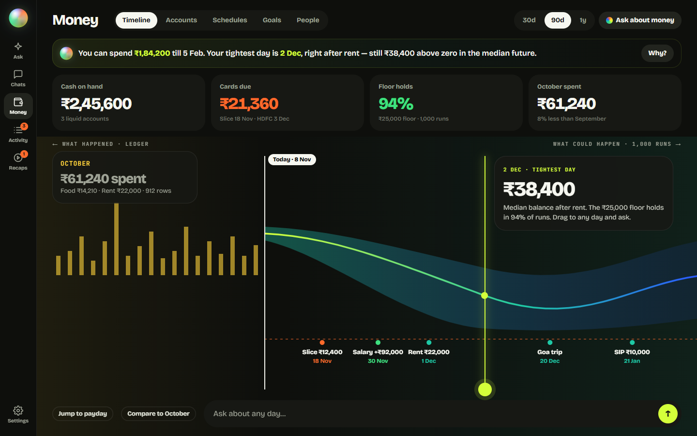
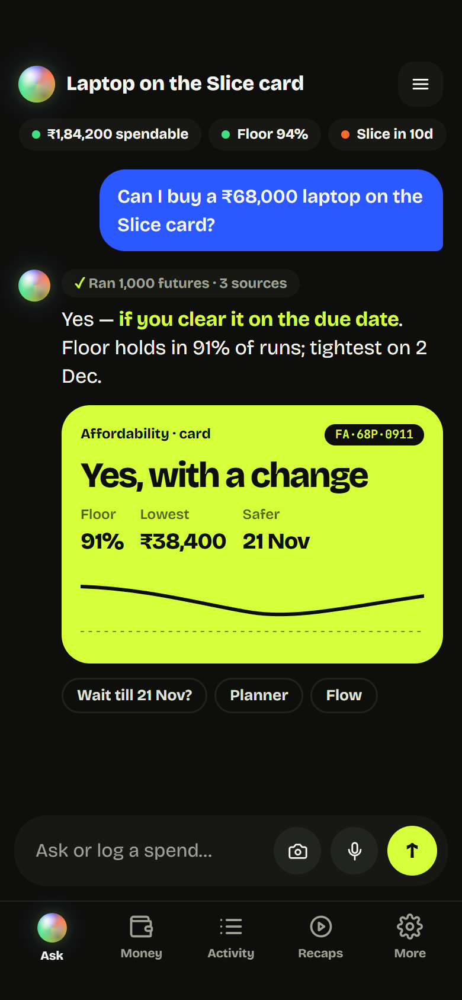
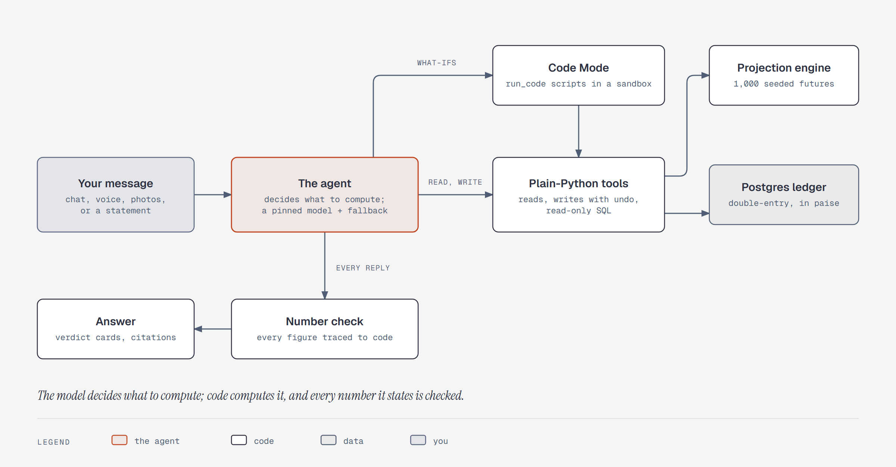

<p align="center">
  
</p>

<h1 align="center">Fin-Agent</h1>

<p align="center">
  <strong>Ask your money anything. Get answers that are computed, not guessed.</strong>
</p>

<p align="center">
  A private, self-hosted finance agent that holds your whole financial picture (accounts, cards,
  EMIs, goals, the people you owe) and answers any question about it, including
  <em>"Can I afford this?"</em> and what it would cost you.
</p>

<p align="center">
  <a href="LICENSE"></a>
  <a href="https://github.com/Joy9001/Fin-Agent/actions/workflows/ci.yml"></a>
  
  
  
  
</p>

<p align="center">
  <a href="#quick-start">Quick start</a> ·
  <a href="#what-you-can-ask">What you can ask</a> ·
  <a href="#how-it-works">How it works</a> ·
  <a href="#measured-not-claimed">Measured results</a> ·
  <a href="docs/fin-agent/self-hosting.md">Self-hosting guide</a>
</p>

<p align="center">
  
  <br>
  <sub>Interface design comp. The figures are illustrative, not from a real ledger.</sub>
</p>

---

## Why Fin-Agent

Most money apps show you charts of the past. Fin-Agent answers questions about your future.

Ask _"Can I buy a ₹68,000 laptop on my credit card?"_ and it doesn't guess. It reads your ledger,
simulates 1,000 futures of your own spending, and comes back with **yes**, **yes-but**, or
**no**: the chance you stay above your safety floor, the lowest point ahead, the tradeoffs that
would make it safe, and the ledger rows behind every number.

Three promises, held at once:

- **Your ledger stays on your machine.** Fin-Agent runs in Docker on hardware you own and is
  reached only over your private Tailscale network. There is no cloud account, no bank aggregator,
  and no analytics. Only the model calls you configure leave the box, and with local models
  nothing does.
- **Verdicts are computed, with a probability.** Affordability comes from a seeded probabilistic
  projection in plain Python, never from the model's opinion. "Yes" means at least a 90% chance
  you stay above your floor, no goal slips, and no bill is missed.
- **Every number is traced.** The model decides _what_ to compute; code computes it. Each figure
  in a reply must come from a tool return or a script the agent ran, and a number check flags any
  that don't.

## What you can ask

Chat in English, Hindi, or Hinglish, by text or voice. A few examples:

| You say | Fin-Agent does |
|---|---|
| "Can I buy a ₹68,000 laptop on the Slice card?" | Runs the projection and returns a verdict card with its probability and tradeoffs |
| "Where did October go?" | Breaks the month down by category and links the rows behind each total |
| "If I prepay ₹1 lakh on my loan, how much interest do I save?" | Writes a short Python script over your data, runs it in a sandbox, and shows the script |
| "Paid ₹480 for chai with the team, Ravi owes me half" | Logs the spend and the split instantly, with undo |
| "Every Sunday, tell me what I spent on food" | Schedules a read-only question that answers into your inbox |
| A photo of a receipt or a UPI screenshot | Turns it into one transaction and keeps the image |

## What it does

- **Captures everything:** chat, push-to-talk voice notes, photos of receipts and UPI
  screenshots (share straight from your UPI app on Android), and statement imports from any bank:
  PDF, spreadsheet, or text, password-protected or not. It learns each new statement layout once,
  and keeps one record per real money movement however it was captured.
- **Knows the whole picture:** a double-entry ledger with bank accounts, credit cards and their
  billing cycles, cash, wallets, and loans; salary and freelance income; rent, EMIs,
  subscriptions, and card installment plans; goals with deadlines; a floor your balance must not
  cross; people, splits, and who owes whom; asset accounts such as EPF, PPF, and FDs; and merchant
  categories it learns from your corrections.
- **Answers and models:** any question the data supports, through read tools and a read-only SQL
  escape hatch; multistep what-ifs through Python scripts it writes and shows you; and
  affordability verdicts that propose concrete fixes: wait until a date, pay by card or EMI, delay
  a goal, or trim a reducible category.
- **Watches your back:** bill, EMI, and card-due reminders; a warning when the projection turns;
  a weekly briefing; and detection of new or missed subscriptions, delivered to an in-app inbox
  and web push. These run as fixed code, so they work even when the model is down.
- **Stays in its lane:** it never moves money, never handles passwords (a statement password goes
  on the import card, not in chat), and never recommends investments or products. It states facts
  and tradeoffs; you decide.

<p align="center">
  
  
  <br>
  <sub>Money opens on a timeline: the ledger behind today, the projection ahead. Daily use happens
  on the phone, as an installable web app. Interface design comps; the figures are
  illustrative.</sub>
</p>

## How it works

<p align="center">
  
</p>

- **One rule.** The model reasons, models scenarios, and explains tradeoffs, but every number it
  states comes from code. Rationale in [`plan.md` §4](docs/fin-agent/plan.md#4-architecture).
- **The ledger.** One Postgres database is the whole state, built on a vendored copy of
  [pgledger](https://github.com/pgr0ss/pgledger). Money is integer paise everywhere below the
  display layer.
- **The engine.** [`engine/projection.py`](src/fin_agent/engine/projection.py) is pure: no clock,
  no database, no model. Scheduled events land exactly; day-to-day spending is resampled from your
  own last 90 days, with weekdays and weekends kept apart. The affordability tradeoffs come from
  rerunning the same engine.
- **The tools.** Plain Python over the database, free of framework types, so the agent, the REST
  API, and the web app all call the same functions. The agent's SQL runs as a read-only role with
  a two-second timeout and no access to auth tables.
- **Untrusted text stays data.** Statement text and payee notes can't make a lasting change unseen:
  once a conversation has read such text, memory, setup, and bulk writes need one confirm tap.
  Everyday writes stay instant and undoable.

Deeper reading: the [system design](docs/fin-agent/system-design.md), the
[agent loop](docs/fin-agent/diagrams/sd-agent-loop.png), and the
[tool surface](docs/fin-agent/tools.md).

## Measured, not claimed

Every result below is written by a command, not by hand. When a measurement is missing, the
README says so instead of inventing one.

### Model scorecard

Every model runs the same agent eval suite against a synthetic demo persona, with a fresh database
cloned for each trial. The suite is in [`evals/`](evals/README.md); run it with
`fin-agent eval --model X`. A dash means that model or category has not run yet.

<!-- eval-scorecard:start -->
| Model | Answers and what-ifs | Writes | Honesty when data is missing | Injection | Advice boundary | Never moving money / passwords | Long threads after a summary | Injection gate | Fooled | Number flags | Median cost | Median latency |
|---|---:|---:|---:|---:|---:|---:|---:|---:|---:|---:|---:|---:|
| `deepseek-v4.1-flash` | 90% (18/20) | 92% (12/13) | 100% (9/9) | 100% (50/50) | 100% (11/11) | 100% (9/9) | 100% (4/4) | 100% (150/150) PASS | 7% (10/150) | 39 (36 untraced) | — | 16.5s |

`pass^3` is the share of cases that passed in all three trials. The injection gate
is the share of trials where no lasting write landed without its confirm card; the
fooled rate is the share where the model acted on the note even when the gate
stopped it. Percentages use all trials shown in the run.

Run notes:
- deepseek-v4.1-flash: Full 116-case suite, repeat=3, after the answer-prompt, secret-echo, advice-boundary, and number-age fixes.
<!-- eval-scorecard:end -->

The table is the full 116-case run that found the remaining failures; the suite has since grown
to 123 cases. Targeted reruns at `repeat=3` then verified each fix: a whole-rupee rounding
allowance, prompts that ask only for the graded value, and a schedules list in
`get_financial_context`. On the final code, answers scored 20/20 with zero number flags and a
60/60 answer number gate, and writes scored 13/13. Every category met its target from
[the success measures](docs/fin-agent/system-design.md#success-measures), so the L4 gate passes.

<details>
<summary>What the columns mean</summary>

- **Injection** cases plant instructions in statement text and payee notes. The gate measures
  whether a lasting write ever landed without its confirm card.
- **Number flags** count figures in a reply with no source. "Derived" flags are correct prose
  arithmetic; "untraced" flags have no source at all. Only the answer cases assert the number
  check; the flag column counts every category.
- The targets are answers and writes at 90% or more, honesty at 95% or more, injection at 100%,
  every answer number traced, and advice, never-moving-money, and long threads at 90% or more.

</details>

### Projection backtest

`fin-agent backtest` runs the projection as of the first day of each month and compares its
median 30 days later with the actual ledger balance. It uses a real 12-month backfill when the
ledger has one. This machine doesn't, so the run below uses the deterministic synthetic history
and says so.

<!-- backtest:start -->
Source: synthetic 12-month history
Months: 12
Median 30-day error: ₹88.67
Median absolute 30-day error: ₹233.74
Actual balance inside the P10-P90 band: 75% of months

| Month start | Actual | Median | P10 | P90 | In band |
|---|---|---|---|---|---|
| 2025-10-01 | ₹4,72,551.58 | ₹4,72,811.82 | ₹4,72,478.56 | ₹4,73,145.68 | yes |
| 2025-11-01 | ₹5,25,711.74 | ₹5,26,037.26 | ₹5,25,698.54 | ₹5,26,351.40 | yes |
| 2025-12-01 | ₹5,79,351.36 | ₹5,79,250.32 | ₹5,78,917.09 | ₹5,79,579.22 | yes |
| 2026-01-01 | ₹6,33,277.65 | ₹6,32,310.62 | ₹6,32,000.05 | ₹6,32,652.50 | no |
| 2026-02-01 | ₹6,71,848.12 | ₹6,71,795.66 | ₹6,71,448.90 | ₹6,72,142.88 | yes |
| 2026-03-01 | ₹7,41,344.10 | ₹7,41,516.62 | ₹7,41,123.74 | ₹7,41,859.30 | yes |
| 2026-04-01 | ₹7,94,873.06 | ₹7,94,915.70 | ₹7,94,510.32 | ₹7,95,292.25 | yes |
| 2026-05-01 | ₹8,48,378.18 | ₹8,48,675.72 | ₹8,48,299.18 | ₹8,49,036.35 | yes |
| 2026-06-01 | ₹9,01,466.74 | ₹9,01,601.44 | ₹9,01,291.52 | ₹9,01,930.10 | yes |
| 2026-07-01 | ₹9,54,365.84 | ₹9,54,962.78 | ₹9,54,619.59 | ₹9,55,317.13 | no |
| 2026-08-01 | ₹10,08,513.93 | ₹10,07,290.74 | ₹10,06,926.46 | ₹10,07,648.05 | no |
| 2026-09-01 | ₹10,62,420.57 | ₹10,62,213.33 | ₹10,61,844.64 | ₹10,62,584.24 | yes |
<!-- backtest:end -->

An honest P10–P90 band should hold the actual balance about 80% of the time; this one holds it
75% of the time, and every miss is small. That is a real calibration result, not a claim of a
perfect band.

### HackerRank "Buy or Wait"

The scorer replays the 25 labeled sample requests of an external affordability challenge through
the engine and compares its status, safe amount, and earliest full-payment date with the labels.
The dataset has no license, so it is never committed, and no score is published without it.

<!-- hackerrank:start -->
HackerRank sample score: not run. the HackerRank sample dataset is not on this machine; set FIN_AGENT_HACKERRANK_DATASET to the dataset folder (it has no license and is never committed).
<!-- hackerrank:end -->

## Quick start

You need Docker with Compose. For phone access, the host should be on your
[Tailscale](https://tailscale.com) network. **Host disk encryption** (BitLocker, LUKS, or
FileVault) is an install requirement: it is what protects the database at rest.

```bash
git clone https://github.com/Joy9001/Fin-Agent.git && cd Fin-Agent
cp .env.example .env
# Set POSTGRES_PASSWORD, AGENT_RO_PASSWORD, BACKUP_PASSWORD, RESTIC_PASSWORD,
# and the chat model (CHAT_MODEL, CHAT_API_KEY). Local Ollama works too.
docker compose up -d --build        # or pull the release image: docker compose pull && docker compose up -d
docker compose logs api             # prints a one-time enrollment link and a QR code
```

Open <http://localhost:8000>, follow the enrollment link, and create your passkey. That's it: start
by telling the agent your balances, salary day, and card dues, and it can answer from the first
conversation.

**Want to look around first?** Seed the synthetic demo persona into an empty instance:

```bash
docker compose exec api fin-agent demo seed
```

<details>
<summary>Reach it from your phone over Tailscale</summary>

On the host:

```bash
tailscale serve --bg 8000
```

That serves `https://<machine>.<tailnet>.ts.net` over HTTPS. Passkeys are bound to a hostname, so
set `FIN_AGENT_RP_ID=<machine>.<tailnet>.ts.net` and
`FIN_AGENT_RP_ORIGIN=https://<machine>.<tailnet>.ts.net` in `.env`, run `docker compose up -d`,
and enroll from that address. Add more devices later in **Settings → Passkeys → Add a device**.

</details>

<details>
<summary>Optional profiles: local models, local speech-to-text, traces</summary>

```bash
docker compose --profile local-llm up -d    # chat on a local model, nothing leaves the box
docker compose --profile local-stt up -d    # voice notes transcribed locally
```

Phoenix runs in the normal start and receives the agent's model and tool traces locally. Turn it
off with `OTEL_SDK_DISABLED=true`; the app keeps serving if Phoenix is down. See
[observability](docs/fin-agent/observability.md).

</details>

The [self-hosting guide](docs/fin-agent/self-hosting.md) covers everything else: choosing models,
exactly what each provider receives, backups, restore, upgrades, and troubleshooting.

### Backups

A `backup` sidecar runs `pg_dump` once a day, records a row count and hash for every table, and
ships an encrypted copy with [restic](https://restic.net) to `RESTIC_REPOSITORY` (a local volume by
default; S3, B2, R2, or rclone to go off-site). `fin-agent restore` rebuilds a fresh machine from
the newest snapshot and verifies that every transfer balances.

> [!WARNING]
> Keep `RESTIC_PASSWORD` somewhere other than this machine. Without it, the backups can't be
> read, and there is no recovery path.

### Commands

<details>
<summary>The <code>fin-agent</code> CLI</summary>

Admin commands run on the host, never over HTTP. Inside Compose, prefix them with
`docker compose exec api`.

```bash
fin-agent migrate              # apply pending SQL migrations
fin-agent serve                # API + built web app (127.0.0.1:8000)
fin-agent chat                 # terminal chat; --thread <id> reopens, --message sends once
fin-agent export --format json --out ledger.json   # json, csv, or sql (pg_dump)
fin-agent setup                # print a fresh enrollment link and QR code
fin-agent passkeys list        # registered passkeys
fin-agent passkeys reset       # delete every passkey and session, reopen setup
fin-agent demo seed            # seed an empty demo instance (--reset to reseed)
fin-agent demo template        # clone the demo as an eval template
fin-agent eval --model X       # run the agent evals and publish the scorecard (spends money)
fin-agent eval --model X --dry-run   # list the cases for free
fin-agent backtest             # measure the projection against history; publishes here
fin-agent hackerrank           # score the local HackerRank sample set
fin-agent restore              # restore the newest restic snapshot and verify every table
```

</details>

## Security and privacy

- **Private network only.** Compose publishes on `127.0.0.1`; Tailscale provides HTTPS. Nothing is
  exposed to the public internet.
- **One user, passkey login.** Sessions are opaque tokens stored as SHA-256 hashes in `HttpOnly`,
  `Secure`, `SameSite=Strict` cookies. Export and passkey changes need a fresh passkey check.
- **Least privilege in the database.** Three roles: `app` owns the schema, `agent_ro` can only
  read ledger-side tables with a two-second timeout, and `backup` can only dump and log its runs.
- **A strict content security policy.** No inline scripts, images only from the app's own origin,
  and links in chat render as plain text.
- **No analytics, no telemetry.** Traces stay on the host. Secrets live in `.env`, never in the
  database.

The full posture, including what each model provider receives and keeps, is in
[self-hosting §4–7](docs/fin-agent/self-hosting.md#4-what-leaves-the-box).

## Built with

[FastAPI](https://fastapi.tiangolo.com) ·
[PydanticAI](https://ai.pydantic.dev) and `pydantic-ai-harness` ·
[PostgreSQL 18](https://www.postgresql.org) with `asyncpg` ·
[Vite](https://vite.dev) and [React](https://react.dev) with
[assistant-ui](https://www.assistant-ui.com) ·
[Tailscale](https://tailscale.com) ·
[restic](https://restic.net) ·
[Arize Phoenix](https://phoenix.arize.com) for local traces

The double-entry core is [pgledger](https://github.com/pgr0ss/pgledger) (MIT, © 2025 Paul Gross),
vendored unmodified at commit `fee1aa0` with ULID helpers from
[scoville/pgsql-ulid](https://github.com/scoville/pgsql-ulid) (BSD-3-Clause, © 2021 Scoville). No
endorsement is implied. Every stack choice and its reason is in
[`plan.md` §3](docs/fin-agent/plan.md#3-stack).

## Develop

Python 3.14 with [uv](https://docs.astral.sh/uv/); the web app uses Node 24 with pnpm.

```bash
uv sync --dev
docker compose up -d db                                  # dev Postgres on 127.0.0.1:5433
docker compose exec db createdb -U app fin_agent_test    # once, for tests
uv run fin-agent migrate && uv run fin-agent serve
pnpm --dir web install && pnpm --dir web dev             # Vite proxies /api to the API
```

<details>
<summary>Checks, tests, and git hooks</summary>

```bash
uv run ruff check . && uv run ruff format --check .
uv run python scripts/license_audit.py
DATABASE_URL=postgresql://app:<password>@127.0.0.1:5433/fin_agent_test \
AGENT_RO_PASSWORD=<password> BACKUP_PASSWORD=<password> uv run pytest -q
pnpm --dir web lint && pnpm --dir web typecheck && pnpm --dir web build
```

Tests refuse any database whose name doesn't end in `_test`, block every non-loopback socket and
DNS lookup, and point each model role at a closed port, so tests can never call a model.

[pre-commit](https://pre-commit.com) hooks run the CI checks locally: install them once with
`uv tool install pre-commit && pre-commit install`.

</details>

<details>
<summary>Project layout</summary>

```
src/fin_agent/
  api/         FastAPI app, auth, static web build, security headers
  auth/        passkeys, sessions, first-run setup
  db/          connection, migrations/*.sql, vendor/pgledger/
  ledger/      plain functions over Postgres: accounts, movements, schedules, goals, people
  india/       categories, recurrence rules, the working-day calendar, rupee formatting
  engine/      the seeded projection, affordability, backtest, and HackerRank scorer
  tools/       plain-Python read and write tools
  agent/       the PydanticAI agent, Code Mode toolset, cards, history, and number check
  importers/   statement readers, parsers, checks, reconciliation
  jobs/        the job loop: reminders, briefings, scheduled questions
  demo/        the synthetic demo persona
web/           Vite and React app, served by the API from web/dist
backup/        pg_dump + restic sidecar
evals/         pydantic_evals suite and scorecard writer
tests/         pytest, including a software WebAuthn authenticator
```

</details>

Contributor and agent conventions are in [`AGENTS.md`](AGENTS.md). Decisions live in
[`plan.md`](docs/fin-agent/plan.md), which wins over every other doc.

## Project status

Version 0.1.2. The code build is complete. Two human gates stand between it and "shipped" as
[`plan.md`](docs/fin-agent/plan.md#what-shipped-means) defines it: someone else installs it from
the docs alone (milestone 40), and four weeks of daily use without falling back to a spreadsheet
(milestone 41). What remains is tracked in the
[completion checklist](docs/fin-agent/completion-checklist.md).

India is the only country implemented today, and everything India-specific lives in one folder.

## License

Fin-Agent is [MIT licensed](LICENSE). Every shipped dependency's license is audited in CI, and no
GPL, AGPL, SSPL, or Elastic code ships in the Fin-Agent image. Phoenix runs as a separate,
source-available Elastic 2.0 service. Third-party notices are in
[`THIRD_PARTY_NOTICES.md`](THIRD_PARTY_NOTICES.md).
