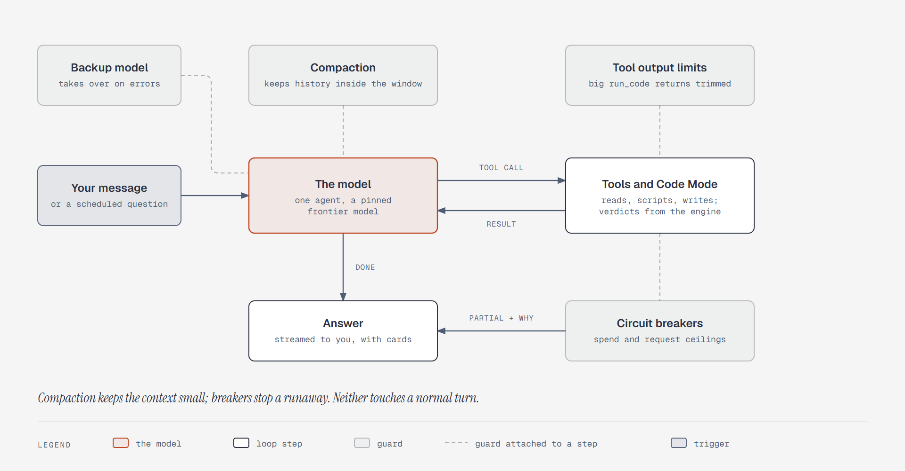
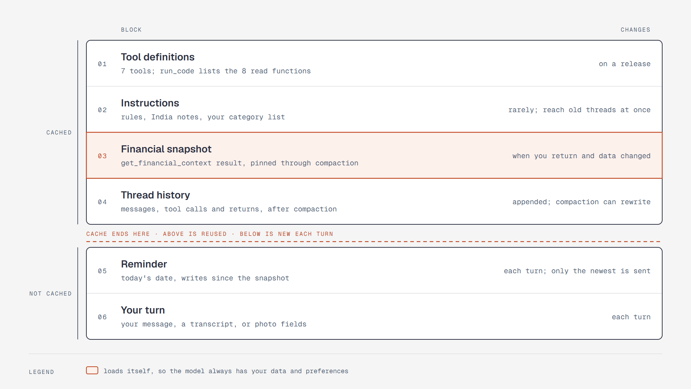
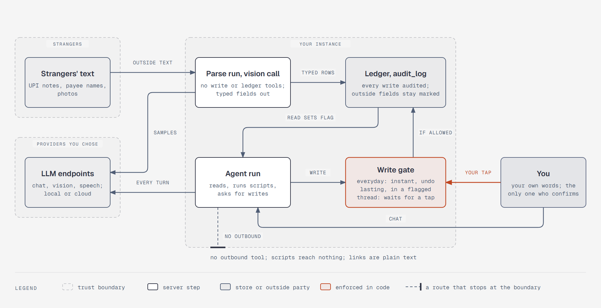
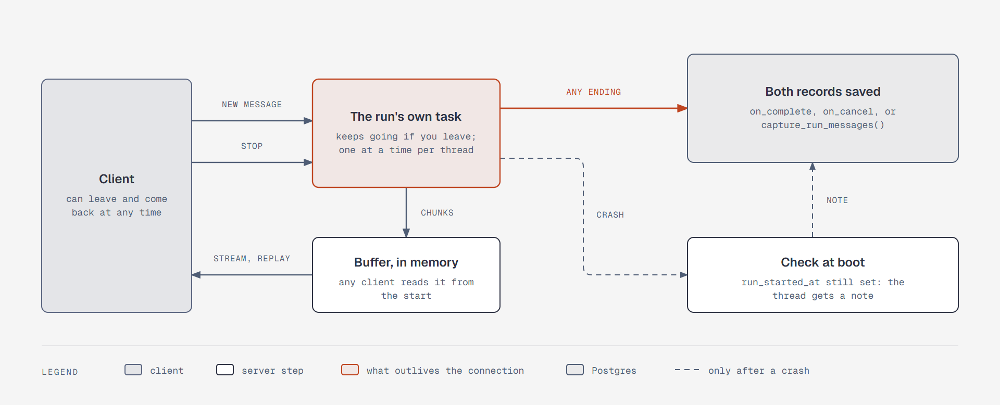
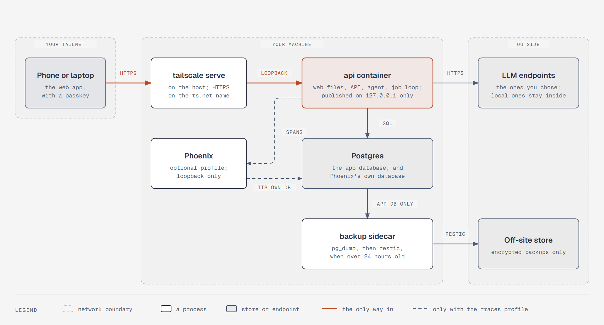

# Architecture

This document explains how Arno's pieces fit together: control and autonomy, the agent loop, ground
truth, tool boundaries, context and memory, trust boundaries, failure recovery, evaluation, and
success measures. Decisions live in [`plan.md`](plan.md); subsystem schemas and contracts live in
[`specs/`](specs/). The historical October–November 2026 design walk and prototype probe tables are
archived in
[`records-2026-11/system-design-walk-2026-10.md`](../archive/records-2026-11/system-design-walk-2026-10.md).

_Figure: Arno's architecture across four layers—requirements, the agent's world, trust and
reliability, and operations—with evals feeding back into requirements
([note](diagrams/sd-framework.md))._

## Architecture overview

Arno is a single-user, self-hosted personal finance system built around one FastAPI process and one
PostgreSQL 18 database. Throughput is small, so correctness, auditability, and privacy shape every
boundary.

### Scale assumptions

The following table lists the operating envelope Arno is designed for:

| Dimension | Expected scale |
|---|---|
| Users | One person for each instance |
| Transactions | 100–500 a month (~60,000 rows over ten years, well under 50 MB) |
| Chat volume | 10–50 turns a day; one active conversation at a time |
| Statements | 3–5 files a month, plus a 12-month backfill at setup |
| Context per turn | Compact summaries and row IDs, never hundreds of raw rows |

---

## Control and autonomy

Code owns every invariant that must hold on every run; the model owns language, judgment, and
selecting what to compute.

_Figure: User chat and user-scheduled questions invoke agent loops, while statement import,
built-in alerts and reminders run as deterministic code
([note](diagrams/sd-agent-vs-workflow.md))._

### Agent versus workflow paths

- **Built-in tasks are workflows:** Due reminders, risk warnings, and pattern checks run as fixed
  code, so monitoring continues when the LLM is unreachable. The weekly briefing is a default
  scheduled question, so it runs the agent read-only like any question you schedule.
- **User-scheduled questions run the agent read-only:** Scheduled prompts execute with the read
  tools and a per-run request limit, delivering answers to the **Inbox**.
- **Statement imports are code around one extraction step:** An upload opens an import that
  reads itself. Images and short PDFs go to one vision call; spreadsheets, text formats, and long
  PDFs go to a model that answers with a script the host runs in the sandbox. Code owns the
  decryption, verification checks, reconciliation, review, and commit
  ([`specs/import.md`](specs/import.md#extraction)).
- **Categorization runs post-commit:** Your rules and refunds run first. A background
  call per chunk of remaining payees labels the ones it is sure of and leaves the rest
  uncategorized with a hint.

### Control inside a chat turn

_Figure: The model selects tools and explains results; code enforces rules, computes verdicts, and
gates writes; you confirm risky writes and can undo any write
([note](diagrams/sd-chat-turn-control.md))._

The following table defines who decides each action:

| Model decides | Code decides | You decide |
|---|---|---|
| Which read tool or `run_python` script to run | Category rules for known merchants | Starting or scheduling a turn |
| How to phrase explanations and tradeoffs | Affordability verdict (`yes`, `yes-but`, `no`) | Confirming a wide or account-wide write |
| Whether to propose or save a memory | Write tier and confirm-card gating | Approving or rejecting an import review |
| When to ask a clarifying question | Duplicate-write protection and idempotency | Accepting a recurring-charge proposal |
| | Run request limits, timeouts, and the daily spend cap | Undoing any committed write |

### Autonomy by action

The following table sets what Arno can do without prompting:

| Action | Initiator | Autonomous behavior |
|---|---|---|
| Answer a question or run a what-if | You | Reads, computes, and explains freely |
| Log or edit a single transaction | You | Writes immediately with an inline undo card |
| Save or update a memory | Agent | Writes immediately with a **Remembered** undo card; undoable |
| Change setup (accounts, schedules, goals, floor) | You | Writes immediately with undo; archiving and settings ask first |
| Import a bank or card statement | You | Stages only; writes nothing until you commit the review screen |
| Run a scheduled question | Schedule | Reads and posts to the **Inbox**; zero write tools |
| Send reminders or warnings | Schedule | Informs only; tapping an item opens a seeded chat only when you choose |
| Detect a recurring charge or price step | Schedule | Raises a proposal; never writes a schedule silently |
| Move money or recommend investments | | Never |

Photos log immediately as one undoable transaction with the image shown beside extracted fields.
Setup is agent-led: code computes `setup_gaps`, and the agent walks through missing pieces without a
rigid wizard. When data is missing, the agent states what is absent instead of guessing.

---

## Agent core

_Figure: One primary agent loops between the model and tools, bounded by history trimming, a
request limit, model fallback, and the daily spend cap ([note](diagrams/sd-agent-loop.md))._

- **Single primary agent:** Interactive financial questions are sequential and state-dependent, so
  one plain PydanticAI `Agent` owns chat. One isolated specialist, the `categorizer` agent, labels
  payees after a commit.
- **Tested engine math plus a sandbox:** Probabilistic projections run in tested Python modules
  (`src/arno/engine/`) behind `project`. For other arithmetic the agent writes a script
  (`run_python`) that runs in the isolated `sandbox` service and states only its output.
- **Model roles:** Separate configuration slots exist for `CHAT`, `VISION`, `STT`, and
  optional `CHAT_FALLBACK`. Every model ID is pinned to a dated
  version. Replies produced by a fallback model display a badge.

For capabilities, prompt discipline, and history storage, see
[`specs/harness.md`](specs/harness.md).

---

## Ground truth

_Figure: Every real money movement owns balanced `movement_legs`, and every write lands in the undo
log ([note](diagrams/sd-ledger-model.md))._

- **Double-entry core:** Each `movement_legs` row moves a positive integer-paise amount from one
  account to a different one, so the ledger is zero-sum by `CHECK` constraint and a balance is the
  sum of legs in minus legs out.
- **One undo rule:** Corrections edit a movement in place and deletes remove it. `undo_log` stores a
  `{table, key, before, after}` snapshot per write group, and undo replays it backwards, so every
  write is reversible without a second set of rows to net out.
- **Named read model:** `agent_ro` reads 23 curated views and domain tables (`v_accounts`,
  `v_legs`, `v_spending`, `v_balances`, `v_owed`, plus 18 domain tables) with a
  2-second statement timeout and zero access to authentication, session, or credential tables.

Full schema, engine math, pattern detection, and invariants live in
[`specs/data-and-engine.md`](specs/data-and-engine.md).

---

## Tool surface

_Figure: Three read tools and four write tools are direct tool calls, plus web search
([note](diagrams/sd-tool-surface.md))._

- **3 read tools:** `run_query` (read-only SQL), `project` (the projection engine), and
  `run_python` (a script in the isolated sandbox).
- **4 write tools:** `record_movements`, `correct_movement`, `update_setup`, and `undo` execute as
  normal tool calls with typed Pydantic schemas and undo IDs. `correct_movement` with a wide scope
  and `update_setup` to archive or change settings ask for a confirm tap.
- **Web search:** The model's own search, or Brave Search when `BRAVE_API_KEY` is set. Replies cite
  sources as `[n]`.

Every tool contract, input, and output is specified in
[`specs/tools.md`](specs/tools.md).

---

## Context and memory

_Figure: Static instructions sit at the cacheable prefix; the dynamic date and categories, history,
and the current turn follow ([note](diagrams/sd-context-stack.md))._

_Figure: Each thread stores both UI messages for display and provider-neutral model history for
continuing runs ([note](diagrams/sd-thread-records.md))._

- **Prompt cache ordering:** The static system prompt occupies the stable prefix; today's date,
  the active categories, and the history follow.
- **History trimming:** When the last request nears 70% of the context window, a history processor
  blanks older read-tool returns and keeps write-tool returns
  (`trim_old_tool_payloads` in `src/arno/agent/capabilities.py`). The agent reads data fresh with
  `run_query` instead of relying on a snapshot.
- **Typed memories:** Memories are explicit, visible, and undoable (`preference`, `fact`, `rule`),
  replaced in place per `(kind, subject)` with previous values recoverable from `undo_log`. Hidden
  background memory extraction stays parked ([`planning/parked.md`](planning/parked.md)).

---

## Safety and trust

_Figure: Statement text and payee notes cross an explicit untrusted boundary; wide or
account-wide writes require confirmation ([note](diagrams/sd-trust-boundaries.md))._

- **Data, not instructions:** The prompt tells the agent that statement text, payee notes, and
  image text are data. The agent cannot move money, and every write is undoable.
- **Write gating:** `correct_movement` with `scope="future"` or `scope="all"`, and `update_setup`
  with `action="archive"` or `entity="settings"`, require an explicit confirm-card approval
  (PydanticAI's `ApprovalRequired`) before writing. A turn's confirm cards are answered
  all-or-nothing.
- **Isolated code:** `run_python` runs in a separate container with no network, no database route,
  and no secrets.
- **No input redaction:** Nothing scrubs chat text. The prompt forbids repeating a password, PIN,
  OTP, or full card number, and a statement password goes on the import card, never in chat. Vision
  calls set `agent.instrument = False` so raw images never enter traces.
- **Identifier stripping:** Unused statement identifiers are dropped during extraction rather than
  maintaining a reversible PII-scrubbing proxy.

Detailed write tiers live in
[`specs/data-and-engine.md`](specs/data-and-engine.md#trust-boundaries-and-write-tiers); the full
threat model lives in [`specs/platform.md`](specs/platform.md#security-and-threat-model).

---

## Reliability and failure modes

_Figure: Chat turns run in detached background tasks backed by an in-memory replay buffer, so phone
locks and reconnects do not drop turns or orphan writes ([note](diagrams/sd-detached-turn.md))._

_Figure: Tool-call idempotency keys stop retried calls, a near-duplicate check prompts before
repeating recent manual entries, and statement reconciliation deduplicates later
([note](diagrams/sd-duplicate-writes.md))._

### Turn lifecycle and persistence

- **Detached execution:** A chat turn runs in its own server task and buffers stream chunks.
  Reconnecting calls `GET /api/chat/{thread}/stream` to replay the live stream; stopping calls the
  dedicated cancel endpoint (`CancellationToken`). One thread lock serializes concurrent sends.
- **Consistent persistence:** Finished turns (`on_complete`), stopped turns (`on_cancel`), and
  failed turns (`capture_run_messages()`) all save both the UI transcript and `model_history` so
  subsequent turns see any write that landed. The transcript is written from the saved model
  history (`VercelAIAdapter.dump_messages`), and answered confirm cards settle at the same save. A
  `run_started_at` marker detects hard process crashes at boot and inspects `undo_log` to report
  whether any write landed.
- **Idempotency:** Each UI message ID starts at most one turn. Open confirm cards persist in
  `model_history` across restarts, and repeated approvals reuse the same `tool_call_id`.
- **Graceful shutdown:** Server shutdown drains active turns for 20 seconds, then cancels remaining
  runs inside Docker's 30-second `stop_grace_period`.

### Model, tool, and database resilience

- **Model errors and timeouts:** `ModelFallback` (`sticky=False`) switches to the configured backup
  endpoint after SDK retries and returns to the primary model on the next step. Streaming requests
  use a 600-second inter-chunk idle timeout (`timeout=600`); usage limits (`request_limit=25`) bound total steps rather
  than wall-clock turn timers. A fallback wrapper checks
  `CHAT_FALLBACK_CONTEXT_WINDOW` before sending so small local backups do not silently truncate.
- **Tool errors:** `on_tool_execute_error` converts unexpected exceptions into safe tool results
  for the model while logging full details to traces; browser streams receive plain error messages.
  Read tools carry a 60-second timeout; write tools omit timeouts so a slow commit is never retried
  under a second `tool_call_id`.
- **Database connections:** The API process maintains a per-loop cache of up to eight idle
  `asyncpg` connections, opening direct connections immediately when empty so long chat streams
  never starve other requests ([`specs/platform.md`](specs/platform.md#database-connections-and-integrity)).
- **Minute loop and spawned tasks:** One asyncio loop in the API process fires due scheduled
  questions and the daily tasks, and `spawn` runs work after a write. State stays in Postgres, so
  a restart resumes categorization from `imports.categorize` and claims each question once.

### Graceful degradation

The following table shows what remains available during component outages:

| Outage | Available functionality | User-visible behavior |
|---|---|---|
| Primary LLM | Full functionality on configured backup model | Replies carry a fallback badge |
| All LLMs | Panels, undo, reminders, risk checks; uploads stay saved | Plain "couldn't answer" message |
| Vision or STT | Uploaded file or recording is preserved | Retry card |
| PostgreSQL | None | Plain "database unreachable" with zero LLM spend |
| Host asleep | Pauses until wake | Missed scheduled jobs fire once on wake |
| Backup target | Everything except off-site sync | Alert in **Inbox** after 48 hours |

---

## Evals and observability

_Figure: Deterministic tests guard every commit, `pydantic_evals` scores model behavior, and
Phoenix traces observe live turns
([note](diagrams/sd-measure-layers.md))._

1. **Automated tests (every commit, zero model calls):** `pytest` over real Postgres with non-loopback
   sockets blocked (`ALLOW_MODEL_REQUESTS = False`), plus financial invariants (`tests/invariants.py`),
   web interaction tests, and answer-contract tests.
2. **Agent evaluations (on model, prompt, or tool changes):** `pydantic_evals` runs 85 cases
   across five categories (answers, writes, honesty, never moving money/passwords, and long
   threads) on cloned demo databases with `repeat=3` (`pass^3`).
   See [`evals/README.md`](../../evals/README.md).
3. **Runtime traces (every turn):** Opt-in OTLP/HTTP export to Arize Phoenix
   (fail-open, disabled when `OTEL_EXPORTER_OTLP_ENDPOINT` is unset or `OTEL_SDK_DISABLED=true`)
   through the stock OpenTelemetry SDK
   ([`operations/observability.md`](operations/observability.md)). Model cost is a separate Postgres
   usage log with one shared daily cap ([`specs/cost-tracking.md`](specs/cost-tracking.md)).

---

## Interfaces and deployment

_Figure: All traffic enters through `tailscale serve` to loopback; only configured LLM requests,
encrypted off-site backups, and optional webhook pings leave the host
([note](diagrams/sd-deployment.md))._

- **Web interface:** Agent-first SPA with six primary destinations (**Ask**, **Chats**, **Money**,
  **Activity**, **Recaps**, **Settings**), built with React, Vite, `@assistant-ui/*`, and
  Radix UI ([`specs/web-interface.md`](specs/web-interface.md),
  [`DESIGN.md`](../../DESIGN.md)).
- **Compose stack:** Three default services (`db`, `api`, and `sandbox`) plus optional `local-llm`
  (Ollama) and `obs` (stock Phoenix) profiles. The `sandbox` runs model-written Python on an
  internal network with no internet and no database route, reachable only from `api`. The API runs
  the daily backup. All host ports bind to `127.0.0.1`
  ([`operations/self-hosting.md`](operations/self-hosting.md)).

---

## Success measures

The following targets define what "working" means across agent evals, categorization,
and daily use (`pass^3` counts a case only when all three trials pass):

| Dimension | Measurement | Target |
|---|---|---|
| Answers and writes | Agent eval suite (`pass^3`) | 90% or higher |
| Honesty when data is missing | Agent eval suite (`pass^3`) | 95% or higher |
| Number traceability | Answer evals (`pass^3`) | 100% of figures traced to tool output |
| Never-move and long threads | Agent eval suite (`pass^3`) | 90% or higher |
| Categorizer accuracy | Share of LLM-assigned categories left uncorrected in `undo_log` | 90% or higher |
| Daily reliability | Four weeks of daily owner use without spreadsheet or mental-math fallback | Required ship gate ([`plan.md`](plan.md#what-shipped-means)) |
