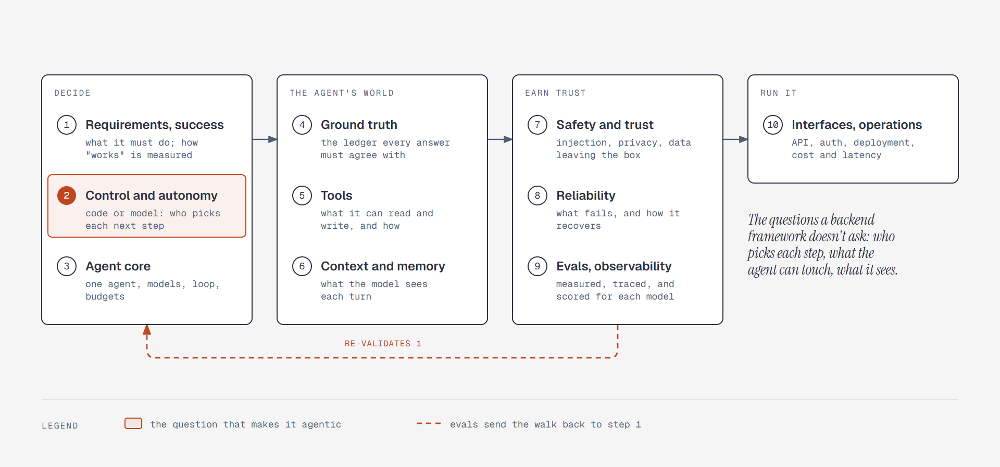
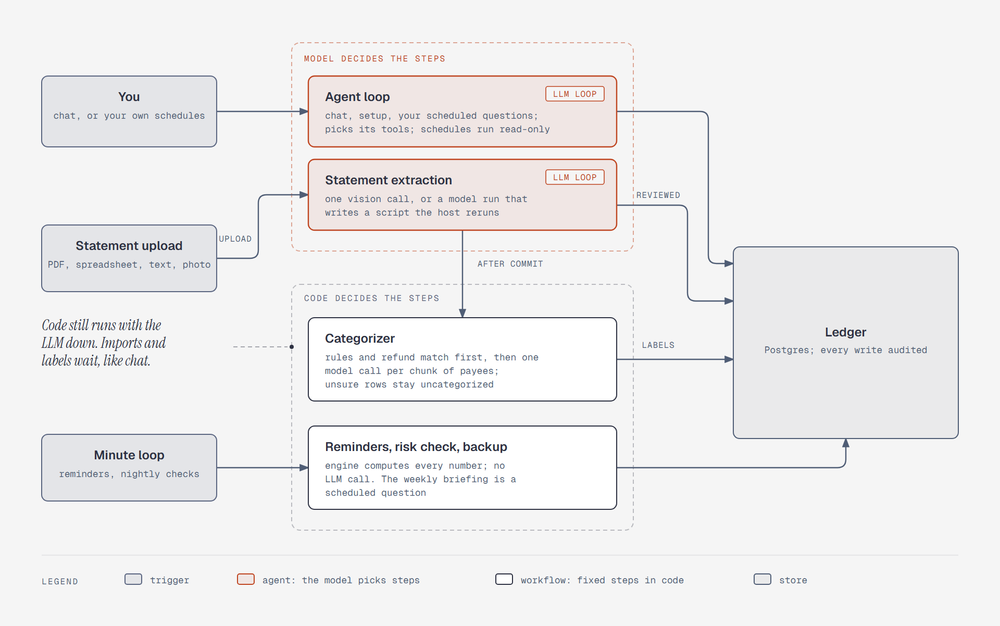
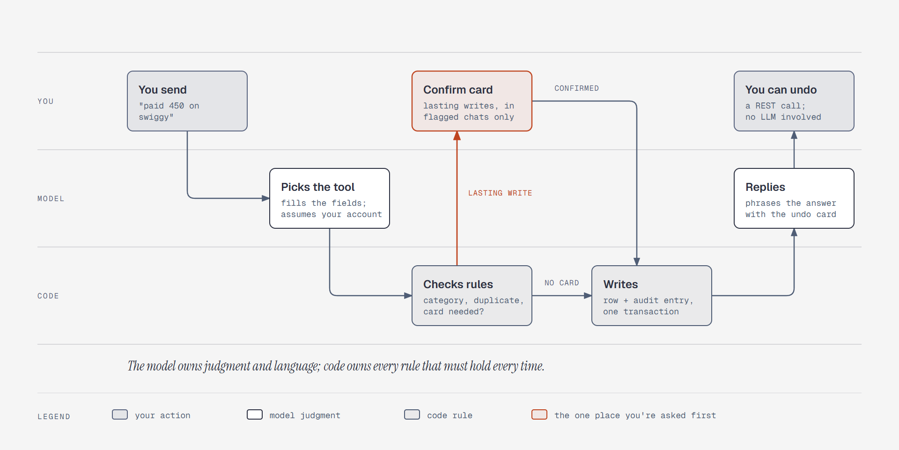
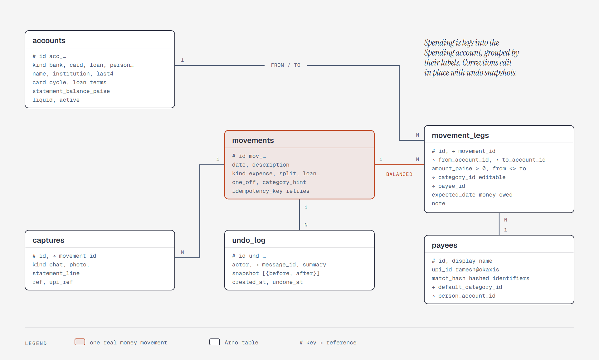
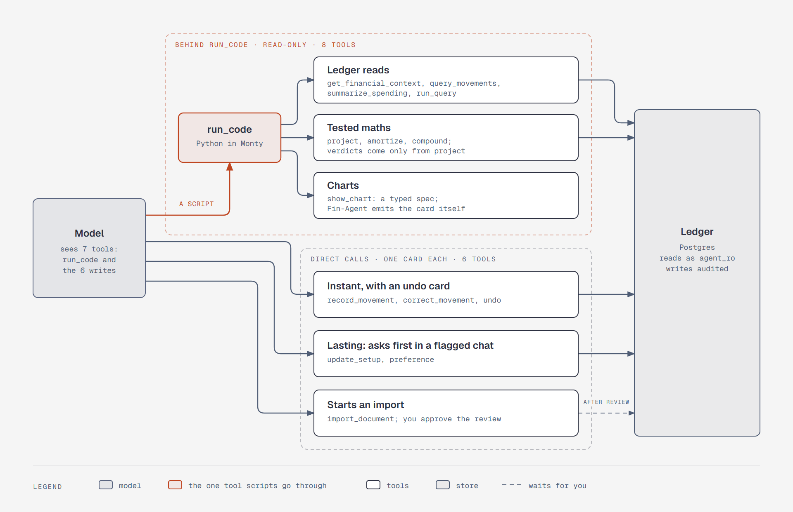
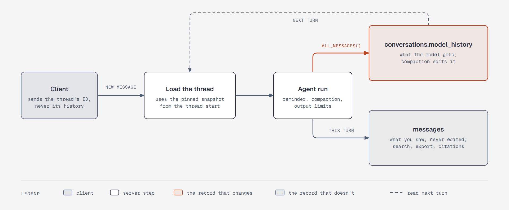
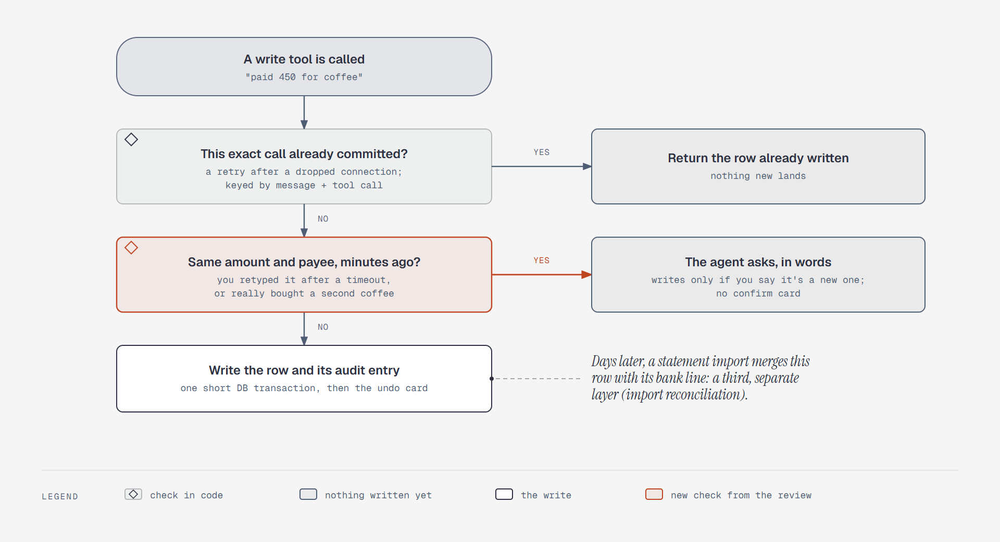
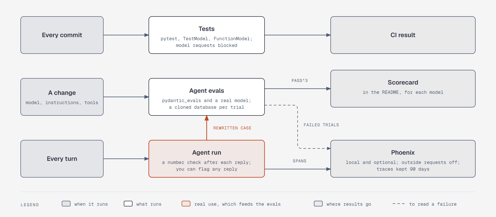

# Architecture

This document explains how Arno's pieces fit together: control and autonomy, the agent loop, ground
truth, tool boundaries, context and memory, trust boundaries, failure recovery, evaluation, and
success measures. Decisions live in [`plan.md`](plan.md); subsystem schemas and contracts live in
[`specs/`](specs/). The historical October–November 2026 design walk and prototype probe tables are
archived in
[`records-2026-11/system-design-walk-2026-10.md`](../archive/records-2026-11/system-design-walk-2026-10.md).

_Figure: Arno's architecture across four layers—requirements, the agent's world, trust and
reliability, and operations—with evals feeding back into requirements
([note](diagrams/sd-framework.md))._

## Architecture overview

Arno is a single-user, self-hosted personal finance system built around one FastAPI process and one
PostgreSQL 18 database. Throughput is small, so correctness, auditability, and privacy shape every
boundary.

### Scale assumptions

The following table lists the operating envelope Arno is designed for:

| Dimension | Expected scale |
|---|---|
| Users | One person for each instance |
| Transactions | 100–500 a month (~60,000 rows over ten years, well under 50 MB) |
| Chat volume | 10–50 turns a day; one active conversation at a time |
| Statements | 3–5 files a month, plus a 12-month backfill at setup |
| Context per turn | Compact summaries and row IDs, never hundreds of raw rows |

---

## Control and autonomy

Code owns every invariant that must hold on every run; the model owns language, judgment, and
selecting what to compute.

_Figure: User chat, user-scheduled questions, and statement imports invoke agent loops, while
built-in alerts, reminders, recaps, and briefings run as deterministic code
([note](diagrams/sd-agent-vs-workflow.md))._

### Agent versus workflow paths

- **Built-in jobs are workflows:** Due reminders, risk warnings, pattern checks, recaps, and weekly
  briefings run as fixed code. At most one optional LLM call drafts briefing prose, with a template
  fallback so monitoring continues when the LLM is unreachable.
- **User-scheduled questions run the agent read-only:** Scheduled prompts execute with the pinned
  financial snapshot, read-only Code Mode tools, and a per-run spend ceiling, delivering answers to
  the **Inbox**.
- **Statement imports run a background parser subagent:** Uploads enter through chat, and the main
  agent delegates parsing to the `parser` subagent with no write tools. Code owns verification
  checks, regression replay, reconciliation, review, and commit ([`specs/import.md`](specs/import.md)).
- **Categorization runs post-commit:** Deterministic merchant rules run first. A background
  categorizer agent handles remaining payees in chunks or via provider batch APIs, leaving low-trust
  matches uncategorized with a hint.

### Control inside a chat turn

_Figure: The model selects tools and explains results; code enforces rules, computes verdicts, and
gates writes; you confirm risky writes and can undo any write
([note](diagrams/sd-chat-turn-control.md))._

The following table defines who decides each action:

| Model decides | Code decides | You decide |
|---|---|---|
| Which read tools or Code Mode script to run | Category rules for known merchants | Starting or scheduling a turn |
| How to phrase explanations and tradeoffs | Affordability verdict (`yes`, `yes-but`, `no`) | Confirming a lasting or wide write in a tainted chat |
| Whether to propose or save a memory | Write tier and confirm-card gating | Approving or rejecting an import review |
| When to ask a clarifying question | Duplicate-write protection and idempotency | Accepting a recurring-charge proposal |
| | Run budgets, timeouts, and spend ceilings | Undoing any committed write |

### Autonomy by action

The following table sets what Arno can do without prompting:

| Action | Initiator | Autonomous behavior |
|---|---|---|
| Answer a question or run a what-if | You | Reads, computes, and explains freely |
| Log or edit a single transaction | You | Writes immediately with an inline undo card |
| Save or update a memory | Agent | Writes immediately with a **Remembered** undo card; asks first in a tainted conversation |
| Change setup (accounts, schedules, goals, floor) | You | Writes immediately with undo; asks first in a tainted conversation |
| Import a bank or card statement | You | Parses and stages only; writes nothing until you commit the review screen |
| Run a scheduled question | Schedule | Reads and posts to the **Inbox**; zero write tools |
| Send reminders, warnings, recaps, or briefings | Schedule | Informs only; tapping an item opens a seeded chat only when you choose |
| Detect a recurring charge or price step | Schedule | Raises a proposal; never writes a schedule silently |
| Move money or recommend investments | | Never |

Photos log immediately as one undoable transaction with the image shown beside extracted fields.
Setup is agent-led: code computes `setup_gaps`, and the agent walks through missing pieces without a
rigid wizard. When data is missing, the agent states what is absent instead of guessing.

---

## Agent core

_Figure: One primary agent loops between the model and tools, bounded by compaction, tool output
caps, model fallback, and spend limits ([note](diagrams/sd-agent-loop.md))._

- **Single primary agent:** Interactive financial questions are sequential and state-dependent, so
  one main agent owns chat. Two isolated specialists handle long untrusted work outside the main
  context: the `parser` subagent (statement files, no write tools) and the `categorizer` agent
  (post-commit merchant batching).
- **Code Mode plus tested engine math:** Standard financial formulas and probabilistic projections
  run in tested Python modules (`src/arno/engine/`). Code Mode (`run_code`) lets the agent compose
  read tools and custom arithmetic in a sandbox and show the script alongside the answer.
- **Model roles:** Separate configuration slots exist for `CHAT`, `PARSE` (defaults to `CHAT`),
  `BATCH`, `VISION`, `STT`, and optional `CHAT_FALLBACK`. Every model ID is pinned to a dated
  version. Replies produced by a fallback model display a badge.

For harness capabilities, prompt rules, and wake-turn mechanics, see
[`specs/harness.md`](specs/harness.md).

---

## Ground truth

_Figure: Every real money movement pairs a balanced `pgledger` transfer with a `movement_legs`
record and unified reversal state ([note](diagrams/sd-ledger-model.md))._

- **Double-entry core:** Vendored `pgledger` enforces balanced integer-paise entries and transfer
  idempotency. Every transfer pairs 1:1 with `movement_legs` through a deferred foreign key.
- **One reversal rule:** `movement_reversal_state(as_of)` and `v_movement_state` define effective
  reversal once in SQL (`1 - sum(child signs) <= 0`), so balances, spending, recaps, and exports
  never disagree.
- **Named read model:** `agent_ro` reads 23 curated views and domain tables (`v_accounts`,
  `v_legs`, `v_movement_state`, `v_spending`, `v_balances`, `v_owed`, plus 17 domain tables) with a
  2-second statement timeout and zero access to authentication, session, or credential tables.

Full schema, engine math, pattern detection, and invariants live in
[`specs/data-and-engine.md`](specs/data-and-engine.md).

---

## Tool surface

_Figure: Read and presentation tools run inside `run_code`; write and delegation tools are direct
tool calls ([note](diagrams/sd-tool-surface.md))._

- **14 read and presentation tools** sit inside `run_code` (Code Mode), letting the model query,
  model, and emit structured charts, tables, and verdict cards without bloating intermediate turns.
- **6 direct write tools** (`record_movement`, `correct_movement`, `update_setup`,
  `schedule_payment`, `preference`, `undo`) execute as normal tool calls with typed Pydantic
  schemas, undo IDs, and taint-aware approval gates.
- **5 harness delegation tools** (`delegate_task`, `list_tasks`, `message_task`, `answer_task`,
  `cancel_task`) coordinate background `parser` subagent runs.

Every tool contract, input, output, and parser/categorizer function is specified in
[`specs/tools.md`](specs/tools.md).

---

## Context and memory

_Figure: Static instructions and pinned snapshot sit at the cacheable prefix; history, compaction
summaries, and the current turn follow ([note](diagrams/sd-context-stack.md))._

_Figure: Each thread stores both UI messages for display and provider-neutral model history for
continuing runs ([note](diagrams/sd-thread-records.md))._

- **Prompt cache ordering:** Static system instructions and the pinned financial snapshot occupy
  the stable prefix; per-turn date/state reminders and recent turns sit at the tail.
- **Compaction:** `SummarizingCompaction` summarizes older turns while preserving exact figures
  that decisions rest on (`SUMMARY_PROMPT` in `src/arno/agent/capabilities.py`).
- **Typed memories:** Memories are explicit, visible, and undoable (`preference`, `fact`, `rule`),
  replaced in place per `(kind, subject)` with previous values recoverable from `audit_log`. Hidden
  background memory extraction stays parked ([`planning/parked.md`](planning/parked.md)).

---

## Safety and trust

_Figure: Statement text, parser reports, and payee notes cross an explicit untrusted boundary;
lasting or wide writes require confirmation once a thread is tainted
([note](diagrams/sd-trust-boundaries.md))._

- **Taint propagation:** Any tool return carrying statement text or payee notes (`mark()`), as well
  as every `parser` subagent report or question (`TaskTextIsOutside`), flags the conversation as
  tainted.
- **Write gating:** In a tainted conversation, `update_setup`, `preference`, and `correct_movement`
  with `scope="future"` or `scope="all"` require an explicit confirm-card approval before writing.
  A turn's confirm cards are answered all-or-nothing.
- **Redaction:** Keyword-anchored secrets (passwords, OTPs, PINs, CVVs, API keys in English,
  Hinglish, and Devanagari), card numbers, and Aadhaar numbers are redacted before entering model
  prompts, stored history, titles, or traces. Vision calls set `agent.instrument = False` so raw
  images never enter traces.
- **Identifier stripping:** Unused statement identifiers are dropped during parsing rather than
  maintaining a reversible PII-scrubbing proxy.

Detailed write tiers live in
[`specs/data-and-engine.md`](specs/data-and-engine.md#trust-boundaries-and-write-tiers); the full
threat model lives in [`specs/platform.md`](specs/platform.md#security-and-threat-model).

---

## Reliability and failure modes

_Figure: Chat turns run in detached background tasks backed by an in-memory replay buffer, so phone
locks and reconnects do not drop turns or orphan writes ([note](diagrams/sd-detached-turn.md))._

_Figure: Tool-call idempotency keys stop retried calls, a near-duplicate check prompts before
repeating recent manual entries, and statement reconciliation deduplicates later
([note](diagrams/sd-duplicate-writes.md))._

### Turn lifecycle and persistence

- **Detached execution:** A chat turn runs in its own server task and buffers stream chunks.
  Reconnecting calls `GET /api/chat/{thread}/stream` to replay the live stream; stopping calls the
  dedicated cancel endpoint (`CancellationToken`). One thread lock serializes concurrent sends.
- **Consistent persistence:** Finished turns (`on_complete`), stopped turns (`on_cancel`), and
  failed turns (`capture_run_messages()`) all save both the UI transcript and `model_history` so
  subsequent turns see any write that landed. A `run_started_at` marker detects hard process
  crashes at boot and inspects `audit_log` to report whether any write landed.
- **Idempotency:** Each UI message ID starts at most one turn. Open confirm cards persist in
  `model_history` across restarts, and repeated approvals reuse the same `tool_call_id`.
- **Graceful shutdown:** Server shutdown drains active turns for 20 seconds, then cancels remaining
  runs inside Docker's 30-second `stop_grace_period`.

### Model, tool, and database resilience

- **Model errors and timeouts:** `ModelFallback` (`sticky=False`) switches to the configured backup
  endpoint after SDK retries and returns to the primary model on the next step. Streaming requests
  use a 600-second inter-chunk idle timeout (`timeout=600`); usage limits bound total steps rather
  than wall-clock turn timers so long parses are never killed prematurely. A fallback wrapper checks
  `CHAT_FALLBACK_CONTEXT_WINDOW` before sending so small local backups do not silently truncate.
- **Tool errors:** `on_tool_execute_error` converts unexpected exceptions into safe tool results
  for the model while logging full details to traces; browser streams receive plain error messages.
  Read tools carry a 60-second timeout; write tools omit timeouts so a slow commit is never retried
  under a second `tool_call_id`.
- **Database connections:** The API process maintains a per-loop cache of up to eight idle
  `asyncpg` connections, opening direct connections immediately when empty so long chat streams
  never starve other requests ([`specs/platform.md`](specs/platform.md#database-connections-and-integrity)).
- **Plain-table job loop:** A `jobs` table and single API loop replace external brokers. On boot,
  interrupted `running` jobs reset cleanly, and period-keyed schedules prevent duplicate runs.

### Graceful degradation

The following table shows what remains available during component outages:

| Outage | Available functionality | User-visible behavior |
|---|---|---|
| Primary LLM | Full functionality on configured backup model | Replies carry a fallback badge |
| All LLMs | Panels, undo, reminders, risk checks, recaps, template briefings; uploads stay saved | Plain "couldn't answer" message |
| Vision or STT | Uploaded file or recording is preserved | Retry card |
| PostgreSQL | None | Plain "database unreachable" with zero LLM spend |
| Host asleep | Pauses until wake | Missed scheduled jobs fire once on wake |
| Backup target | Everything except off-site sync | Alert in **Inbox** after 48 hours |

---

## Evals and observability

_Figure: Deterministic tests guard every commit, `pydantic_evals` scores model behavior, and
Phoenix plus the post-reply number check observe live turns
([note](diagrams/sd-measure-layers.md))._

1. **Automated tests (every commit, zero model calls):** `pytest` over real Postgres with non-loopback
   sockets blocked (`ALLOW_MODEL_REQUESTS = False`), plus financial invariants (`tests/invariants.py`),
   web interaction tests, and answer-contract tests.
2. **Agent evaluations (on model, prompt, or tool changes):** `pydantic_evals` runs 145 cases
   across seven categories (answers, writes, honesty, 50 injection notes, advice boundary, never
   moving money/passwords, and long threads) on cloned demo databases with `repeat=3` (`pass^3`).
   See [`evals/README.md`](../../evals/README.md).
3. **Runtime traces and number check (every turn):** Opt-in OTLP/HTTP export to Arize Phoenix
   (fail-open, disabled when `PHOENIX_COLLECTOR_ENDPOINT` is unset or `OTEL_SDK_DISABLED=true`)
   with a Postgres cost journal and replay job ([`operations/observability.md`](operations/observability.md)).
   After each reply, `agent/number_check.py` compares every stated money amount and percentage
   against tool outputs, the snapshot, and user messages, flagging untraced figures.

---

## Interfaces and deployment

_Figure: All traffic enters through `tailscale serve` to loopback; only configured LLM requests,
encrypted off-site backups, and contentless push pings leave the host
([note](diagrams/sd-deployment.md))._

- **Web interface:** Agent-first SPA with six primary destinations (**Ask**, **Chats**, **Money**,
  **Activity**, **Recaps**, **Settings**), built with React, Vite, `@assistant-ui/*`, and
  `@radix-ui/themes` ([`specs/web-interface.md`](specs/web-interface.md),
  [`DESIGN.md`](../../DESIGN.md)).
- **Compose stack:** Four default services (`db`, `api`, `backup`, `phoenix`) plus optional
  `local-llm` (Ollama) and `local-stt` (`whisper.cpp`) profiles. All host ports bind to
  `127.0.0.1` ([`operations/self-hosting.md`](operations/self-hosting.md)).

---

## Success measures

The following targets define what "working" means across agent evals, forecasting, categorization,
and daily use (`pass^3` counts a case only when all three trials pass):

| Dimension | Measurement | Target |
|---|---|---|
| Answers and writes | Agent eval suite (`pass^3`) | 90% or higher |
| Honesty when data is missing | Agent eval suite (`pass^3`) | 95% or higher |
| Prompt-injection resistance | 50 distinct notes; zero lasting writes without a confirm card | 100% (hard gate) |
| Number traceability | Post-reply number check | 100% in answer evals; untraced amounts flagged in live replies |
| Advice boundary, never-move, long threads | Agent eval suite (`pass^3`) | 90% or higher |
| Forecast calibration | Backtest P10–P90 coverage across 7–90 day horizons | 80% target (synthetic holdout measures 69%–76% in [`README.md`](../../README.md#projection-backtest)) |
| Forecast accuracy | CRPS skill against four baselines (including `empirical_flat`) | Beat baselines on synthetic holdout; set real-ledger target after first 90-day linked real backtest |
| Affordability engine | 25 labeled HackerRank "Buy or Wait" samples | 90% target (shipped engine measures 86.8%: 22/25 status, 21/25 amount, 22/25 earliest) |
| Categorizer accuracy | Share of LLM-assigned categories left uncorrected in `audit_log` | 90% or higher |
| Daily reliability | Four weeks of daily owner use without spreadsheet or mental-math fallback | Required ship gate ([`plan.md`](plan.md#what-shipped-means)) |
