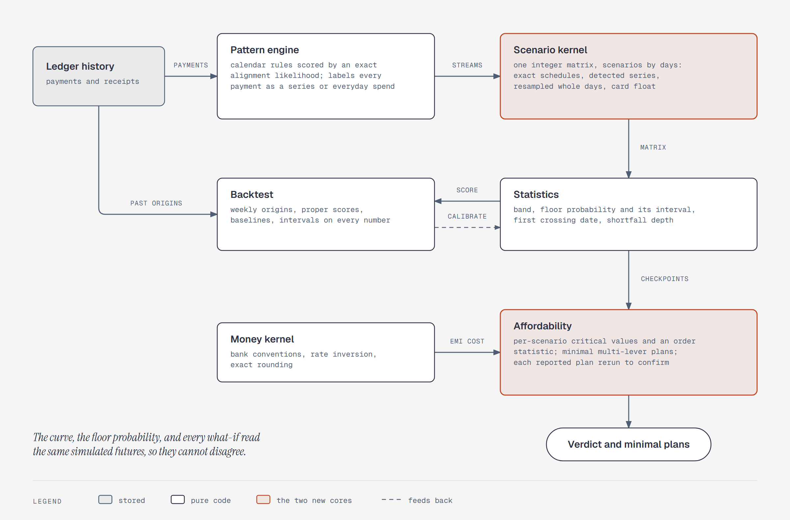

# One scenario matrix answers every question

**What it shows:** How the proposed engine composes. Ledger history goes to the pattern engine,
which labels every payment as part of a recurring series or as everyday spend and hands the
resulting streams to the scenario kernel. The kernel builds one integer matrix of scenarios by
days. Statistics and the affordability search both read that matrix, so the band, the floor
probability, and every what-if describe the same simulated futures. The money kernel supplies EMI
costs. The backtest replays past origins, scores the statistics, and feeds calibration back.

**Diagram type:** Data flow. No semantic pattern matched.

**What the budget forced out:** The four streams (confirmed schedules, detected series, everyday
pool, rare large spend), the model switches inside the kernel, the verification rerun, and the
HackerRank adapter are in [`../engine-blueprint.md`](../engine-blueprint.md). 8 nodes, 9 arrows;
the accent marks the scenario kernel and the affordability search.

**Source:** `engine-composition.html` (diagram-design skill, default skin, minimal light,
doc-inline preset).

**Illustrates:** [`../engine-blueprint.md`](../engine-blueprint.md), section 9.
