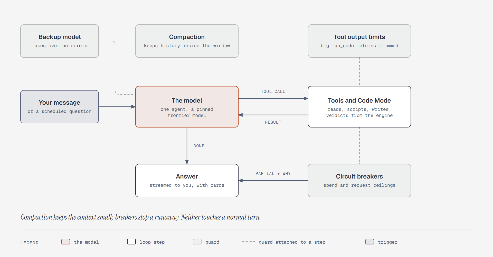

# The agent loop and its guards

**What it shows:** The one agent's loop. Your message (or a question you scheduled) goes to the
model, which calls tools and reads their results until it gives an answer. Guards sit on the loop:
history trimming blanks old read results near the context limit, an approval gate holds wide writes
for your tap, a backup model takes over on errors, and circuit breakers (the daily spend cap and a
25-request limit) stop a runaway turn and hand back a partial answer with the reason.

**Diagram type:** Architecture, with guards attached to loop steps by dashed lines. No semantic
pattern matched.

**What the budget forced out:** Retries before the backup model takes over, the one-running-turn
rule, and the exact breaker values are in the step 3 text. 8 nodes, 5 arrows plus 4 guard lines;
the accent marks the model.

**Source:** `sd-agent-loop.html` (diagram-design skill, default skin, minimal light, doc-inline
preset).

**Illustrates:** [`../architecture.md`](../architecture.md), step 3.
