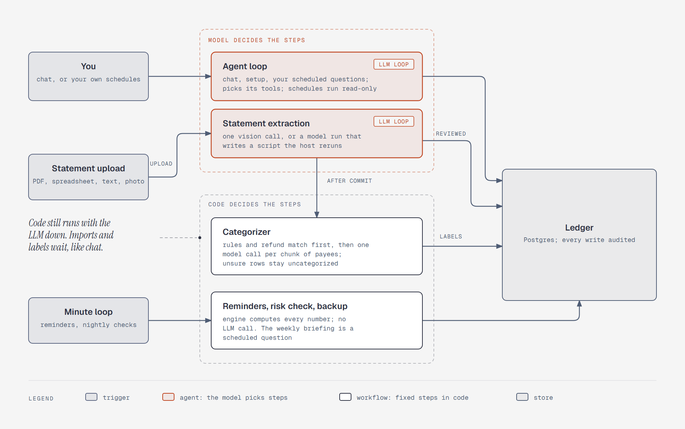

# The agent loop runs for your chat and your schedules

**What it shows:** Arno's paths by trigger. Your chat, and the questions you schedule yourself
(the Weekly Briefing is one), go to the agent loop, where the model picks the steps; scheduled runs
are read-only. A statement upload goes to extraction: one vision call, or a model run that writes a
script the host reruns. Its rows reach the ledger only after you approve the review screen. After
you commit, rules and a refund match label the rows, and one model call per chunk of payees labels
the rest. The minute loop's reminders, nightly risk check, and backup run as code with no model
call, so they work when the LLM is down; imports and labels wait for it, as chat does.

**Diagram type:** Architecture, with two dashed zones for "model decides" and "code decides". No
semantic pattern matched.

**What the budget forced out:** The review screen and the checks between extraction and the ledger
are in [`sd-import-pipeline`](sd-import-pipeline.md). Your chat and your own schedules share one
trigger node, and reads and writes share one arrow to the ledger. The categorizer sits in the code
zone because code fixes its steps; only its chunk calls reach the model. 8 nodes, 8 arrows; the
accent marks the two agent runs.

**Source:** `sd-agent-vs-workflow.html` (diagram-design skill, default skin, minimal light,
doc-inline preset).

**Illustrates:** [`../architecture.md`](../architecture.md), step 2.
