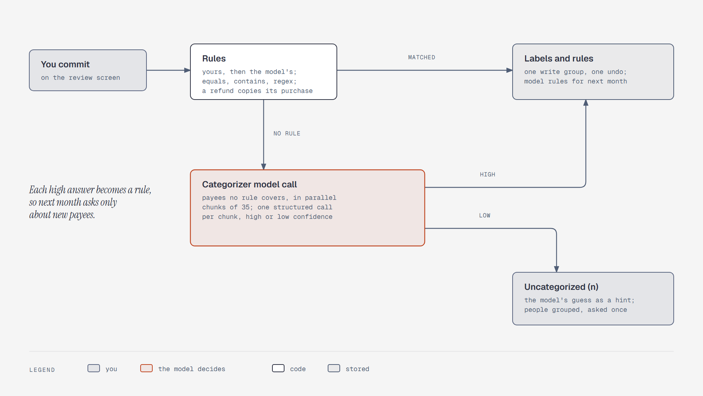

# Rules label most rows, and the model labels the rest

**What it shows:** Categorizing after you commit an import. Rules label every row they match:
yours first, then the model's earlier answers, by `equals`, `contains`, or a regex. A refund takes
the original purchase's category. The payees no rule covers go to the model in parallel chunks,
one structured call each. High-confidence answers become labels and rules in one undoable write;
the rest stay uncategorized, with the model's guess as a hint.

**Diagram type:** Flowchart. No semantic pattern matched.

**What the budget forced out:** Own-account transfers are decided before commit, at the review
screen, so they aren't here
([`../specs/import.md`](../specs/import.md#own-account-transfers-and-card-credits)). The payment
apps that never become name rules and the stripped payment-rail codes are in
[`../specs/import.md`](../specs/import.md#post-commit-categorization). 5 nodes, 5 arrows; the accent
marks the model call.

**Source:** `sd-categorize.html` (diagram-design skill, default skin, minimal light, doc-inline
preset).

**Illustrates:** [`../specs/import.md`](../specs/import.md), categorizing after commit.
