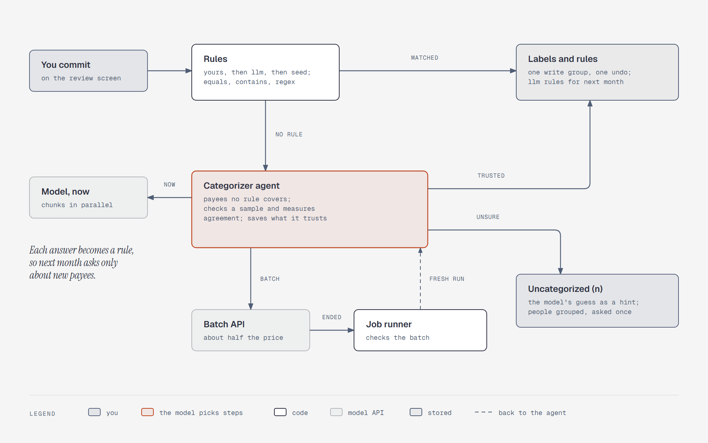

# Rules label most rows, and the model labels the rest

**What it shows:** Categorizing after you commit an import. Rules label every row they match:
yours first, then the model's earlier answers, then the shipped seed list, by `equals`, `contains`,
or a regex. A categorizer agent takes the payees no rule covers and picks how to ask the model: at
once, in parallel chunks, or as a batch the job runner collects. It checks a sample, measures how
often the model agrees with categories already known, saves the answers it trusts as labels and
rules in one undoable write, and leaves the rest uncategorized, with the model's guess as a hint.

**Diagram type:** Flowchart. No semantic pattern matched.

**What the budget forced out:** Own-account transfers are decided before commit, by the parser
subagent and you, so they aren't here ([`../import.md`](../import.md#own-account-moves-need-a-human-yes)).
The payment apps marked "don't categorize by name", refunds taking the original purchase's
category, and the stripped payment-rail codes are in [`../import.md`](../import.md#categorizing-after-commit).
8 nodes, 9 arrows; the accent marks the agent.

**Source:** `sd-categorize.html` (diagram-design skill, default skin, minimal light, doc-inline
preset).

**Illustrates:** [`../import.md`](../import.md), categorizing after commit.
