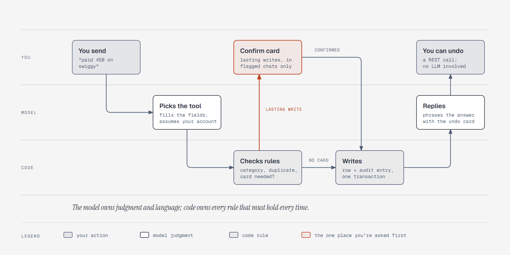

# Who decides what in one chat turn

**What it shows:** One chat turn ("paid 450 on swiggy") across three lanes. You send it; the model
picks the tool and fills it in, assuming your usual account; code checks the rules (category,
duplicate, whether a card is needed) and writes the row with its audit entry; the model replies
with the undo card; you can undo with a REST call. A lasting write in a flagged conversation
detours through the one place you're asked first: the confirm card.

**Diagram type:** Swimlane, with lanes for you, the model, and code.

**What the budget forced out:** The suspected-duplicate question and the clarifying question are
left out; both are the model asking in words, covered by the step 2 text. The undo's own path to
code isn't drawn. 7 nodes, 7 arrows; the accent marks the confirm card and the branch into it.

**Source:** `sd-chat-turn-control.html` (diagram-design skill, default skin, minimal light,
doc-inline preset).

**Illustrates:** [`../system-design.md`](../system-design.md), step 2.
