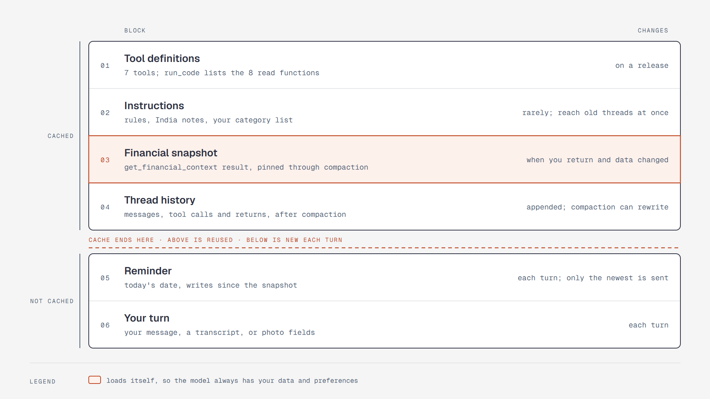

# What the model sees each turn, from unchanging to changing

**What it shows:** The six blocks of a model request, in order. Tool definitions, instructions,
today's date and your categories, and the thread's history stay cached, because what rarely changes
comes first. Attached images and your turn come after the cache and are new each turn.

**Diagram type:** Layer stack, split by the point where the cache ends. No semantic pattern matched.

**What the budget forced out:** The trimming threshold and the typed memories the agent reads
with `run_query` are in the step 6 text. 6 layers; the accent marks the date and categories block
and the point where the cache ends.

**Source:** `sd-context-stack.html` (diagram-design skill, default skin, minimal light, doc-inline
preset).

**Illustrates:** [`../architecture.md`](../architecture.md), step 6.
