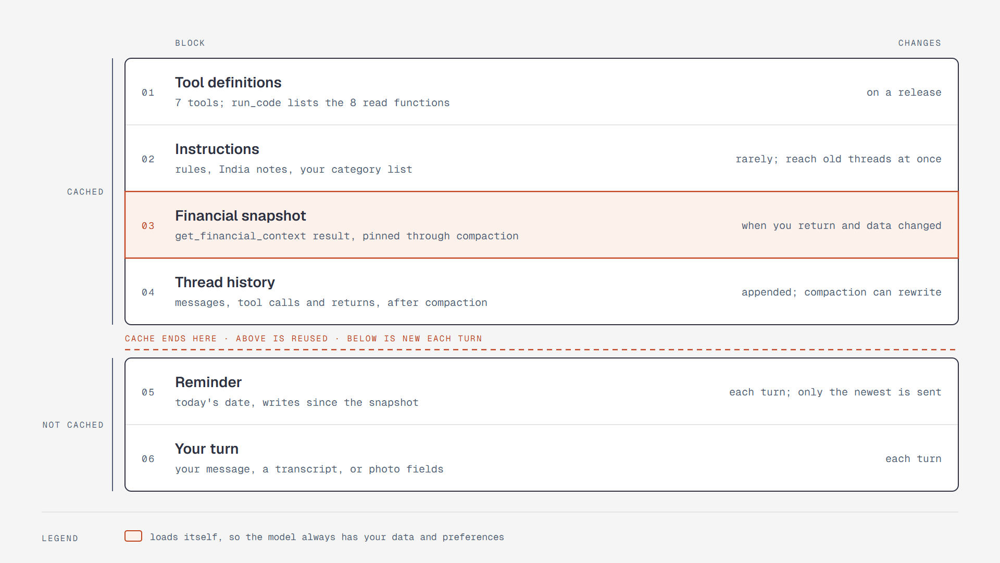

# What the model sees each turn, from unchanging to changing

**What it shows:** The six blocks of a model request, in order. Tool definitions, instructions, the
pinned financial snapshot, and the thread's history stay cached, because what rarely changes comes
first. The reminder and your turn come after the cache and are new each turn.

**Diagram type:** Layer stack, split by the point where the cache ends. No semantic pattern matched.

**What the budget forced out:** Compaction's settings, how the snapshot gets swapped, and memory
other than the snapshot are in the step 6 text. 6 layers; the accent marks the snapshot and the point
where the cache ends.

**Source:** `sd-context-stack.html` (diagram-design skill, default skin, minimal light, doc-inline
preset).

**Illustrates:** [`../system-design.md`](../system-design.md), step 6.
