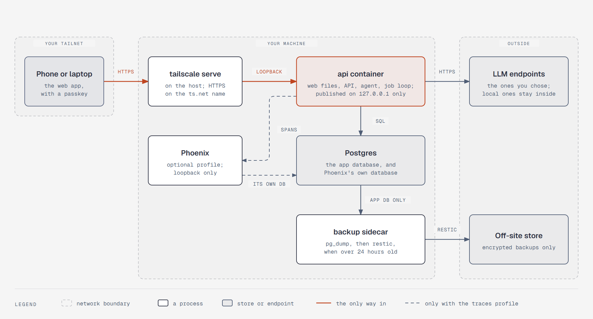

# One way in, and only two ways out

**What it shows:** Where each piece runs. Your phone or laptop reaches the machine over the tailnet,
through `tailscale serve` on the host, which proxies to the API container on loopback. The API serves
the web files and runs the agent and job loop. Phoenix, if its profile is on, takes spans on loopback
and keeps its own database. The backup sidecar dumps the app database only. The only routes out are the
LLM endpoints you chose and the encrypted off-site backups.

**Diagram type:** Architecture, grouped by network boundary.

**What the budget forced out:** Ollama and `speaches` (optional local profiles that sit inside the
machine), contentless push pings, and the CLI on the host are left out; the step 10 text and
[`platform.md`](../platform.md#deployment) cover them. 8 nodes, 3 zones, 8 arrows; the accent marks the
API and the one way in.

**Source:** `sd-deployment.html` (diagram-design skill, default skin, minimal light, doc-inline preset).

**Illustrates:** [`../system-design.md`](../system-design.md), step 10.
