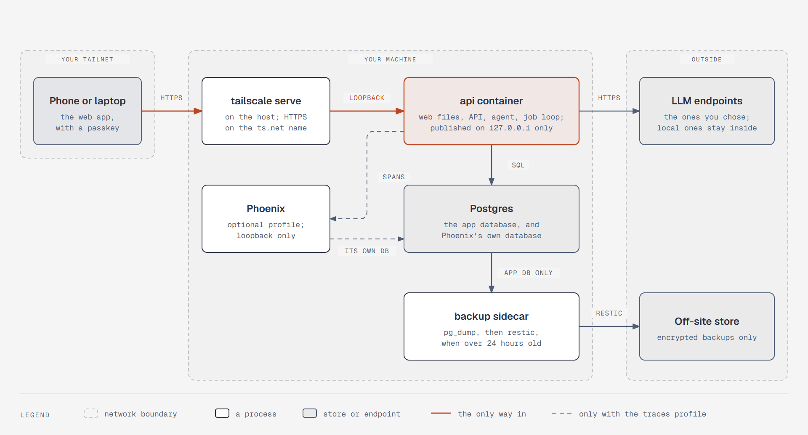

# One way in, and only two ways out

**What it shows:** Where each piece runs. Your phone or laptop reaches the machine over the tailnet,
through `tailscale serve` on the host, which proxies to the API container on loopback. The API serves
the web files and runs the agent and job loop. Phoenix starts with the default Compose stack, takes
spans on loopback, and keeps its own files. The API's daily backup job dumps the app database only. The
only routes out are the LLM endpoints you choose and encrypted off-site backups.

**Diagram type:** Architecture, grouped by network boundary.

**What the budget forced out:** Ollama (an optional local profile that runs on the
host), the optional notification webhook (`ARNO_NOTIFY_WEBHOOK_URL`), and the host CLI are left out;
[`../specs/platform.md`](../specs/platform.md) and
[`../operations/self-hosting.md`](../operations/self-hosting.md) cover them. 8 nodes, 3 zones, 8
arrows; the accent marks the API and the single entry point.

**Source:** `sd-deployment.html` (diagram-design skill, default skin, minimal light, doc-inline preset).

**Illustrates:** [`../architecture.md`](../architecture.md#interfaces-and-deployment).
