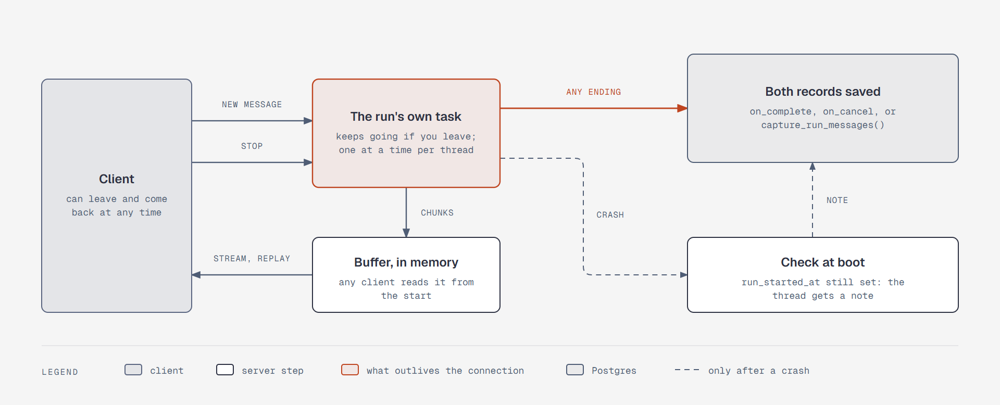

# A turn outlives its connection

**What it shows:** One chat turn with a client that may leave. A new message starts the run as its
own task, which writes chunks to an in-memory buffer that any client can read from the start. So
leaving stops the reading, not the run. Stop reaches the run through a cancellation token. Every
ending saves both records. A crash can't save them, so a check at boot finds the unfinished turn and
adds a note to the thread.

**Diagram type:** Architecture. No semantic pattern matched.

**What the budget forced out:** The per-thread lock, what each ending saves, and the job loop are left
out; the step 8 text covers them. 5 nodes, 7 arrows; the accent marks the run and the save.

**Source:** `sd-detached-turn.html` (diagram-design skill, default skin, minimal light, doc-inline
preset).

**Illustrates:** [`../system-design.md`](../system-design.md), step 8.
