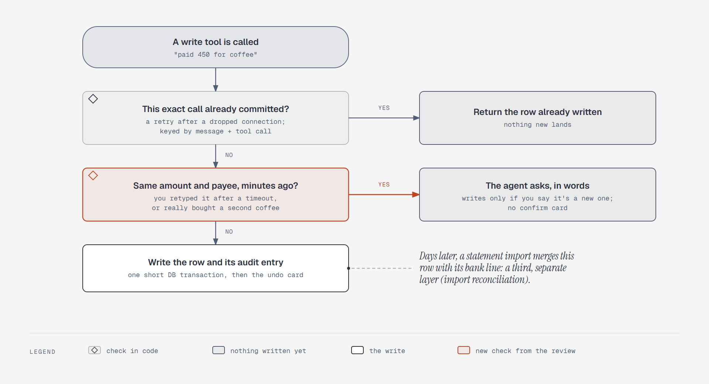

# A chat write can't land twice

**What it shows:** The two checks a chat write passes before it lands. A retried tool call (the
same message and tool call) returns the row already written. A near-identical entry from minutes
ago makes the agent ask in words, with no confirm card. Otherwise the row and its audit entry
commit in one short transaction, and the undo card appears. Statement reconciliation, days later,
is a third, separate layer.

**Diagram type:** Flowchart. Decisions are rectangles tagged with a small diamond glyph, because
the questions are too long for diamond shapes.

**What the budget forced out:** The user's answer to the agent's question (new, or the same one)
isn't drawn; the outcome box says the agent writes only if you confirm. The exact time window and
fields of the suspected-duplicate check wait for step 4. 6 nodes, 5 arrows; the accent marks the
check the outside review added.

**Source:** `sd-duplicate-writes.html` (diagram-design skill, default skin, minimal light,
doc-inline preset).

**Illustrates:** [`../system-design.md`](../system-design.md), step 2, decision D.
