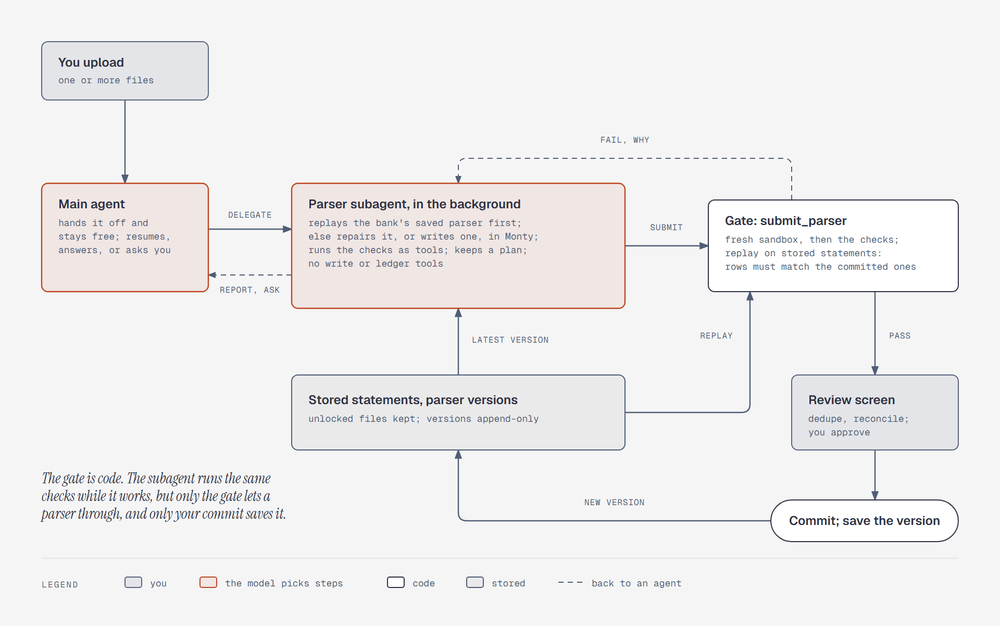

# A parser subagent imports each statement

**What it shows:** How a statement becomes ledger rows. The main agent hands the upload to a parser
subagent that runs in the background, so the chat stays free. The subagent has no write or ledger
tools. It replays the bank's saved parser first, and repairs it or writes one in Monty when that
fails. It submits the script to a gate written in code: a fresh sandbox, the checks, and a replay on
every stored statement from that bank. A failure goes back to the subagent with the reason. A pass
goes to the review screen, and your commit saves the parser as a new version.

**Diagram type:** Flowchart. No semantic pattern matched.

**What the budget forced out:** Reading the file, the password card, the import card's progress
view, and the subagent's plan are in [`../import.md`](../import.md) and
[`../tools.md`](../tools.md). "Report, ask" covers the final report and the questions the subagent
asks through the main agent. 7 nodes, 10 arrows; the accent marks the two agents.

**Source:** `sd-import-pipeline.html` (diagram-design skill, default skin, minimal light,
doc-inline preset).

**Illustrates:** [`../system-design.md`](../system-design.md), step 5.
