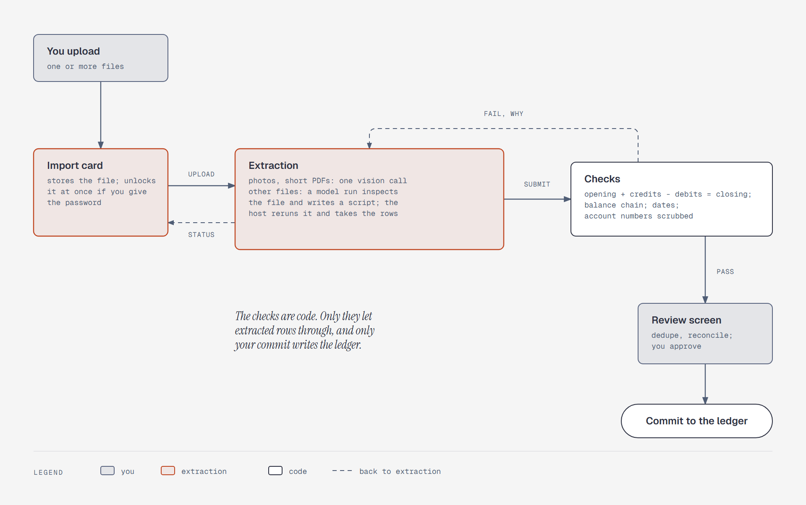

# An import passes the gate before review

**What it shows:** How a statement becomes ledger rows. An upload is stored and opens an import
card, which takes the password. Extraction, the step that turns the file into rows, is being rebuilt
and no code runs it today. Extracted rows go to a gate written in code: a fresh sandbox, the checks,
and a replay on every stored statement from that bank. A failure goes back to extraction with the
reason. A pass goes to the review screen, and your commit saves the parser as a new version.

**Diagram type:** Flowchart. No semantic pattern matched.

**What the budget forced out:** Reading the file and the password card are in
[`../specs/import.md`](../specs/import.md). "Status" covers the progress and result the import card
shows. 7 nodes, 10 arrows; the accent marks extraction.

**Source:** `sd-import-pipeline.html` (diagram-design skill, default skin, minimal light,
doc-inline preset).

**Illustrates:** [`../architecture.md`](../architecture.md), step 5.
