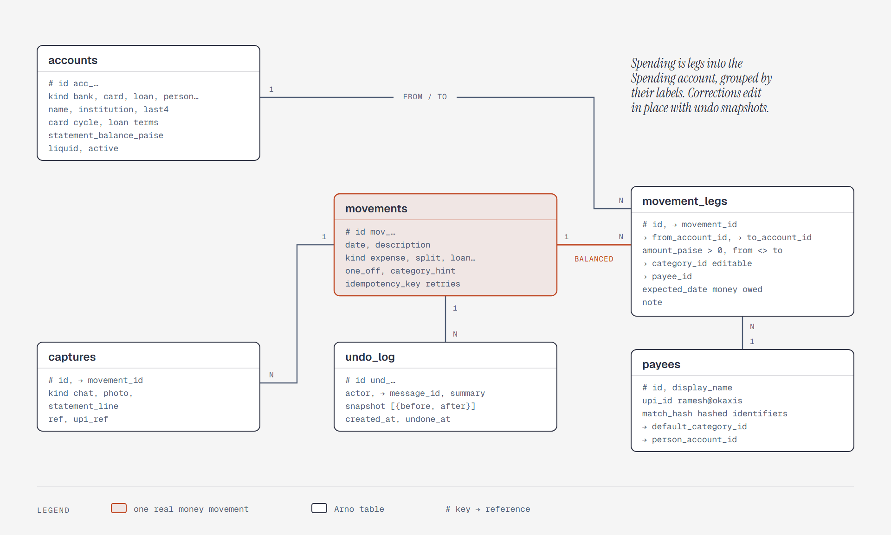

# The ledger model

**What it shows:** Arno's ledger. One real money movement is a `movements` row that owns one or more
`movement_legs`. Each leg moves a positive amount from one `accounts` row to a different one, so the
ledger is zero-sum by constraint. A leg holds its editable category and payee, `payees` identifies
who money went to, and `captures` links every chat message, photo, and statement line to its
movement. `undo_log` stores one snapshot row per write group.

**Diagram type:** ER.

**What the budget forced out:** `statement_lines`, `imports`, and `categories` are left out, and the
views are in the text; the Spending, Income, and equity accounts are rows in `accounts`.

**Source:** `sd-ledger-model.html` (diagram-design skill, default skin, minimal light, doc-inline
preset).

**Illustrates:** [`../specs/data-and-engine.md`](../specs/data-and-engine.md) and [`../architecture.md`](../architecture.md),
step 4.
