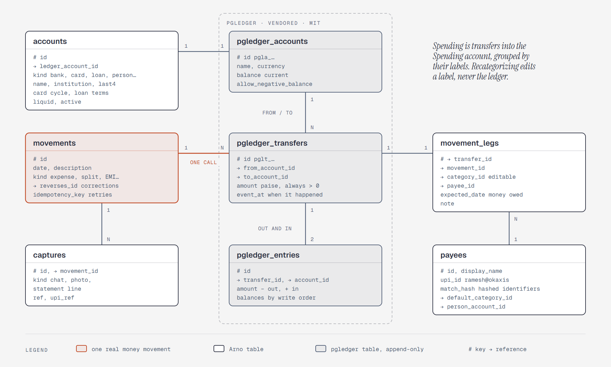

# The ledger, built on pgledger

**What it shows:** Arno's ledger. One real money movement is one pgledger call of balanced
transfers between accounts. pgledger's tables are vendored and append-only. Arno's tables sit
around them: `accounts` carries the domain fields, `movement_legs` links each transfer to its
movement and holds its editable category and payee, `payees` identifies who money went to, and
`captures` links every chat message, photo, and statement line to its movement.

**Diagram type:** ER, with a dashed zone around the vendored tables.

**What the budget forced out:** `statement_lines`, `imports`, `categories`, and
`pgledger_idempotency_keys` are left out, and the views are in the text; the Spending, Income, and
equity accounts are rows in `accounts`. 8 entities, 7 relationships; the accent marks `movements`
and its link to the transfers.

**Source:** `sd-ledger-model.html` (diagram-design skill, default skin, minimal light, doc-inline
preset).

**Illustrates:** [`../design.md`](../design.md) and [`../system-design.md`](../system-design.md),
step 4.
