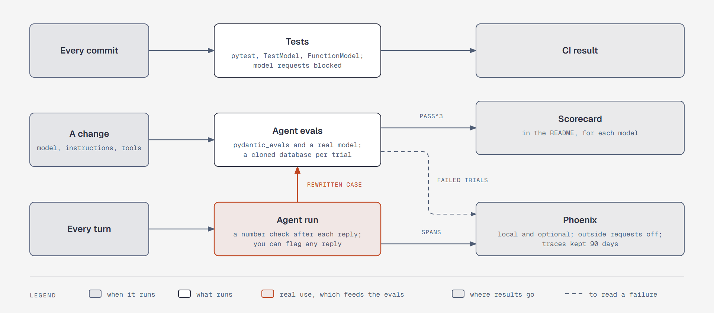

# Three layers measure the agent

**What it shows:** When each layer runs, what runs, and where its results go. Every commit runs tests
with model requests blocked. A change to the model, instructions, or tools runs agent evals with a real
model, which fill the scorecard. Every turn runs a number check after the reply and exports spans to
Phoenix. Failed eval trials go to Phoenix too, and a reply you flag gets rewritten as a synthetic case.

**Diagram type:** Architecture. No semantic pattern matched.

**What the budget forced out:** The eval categories, the graders, and the parts that stay in Postgres
are left out; the step 9 text covers them. 9 nodes, 8 arrows; the accent marks real use and how it feeds
the evals.

**Source:** `sd-measure-layers.html` (diagram-design skill, default skin, minimal light, doc-inline
preset).

**Illustrates:** [`../system-design.md`](../system-design.md), step 9.
