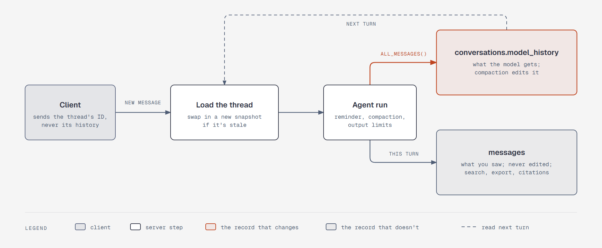

# One thread keeps two records

**What it shows:** One chat turn. The client sends the thread's ID and a new message, never its
history. The server loads the thread's model history, swaps in a new snapshot if the old one is
stale, and runs the agent. When the run ends, `all_messages()` replaces the model history, which
compaction may have edited, and this turn's messages are added to `messages`, which is never edited.

**Diagram type:** Architecture. No semantic pattern matched.

**What the budget forced out:** The reply streaming back to the client, tool calls inside the run,
and when a swap happens are left out; the step 6 text covers the swap. 5 nodes, 5 arrows; the accent
marks the record that compaction changes and the arrow into it.

**Source:** `sd-thread-records.html` (diagram-design skill, default skin, minimal light, doc-inline
preset).

**Illustrates:** [`../system-design.md`](../system-design.md), step 6.
