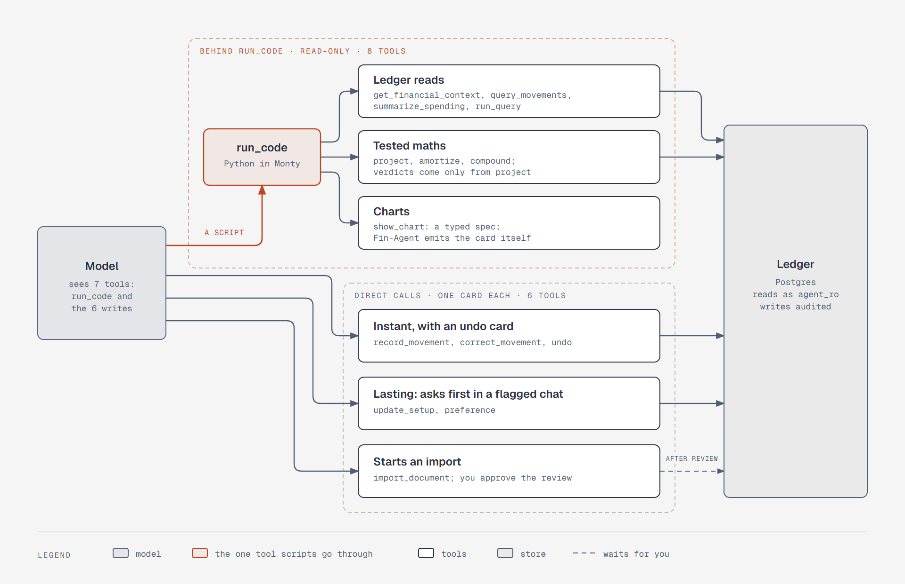

# Scripts read and compute; every write is a direct call

**What it shows:** The agent's tool surface. The model sees seven tools: `run_code` and the six
write tools. A script inside `run_code` can call the eight read tools: ledger reads, tested maths,
and charts. Write tools are normal tool calls, each with its own card. They land instantly, ask
first in a flagged conversation, or start an import that waits for your review.

**Diagram type:** Architecture, with two dashed zones for "behind `run_code`" and "direct calls".
No semantic pattern matched.

**What the budget forced out:** The 14 tools share 6 grouped nodes, and each tool's description,
input, output, and logic are in [`../tools.md`](../tools.md). `run_code`'s limits and the parse
run's own functions are left out. 9 nodes, 12 arrows; the accent marks `run_code` and the arrow
into it.

**Source:** `sd-tool-surface.html` (diagram-design skill, default skin, minimal light, doc-inline
preset).

**Illustrates:** [`../system-design.md`](../system-design.md), step 5.
