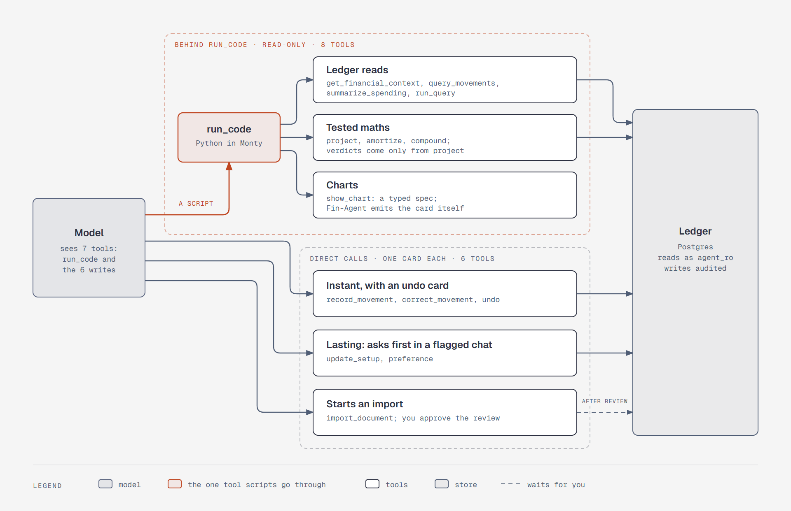

# Reads compute; every write is a direct call

**What it shows:** The agent's tool surface. Three read tools (`run_query`, `project`, and
`run_python`) and web search are direct tool calls that never write. The four write tools
(`record_movements`, `correct_movement`, `update_setup`, and `undo`) are direct calls too. Writes
land instantly with undo, except a wide `correct_movement` scope, archiving, and settings, which
ask for a confirm tap first.

**Diagram type:** Architecture, with two dashed zones for "reads" and "writes".

**What the budget forced out:** Individual tool contracts live in
[`../specs/tools.md`](../specs/tools.md). The diagram leaves out the sandbox service, tool limits,
and the categorizer. 8 nodes, 9 arrows; the accent marks the read tools and the arrow into them.

**Source:** `sd-tool-surface.html` (diagram-design skill, default skin, minimal light, doc-inline
preset).

**Illustrates:** [`../architecture.md`](../architecture.md#tool-surface) and
[`../specs/tools.md`](../specs/tools.md).
