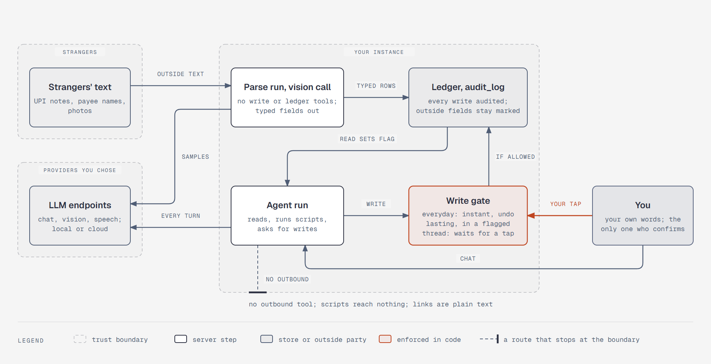

# Outside text reaches the agent, but lasting writes need you

**What it shows:** The three trust zones and what crosses them. Strangers' text enters through a parse
run or vision call with no write or ledger tools, and lands in the ledger as typed rows. When the
agent reads it back, the read sets a flag on the thread. Every write passes the gate: everyday writes
go through with undo, and lasting writes in a flagged thread wait for your tap. Data goes to the LLM
endpoints you chose, and no other route leads out.

**Diagram type:** Architecture, using the secure paved road pattern.

**What the budget forced out:** A photo's marked entry going straight into the thread, voice notes,
encrypted backups, push pings, statement passwords, and the sandbox around scripts are left out; the
step 7 text covers them. 7 nodes, 3 zones, 10 paths; the accent marks the gate and your tap, the one
privileged moment.

**Source:** `sd-trust-boundaries.html` (diagram-design skill, default skin, minimal light, doc-inline
preset).

**Illustrates:** [`../system-design.md`](../system-design.md), step 7.
