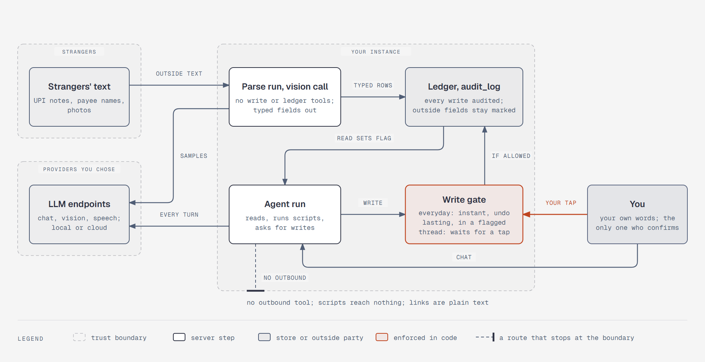

# Outside text reaches the agent, but wide writes need you

**What it shows:** The three trust zones and what crosses them. Strangers' text enters through a vision
call with no write or ledger tools, or through statement rows, and lands in the ledger as typed
rows. The agent reads it back as data. Every write passes the gate: everyday writes go through
with undo, and wide writes wait for your tap. Data goes to the LLM
endpoints you chose, and no other route leads out.

**Diagram type:** Architecture, using the secure paved road pattern.

**What the budget forced out:** A photo going straight into the thread, voice notes,
encrypted backups, push pings, and statement passwords are left out; the step 7 text covers them. 7 nodes, 3 zones, 10 paths; the accent marks the gate and your tap, the one
privileged moment.

**Source:** `sd-trust-boundaries.html` (diagram-design skill, default skin, minimal light, doc-inline
preset).

**Illustrates:** [`../architecture.md`](../architecture.md), step 7.
