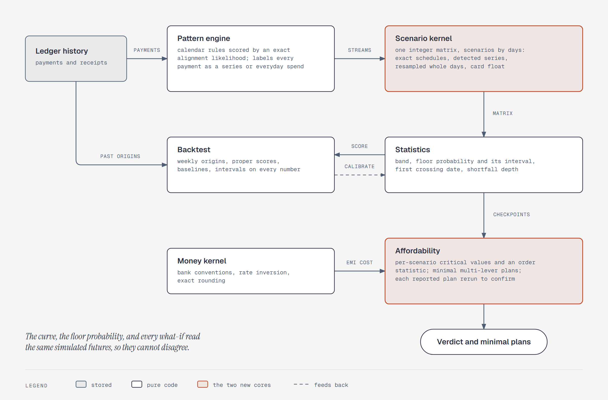

# Engine blueprint: the next projection, affordability, pattern, and money engine

**Status: decided on November 13, 2026, and being built.** The decisions of section 11 are
recorded in [`plan.md`](plan.md) §6, which owns them. Until a step of section 10 lands,
`design.md` and `tools.md` describe the shipped engine. Written against `src/arno/engine` at
commit `4d37028`. Step 1 landed on November 15, 2026: on the held-out synthetic households the
shipped engine's P10-P90 band holds 23% to 33% of outcomes, and at 90 days a flat balance
forecasts the end balance better than it does (README, "Projection backtest").
Revised the same day after two external reviews; each accepted finding was first checked against
the code or by brute force, and sections 4.2, 4.3, 4.5, 5.1, and 6.2 changed as a result.

The code facts below come from a line-by-line read-out of every engine module, its callers, its
tests, and the docs. Timings marked _measured_ were run on this machine; everything marked
_estimate_ is an operation count, not a benchmark.



## 1. The short version

| Subsystem | Today | Proposed | What it buys |
|---|---|---|---|
| Projection | 1,000 walks, one independent draw per category per day, plug-in pools | One integer scenario matrix: whole-day vectors, per-scenario pool resampling, class-matched blocks, 16,384 scenarios | Bands that widen honestly with short history; verdict noise ±0.5 points instead of ±1.9; about 50× faster |
| Affordability | Four levers tried one at a time, each a full re-simulation; six-step cut scan | Per-scenario critical values and an order statistic; exact minimal multi-lever plans; one verification rerun per reported plan | The smallest change that works, provably, with no scan resolution and no missed combinations |
| Patterns | All gaps within ±3 days of 7, 30, or 365; all amounts within ±10% | Calendar-rule hypotheses scored by an exact alignment likelihood; posterior confidence; next-date distribution; still-alive probability | Survives weekend shifts, month-end, skipped months, price changes, double payments; finds salary |
| Money | EMI and monthly compounding | Convention-aware schedules, integer-lattice rate inversion, guarded XIRR, cumulative rounding | Matches a bank's statement to the paisa; EMI tradeoffs carry their real cost |
| Backtest | 12 points, one metric, no baseline, generator mirrors the model | Weekly rolling origins, proper scoring rules, baselines, adversarial personas, confidence intervals | The only way to know whether any of the above is better |
| HackerRank | A 1,433-line parallel implementation | A thin adapter over the production pattern and plan code | The score measures the shipped engine |

The individual techniques are textbook. The edge is the composition and the measurement: no
consumer product or paper we could find publishes a calibrated probability that a household
balance crosses a floor, a provably minimal affordability plan, or a reproducible scorecard with
baselines. The prior-art search found only deterministic "balance minus committed" rules.

## 2. What the current engine does, and where it breaks

Ranked by how much each one distorts an answer.

### 2.1 The band is too narrow by construction

`projection.py` resamples future spend from a 90-day pool and treats that pool's mean as the true
mean. It is an estimate. For a pool of `n` days with daily variance `σ²`, the variance of total
spend over `H` future days is

```
Var = H·σ²  +  H²·σ²/n  =  H·σ²·(1 + H/n)
      noise    uncertainty about the mean
```

The engine simulates only the first term. Its band is too narrow by `√(1 + H/n)`, so a nominal
80% band covers (normal approximation):

| Horizon `H`, pool `n` | Width shortfall | Real coverage of the "80%" band |
|---|---|---|
| 30 days, 90 days | ×1.15 | 73% |
| 90 days, 90 days | ×1.41 | 64% |
| 180 days, 90 days | ×1.73 | 54% |

The published backtest reports 75% at 30 days from a 90-day pool, on synthetic data that is
independent by construction, so this is the only error present. The prediction is 73%. Twelve
points cannot separate 73% from 80%, but nothing in the result contradicts the diagnosis. The same
error pushes `floor_probability` toward 0 or 1.

### 2.2 Less data produces more confidence

A category with fewer than 14 days of spend (`MIN_REAL_DAYS`) falls back to a flat daily amount
with zero variance. A new user gets the tightest band and the most extreme floor probability.

### 2.3 Draws are independent across days and categories

Each category draws its own day (`projection.py:608-639`). A day out that raises food, transport,
and shopping together becomes three unrelated draws, and a run of expensive days becomes
unrelated days. Both remove variance from the horizon total. `card_share` is one learned fraction
per category applied to every draw, though the ledger knows which account paid each day.

### 2.4 The verdict sits on sampling noise

At 1,000 runs and a true probability of 0.90, the standard error is 0.95 points, so the 95%
interval is ±1.9 points. Any purchase whose floor probability lies between 0.88 and 0.92 gets a
verdict decided by the seed. The fixed seed makes that repeatable, not correct.

`obligations_met` is stricter still and depends on the run count: it fails if any single run-day
with an obligation ends below zero (`projection.py:595-596`). At 1,000 runs that is roughly a
99.9% constraint; raising the run count silently tightens it.

### 2.5 The statistics disagree with each other

`floor_probability` counts per-run minima against the floor. `first_floor_crossing` and
`median_low` follow the median curve (`projection.py:719-724`). A projection can report an 85%
floor probability, which fails the verdict, and no crossing date.

### 2.6 History and schedules are split by category, not by payment

`tools/projection.py:305-310` drops a whole category from the simulation when a schedule names it.
A schedule with no category, or a payment filed under another category, is counted twice: once as
a dated event and once inside the resampled pool. Discretionary spend inside a covered category
disappears. A recurring charge the user has not accepted as a schedule stays in the pool as a
random spike: the mean is right, the timing and variance are wrong.

### 2.7 Affordability searches one lever at a time, coarsely

Levers are never combined (`affordability.py:217-410`). The category cut is six steps of two
points from a computed minimum, so a passing cut more than ten points above it is never found.
Each lever is a full re-simulation. Card EMI is `amount // months` with no interest, fee, or tax,
so it always looks free. `goal_slips` is always empty, so the "no goal slips" condition for a yes
cannot fail. The wait lever ignores `threshold`. When no balance is known the engine runs every
lever and then discards the result.

### 2.8 Pattern detection is all-or-nothing and disconnected

One gap outside ±3 days or one amount outside ±10% discards the merchant
(`patterns.py:97-104, 151-156`). A price change, a double payment, a skipped month, or two plans
at one merchant yields nothing. There is no fortnightly or quarterly cadence, "monthly" is a
30-day count, there is no confidence, no next date, no check that the series is still alive, and
income never enters. Digits survive normalization, so UPI reference numbers split one merchant
into many; non-Latin names normalize to an empty string. Nothing in `projection.py` or
`affordability.py` imports the detector.

### 2.9 The scorecards cannot see any of this

The backtest scores the 30-day median balance at 12 origins, with P10–P90 coverage as its only
calibration measure. Detecting a drop from 80% to 73% coverage with 80% power needs about 270
independent forecasts. There is no baseline, no proper scoring rule, and no sharpness measure;
`floor_probability` is recorded per row and never scored. The synthetic generator is independent
Gaussian spend with the true schedule handed to the engine, which is exactly the engine's own
assumption. HackerRank is 25 samples: 23 of 25 on status is a 95% interval of 75% to 98%, so the
"90% or more" target is not resolvable on this dataset.

### 2.10 It is slow, and most of the time is one avoidable lookup

_Measured_: one `project()` call takes 3.4 to 3.7 s (1,000 runs, 90 days, 6 categories). A
profile attributes 8.8 of 12.8 profiled seconds to `charge_card`, which recomputes
`card_due_date` through `calendar.monthrange` 543,000 times for at most 90 distinct answers. A
no-verdict check costs 2 to 10 or more such calls, against a 15 s target for a multistep what-if
(plan.md §2). A lookup table for the due date is a 20-line fix worth doing regardless of the rest
of this document.

_Measured on November 14, 2026_, after the schema redesign and the API connection cache: the
projection is now nearly all of the home page's time. On the demo persona a warm home load takes
about 1.9 s, of which about 1.8 s is projection CPU. At ten years of synthetic history the home
page's database work is 36 statements (about 354 ms), while the projection takes 13.8 s. The new
kernel's target is that the home page's projection stays under 1 s at the ten-year scale, so the
page is bound by its database work again.

### 2.11 The whole card balance is paid on the first due date

`CardAccount` carries one `outstanding_paise`, and the walk pays all of it on the first due date
on or after today (`projection.py:493-497`). Spend since the last statement close belongs to the
next bill. On the 13th, with a statement on the 5th and a due date on the 25th, eight days of
spend leave cash a month early.

## 3. What stays fixed

- Whole paise. The kernel is integer-only; the only floats in an output are reported
  probabilities.
- `project()` stays pure: no clock, no database, no model. Dates and data are passed in.
- Same inputs and seed give the same output, on any platform.
- Verdicts come only from the engine, and every reported tradeoff is confirmed by a real rerun.
- The output keys of the `project` tool and `GET /api/projection` do not change. Section 11 lists
  the two whose meaning does.
- A model component ships only if it beats the previous one on the backtest. Each proposal in
  section 4 is a switch on one kernel, so the current behavior remains a testable configuration.

## 4. Projection: one integer scenario matrix

### 4.1 Model

The balance is a sum of streams, and every historical movement belongs to exactly one:

```
B_t = B_0 + confirmed schedules   (exact, as today)
          + detected series        (random date, amount, and survival; section 6)
          + everyday spend         (resampled)
          + rare large spend       (resampled from a longer window)
```

Attribution by payment replaces the category-level split of section 2.6. The pattern engine's
alignment labels each historical payment as matched to a series or not; only unmatched spend
enters the everyday pool.

### 4.2 Resampling

The unit is a whole historical day: a vector of cash spend and per-card spend, split into
reducible and fixed. One draw per future day replaces one per category, which keeps
cross-category and cash-versus-card dependence and removes `card_share`.

Three changes to how a day is drawn, each independently switchable:

1. **Pool resampling.** Each scenario first builds its own pseudo-history by running the walk of
   change 2 over the real history, then draws its future by the same walk over that
   pseudo-history. "Next day" always means next in the sequence being walked. The pseudo-history
   mean varies across scenarios with the variance of the sample mean, which restores the missing
   `H²·σ²/n` term of section 2.1 with integer indices only. At `L = 1` this is the multinomial
   form of the Bayesian bootstrap. Resampling only the block start weights was checked and
   rejected: on independent data it understates that variance by `2L − 1` (5× at `L = 3`), where
   the two-level walk matches it.
2. **Class-matched blocks.** With probability `1/L` a day starts a new block at a random day of
   the same class (weekday or weekend, as today); otherwise it takes the next day if its class
   still matches. This is a stationary bootstrap that keeps short runs of related days. `L = 1`
   is exactly today's scheme. `L` is one fixed value for everyone, 1, 2, or 3, chosen by the
   backtest. Estimating it per user (Patton–Politis–White) is rejected: on 90 points the estimate
   is mostly noise.
3. **Recency weights.** History days carry integer weights that decay with age. Faster decay
   lowers the effective sample size, which widens the band through change 1 with no extra code.
   Changepoint detection is rejected: at 90 to 730 days it fires on single outliers.

**Short history.** Resampling shows only the spread the sample has: no days, or ten identical
days, still give a flat line. Below `MIN_REAL_DAYS` the pool is topped up to 14 with pseudo-days,
fixed integer multiples of the stated baseline, so the prior fades out as real days arrive. The
multiples are set by the backtest, by truncating each persona's history and scoring coverage
(section 11).

**Rare large spend.** A day whose spend exceeds a robust threshold (median plus a multiple of the
median absolute deviation, both taken over days with spend) is removed from the everyday pool and
resampled as its own stream, at a rate estimated from all available history. Taken over all days
the threshold collapses to zero for anyone who spends on fewer than half of days. A zero deviation
disables the split. Everyday habits need a recent window; rare events need a long one. Fitting a
parametric tail is rejected: it needs 50 to 100 exceedances and six months gives about 18.

### 4.3 Kernel

- **Randomness.** A counter-based integer hash (the SplitMix64 finalizer over `seed`, stream,
  scenario, and day) gives the draw for any cell directly. Scenario `r` does not depend on the
  scenario count, on any other stream, or on a library's sampling methods. A pure-Python
  reference of the same five lines is the test oracle for the vectorized kernel.
- **Arithmetic.** Gather day vectors, cumulative-sum along time, add the dated events.
- **Card float.** Used credit falls only when a bill is paid, so it is segmented by due dates,
  not statements: a closed, unpaid bill and the next statement's spend share one limit. Within a
  segment used credit only rises, so the amount charged so far is `min(spend so far, headroom at
  the segment start)` and the rest moves to cash that day. A bill is the difference of that
  charged total at two statement closes. Segments run in order, three or four per card in 90
  days, each vectorized across scenarios. The opening balance is split at the last statement
  close into a billed part, due first, and an unbilled part, due with the next bill (section
  2.11); the loader derives the split from card spend since that close.
- **Size.** 16,384 scenarios at every horizon. Days are processed in 127-day chunks that carry
  each scenario's state forward, which the counter-based draws allow, so memory stays near 16 MB
  and cost grows linearly with the horizon. Halving the count on long horizons was considered and
  rejected: at ten years it leaves 512 scenarios and ±2.6 points.
- **Cost.** _Estimate_: 50 to 80 ms per projection with NumPy, against 3.5 s measured today.
  This needs NumPy, which the project does not have (section 11).

### 4.4 Statistics, all from the same matrix

- **Curve.** Integer order statistics at ranks `⌈0.1N⌉`, `⌈0.5N⌉`, `⌈0.9N⌉`: values that
  occurred, with no float interpolation.
- **Floor probability.** The share of scenarios whose minimum stays at or above the floor, with
  a Wilson interval: ±0.46 points at 16,384. A `borderline` data-quality note when the interval
  contains the threshold.
- **First floor crossing.** The first date by which more than 10% of scenarios have crossed. It
  is absent exactly when the floor probability is at least 90%, so the date and the verdict can
  no longer disagree.
- **Depth.** Mean shortfall below the floor among breaching scenarios, so a tradeoff can say how
  bad a breach is, not only how likely.
- **Optimistic case.** Unconfirmed income is a dated step added to the same matrix; no second
  simulation.

### 4.5 The checkpoint lemma

Spend and bills only lower the balance. It can rise only on an inflow day: a day on which any
scenario has a dated event with a positive cash amount, whatever its kind. So the minimum over
the horizon is attained on the day before such a day, or on the last day:

```
min over all days of B_t  =  min over Q of B_t,   Q = {p − 1 : p an inflow day} ∪ {H}
```

_Proof._ Take any minimizing day outside `Q`. The next day has no inflow, so its balance is no
higher and it is also a minimizer. Repeat until a day in `Q` is reached.

The premise is an invariant the kernel enforces: every resampled day is non-negative spend (the
loader already takes positive spend rows only), and `Q` is built from the sign of every event, in
every scenario, including the optimistic case. An inflow with a random date adds each date it can
land on, so a salary with three days of jitter gives about 15 checkpoints, not 4.

A 90-day horizon with fixed dates has four to seven checkpoints. Every floor test, and every
lever search in section 5, needs only a scenarios-by-checkpoints matrix.

### 4.6 Calibration

Conformal guarantees are per-day and marginal; the number the verdict uses is a path minimum.
So calibration targets the path minimum directly: the backtest records where each realized
minimum fell in its forecast distribution, and a monotone map with shrinkage toward the identity
corrects the reported quantiles. It ships only if the backtest still shows miscalibration after
section 4.2, and its parameters are data passed into `project()`.

### 4.7 Considered and rejected

- **Exact lattice walk as the primary engine.** With independent daily increments the floor
  probability is an exact absorbing-barrier recursion. Card float breaks the premise: spend
  leaves cash on a later due date, so the state needs cash, billed, and unbilled amounts. It
  survives as a test oracle for card-free inputs, where the kernel must match it within its
  interval.
- **Saddlepoint approximations.** The moment generating function does not exist for heavy-tailed
  spend where the upper tail needs it.
- **Quasi-Monte Carlo and importance sampling.** The floor test is a discontinuous function of
  hundreds of draws, and a 10% event is not rare. More scenarios is simpler and sufficient.

## 5. Affordability: critical values and minimal plans

### 5.1 Every lever is a path transform

On a fixed scenario matrix, a lever changes each scenario's checkpoint balances in a known way:

| Lever | Effect on scenario `r` at checkpoint `q` |
|---|---|
| Pay amount `a` on date `τ` | `−a` for `q ≥ τ` |
| Pay by card or EMI | the same steps on the due dates |
| Skip a goal contribution | `+c` from its date |
| Cut reducible spend by `ρ` until date `u` | `+ρ · R_q(r)`, the reducible spend that has left cash by `q` |

`R_q(r)` counts cash spend up to `min(q, u)`, and card spend up to `u` only once its bill's due
date is at or before `q`. Cutting a card purchase frees no cash until that bill is paid, so
counting it on the purchase date would understate the cut needed. The transform is linear in `ρ`
for every scenario whose credit cap never binds. A cut can only loosen a cap, so those scenarios
are known from the baseline; the few where a cap binds get their critical value by bisection over
0 to 5,000 basis points on the exact kernel.

No lever needs a new simulation of the whole matrix.

### 5.2 The critical-value theorem

For a lever where more is always at least as safe, each scenario has a critical value: the
smallest setting at which it passes. Then

```
smallest setting that passes a share p of scenarios  =  the ⌈p·N⌉-th smallest critical value
```

because a scenario passes exactly when the setting reaches its critical value. This one
statement replaces three separate mechanisms:

- **Safe amount.** Critical value `min over q ≥ τ of (B_q − floor)`. For today this is what
  `safe_amount_today` already computes.
- **Earliest date.** The first date after which paying leaves every later checkpoint above the
  floor, with the checkpoints before it tested unchanged. For a payment from an account, which
  is what the wait lever is today, later is always safer, so this is monotone. The current
  day-by-day scan gives the same answer at many times the cost. A card payment under a binding
  credit cap is not guaranteed monotone and is scanned.
- **Smallest cut.** `max over q of (floor − B_q) / R_q(r)`, compared as integer fractions and
  rounded up to a basis point. This replaces the six-step scan with the exact answer.

### 5.3 Minimal plans

Discrete choices (payment method, EMI tenor, which goal contributions to skip) are enumerated;
for each combination the smallest cut is one order statistic. A plan is _minimal_ if no other
passing plan skips a subset of its goals with a cut no larger. Enumerating combinations by size
and keeping those whose cut is strictly smaller than every subset's yields exactly the minimal
plans. With up to four goals and a handful of methods that is about a hundred combinations at
roughly 0.1 ms each (_estimate_).

The engine returns up to four minimal plans, ordered by fewest levers, then rupee cost (EMI
interest and fees; spending forgone for a cut), then name. It does not invent weights to compare
rupees with days.

Tuning levers on the same scenarios used to test them is optimistic by about `d/(N+1)` for `d`
tuned quantities: 0.02 points at 16,384 scenarios, against 0.3 at 1,000.

### 5.4 Verification

Each reported plan is applied to the inputs and rerun through the full kernel on the same
scenarios. If per-day rounding or a credit cap makes it fail, the cut rises by one basis point
and it reruns. Every number shown comes from that rerun.

### 5.5 Rule fixes

- The obligation test becomes an explicit probability with a named threshold, independent of the
  scenario count.
- The unreachable goal-slip clause is removed; a goal slips only through the skip lever, which
  reports exact slip days.
- A card EMI carries interest, fee, and tax from the money kernel. The rate and fee come from
  the what-if, then the card's default, then 16% a year, labeled in `data_quality`. Zero
  is used only when the user says the offer is no-cost; an unknown rate assumed to be zero is the
  one value known to be wrong in the unsafe direction.
- The wait lever honors `threshold`. No lever runs when no balance is known.

_Estimate_: a full no-verdict check under 300 ms, against 2 to 10 or more calls of 3.5 s today.

## 6. Patterns: calendar rules scored by likelihood

### 6.1 Hypotheses, not gap windows

Each candidate is a calendar rule plus a business-day convention: weekly, fortnightly,
four-weekly, twice monthly, monthly on day `k`, last day, last working day, n-th weekday,
quarterly, half-yearly, yearly; each unshifted, or moved to the next or previous working day.
Rules expand through the existing `arno.india.recurrence`. Month-end clamping and holiday shifts
are part of the rule, not noise to tolerate. Free period search (periodograms) is rejected: with
3 to 12 events it cannot tell monthly from four-weekly.

### 6.2 One alignment computes everything

Under a rule, each expected date is paid with probability `1 − q`, on a day offset by a jitter
distribution `f`; unrelated payments arrive at a background rate `λ`. The likelihood of the
observed dates sums over every way to align them to the expected dates:

```
S[i][j] = (S + U)[i−1][j−1] · (1 − q) · f(o_i − e_j)    observed i is expected j
        + S[i][j−1]         · q                         expected j was skipped
        + π                                             the series starts after expected j (i = 0)
U[i][j] = (S + U)[i−1][j]   · λ                         observed i is unrelated
```

Two tables, not one, because a skip may not follow an unrelated payment. That counts each
labeling of the payments exactly once. A single table counts a gap holding `a` unrelated payments
and `b` skips `C(a+b, a)` times, which lets "a weekly series that skipped every week" beat "no
pattern" 142 to 1 where the true ratio is 0.25. The two-table form matches a brute-force sum over
all labelings.

The series has a latent start and end. It starts at any expected date with equal prior `π`, and
after each expected date it ends with probability `c`; the likelihood sums `(S + U)[M][j]` over
every end `j`. Expected dates outside that window cost nothing. Without it, a subscription three
months old in an 800-day window is scored as 23 skipped payments and never detected.

Every weight is an integer over a power of two, and each cell keeps one common denominator, so
the recursion runs in exact Python integers and the ranking of hypotheses is reproducible to the
bit. Summing over a small grid of `q`, jitter width, and `λ` gives each rule's marginal
likelihood. "No pattern" is the same recursion with no expected dates, `λ^M`, so a rule with more
expected dates gets no advantage: each one must be matched or paid for as a skip.

- **Confidence** is one minus the posterior of "no pattern". Three clean monthly payments give
  about 0.9 under the proposed priors (a hand calculation, to be checked on labeled data).
- **Next date** is the posterior-weighted mixture of each rule's next expected date and jitter.
- **Still alive** is the share of the likelihood whose end is the last expected date. After `k`
  trailing misses that is `x^k / (x^k + c·(1 + x + … + x^(k−1)))` with `x = (1 − c)·q`. At
  `q = 0.05`, `c = 0.03`: one miss leaves 62%, two leave 7%.
- **Attribution.** The best alignment labels each payment as part of the series or not, which is
  the split section 4.1 needs.

A skipped month, a double payment, a weekend shift, and a month-end date are each one term of
the recursion, so none of them discards the series.

### 6.3 Amounts and payees

- **Amounts.** Fixed, stepped (one series, new level after a change), or variable. A variable
  bill predicts from its own residual quantiles, and from the same month last year once 13 months
  exist. A distribution-free 90% interval needs nine past values; shorter series report the
  coverage they can support.
- **Two plans at one merchant.** If the whole series fits no rule and amounts form two tight
  groups of three or more, each group is scored separately.
- **Payees.** Group by `payee_id`, then by a normalized name that drops digit-only tokens and
  keeps non-Latin letters.
- **Income** is detected the same way, which supplies the salary schedule the real-ledger
  backtest is blocked on (plan.md milestone 29). It reads receipts from income accounts only.
  Spending detection reads `v_spending`, which already excludes card bill payments and transfers
  between the user's own accounts, so neither can be mistaken for a series.

The `holidays` package has no bank category for India; second and fourth Saturdays and RBI bank
holidays are a small table to add.

_Estimate_: about a million integer operations per payee across rules and the grid; a nightly run
over a few hundred payees takes under a minute in pure Python. Detection moves behind a pure
function; the loader stays in `tools/`.

## 7. Money: conventions, inversion, and rounding

`Decimal` stays. Its 28 digits are far beyond need, and exact fractions are rejected: banks round
every period, so the convention decides the answer, not the precision.

- **Conventions.** `amortize` takes a rest frequency, day count, rounding unit, EMI rounding
  rule, and a piecewise rate for floating loans. Today it assumes monthly rests and half-up
  paise.
- **Rate inversion.** EMI rises strictly with the rate, so the rate behind an observed EMI is
  unique. Bisect over integer rate units using the exact forward schedule. It stops on an
  integer interval with no tolerance to tune, and the interval's width says how precisely the
  statement pins the rate. A change between statements is a floating-rate reset.
- **XIRR.** Bracketed bisection, returned only when the cash flows have one sign change;
  otherwise the function says the rate is not unique.
- **Cumulative rounding.** Round the running total and take differences, so a scaled series is
  exact to half a paisa at every point of any horizon. Today's per-day rounding drifts by up to
  half a paisa per day. This is what makes a cut exactly linear in section 5.
- **Allocation.** One largest-remainder split for every place an amount divides.
- **Edge cases.** An EMI below the amortizing EMI, and a prepayment larger than the balance, are
  reported, not silently absorbed. One `_add_months`.

Tax, inflation indexing, and investment returns stay out, per plan.md.

## 8. Evaluation: the scoreboard comes first

### 8.1 Backtest

- **Origins and horizons.** Weekly rolling origins; horizons of 7, 14, 30, 60, and 90 days from
  one projection each.
- **Targets.** End balance and minimum balance.
- **Scores.** CRPS for the distribution, pinball loss at 10/50/90, coverage with mean band
  width, the Brier score of the floor-breach event with its reliability decomposition, and a
  histogram of where outcomes fell in their forecasts.
- **Baselines.** Flat balance; schedule only; schedule plus mean daily spend; and the current
  engine as a kernel configuration. Each score is reported as skill against a baseline, with a
  Diebold–Mariano test that accounts for overlapping horizons.
- **Personas.** A family with heavy tails, runs of expensive days, a payday effect, drift, rare
  large expenses, and shifted salary dates. The schedule is not handed over: patterns are
  re-detected at each origin from past data only.
- **Honesty.** Every published number carries an interval and its sample count. Dropped origins
  are counted.

The faster kernel makes this affordable: 50 origins across 10 personas is about 30 s
(_estimate_), against 88 s measured for 12 origins today.

### 8.2 HackerRank

The scorer becomes an adapter from the dataset to `Charge` rows and `ProjectionInput`. Stream
inference is the pattern engine and plan search is section 5.3, so the score measures production
code. The report adds a per-status table and intervals, counts errors as misses in the
denominator, and pins the weights and tolerances in a test. The four-day tail cutoff and the
message regexes stay in the adapter, labeled as dataset conventions.

## 9. How the pieces compose

1. The ledger loader hands the pattern engine every payment and receipt.
2. Patterns return series with a rule posterior, next-date and amount distributions, a survival
   probability, and a label on every historical payment.
3. Confirmed schedules stay exact. Detected series enter as random events. Unlabeled spend forms
   the everyday pool and the rare-spend stream.
4. The kernel builds one scenario matrix and its statistics.
5. Affordability applies lever transforms to the same matrix, finds minimal plans, and verifies
   them. The money kernel supplies EMI schedules and costs.
6. The backtest replays steps 1 to 4 at past origins and scores them; its residuals feed
   calibration.

Each stage is a pure function of the previous stage's output.

## 10. Build order

Each step is built to its final shape and depends only on those above it. Before step 1, the
due-date lookup of section 2.10 goes into the current engine, because step 1 runs that engine
hundreds of times.

1. **Backtest scoring and baselines**, on the current engine. Nothing else can be judged without
   it.
2. **Scenario kernel** reproducing today's model, with the pure-Python reference and the exact
   lattice oracle as tests.
3. **Model switches**, each admitted by the backtest: pool resampling, whole-day vectors, blocks,
   recency weights, rare-spend stream.
4. **Affordability** on the kernel: critical values, minimal plans, verification, rule fixes.
5. **Money** conventions, inversion, and rounding, which step 4's EMI costs need.
6. **Pattern engine**, then payment-level attribution and detected series into the projection.
7. **Calibration**, only if step 3 leaves measurable miscalibration.
8. **HackerRank adapter** onto steps 4 and 6.

## 11. Decisions

Decided on November 13, 2026, and recorded in plan.md §6.

1. **NumPy** is a runtime dependency (BSD-3-Clause, on the audit allowlist). The kernel is not
   viable without array arithmetic.
2. **Scenario count**: 16,384 replaces the 1,000 in `tools.md`.
3. **Block resampling** revisits the plan.md §6 decision to resample single days. A fixed block
   length of 2 or 3 is adopted only if the backtest shows a gain over 1.
4. **Obligation rule**: a threshold of 0.99 replaces "no failing run-day". It is the closest
   fixed value to today's behavior (roughly 99.9% at 1,000 runs). It is a policy choice: no
   backtest of this size can check a 1% tail.
5. **`first_floor_crossing`** changes meaning from the median curve to the first date by which
   more than 10% of scenarios have crossed. The date the P10 curve crosses is a different number
   and would bring back the disagreement of section 2.5.
6. **Goal-slip clause** of the yes rule is removed. Making contributions conditional on cash
   would have the engine skip them silently to protect the floor, which assumes behavior a
   mandate does not have and makes every lever depend on the path.
7. **Detected, unconfirmed series in the projection** are outflows only, labeled in
   `data_quality`, mirroring how unconfirmed income is handled today. Detected income stays out
   of the base case even when no income is confirmed; it becomes an inbox proposal, and the
   projection stays unusable until one is accepted, as today.
8. **EMI cost inputs**: a rate and fee on the what-if, a default per card, and a labeled default
   of 16% a year. The 18% GST on interest and fees is checked against an issuer's terms before
   it is coded.
9. **Pattern thresholds**: posterior thresholds replace "three occurrences, ±3 days, ±10%". Two
   of them, a lower one to propose a series and a higher one to put it in the projection, both
   set from precision on labeled data.
10. **Quantile definition**: order statistics without interpolation shift published numbers by a
    few paise.
11. **Short-history prior**: the pseudo-day multiples of section 4.2 are set by the backtest.
12. **A one-off mark on a movement**, which would let the user exclude a payment from the
    rare-spend stream, waits on the backtest: it matters only if that stream ships. Nothing like
    it exists in the ledger today. Without it, one large expense 14 months ago adds about a 19%
    chance of a repeat inside any 90 days.

Still open: whether "shipped" (plan.md) waits for this redesign.

## 12. What is not yet known

- Every latency figure for the new kernel is an operation count.
- Each model switch is a hypothesis until the backtest scores it. Section 2.1 is a derivation,
  and the 75% result is consistent with it but too small a sample to confirm it.
- The pattern priors and the 0.9 confidence example are hand calculations.
- The NPCI presentation rule for mandates and the ISDA business-day text could not be opened at
  the source; the conventions above are standard but unverified against those documents.

## 13. References

- Politis and Romano (1994), "The stationary bootstrap", _JASA_ 89.
- Rubin (1981), "The Bayesian bootstrap", _Annals of Statistics_ 9.
- Steele, Lea, and Flood (2014), "Fast splittable pseudorandom number generators", _OOPSLA_;
  Salmon, Moraes, Dror, and Shaw (2011), "Parallel random numbers: as easy as 1, 2, 3", _SC11_.
- Gneiting and Raftery (2007), "Strictly proper scoring rules, prediction, and estimation",
  _JASA_ 102.
- Diebold and Mariano (1995), "Comparing predictive accuracy", _JBES_ 13.
- Gibbs and Candès (2021), "Adaptive conformal inference under distribution shift", _NeurIPS_.
- Campi and Garatti (2008), "The exact feasibility of randomized solutions of uncertain convex
  programs", _SIAM Journal on Optimization_ 19.
- Rockafellar and Uryasev (2000), "Optimization of conditional value-at-risk", _Journal of Risk_
  2.
- Needleman and Wunsch (1970), "A general method applicable to the search for similarities in
  the amino acid sequence of two proteins", _Journal of Molecular Biology_ 48.
- Fader, Hardie, and Lee (2005), "Counting your customers the easy way", _Marketing Science_ 24.
