# Codebase complexity and over-engineering audit

This report audits all 372 source, frontend, evaluation, and deployment files (112,477 LOC) against Arno's product plan ([`plan.md`](../plan.md)) and architecture ([`architecture.md`](../architecture.md)), under one lens: a single-user, Tailscale-only personal finance app that never moves money and targets a capable frontier cloud LLM.

## Executive thesis

Arno's core financial brain—pure integer-paise cashflow projection, Indian loan/EMI math, and statement verification—totals roughly **3,000 LOC**, yet the codebase spans **112,477 LOC** across six Docker containers and 47 Postgres tables. Almost **73% of that weight (~81,600 LOC)** exists to distrust the LLM, babysit weak local models, run a bespoke UI card VM, or re-implement enterprise fintech ledgers, observability forks, and compliance tooling.

> [!NOTE]
> **Agreed execution refinements:** Following review of this audit, five decisions were finalized in [`simplification-plan.md`](simplification-plan.md): (1) add a static `sandbox` container on an `internal: true` Compose network running Python (`pdfplumber`, `python-calamine`, `python-docx`) with generous `request_limit=25` for Excel/CSV/long-PDF exploration; (2) keep stock unpatched Arize Phoenix behind `--profile obs` with full backend OTel alongside the 60-LOC `llm_usage` cost table; (3) keep `@assistant-ui/react` + `@assistant-ui/generative-ui` (gutting unused `.aui.tsx` templates) and cherry-pick `shadcn AI Elements` (`InlineCitation`, `Sources`); (4) rebuild Flow View in ~250 LOC using `@xyflow/react`; and (5) add a `web_search` tool emitting `source-url` citations.

## Architecture and delta maps

Inspect these five standalone editorial schematics alongside the Mermaid flow traces in this report.

| Diagram | Visual type | What it shows |
|---|---|---|
| [`audit-loc-dumbbell.html`](../diagrams/audit-loc-dumbbell.html) | Dumbbell chart | Today's 112,477 LOC vs. the ~30,850 LOC target across eight subsystems |
| [`audit-system-delta.html`](../diagrams/audit-system-delta.html) | Architecture delta | Full-system topology shrinking from 6 containers and 47 tables to 2 containers and 15 tables |
| [`audit-chat-turn-layers.html`](../diagrams/audit-chat-turn-layers.html) | Layer stack | How L4 distrust cascades bloat up into the UI and down into Postgres |
| [`audit-import-delta.html`](../diagrams/audit-import-delta.html) | Architecture delta | Statement pipeline dropping Monty code-gen and Batch API while keeping the math gate |
| [`audit-genui-delta.html`](../diagrams/audit-genui-delta.html) | Architecture delta | Chat rendering shifting from 16 static cards to 10 interactive Generative UI widgets |

## Master scoreboard

The table below sums non-overlapping file counts and line counts across the entire repository.

| Subsystem | Files | Today (LOC) | Target (LOC) | Cut | Core action |
|---|---:|---:|---:|---:|---|
| `web/src/` | 148 | 42,828 | ~14,000 | −67% | Drop static card VM, `FlowView`, `run/`, 3 CSS systems; ship Grounded GenUI |
| `src/arno/engine/` | 14 | 12,734 | ~3,200 | −75% | Evict 5.1k benchmarks; drop chunking, `criticals.py`, Bayesian DP `series.py` |
| `src/arno/agent/` | 25 | 11,521 | ~2,200 | −81% | Drop `pydantic-ai-harness`, metering, `presentation.py`, `number_check`, `wake.py` |
| `src/arno/tools/` + `api/` | 33 | 11,175 | ~3,500 | −69% | Collapse 18 tools to 6; delete `tasks.py`, `run_view.py`, `wake.py`, duplicate routes |
| `src/arno/ledger/` + `db/` | 71 | 10,574 | ~2,800 | −74% | Replace `pgledger` + reversal CTE + CDC `audit.py` + `conn.py` pool with plain SQL |
| `src/arno/importers/` + `capture/` | 28 | 8,530 | ~1,900 | −78% | Replace Monty VM + Batch API with direct LLM PDF extraction; fix Whisper bug |
| `evals/` + `cli.py` + `scripts/` | 10 | 5,887 | ~1,250 | −79% | Drop injection theater, `judge.py`, `license_audit.py`, dev CLI commands |
| `jobs/`, `auth/`, ops, `deploy/`, `backup/` | 35 | 8,039 | ~900 | −89% | Delete Phoenix fork, backup sidecar, WebAuthn, RRULE mirror, VAPID push |
| `src/arno/india/` + `demo/` | 8 | 1,189 | ~1,100 | −7% | Keep intact (`india/` is high-signal domain logic) |
| **Total** | **372** | **112,477** | **~30,850** | **−72.6%** | **6 containers → 2 · 47 tables → ~15 · 5 PG roles → 2 · 21 capabilities → 0** |

## Challenging the `plan.md §4` rules

Nothing is sacred when targeting a capable frontier model on a private single-user host.

| Current rule or bet | Why it bloated the codebase | Verdict and replacement |
|---|---|---|
| **Rule 1:** Every stated figure traced by `number_check.py` | Forced 528 LOC of Hinglish regexes, unnatural prompt bans ("say 93 days, not 3 months"), and 62% of eval contortions | **Keep math in tools/engine; delete `number_check.py`** and weak-model prose bans |
| **Rule 2:** Untrusted text taints threads (`outside_text_at`) | Turn-0 financial context already taints most real threads, yet still costs 350+ LOC and 50 injection evals | **Delete dynamic tainting**; use static confirmation only on bulk/destructive/import commits + 1-tap undo |
| **Rule 3:** Plain Python tools free of PydanticAI | Created 1,490 LOC of duplicate Pydantic schemas and `toolset.py` shims | **Relax boundary:** share Pydantic schemas across `tools/` and `api/`; keep only thin tool registration in `agent/` |
| **Rule 4:** Postgres is the whole state + 5 PG roles | Violated by `/tmp/arno-tasks/` JSON files; `backup` and `phoenix` roles add 8+ `.env` secrets | **Enforce Rule 4** (kill `/tmp` task files); **keep `agent_ro`**, drop `backup` and `phoenix` roles |
| **Dependency:** `pydantic-ai-harness` (`0.x`) | Forced `CodeMode` ↔ `VercelAIAdapter` hacks, `SubAgents` wake turns, and `StrictSpendStore` pools | **Drop `pydantic-ai-harness`**; use lean PydanticAI directly (`Agent`, `Tool`, `ModelFallback`, `ApprovalRequired`) |
| **Stack:** Vendored `pgledger`, forked Phoenix, WebAuthn | Turned a ₹500 expense into 21 SQL hops, forced a 2,076-LOC Phoenix patch, and added 2,290 LOC of passkeys | **Drop all three** for plain ledger entries, a 40-LOC LLM usage table, and Tailscale/cookie auth |

---

## Ranked findings

Every finding below is ordered by net complexity removed per unit of risk.

### 1. The 21-capability defensive agent harness

A simple question like `"How much did I spend on groceries?"` triggers 17 agent capabilities plus 4 per-turn capabilities, 10+ Postgres round-trips just in middleware, a Monty Python sandbox (`CodeMode`), and a 528-LOC regex prose auditor. Removing `pydantic-ai-harness`, `CodeMode`, `number_check.py`, dynamic tainting, and the self-defeating turn-0 pinned snapshot eliminates ~80% of `src/arno/agent/`.

#### Current flow

```mermaid
flowchart LR
  classDef bloat fill:#fde8e4,stroke:#bf4520,color:#2d3142
  U["User: 'Groceries spend?'"] --> API["api/chat.py: 3x JSON parse"]:::bloat
  API --> HIST["history.py: pin full snapshot JSON"]:::bloat
  HIST --> CAPS["21 capabilities + InputGuardrail"]:::bloat
  CAPS --> DB1["4 DB trips/step: instructions, audit_log, spend, intent"]:::bloat
  DB1 --> LLM1["LLM Call #1"]
  LLM1 --> CM["CodeMode Monty sandbox: run_code()"]:::bloat
  CM --> REG["presentation.py: UUID ResultRegistry + present() AST"]:::bloat
  REG --> TAINT["OutsideTextTaint + ToolOutputLimits"]:::bloat
  TAINT --> LLM2["LLM Call #2: copy exact printed figures"]
  LLM2 --> CHK["number_check.py: 528-LOC regex audit"]:::bloat
  CHK --> SSE["turns.py: splice finish SSE + model_history rewrite"]:::bloat
```

#### Proposed simple flow

```mermaid
flowchart LR
  classDef clean fill:#e8f5e9,stroke:#2e7d32,color:#1b5e20
  U["User: 'Groceries spend?'"] --> API["api/chat.py: 1 parse + ChatTurn"]:::clean
  API --> AG["Plain PydanticAI Agent + concise prompt"]:::clean
  AG --> LLM1["LLM Call #1: direct run_query() / summarize"]:::clean
  LLM1 --> DB["agent_ro Postgres view (2s timeout)"]:::clean
  DB --> LLM2["LLM Call #2: answer + GenUI widget spec"]:::clean
  LLM2 --> OUT["Stream directly via VercelAIAdapter"]:::clean
```

| Files & LOC | What changes / tradeoffs | Effort & Risk |
|---|---|---|
| `capabilities.py` (644), `builder.py` (230), `instructions.py` (256), `turns.py` (808), `history.py` (646), `number_check.py` (528), `redaction.py` (128), `quote.py` (125), `wake.py` (127), `toolset.py` (1,131), `write_models.py` (359) → **~4,982 LOC to ~1,000 LOC** | Drops `pydantic-ai-harness`, `CodeMode` for chat, `number_check`, tainting, and `wake.py`. Keeps `turns.py` detached `ChatTurn` + `CancellationToken`, `images.py` lazy attachment hydration, and `history.recover_crashed_runs`. Tradeoff: prose numbers are no longer regex-audited after the turn; relies on frontier model discipline + visible data widgets. | Medium effort · Low risk (app never moves money) |

---

### 2. Rigid static presentation VM vs. missing Generative UI

Arno spends **~16,000+ LOC** across `presentation.py`, `cards.py`, `web/src/chat/`, `web/src/components/`, and `web/src/run/` pushing tool results through nine translation layers and 16 static `if/else` cards, yet `@assistant-ui/generative-ui` sits imported in `package.json` with zero references. Replacing the 6-node `present()` AST VM, dead assistant-ui templates, `FlowView`, `run/`, six duplicate projection views, and four competing CSS systems with 10 animated GenUI widgets unlocks real visual polish at a third of the code.

See [`audit-genui-delta.html`](../diagrams/audit-genui-delta.html) for the full topology shift.

#### Current flow

```mermaid
flowchart LR
  classDef bloat fill:#fde8e4,stroke:#bf4520,color:#2d3142
  T["Read tool inside CodeMode"] --> VM["presentation.py: ResultRegistry + AnswerNode AST (1,327 LOC)"]:::bloat
  VM --> C["cards.py: dig metadata + dedupe JSON (301 LOC)"]:::bloat
  C --> SSE["runtime.ts + Chat.tsx: window DOM events (1,767 LOC)"]:::bloat
  SSE --> CLS["thread.aui.tsx: split activity/attention/visible (1,076 LOC)"]:::bloat
  CLS --> DED["parts.tsx + supporting-data.ts: overlap dedupe (577 LOC)"]:::bloat
  DED --> ZOD["answer-data.ts: 4th Zod/BFS tree parse (195 LOC)"]:::bloat
  ZOD --> SW["cards.tsx + answer-ui.tsx: 16 static cards (1,162 LOC)"]:::bloat
  SW --> DUP["6 projection views + FlowView (1.6k) + Run (1.7k)"]:::bloat
  DUP --> CSS["4 CSS systems across 10 files (11,871 LOC)"]:::bloat
```

#### Proposed simple flow

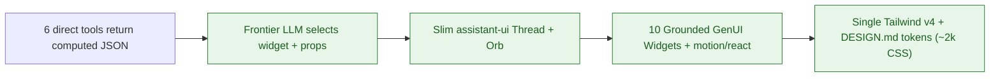

| Files & LOC | What changes / tradeoffs | Effort & Risk |
|---|---|---|
| `presentation.py` (1,327), `cards.py` (301), `web/src/chat/` (8,125), `web/src/components/` (7,885), `web/src/run/` (1,714), `EvidencePanel.tsx` (272), `Planner.tsx` (203), `Projection.tsx` (475), 10 CSS files (11,871) → **~32,173 LOC to ~10,000 LOC** | Deletes `present()` VM, `FlowView`, `web/src/run/` trace debugger, unused `media-player.tsx` / `file.tsx` / `quote.aui.tsx` / dead `.aui.tsx` files, 850 LOC of bypassed approval logic in `tool-fallback.aui.tsx`, and `@radix-ui/themes`. Unifies 6 projection renderers into one `AffordabilityLab` widget. | High effort · Low-Medium risk (needs frontend test rewrite) |

---

### 3. Bank statement VM, 10-phase batch categorizer, and Whisper bug

Parsing a monthly PDF statement routes uploads through chat-LLM subagent delegation, a 10-minute busy-polling password tool, a dual-Monty code-gen sandbox with full historical PDF regression replay, and a 2-agent + 10-phase Batch API categorizer—plus `capture/transcribe.py` throws away working Whisper transcripts whenever billing metadata is absent. Synchronous API decryption, direct multimodal frontier-LLM extraction guarded by `checks.py`, and one parallel structured-output categorization call deliver the same accounting safety in one-fifth the code.

See [`audit-import-delta.html`](../diagrams/audit-import-delta.html) for the before/after pipeline.

#### Current flow

```mermaid
flowchart LR
  classDef bloat fill:#fde8e4,stroke:#bf4520,color:#2d3142
  UP["Upload PDF + Chat Turn"] --> DEL["Chat LLM delegates to parser subagent"]:::bloat
  DEL --> PW["wait_for_password: 600s poll inside LLM tool"]:::bloat
  PW --> RDR["readers.py: 19 formats + pure-Py PNG encoder"]:::bloat
  RDR --> COD["parser.py: CodeMode + PostgresPlanStore"]:::bloat
  COD --> GATE["monty.py + gate.py: full historical PDF replay"]:::bloat
  GATE --> CHK["checks.py: paise balance + chain invariants"]
  CHK --> REC["reconcile.py (N+1 SQL) + balance_plan.py"]:::bloat
  REC --> CAT["categorizer.py: outer agent -> inner chunk agent + 10-phase Batch API"]:::bloat
```

#### Proposed simple flow

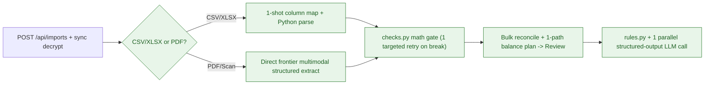

| Files & LOC | What changes / tradeoffs | Effort & Risk |
|---|---|---|
| `importers/` (8,156), `capture/` (374), `agent/parser.py` (1,375), `agent/categorizer.py` (711), `api/tasks.py` (439), `api/run_view.py` (341), `api/wake.py` (183), `Imports.tsx` (1,965) → **13,544 LOC to ~2,700 LOC** | Deletes dead `spike.py` (388), `synthetic.py` (277), `repair.py` (204), `layout_detect.py` (38), `monty.py`, `gate.py`, `layouts.py`, `passwords.py`, `batch_accounting.py`, `seed_rules.py`, `/tmp/arno-tasks/`, `run_view.py`, and `wake.py`. Fixes `transcribe.py` (355 → ~65 LOC) so missing `usage` never drops a transcript. Tradeoff: pays ~$0.01–$0.03 per monthly PDF instead of caching Monty parsers. | Medium effort · Low risk (`checks.py` + human review keep accuracy intact) |

---

### 4. Cost metering, SSE sniffing, and the custom Phoenix 21.0 fork

Arno runs an always-on forked Arize Phoenix 21.0 container rebuilt with a **2,076-LOC patchset**, a dedicated Postgres role/DB, a 5-minute `cost_replay` cron job, a wire-level SSE JSON sniffer, and a 2-phase DB intent journal—spending **~6,200 LOC** to track pennies of single-user LLM spend. Logging one usage row after each run (and capping daily spend with one query) eliminates an entire container and 95% of the billing code.

#### Current flow

```mermaid
flowchart LR
  classDef bloat fill:#fde8e4,stroke:#bf4520,color:#2d3142
  REQ["Every LLM step"] --> VAL["pricing.py: validate_pricing() synthetic probe"]:::bloat
  VAL --> SPD["spend.py: StrictSpendStore + custom pool"]:::bloat
  SPD --> INT["cost_journal.py: INSERT 'intent' row"]:::bloat
  INT --> SSE["provider_usage.py: wrap SSE stream, Decimal parse"]:::bloat
  SSE --> RET["_MeteredStream: 2nd retry loop (max_retries=0 SDK)"]:::bloat
  RET --> PRC["Observe cost TWICE (metering + SpendLimits)"]:::bloat
  PRC --> FIN["UPDATE llm_calls + UsageOnceExporter strip"]:::bloat
  FIN --> CRON["5-min cost_replay cron -> 2,076-LOC patched Phoenix"]:::bloat
```

#### Proposed simple flow

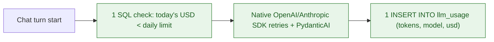

| Files & LOC | What changes / tradeoffs | Effort & Risk |
|---|---|---|
| `deploy/phoenix-cost/` (2,169), `metering.py` (584), `pricing.py` (521), `spend.py` (362), `cost_journal.py` (313), `provider_usage.py` (188), `models.py` (413), `chatgpt_auth.py` (190), `observability.py` (223), `jobs/costs.py` (12), `test_phoenix_cost_contract.py` (1,212) → **~6,187 LOC to ~200 LOC** | Removes the `phoenix` container, `phoenix` DB/role, 4 `.env` secrets, 4 OTel/Phoenix dependencies, `WindowLimited`, `batch_model()`, and `chatgpt_auth.py` (if API keys suffice). Tradeoff: view detailed provider spend in OpenAI/Anthropic dashboards; lose local Phoenix trace UI. | Low effort · Very low risk |

---

### 5. Fintech ledger (`pgledger`), reversal DAG, and hand-rolled pool

Logging `"₹500 Swiggy"` runs **~21 SQL round-trips**, generates 6–9 ULIDs in PL/pgSQL, touches 8–9 tables behind a deferred circular FK, and finishes with a **10-table join**—while fixing one typo inserts 3 movements and forces every query to execute a recursive reversal-parity CTE. Replacing `pgledger`, `audit.py`'s CDC/English-narrator engine, and `conn.py`'s `SELECT 1`-per-reuse pool with plain integer-paise entries and `asyncpg.create_pool` cuts ~7,800 LOC and drops 47 tables to ~15.

#### Current flow ("Log ₹500 Swiggy")

```mermaid
flowchart LR
  classDef bloat fill:#fde8e4,stroke:#bf4520,color:#2d3142
  IN["record_expense(₹500 Swiggy)"] --> POOL["conn.py: custom deque + SELECT 1 pre-ping"]:::bloat
  POOL --> AUD["audit.py: BEGIN + generate_id('und') + risk_check"]:::bloat
  AUD --> CAT["Load ALL category_rules into Python"]:::bloat
  CAT --> PGL["pgledger_create_transfers(): advisory lock + 2 balance updates + deferred FK"]:::bloat
  PGL --> LEGS["INSERT movements + movement_legs + captures"]
  LEGS --> SNAP["3x INSERT full-row JSONB snapshots to audit_log"]:::bloat
  SNAP --> ECHO["10-table join via v_accounts to echo result"]:::bloat
```

#### Proposed simple flow

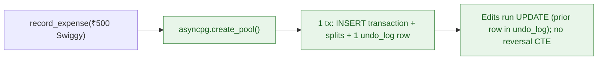

| Files & LOC | What changes / tradeoffs | Effort & Risk |
|---|---|---|
| `ledger/` (6,820), `db/` (3,754 incl. 44 migrations, `preflight/`, `vendor/pgledger/`, `conn.py`) → **10,574 LOC to ~2,800 LOC** | Drops `vendor/pgledger/` (587), `postings.py` (261), `movement_reversal_state` CTE, CDC/narrator `audit.py` (1,004 → ~180), `schedule_payments.py` (389 → ~120), `deletion.py` (338 → ~30), `workbook.py` (122 + `xlsxwriter`), `conn.py` (392 → ~45). Squashes 44 migrations into 1 schema (~15 tables, keep `agent_ro`). | High effort · Medium risk (requires migration/data rewrite + invariant test updates) |

---

### 6. Projection gold-plating and competition harnesses in `src/`

Over **40% of `src/arno/engine/` (5,150 LOC)** is offline backtest/HackerRank competition code—including Indonesian layoff regexes—shipped inside the runtime package, while the runtime engine itself carries rejected backtest switches, 16,384-scenario chunking, `criticals.py`, 4D Pareto powerset search, and a 1,279-LOC Bayesian/Viterbi detector. Keeping the pure integer-paise kernel (`S=2,048`) and Indian loan/EMI math while cutting benchmarks, dead switches, and DP machinery saves ~9,500 LOC.

#### Current flow

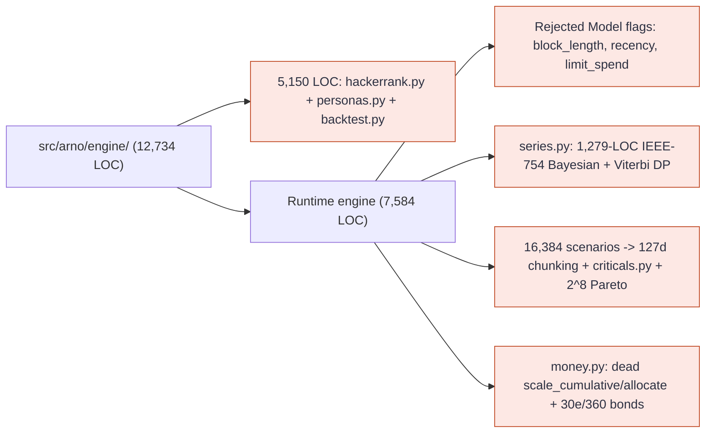

#### Proposed simple flow

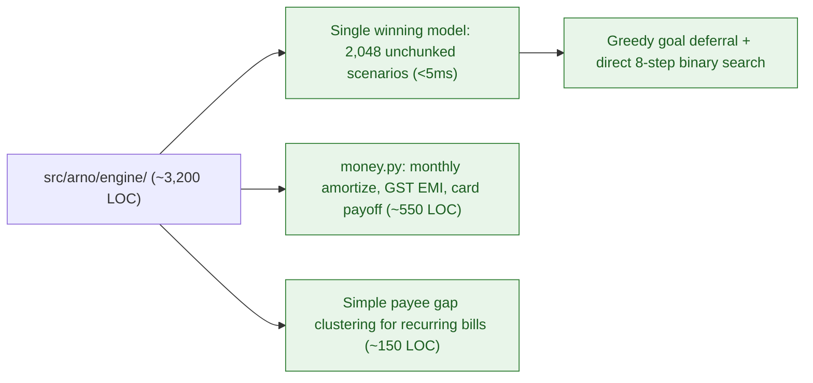

| Files & LOC | What changes / tradeoffs | Effort & Risk |
|---|---|---|
| `personas.py` (2,071), `hackerrank.py` (1,802), `backtest.py` (1,087), `scoring.py` (190), `criticals.py` (157), `series.py` (1,279), `projection.py` (1,734), `kernel.py` (929), `affordability.py` (999), `money.py` (1,381) → **12,734 LOC to ~3,200 LOC** | Deletes `hackerrank.py` and moves/drops `personas`/`backtest`. Lowers `DEFAULT_RUNS` from 16,384 to 2,048 (±1.3pp CI vs 5–20pp real spend variance), removes chunking and `criticals.py`. Replaces `series.py` DP with transparent gap clustering. Tradeoff: slightly wider Monte Carlo noise on P90 (well below real-world uncertainty). | Medium effort · Low risk (financial core stays 100% deterministic & tested) |

---

### 7. Tool and API translation tax

Every `POST /api/chat` parses the JSON request body **three times**, `app.py` manages three separate DB pools, `/api/recaps` triggers **~110 SQL queries** in an N+1 loop, and 18 exposed LLM tools duplicate SQL views, manual dict validators, and three separate `preferences` write paths. Collapsing to 6 tools + clean Postgres views and merging duplicate routes removes ~7,600 LOC across `tools/` and `api/`.

#### Current flow

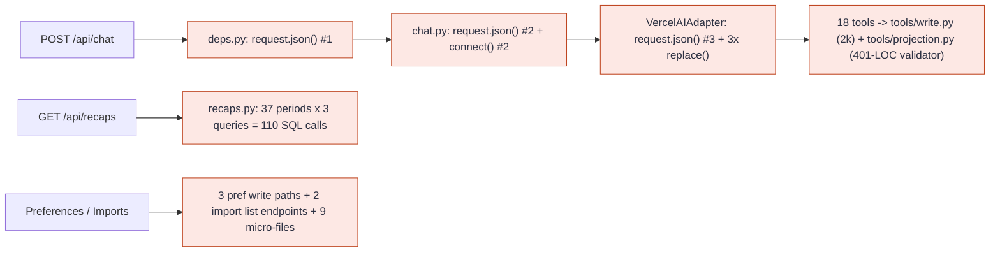

#### Proposed simple flow

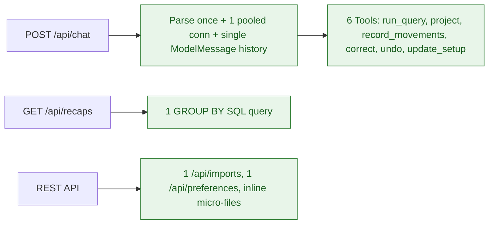

| Files & LOC | What changes / tradeoffs | Effort & Risk |
|---|---|---|
| `tools/` (6,238), `api/` (4,937) → **11,175 LOC to ~3,500 LOC** (plus `toolset.py`/`write_models.py` in Finding 1) | Merges `record_movement(s)`, replaces `query_movements` / `summarize_spending` / kitchen-sink `get_financial_context` with `run_query` + slim context, replaces 401-LOC validator in `tools/projection.py` with Pydantic models, fixes `recaps.py` N+1, merges `import_history.py` and duplicate preference/watch routes. | Medium effort · Low risk |

---

### 8. Custom job queue, rigid templates, and untested Web Push

Arno runs an RRULE-mirroring DB job scheduler, advisory-locked `FOR UPDATE SKIP LOCKED` polling, a per-write Monte Carlo trigger, a lobotomized `thinking=False` weekly briefing duplicating `scheduled_questions`, 149 LOC of recursive-CTE alert auto-resolution, and **untested** (`TODO(L6)`) VAPID Web Push dragging an MPL-2.0 dependency. Keeping `scheduled_questions` (even making Weekly Briefing one!) and a tiny `asyncio` timer + inbox cuts ~3,100 LOC while making proactive insights smarter.

#### Current flow

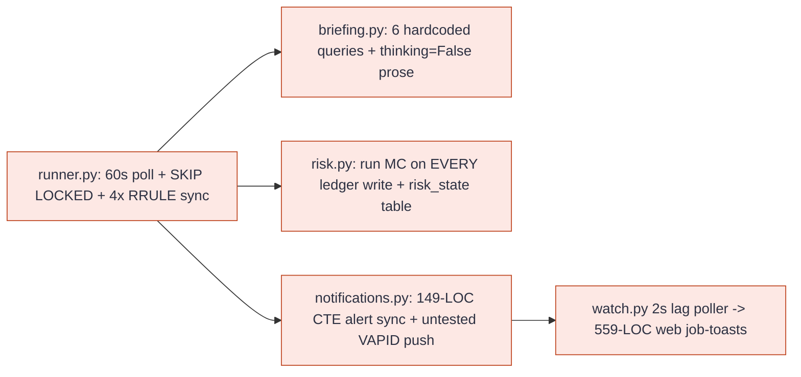

#### Proposed simple flow

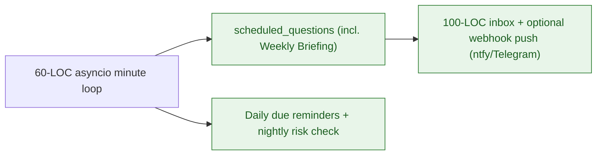

| Files & LOC | What changes / tradeoffs | Effort & Risk |
|---|---|---|
| `jobs/` (2,128), `notifications.py` (587), `scheduled_questions.py` (193), `api/watch.py` (325), `api/notification_query.py` (100), `web/src/jobs.ts` + `job-toasts.*` (559) → **~3,892 LOC to ~550 LOC** | Deletes `job_schedules`, `risk_state`, `push_subscriptions`, `vapid_keys`, `pywebpush`, `briefing.py` (converted to a default Scheduled Question), payment-alert CTE sync, and web toast polling. Tradeoff: browser push replaced by optional webhook URL (far more reliable on Tailscale/iOS). | Low-Medium effort · Low risk |

---

### 9. WebAuthn passkeys and step-up reverify on a Tailscale-only app

For a single user already authenticated to a private WireGuard tailnet (`127.0.0.1:8000` behind `tailscale serve`), Arno maintains 5 auth tables, 14 API endpoints, terminal QR enrollment, clone sign-count checks, and a 5-minute step-up `FreshSession` modal just to export your own CSV. Trusting `Tailscale-User-Login` (or one `.env` passphrase + HMAC `HttpOnly` cookie) eliminates ~1,900 LOC and five tables with minimal friction.

#### Current flow

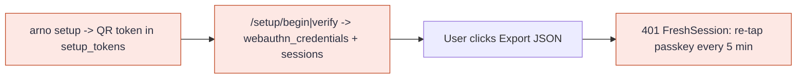

#### Proposed simple flow

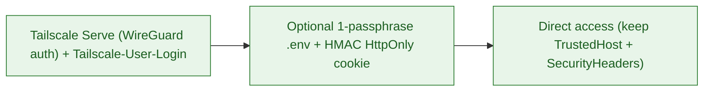

| Files & LOC | What changes / tradeoffs | Effort & Risk |
|---|---|---|
| `src/arno/auth/` (709), `api/auth.py` (403), `cli.py` passkeys (88), `web/src/auth.ts` + `Login.tsx` + `Setup.tsx` + `Passkeys.tsx` (682) → **~1,882 LOC to ~80 LOC** | Drops `webauthn`, `segno`, `cbor2`, 5 DB tables, 14 endpoints, and step-up reverify. Tradeoff: anyone using your unlocked Tailscale device has browser access unless the optional 1-passphrase cookie is enabled. | Low effort · Low risk (never exposes public ports or moves money) |

---

### 10. Monolithic read-only panels and 11-tab settings sprawl

Even though Arno's core UX is chat-first, `web/src/panels/` holds **13,333 LOC** of giant screens—`Settings.tsx` alone is 2,784 LOC (+ 1,243 LOC CSS) with 11 tabs, duplicated pagination helpers, GDPR-style provider disclaimers, and full CRUD managers for categories, rules, memories, and schedules. Slimming Settings to essentials and handling category/rule/memory edits via interactive chat GenUI cards removes ~5,000+ LOC.

#### Current flow

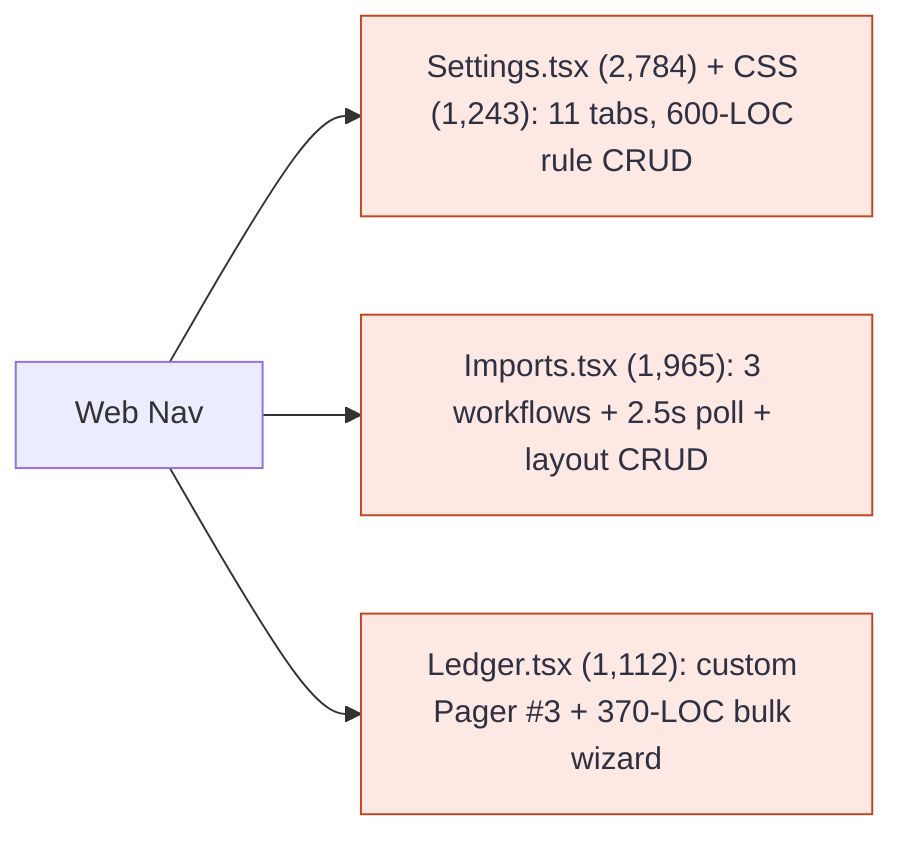

#### Proposed simple flow

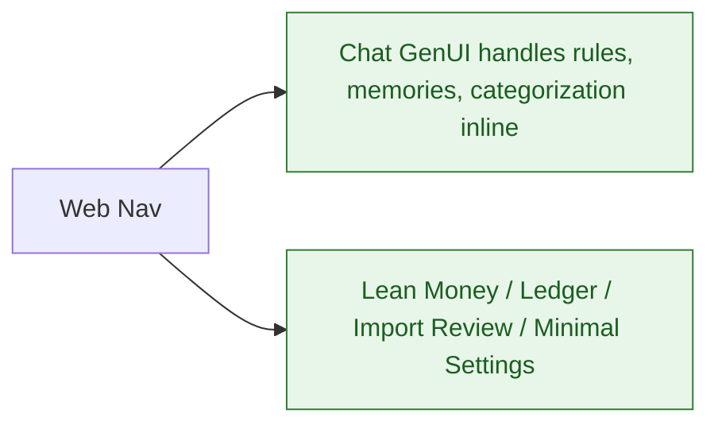

| Files & LOC | What changes / tradeoffs | Effort & Risk |
|---|---|---|
| `Settings.tsx` (2,784), `Settings.css` (1,243), `Imports.tsx` (1,965), `Ledger.tsx` (1,112), `DeletionScope.tsx` (94), `RuntimeInfo.tsx` (63), `PushStatus.tsx` (21), `History.tsx` (148) → **~7,430 LOC to ~2,000 LOC** | Splits `Imports` and `Ledger` cleanly, drops Settings tabs replaced by GenUI chat actions (`categories`, `rules`, `memory`, `passkeys`, `jobs`, `export/erase` ceremony), shares one table pager. | Medium effort · Low risk |

---

### 11. Backup FIFO sidecar, FFmpeg-from-source, and legal/ops ceremony

Running a single-user app pulls in a separate `backup` container with two named FIFOs (`mkfifo` + FD3/FD4) running `sleep 1` 3,600 times in a loop, a PL/pgSQL MD5-of-every-row hash manifest, 12 manually copied `.so` files in two Dockerfiles, a 196-LOC FFmpeg-from-source build for local STT, a 570-LOC bash migration script, and a 288-LOC SPDX license auditor. Piping `pg_dump | restic backup --stdin` from a daily task inside the `api` container keeps identical encrypted off-site durability in ~65 LOC.

#### Current flow

```mermaid
flowchart LR
  classDef bloat fill:#fde8e4,stroke:#bf4520,color:#2d3142
  BK["backup sidecar + 11 .so copies"] --> FIFO["backup.sh: mkfifo FD3/FD4 + pg_export_snapshot()"]:::bloat
  FIFO --> MD5["fin_agent_backup_manifest(): MD5 every row of 44 tables"]:::bloat
  MD5 --> SLP["3,600x sleep 1 loop + backup_runs table + backup role"]:::bloat
  OPS["Build/CI"] --> FFM["196-LOC compile FFmpeg + 288-LOC license_audit + 570-LOC demote-app.sh"]:::bloat
```

#### Proposed simple flow

```mermaid
flowchart LR
  classDef clean fill:#e8f5e9,stroke:#2e7d32,color:#1b5e20
  API["Existing api container (postgresql-client + restic)"] --> DUMP["25-LOC daily task: pg_dump -Fc | restic backup --stdin"]:::clean
  DUMP --> RST["40-LOC arno restore: restic dump | pg_restore"]:::clean
```

| Files & LOC | What changes / tradeoffs | Effort & Risk |
|---|---|---|
| `backup/` (241), `backup_restore.py` (494), `jobs/backup.py` (74), `deploy/demote-app.sh` (570), `deploy/whisper/` (269), `deploy/phoenix-db.sh` (27), `scripts/license_audit.py` (288), `compose.yaml` / `Dockerfile` / `release.yml` bloat → **~2,200 LOC to ~150 LOC** | Deletes `backup` container, `backup` PG role, `backup_runs`, `fin_agent_backup_manifest()`, `demote-app.sh`, `license_audit.py`, and source-built Whisper/FFmpeg. Keeps daily encrypted off-site `restic` backups and `pre_migration.py` (33 LOC). | Low effort · Low risk |

---

### 12. Goodharted evals and kitchen-sink CLI

Only **37.9% (55/145)** of `evals/cases.py` tests financial accuracy or writes—the rest tests `<outside>` injection regexes, regulatory advice refusals (sole reason `evals/judge.py` exists), or warps prompts (*"Reply with only the number of months"*) to avoid tripping `number_check.py`. Trimming `evals/` to ~50 core financial/write/honesty cases and `cli.py` to runtime commands removes ~4,400 LOC.

#### Current flow

```mermaid
flowchart LR
  classDef bloat fill:#fde8e4,stroke:#bf4520,color:#2d3142
  EV["evals/ (4,648 LOC)"] --> INJ["50 injection cases + 187-LOC regexes"]:::bloat
  EV --> JDG["11 advice cases -> judge.py LLMJudge"]:::bloat
  EV --> GH["Prompts warped for number_check + 400-LOC README table writer"]:::bloat
  CLI["cli.py (951 LOC)"] --> DEV["import-spike, repair-openings, cost-replay, chat, passkeys"]:::bloat
```

#### Proposed simple flow

```mermaid
flowchart LR
  classDef clean fill:#e8f5e9,stroke:#2e7d32,color:#1b5e20
  EV["evals/ (~1,100 LOC)"] --> CORE["~50 real finance + write + honesty cases via lifecycle.py"]:::clean
  CLI["cli.py (~200 LOC)"] --> OPS["migrate, serve, export, restore, demo seed"]:::clean
```

| Files & LOC | What changes / tradeoffs | Effort & Risk |
|---|---|---|
| `evals/` (4,648), `src/arno/cli.py` (951) → **5,599 LOC to ~1,300 LOC** | Deletes `injection_notes.py` (281), `judge.py` (158), README scorecard writer (~400), and dev/legacy subcommands from `cli.py`. Keeps `evals/lifecycle.py` template DB cloning and deterministic DB/engine assertions. | Low effort · Very low risk |

---

## Generative UI blueprint: awesome, flashy, and grounded

Industry GenUI spans three patterns: **Controlled** (tool-to-React component), **Declarative** (LLM emits a JSON UI spec over a curated catalog like Google A2UI), and **Open-Ended** (LLM streams sandboxed HTML/JS like Google Research Dynamic View). Arno fits **Hybrid Grounded GenUI**: the frontier model runs real SQL/engine tools first, then invokes a single `render_ui` layout tool (or tool-bound UI parts via `@assistant-ui/react` + `@assistant-ui/generative-ui` + `motion/react`) referencing computed data IDs—never inventing numbers, never stuck in static cards.

```mermaid
flowchart LR
  classDef soul fill:#eef3ff,stroke:#2b59ff,color:#1d2b5a
  classDef gen fill:#e8f5e9,stroke:#2e7d32,color:#1b5e20
  Q["User question / photo / voice"] --> ORB["Orb thinking state (Orb.tsx)"]:::soul
  ORB --> TOOLS["Frontier LLM calls 1-6 typed tools / agent_ro SQL"]:::gen
  TOOLS --> DATA["Server computes exact paise, scenarios & rows"]:::gen
  DATA --> SPEC["LLM emits declarative layout spec binding computed data"]:::gen
  SPEC --> WID["10 Animated GenUI Widgets (DESIGN.md + motion/react + Recharts)"]:::soul
  WID --> LIVE["User tweaks sliders / categories -> hits API or confirms write"]:::gen
```

Ten high-craft, composable widgets replace all 16 static cards, `FlowView`, `web/src/run/`, and 6 duplicate projection views:

| Widget | Replaces | Interactive capability ("living being" feel) |
|---|---|---|
| `MetricHero` | Static `SummaryBody` + `AskHome` cards | Mesh gradient card, animated count-up numbers, delta badge, provenance pill |
| `InteractiveChart` | Static `ChartCard` (`isAnimationActive={false}`) | Animated Recharts area/bar/donut/waterfall, hover crosshair, click bar to drill down |
| `AffordabilityLab` | All 6 duplicate projection/planner/evidence views | Live price/date/EMI/cut sliders calling `/api/projection` + radial gauge + P10–P90 fan |
| `BreakdownTable` | Unsortable 10-row `TableBody` + `Ledger` wizard | Search, sort, inline category bars, click row to inspect/recategorize/mark one-off |
| `ComparisonMatrix` | Static `amortize`, `card_payoff`, `compound` cards | Side-by-side loan/card/month comparison with winner highlight & tenure/prepay sliders |
| `GoalProgressRing` | Static goals panel fragments | Animated SVG rings with projection-backed landing dates and contribution quick-adjust |
| `TimelineStrip` | `Timeline.tsx` + upcoming reminders list | Past-30d spending + future bills/income curve with scrubbable day popover |
| `ActionConfirmCard` | `ApprovalCard` + static write/undo cards | Editable preview before confirm (tweak category/amount inline) or instant 1-tap undo |
| `StoryCard` | `Recaps.tsx` page-only stories | Swipeable wrapped-style insight cards usable directly inside chat turns |
| `ImportReviewWidget` | Monolithic `Imports.tsx` 2.5s poller + `run/` | Clean extraction progress + one-screen conflict/transfer/credit resolver |

---

## What to keep and protect

Simplifying ruthlessly does not mean making Arno bland—protect these high-craft foundations:

- **Visual soul (`DESIGN.md`, `Orb.tsx`, `Recaps.tsx`, `Timeline.tsx`, `Planner.tsx`):** Keep the near-black olive ground, Bricolage Grotesque + JetBrains Mono typography, Action Lime / Cobalt / Teal accents, iridescent `Orb`, swipeable Wrapped-style Recaps, and scrubbable Timeline.
- **Pure integer-paise core (`engine/projection.py`, `kernel.py`, `affordability.py`, `money.py`, `scenario.py`):** Keep all financial math in tested Python—never let an LLM approximate loan amortization, GST on card interest, or cashflow survival probabilities.
- **India domain craft (`src/arno/india/`):** Keep the 22 reducible categories, lakh/crore formatter, Indian bank holiday shifting, and RFC 5545 short-month clamping (`recurrence.py`).
- **Statement math gate (`importers/checks.py`, `identifiers.py`):** Keep exact `opening + credits - debits == closing`, running balance chain verification, and UTR-preserving PII scrubbing.
- **Read-only SQL boundary (`agent_ro`):** Keep the 2s-timeout, read-only Postgres role for `run_query`.
- **Reliable UX core:** Keep detached `ChatTurn` + `CancellationToken`, `recover_crashed_runs`, lazy `images.py` attachment hydration, and LLM-powered `scheduled_questions`.

---

## Phased simplification roadmap

Execute cuts in four waves so tests and real financial invariants stay green after every wave.

```mermaid
flowchart LR
  classDef w1 fill:#fde8e4,stroke:#bf4520,color:#2d3142
  classDef w2 fill:#fff8e1,stroke:#b28704,color:#2d3142
  classDef w3 fill:#eef3ff,stroke:#2b59ff,color:#1d2b5a
  classDef w4 fill:#e8f5e9,stroke:#2e7d32,color:#1b5e20
  W1["Wave 1: Delete dead weight (~23k LOC)"]:::w1 --> W2["Wave 2: Strip harness & subagents (~26k LOC)"]:::w2
  W2 --> W3["Wave 3: Grounded GenUI & CSS (~23k LOC)"]:::w3
  W3 --> W4["Wave 4: Plain SQL ledger & 2k engine (~10k LOC)"]:::w4
```

| Wave | Scope | Est. LOC cut | Verification gate |
|---|---|---:|---|
| **Wave 1: Safe deletions** | Delete `phoenix-cost/`, `cost_journal.py`, `observability.py` replay, `backup/` sidecar, `hackerrank.py`/`personas.py`/`backtest.py`, `spike.py`/`synthetic.py`/`repair.py`, `license_audit.py`, `demote-app.sh`, dead `web/` files, `evals/` theater | **~23,000** | `docker compose up` (2 containers), pytest + web build green |
| **Wave 2: Harness & imports** | Replace `pydantic-ai-harness` with plain PydanticAI, drop `CodeMode`/`number_check`/tainting/metering, replace Monty parser + Batch categorizer with direct LLM extraction, swap `jobs`/`auth` to lean equivalents, slim `tools/` (18 → 6) and `api/` | **~26,000** | Statement import gate tests, write/undo tests, API + minimal eval suite green |
| **Wave 3: Grounded GenUI** | Delete `presentation.py`, `cards.py`, `FlowView`, `web/src/run/`, 3 CSS systems, bloated `Settings`/`Imports`/`Ledger` panels; ship the 10 animated GenUI widgets | **~23,000** | `pnpm --dir web lint/typecheck/test:web/build` + visual Playwright walk |
| **Wave 4: Core data & engine** | Replace `pgledger` + reversal CTE + CDC `audit.py` + `conn.py` with plain 15-table schema + `asyncpg.create_pool`; simplify `engine/` (`S=2,048`, greedy deferral, gap-cluster bills) | **~10,000** | `tests.invariants` + projection accuracy sanity checks green |
