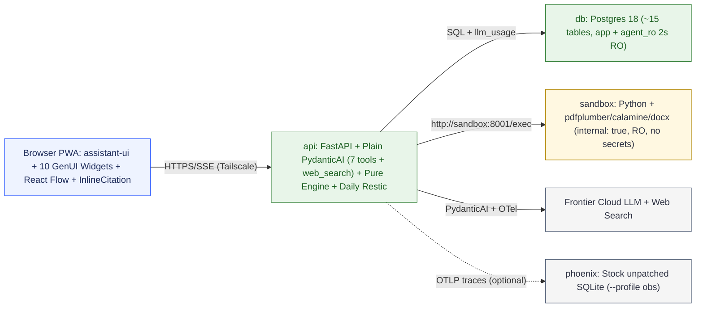

# Simplification and modernization plan

This document is the step-by-step execution plan to simplify Arno from **112,477 LOC** down to **~31,000 LOC** while replacing rigid static mechanics with Grounded Generative UI, an isolated Python document sandbox, web search with inline citations, and clean OpenTelemetry tracing. It builds on [`complexity-audit.md`](complexity-audit.md), [`plan.md`](../plan.md), and [`architecture.md`](../architecture.md).

---

## Locked-in target architecture

Every choice below reflects our agreed balance between simplicity, user delight, and safety for a single-user, Tailscale-only personal finance app backed by a frontier cloud LLM.

| Layer | Agreed target design | Replaces |
|---|---|---|
| **Deployment** | 2 always-on services (`db`, `api`) + 1 internal `sandbox` + optional `--profile obs` stock Phoenix (`SQLite`) | 6 services incl. `backup` sidecar, 2,076-LOC Phoenix fork, and FFmpeg Whisper build |
| **Cost & Observability** | ~60-LOC Postgres `llm_usage` table + daily USD cap (`result.usage()` / `response.cost()`); standard OTel (`FastAPI` + `asyncpg` + `PydanticAI`) → stock unpatched Phoenix (`--profile obs`) | `metering.py`, `pricing.py`, `spend.py`, `cost_journal.py`, `provider_usage.py`, `UsageOnceExporter`, 5-min `cost_replay` cron |
| **Agent Harness** | Plain `pydantic-ai` (`Agent`, `Tool`, `ModelFallback`, `ApprovalRequired`, `UsageLimits(request_limit=25)`) + detached `ChatTurn` + lazy `images.py` | `pydantic-ai-harness`, 21 capabilities, `CodeMode`, `number_check.py`, `OutsideTextTaint`, turn-0 snapshot, `wake.py` |
| **Document Sandbox** | Static `sandbox` service on an `internal: true` Compose network (`read_only: true`, `mem_limit: 512m`, zero secrets) running Python + `pdfplumber` + `python-calamine` + `python-docx` + `pypdfium2` | `agent/parser.py`, `monty.py`, `gate.py` historical replay, 19-format `readers.py`, `/tmp/arno-tasks/` |
| **Statement Import** | Sync decrypt in HTTP API; direct multimodal LLM for photos/short/scanned PDFs; `sandbox` Python exploration for Excel/CSV/long PDFs; preserved `checks.py` math gate; 1 parallel LLM categorizer call | 10-min `wait_for_password` poll, `statement_layouts`, `parser_versions`, 2-agent categorizer + 10-phase Batch API |
| **Tools & External** | **7 direct tools** (`run_query`, `project`, `record_movements`, `correct_movement`, `undo`, `update_setup`, `run_python`) + **`web_search`** emitting `source-url` citations | 18 overlapping tools, 401-LOC manual dict validator, 110-query `recaps.py` N+1 loop, zero external info |
| **Jobs & Auth** | ~60-LOC `asyncio` loop (`scheduled_questions` incl. Weekly Briefing, reminders, nightly risk, daily `pg_dump \| restic`); Tailscale identity + optional `.env` passphrase HMAC cookie | `job_schedules`, `risk_state`, `briefing.py`, untested VAPID Web Push, WebAuthn 5-table passkey auth |
| **Frontend & GenUI** | Keep `@assistant-ui/react` + `@assistant-ui/generative-ui` (gut 5.5k unused `.aui.tsx`) + `shadcn AI Elements` (`InlineCitation` + `Sources`) + 10 animated GenUI widgets + ~250-LOC `@xyflow/react` Flow View + single Tailwind v4 (`DESIGN.md`) | `presentation.py`, `cards.py`, 9-layer render pipeline, `web/src/run/`, old `FlowView`, 6 projection views, 4 CSS systems |
| **Ledger & Engine** | 2 plain double-entry integer-paise tables (`transactions` + `transaction_legs` summing to `0`) + `undo_log` + `asyncpg.create_pool()` + `agent_ro`; pure `engine/` (`S=2,048`, greedy deferral, gap-cluster bills) | Vendored `pgledger`, `postings.py`, reversal CTE, 1,004-LOC CDC `audit.py`, `conn.py` `SELECT 1` pool, 5.1k benchmarks, `criticals.py`, `series.py` DP |



---

## Execution rules and guardrails

1. **One phase at a time, committed cleanly to `main`.** Use Conventional Commits (`chore(...)`, `refactor(...)`, `feat(...)`) after each phase passes its verification gate.
2. **Never run parallel full `pytest` commands.** Use `-n 0` on targeted test files while iterating, then run one full `uv run pytest -q` at each phase gate.
3. **Verify every phase before moving on:**
   - Python: `uv run ruff check . && uv run ruff format --check . && uv run pyrefly check && uv run pytest -q`
   - Ledger/engine phases: also run `uv run arno demo seed && uv run python -m tests.invariants` on a `_test` database.
   - Frontend phase: `pnpm --dir web lint && pnpm --dir web typecheck && pnpm --dir web test:web && pnpm --dir web build`
4. **Update living docs in the same phase** that changes an architecture rule (`docs/arno/plan.md`, `architecture.md`, `specs/`).

---

## Phase 0 — Dead code, benchmarks, and ops purge

**Goal:** Strip ~23,000 LOC of unused code, shipped benchmarks, and container sidecar weight with zero behavior risk to live chat, ledger, or projection paths.

### Steps

1. **Delete observability fork, backup sidecar, and legacy ops scripts:**
   - `[DELETE]` `deploy/phoenix-cost/`, `deploy/phoenix-db.sh`, `deploy/demote-app.sh`, `deploy/whisper/`, `compose.gpu.yaml`
   - `[DELETE]` `backup/` (`backup/Dockerfile`, `backup/backup.sh`)
   - `[DELETE]` `scripts/license_audit.py`, `tests/test_license_allowlist.py`, `tests/test_phoenix_cost_contract.py`
2. **Evict competition & benchmark harnesses from runtime `src/`:**
   - `[DELETE]` `src/arno/engine/hackerrank.py`, `src/arno/engine/scoring.py`, `tests/test_engine_hackerrank.py`, `tests/test_engine_scoring.py`
   - `[DELETE]` (or move outside `src/` if keeping offline synthetic benchmarks) `src/arno/engine/personas.py`, `src/arno/engine/backtest.py`, `tests/test_engine_personas.py`, `tests/test_engine_backtest.py`, `tests/test_backtest_publication.py`
   - `[DELETE]` `src/arno/importers/spike.py`, `src/arno/importers/repair.py`, `src/arno/importers/layout_detect.py`, `tests/test_import_spike.py`
   - `[MOVE]` `src/arno/importers/synthetic.py` → `tests/fixtures/synthetic_statements.py` (update test/eval imports)
3. **Delete dead frontend files and unused `package.json` entries:**
   - `[DELETE]` `web/src/components/tool-group.aui.tsx`, `web/src/components/assistant-ui/elements/task-card.aui.tsx`, `web/src/components/assistant-ui/elements/task-card.tsx`, `web/src/hooks/use-copy-to-clipboard.ts`, `web/src/components/assistant-ui/utils/useIsomorphicLayoutEffect.ts`
   - `[MODIFY]` `web/package.json`: remove unused `@ai-sdk/react` (note: keep `@assistant-ui/generative-ui` for Phase 4).
4. **Clean `Dockerfile`, `compose.yaml`, `.github/workflows/ci.yml`, `.github/workflows/release.yml`:**
   - `[MODIFY]` `Dockerfile`: replace the 12 manual `.so` shared-library `COPY` lines with `apt-get install -y --no-install-recommends postgresql-client-18 restic` (via PGDG apt repo) or a clean single-binary copy.
   - `[MODIFY]` `compose.yaml`: remove `backup` service, `phoenix-db.sh` mount, and `backup-data`/`phoenix-data` Postgres coupling; replace the forked `phoenix` service with stock `arizephoenix/phoenix:21.0` under `profiles: ["obs"]` using local SQLite `/data`.
   - `[MODIFY]` `src/arno/backup_restore.py` + `src/arno/jobs/backup.py`: replace the 494-LOC manifest restore + sidecar status check with a ~25-LOC daily `pg_dump --format=custom | restic backup --stdin` task inside `api` and a ~40-LOC `arno restore` piping `restic dump | pg_restore`.
5. **Trim `evals/` defensive theater and `cli.py` dev bloat:**
   - `[DELETE]` `evals/injection_notes.py`, `evals/judge.py`; strip `injection`/`advice` bloat and the ~400-LOC README scorecard publisher from `evals/runner.py`, `evals/cases.py`, `evals/graders.py` (keep ~50 core finance, write, and honesty cases + `evals/lifecycle.py`).
   - `[MODIFY]` `src/arno/cli.py`: remove `import-spike`, `repair-openings`, `cost-replay`, `chatgpt-login`/`chatgpt-logout`, `chat`, and `eval`/`backtest`/`hackerrank` subcommands (~951 → ~220 LOC).

### Verification gate

```powershell
uv run ruff check . ; uv run ruff format --check . ; uv run pyrefly check
uv run pytest -q
pnpm --dir web lint ; pnpm --dir web typecheck ; pnpm --dir web test:web ; pnpm --dir web build
```

---

## Phase 1 — Observability split, cost log, and isolated Python `sandbox`

**Goal:** Decouple cost tracking (~60-LOC Postgres `llm_usage` table) from full-stack OTel observability (`FastAPI` + `asyncpg` + `PydanticAI`), fix `capture/transcribe.py`, and stand up the stateless `sandbox` container.

### Steps

1. **Create the static `sandbox` container (`sandbox/`):**
   - `[NEW]` `sandbox/Dockerfile`: `FROM python:3.14-slim`, non-root user (`uid 10002`), install `fastapi`, `uvicorn`, `pdfplumber`, `python-calamine`, `python-docx`, `pypdfium2`, `numpy`.
   - `[NEW]` `sandbox/server.py` (~45 LOC): exposes `POST /exec` accepting `{ "code": str, "files": { filename: base64_bytes }, "timeout_seconds": int = 30 }`. Writes files to an ephemeral `tempfile.TemporaryDirectory()`, runs `python3 -I script.py` with `cwd=tmpdir`, enforces timeout, cleans up `tmpdir`, and returns `{ "ok": bool, "stdout": str, "stderr": str, "result_json": Any | None }`.
   - `[MODIFY]` `compose.yaml`: add `sandbox` service (`read_only: true`, `tmpfs: ["/tmp:size=128m"]`, `mem_limit: "512m"`, `cpus: "1.0"`, zero environment secrets) attached ONLY to a `sandbox-net` with `internal: true`. Attach `api` to both default network and `sandbox-net`, passing `ARNO_SANDBOX_URL=http://sandbox:8001`.
2. **Replace enterprise metering/billing sprawl (~2,100 LOC) with `llm_usage` (~60 LOC):**
   - `[DELETE]` `src/arno/agent/metering.py`, `src/arno/agent/pricing.py`, `src/arno/agent/spend.py`, `src/arno/agent/cost_journal.py`, `src/arno/agent/provider_usage.py`, `src/arno/agent/chatgpt_auth.py`, `src/arno/jobs/costs.py`
   - `[NEW]` `src/arno/db/migrations/0045_llm_usage.sql`: creates `llm_usage(id BIGSERIAL PRIMARY KEY, created_at TIMESTAMPTZ DEFAULT now(), role TEXT NOT NULL, model TEXT NOT NULL, input_tokens INT NOT NULL, output_tokens INT NOT NULL, usd NUMERIC(10,6) NOT NULL)`.
   - `[NEW]` `src/arno/agent/usage.py` (~60 LOC): `check_daily_budget(conn, limit_usd)` (`SELECT coalesce(sum(usd), 0)`) and `record_usage(conn, role, model, result.usage(), cost)` using PydanticAI's native usage & `genai-prices`.
   - `[MODIFY]` `src/arno/agent/models.py` (~413 → ~90 LOC): standard PydanticAI model factory with native SDK retries (`max_retries=2`), `CHAT` + optional `CHAT_FALLBACK` + `VISION` + `STT`. Drop `WindowLimited`, `batch_model()`, and OpenCode session hooks.
3. **Wire full-backend OpenTelemetry (~20 LOC):**
   - `[MODIFY]` `src/arno/observability.py` (223 → ~35 LOC): delete `UsageOnceExporter`, `without_logical_usage`, `build_span`, and `export_replay`. When `OTEL_EXPORTER_OTLP_ENDPOINT` is set, enable `FastAPIInstrumentor.instrument_app(app)`, `AsyncPGInstrumentor().instrument()`, and `Agent.instrument_all()`.
   - `[MODIFY]` `pyproject.toml`: add `opentelemetry-instrumentation-fastapi`, `opentelemetry-instrumentation-asyncpg`; drop `arize-phoenix-otel` if plain OTLP HTTP exporter suffices.
4. **Fix `src/arno/capture/transcribe.py` (355 → ~65 LOC):**
   - `[MODIFY]` `src/arno/capture/transcribe.py`: keep `payee_names_prompt` and a clean `httpx.AsyncClient` multipart POST to `{STT_BASE_URL}/audio/transcriptions`. Remove `_preflight`, synthetic `ModelResponse`, and the bug that discards valid transcripts when `usage` is missing.

### Verification gate

```powershell
docker compose build sandbox api
docker compose --profile obs up -d db sandbox phoenix
# Verify sandbox has zero outbound internet and zero DB reachability:
docker compose exec sandbox python -c "import urllib.request; urllib.request.urlopen('https://example.com', timeout=2)" # must fail
uv run ruff check . ; uv run ruff format --check . ; uv run pyrefly check ; uv run pytest -q
```

---

## Phase 2 — Plain PydanticAI agent, 7 direct tools, and web search

**Goal:** Remove `pydantic-ai-harness`, `CodeMode`, `number_check.py`, dynamic tainting, `/tmp` task files, and ghost turns; expose 7 clean tools + `web_search` with a generous `UsageLimits(request_limit=25)`.

### Steps

1. **Remove `pydantic-ai-harness` and defensive babysitting:**
   - `[MODIFY]` `pyproject.toml`: remove `pydantic-ai-harness[code-mode]` (install `pydantic-ai` directly).
   - `[DELETE]` `src/arno/agent/number_check.py`, `src/arno/agent/redaction.py`, `src/arno/agent/quote.py`, `src/arno/agent/wake.py`, `src/arno/tools/mark.py`
   - `[DELETE]` `src/arno/api/tasks.py`, `src/arno/api/run_view.py`, `src/arno/api/wake.py` (removes `/tmp/arno-tasks/`, regex run-view scraping, and server ghost turns).
2. **Rebuild `agent/builder.py` & `agent/instructions.py` on plain PydanticAI (~250 LOC total):**
   - `[MODIFY]` `src/arno/agent/capabilities.py` (or merge into `builder.py`): delete all 21 harness capabilities (`CodeMode`, `TieredCompaction`, `SystemReminders`, `OutsideTextTaint`, `InputGuardrail`, `SubAgents`, `SpendLimits`, `CodeModeHints`, `ToolOutputLimits`). Keep a ~30-LOC PydanticAI `history_processor` that trims old tool payloads if token usage nears context limits, plus dynamic `@agent.instructions` injecting today's date + active categories.
   - `[MODIFY]` `src/arno/agent/instructions.py` (256 → ~90 LOC): clean positive domain prompt (INR/paise, Hinglish, never move money, no investment advice, cite web claims with `[n]`, **never put personal balances/account numbers/payees in `web_search` queries**).
   - `[MODIFY]` `src/arno/agent/builder.py`: plain `Agent(model, deps_type=AgentDeps, instructions=..., history_processors=[...])` with `UsageLimits(request_limit=25)` and `ModelFallback`.
3. **Collapse 18 tools → 7 direct tools + `web_search`:**
   - `[DELETE]` `src/arno/tools/money.py` (move pure math helpers into `sandbox` prelude / `engine/money.py`), `src/arno/agent/write_models.py` (merge shared Pydantic schemas with `tools/`).
   - `[MODIFY]` `src/arno/tools/` + `src/arno/agent/toolset.py`: expose **7 core tools + `web_search`**:
     1. `run_query(sql)` — read-only `agent_ro` (2s timeout, 1,000-row cap, zero tainting).
     2. `project(purchase_rupees, purchase_date, changes, ...)` — Monte Carlo engine with clean Pydantic inputs (replacing the 401-LOC manual dict validator in `tools/projection.py`).
     3. `record_movements(movements)` — unified typed list tool (single or batch) with instant undo ID.
     4. `correct_movement(...)` — (`requires_approval=True` when `scope != "this"` via native PydanticAI `ApprovalRequired`).
     5. `undo(group_id)` — instant 1-tap reversal.
     6. `update_setup(...)` — (`requires_approval=True` for destructive/account-wide changes; unify all 3 `preferences` mutation paths into one).
     7. `run_python(code, attachment_ids)` — executes Python inside the isolated `sandbox` service (`http://sandbox:8001/exec`) for ad-hoc modeling, amortization, or inspecting uploaded files.
     8. `web_search(query)` — PydanticAI built-in `WebSearchTool` or ~30-LOC Tavily/Brave search returning `[{ id, title, url, snippet, published_at }]` and emitting Vercel AI SDK `source-url` stream parts for inline `[n]` citations.
   - `[MODIFY]` `src/arno/tools/read.py` & `src/arno/tools/recaps.py`: delete `query_movements`, `summarize_spending`, and kitchen-sink `get_financial_context` (keep a slim ~50-LOC overview query if needed); replace `recaps.py`'s 110-query N+1 loop with 1 SQL `GROUP BY` query.
4. **Simplify `turns.py`, `history.py`, and `api/chat.py`:**
   - `[MODIFY]` `src/arno/agent/turns.py` + `history.py` (1,454 → ~450 LOC): delete pinned turn-0 snapshot, `approval_sentence` prose synthesizer, `_unread_statements`, SSE finish-chunk string surgery, and 6 redundant merge/patch helpers. Keep detached `ChatTurn`, `CancellationToken`, `drain()`, `recover_crashed_runs()`, and `images.py` lazy attachment hydration. Store `ModelMessage` history cleanly as the single source of truth.
   - `[MODIFY]` `src/arno/api/chat.py` (808 → ~320 LOC): parse request JSON **once**, reuse single DB connection from `app.state.pool`, delete `_merge_saved_state` and duplicate attachment helpers.
   - `[MODIFY]` `src/arno/api/`: merge `import_history.py` into `imports.py`, inline 1-caller micro-files (`provenance.py`, `runtime_info.py`), drop legacy watch/password-405 alias routes, replace `BaseHTTPMiddleware` with pure ASGI headers.

### Verification gate

```powershell
uv run ruff check . ; uv run ruff format --check . ; uv run pyrefly check ; uv run pytest -q
```

---

## Phase 3 — Streamlined statement import, jobs, and Tailscale auth

**Goal:** Eliminate the Monty parser subagent, Batch API categorizer, custom RRULE job queue, VAPID push, and WebAuthn passkeys (~12,000 LOC cut).

### Steps

1. **Sync decrypt & direct 3-path statement extraction:**
   - `[DELETE]` `src/arno/agent/parser.py`, `src/arno/importers/monty.py`, `src/arno/importers/gate.py`, `src/arno/importers/layouts.py`, `src/arno/importers/layout.py`, `src/arno/importers/helpers.py`, `src/arno/importers/passwords.py`, `src/arno/importers/task_status.py`
   - `[MODIFY]` `src/arno/api/imports.py` + `src/arno/importers/pipeline.py`:
     - On upload or `POST /api/imports/{id}/password`, decrypt PDF (`pypdfium2` + `FPDF_REMOVE_SECURITY`) / OOXML (`msoffcrypto`) **synchronously in ~50ms**, store unlocked bytes in `attachments`, discard password from RAM immediately, and enqueue extraction in an `asyncio.Task` backed by `imports.status` in Postgres.
     - **Path A (Photos / ≤5-page PDF / Scanned PDF):** Direct multimodal frontier LLM returning `ExtractedStatement` JSON.
     - **Path B (Excel / CSV / >5-page Digital PDF):** Plain PydanticAI extraction run (up to 25 steps) using `sandbox` (`pdfplumber` / `python-calamine` / `python-docx`) so the model freely inspects headers regardless of row offset and parses 1,000+ rows deterministically in milliseconds. Optionally store working script on `accounts.parser_script` to replay automatically next month until `checks.py` fails.
     - **Gate (KEPT):** Every extracted result passes through `importers/checks.py` (`opening + credits - debits == closing`, running balance chain, date bounds) and `importers/identifiers.py` (UTR-preserving PII scrub), with targeted retry on chain break.
   - `[MODIFY]` `src/arno/importers/reconcile.py`, `balance_plan.py`, `commit.py`: replace N+1 loops in `reconcile.py` with 2 bulk preload queries; unify `balance_plan` preview and commit into one function using `import_id` FK instead of description `LIKE` hunting.
2. **1-call parallel categorizer:**
   - `[DELETE]` `src/arno/agent/categorizer.py`, `src/arno/importers/batch_accounting.py`, `src/arno/importers/seed_rules.py`
   - `[MODIFY]` `src/arno/importers/categorize.py` + `rules.py` (~220 LOC total): apply `user > llm` rules + 60-day refund match first, then categorize remaining payees in parallel chunks of 30–40 via 1 structured-output LLM call (`confidence: Literal["high", "low"]`).
3. **Lightweight scheduler & notifications:**
   - `[DELETE]` `src/arno/jobs/runner.py`, `src/arno/jobs/schedules.py`, `src/arno/jobs/briefing.py`, `src/arno/jobs/recaps.py`, `src/arno/api/notification_query.py`
   - `[MODIFY]` `src/arno/jobs/` + `src/arno/notifications.py` (~300 LOC total): replace `job_schedules` + `SKIP LOCKED` + `risk_state` + per-write risk hook with a ~60-LOC `asyncio` minute loop running `scheduled_questions` (seed Weekly Briefing as a built-in default question!), daily due reminders (`reminders.py`), nightly risk check, and daily `restic` backup. Replace untested VAPID Web Push (`pywebpush`) and 149-LOC payment-alert CTE sync with clean inbox CRUD + `seed_chat_text()` + optional 15-LOC webhook URL (`ntfy`/`Telegram`).
4. **Tailscale / passphrase auth (~80 LOC):**
   - `[DELETE]` `src/arno/auth/passkeys.py`, `src/arno/auth/setup.py`, `src/arno/auth/enrollment.py`, `src/arno/api/auth.py` (replace with ~50-LOC `auth.py`), `web/src/panels/Passkeys.tsx`, `web/src/Setup.tsx`, `web/src/Login.tsx` (or keep ultra-lean passphrase login).
   - `[MODIFY]` `src/arno/api/deps.py`: trust `Tailscale-User-Login` header matching `ARNO_OWNER_EMAIL` (with optional `.env` passphrase → signed `HttpOnly; SameSite=Strict` HMAC cookie). Keep `TrustedHostMiddleware` + `SecurityHeadersMiddleware`. Remove `webauthn`, `segno`, `cbor2`, `pywebpush` from `pyproject.toml`.

### Verification gate

```powershell
uv run ruff check . ; uv run ruff format --check . ; uv run pyrefly check ; uv run pytest -q
```

---

## Phase 4 — Grounded GenUI, `InlineCitation`, React Flow, and CSS unification

**Goal:** Delete ~25,000 LOC of rigid presentation VM, duplicated views, dead `.aui.tsx` templates, and competing CSS systems while making Arno feel alive via 10 animated GenUI widgets, `shadcn AI Elements` inline citations, and an `@xyflow/react` Flow View.

### Steps

1. **Delete rigid presentation VM and dead/duplicate views:**
   - `[DELETE]` `src/arno/agent/presentation.py` (1,327), `src/arno/agent/cards.py` (301)
   - `[DELETE]` `web/src/chat/answer-data.ts`, `answer-ui.tsx`, `supporting-data.ts`, `cards.tsx`, `flow-steps.ts`, `flow.css`, `delegate-task-card.tsx`, `web/scripts/answer-contract.test.mjs`
   - `[DELETE]` `web/src/run/` (1,714 LOC), `web/src/EvidencePanel.tsx`, `web/src/panels/Planner.tsx`, `web/src/components/media-player.tsx`, `file.tsx`, `assistant-ui/elements/quote.aui.tsx`, `web/src/components/job-toasts.tsx`, `job-toasts.css`, `web/src/jobs.ts`
   - `[MODIFY]` `web/src/components/tool-fallback.aui.tsx` (1,330 → ~120 LOC live tool-status pill + `ApprovalCard`), `thread.aui.tsx` (1,076 → ~320 LOC stripping dead voice-call/branch/edit UI), `image.tsx` (639 → ~40 LOC thumbnail + zoom dialog).
2. **Keep `assistant-ui` runtime + add `shadcn AI Elements` `InlineCitation` & `Sources`:**
   - `[MODIFY]` `web/src/chat/Chat.tsx` (1,232 → ~350 LOC) + `runtime.ts` (535 → ~220 LOC): clean `@assistant-ui/react` + `@assistant-ui/generative-ui` setup reading native `message.parts` directly (zero `window` event bus, zero 4-layer Zod deduplication).
   - `[NEW]` `web/src/components/ai-elements/inline-citation.tsx` & `sources.tsx`: install/copy `shadcn` `hover-card` + `InlineCitation` + `Sources` primitives styled in `DESIGN.md` tokens. Wire `InlineCitation` to render BOTH `source-url` web citations (`[1]` → title, snippet, link) AND local ledger citations (`[Swiggy · ₹500]` → exact movement preview).
3. **Build the 10 Grounded GenUI widgets (`web/src/chat/widgets/`):**
   - Register via `@assistant-ui/generative-ui` / tool-bound UI parts over `DESIGN.md` tokens (`#0e0f0c`, Action Lime `#d4ff3a`, Cobalt `#2b59ff`, Teal `#1ec8a5`, Bricolage Grotesque, `motion/react`, animated Recharts):
     1. `MetricHero` (mesh gradient, count-up animation, delta badge, citation pill)
     2. `InteractiveChart` (animated area/bar/donut/waterfall, crosshair, click bar to drill down)
     3. `AffordabilityLab` (single unified component replacing all 6 old projection views: live price/date/EMI/cut sliders hitting `/api/projection` + radial gauge + P10–P90 fan)
     4. `BreakdownTable` (sort, filter, inline category bars, click row to inspect/recategorize/mark one-off)
     5. `ComparisonMatrix` (loan/card-payoff/month comparison with tenure & prepay sliders)
     6. `GoalProgressRing` (animated SVG rings + projected landing dates)
     7. `TimelineStrip` (preserve `Timeline.tsx` past-30d + future fan + scrubbable day popover)
     8. `ActionConfirmCard` (editable category/amount before confirming bulk/setup write, or 1-tap undo)
     9. `StoryCard` (reuses `Recaps.tsx` wrapped-story cards directly inside chat)
     10. `ImportReviewWidget` (clean upload/decrypt/math-gate status + conflict/transfer resolver)
4. **Rebuild Flow View with `@xyflow/react` (~250 LOC):**
   - `[MODIFY]` `web/package.json`: install `@xyflow/react` (MIT).
   - `[MODIFY]` `web/src/chat/FlowView.tsx` (1,101 → ~250 LOC): render a live, zoomable/pannable node graph directly from `message.parts` (Prompt → SQL/Search/Sandbox Tool Nodes → Engine → GenUI Output) with animated lime/cobalt edges (`Orb` at the root).
5. **Unify CSS onto Tailwind v4 + slim panels:**
   - `[MODIFY]` `web/package.json`: remove `@radix-ui/themes`, duplicate `@radix-ui/react-*` packages (keep monolithic `radix-ui`), `@simplewebauthn/browser`, `qrcode.react`.
   - `[DELETE]` redundant legacy rules across `styles.css` (3,704), `shell.css` (1,978), `Settings.css` (1,243), `Activity.css` (1,122), `MoneyViews.css` (1,058) → consolidate onto **Tailwind v4 + `DESIGN.md` CSS variables** (~2,000 LOC CSS total).
   - `[MODIFY]` `Settings.tsx` (2,784 → ~400), `Imports.tsx` (1,965 → ~450), `Ledger.tsx` (1,112 → ~400): remove duplicated pagers, projection body duplication in `Projection.tsx`, and CRUD tabs moved into inline GenUI actions.

### Verification gate

```powershell
pnpm --dir web lint ; pnpm --dir web typecheck ; pnpm --dir web test:web ; pnpm --dir web build
```

---

## Phase 5 — Plain double-entry ledger, `asyncpg` pool, and lean engine

**Goal:** Eliminate `pgledger`, the reversal-parity CTE, CDC `audit.py`, and the `conn.py` `SELECT 1` pool while keeping 100% double-entry integer-paise invariants, and trim the pure engine to its fast core (~17,000 LOC cut).

### Steps

1. **Replace `db/conn.py` & squash schema to ~15 clean tables (`agent_ro` kept):**
   - `[MODIFY]` `src/arno/db/conn.py` (392 → ~45 LOC): standard `asyncpg.create_pool(dsn, min_size=1, max_size=20)`.
   - `[DELETE]` `src/arno/db/vendor/pgledger/`, `src/arno/db/preflight/`, `src/arno/ledger/postings.py`, `src/arno/ledger/workbook.py`, `src/arno/ledger/preference_edits.py`
   - `[MODIFY]` `src/arno/db/migrations/`: squash the 44 historical migrations into a clean baseline schema (~15 tables: `accounts`, `transactions`, `transaction_legs` with `CHECK (sum = 0)` / balanced trigger or tx invariant, `undo_log`, `schedules`, `schedule_links`, `goals`, `categories`, `category_rules`, `imports`, `statement_lines`, `attachments`, `conversations`, `messages`, `preferences`, `notifications`, `scheduled_questions`, `llm_usage`), preserving the `agent_ro` role (2s timeout, read-only views `v_accounts`, `v_balances`, `v_spending`, `v_owed`).
   - `[MODIFY]` `src/arno/ledger/movements.py` (1,584 → ~450 LOC) + `audit.py` (1,004 → ~180 LOC) + `schedule_payments.py` (389 → ~120 LOC) + `deletion.py` (338 → ~30 LOC): plain double-entry writes (~3 SQL queries per ₹500 expense), `UPDATE` edits with prior state stored in `undo_log(id, created_at, summary, snapshot JSONB, undone_at)` (summary formatted once at write time), drop `xlsxwriter` from `pyproject.toml`.
2. **Simplify `src/arno/engine/` (7,584 → ~3,200 LOC):**
   - `[DELETE]` `src/arno/engine/criticals.py`
   - `[MODIFY]` `src/arno/engine/projection.py` + `kernel.py` + `affordability.py`: delete rejected `Model` flags (`block_length`, `recency`, `limit_spend`, `pool_resampling`), set `DEFAULT_RUNS = 2_048` in one unchunked array (<5ms), replace `criticals.py` + 256-subset Pareto search with greedy goal deferral (reverse priority) + direct 8-step binary search over `project()`.
   - `[MODIFY]` `src/arno/engine/series.py` (1,279 → ~150 LOC): replace Forward/Viterbi DP + IEEE-754 rescaling + `SeriesSpec` kernel injection with transparent per-payee gap clustering (`≥3` tx, cadence `7/14/28/30/90/365d ±3d`).
   - `[MODIFY]` `src/arno/engine/money.py` (1,381 → ~550 LOC): delete dead `scale_cumulative()`, `allocate()`, and `30e/360` daily-rest machinery; keep exact `Decimal` paise `amortize`, `card_emi` (18% GST), `card_payoff`, `compare_offers`, `compound`.
3. **Update living docs:**
   - `[MODIFY]` `docs/arno/plan.md`, `docs/arno/architecture.md`, and `docs/arno/specs/` to document the final simplified stack, 7+1 tools, `sandbox`, OTel/usage split, and Grounded GenUI.

### Verification gate

```powershell
uv run ruff check . ; uv run ruff format --check . ; uv run pyrefly check
uv run pytest -q
uv run arno demo seed ; uv run python -m tests.invariants
pnpm --dir web lint ; pnpm --dir web typecheck ; pnpm --dir web test:web ; pnpm --dir web build
```

---

## Dependency diff summary

| File | Removed | Added |
|---|---|---|
| [`pyproject.toml`](../../../pyproject.toml) | `pydantic-ai-harness`, `arize-phoenix-otel`, `webauthn`, `segno`, `cbor2`, `pywebpush`, `xlsxwriter` | `pydantic-ai`, `opentelemetry-instrumentation-fastapi`, `opentelemetry-instrumentation-asyncpg` |
| [`web/package.json`](../../../web/package.json) | `@ai-sdk/react`, `@radix-ui/themes`, `@radix-ui/react-{dialog,popover,tabs}`, `@simplewebauthn/browser`, `qrcode.react` | `@xyflow/react` (+ `shadcn` `hover-card` copy-paste component) |
