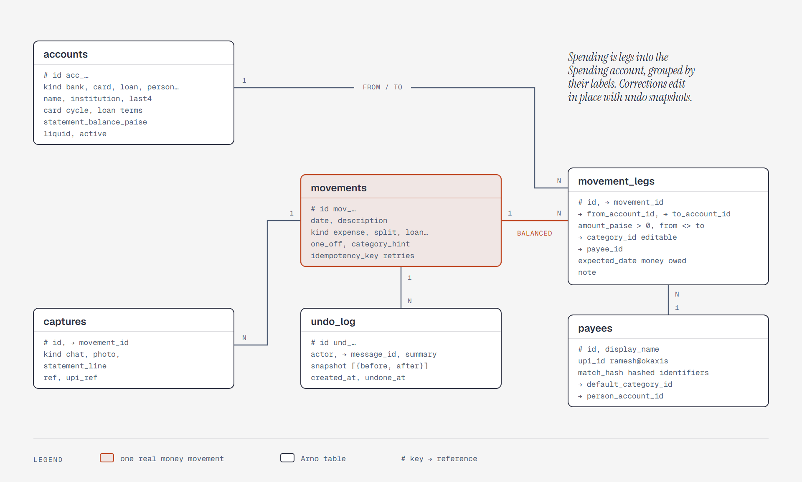
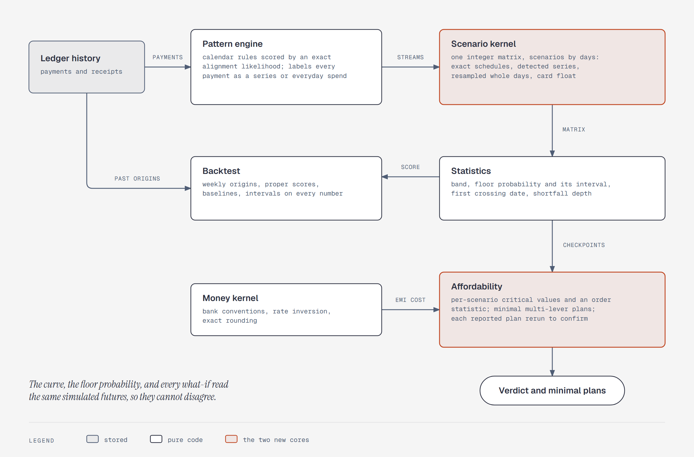

# Data model and numerical engine

This specification defines Arno's PostgreSQL schema, trust boundaries and write tiers, projection
and affordability engine, pattern detector, money calculators, recaps, and financial
invariants; for exact tool contracts see [tools.md](tools.md), and for platform architecture and
deployment see [platform.md](platform.md).

---

## Data model

Arno stores all state in one PostgreSQL 18 database. The double-entry ledger is two plain tables,
`movements` and `movement_legs`, with the books balancing by constraint.

### Conventions

The schema enforces the following data conventions across every table and view:

- Money is stored as integer paise: `BIGINT` in every table and `int` at the Python boundary, never
  `float`.
- Every movement balances: money leaves one account and arrives at another. Leg amounts are always
  positive; direction comes from the `from` and `to` accounts.
- Corrections update a movement in place and deletes remove its rows. The movement ID never changes,
  and the undo log holds the prior state ([Undo log](#undo-log)).
- Primary keys are prefixed text IDs (`mov_...`, `trf_...`) generated by the SQL function
  `new_id(prefix)`: the prefix plus a time-sortable UUIDv7 in hex.
- Business dates use `date` and timestamps use `timestamptz`. `movements.date` is authoritative.
- Enumeration columns use `text` with `CHECK` constraints rather than PostgreSQL enums so schema
  evolution stays straightforward.
- Every row the agent can write carries `created_at`, and every write records before-and-after
  snapshots in `undo_log`.
- Unknown values are `NULL`, never `0`.

### Database roles

PostgreSQL enforces read, write, and backup boundaries through four distinct roles.
The following table lists each role and its permissions:

| Role | Permissions and boundary |
|---|---|
| `postgres` | Local-socket bootstrap superuser with a `NULL` password and no network access |
| `app` | Database owner (`LOGIN CREATEDB CREATEROLE`, `pg_signal_backend`, and `ADMIN OPTION` on `agent_ro` and `backup`, without `SUPERUSER`); runs migrations and all API reads and writes |
| `agent_ro` | Read-only role used by `run_query`. Holds `SELECT` only on the 5 agent read views (`v_accounts`, `v_balances`, `v_legs`, `v_owed`, `v_spending`) and 18 domain tables (`baselines`, `captures`, `categories`, `category_rules`, `conversations`, `goals`, `imports`, `messages`, `movements`, `payees`, `preferences`, `schedule_occurrences`, `schedule_payments`, `scheduled_questions`, `schedules`, `series_detections`, `settings`, `statement_lines`). Has no access to authentication, credential, undo, attachment, or raw `accounts` and `movement_legs` objects; `TEMP` is revoked. `default_transaction_read_only = on` and `statement_timeout = '2s'` add defense in depth |
| `backup` | Read-only dumper with `SELECT` on all tables and sequences in `public`, and `INSERT` on `backup_runs` |

### Ledger tables and views



_Figure: One movement owns one or more balanced legs, each carrying its editable category and payee,
and `captures` links the evidence ([diagram note](../diagrams/sd-ledger-model.md))._

Every movement transfers money from one account to another, and spending follows one rule with no
exceptions: money moving into the `spending` account. The following table shows how common
real-world transactions map to double-entry legs:

| Event | Legs |
|---|---|
| Swiggy ₹3,000 on the Slice card | Slice → Spending ₹3,000, labeled Food |
| Paying the Slice bill from SBI | SBI → Slice ₹3,000 |
| ₹1,200 dinner; Ravi and Amit owe ₹400 each | SBI → Spending ₹400, SBI → Ravi ₹400, SBI → Amit ₹400 |
| Ravi repays ₹400 | Ravi → SBI ₹400 |
| ₹5,000 mutual fund SIP | SBI → Mutual funds ₹5,000 |
| ₹25,000 loan EMI | SBI → Loan ₹18,000, SBI → Spending ₹7,000, labeled Interest |
| Refund of a ₹600 order | Spending → Slice ₹600, labeled Food |

**`accounts`:** Every place money sits has one row. An account has no stored balance: its balance is
the sum of the legs into it minus the sum of the legs out of it. The following table describes its
fields:

| Field | Purpose |
|---|---|
| `kind` | One of `bank`, `card`, `cash`, `wallet`, `loan`, `asset`, `goal`, `person`, `spending`, `income`, or `equity` |
| `name`, `institution`, `last4` | Display name, institution name, and last four digits only. `name` is `NULL` if and only if `kind` is `person` or `goal`, because `payees.display_name` and `goals.name` own those names; readers use `v_accounts` for resolved names |
| `statement_balance_paise`, `statement_balance_as_of` | Last balance stated by a statement or the owner, used to anchor known balances and report staleness |
| `liquid` | Counts toward spendable cash in the projection (`true` for `bank`, `cash`, and `wallet`) |
| Card fields: `credit_limit_paise`, `statement_day`, `due_day`, `emi_rate_bps`, `emi_fee_paise`, `finance_rate_bps`, `min_due_bps`, `min_due_floor_paise` | Card spend accrues as a liability until its bill due date. EMI cost falls back from the offer terms to `emi_rate_bps` and `emi_fee_paise` to a labeled 16% annual rate with zero fee. Revolving finance terms (`finance_rate_bps`, `min_due_bps`, `min_due_floor_paise`) remain `NULL` when unknown |
| Loan fields: `rate_bps`, `tenure_months`, `emi_schedule_id` | Ledger balance holds outstanding principal (negative). `loan_payment_parts` splits logged EMIs into principal and interest, and loan statements adjust drift |
| Asset accounts | Carry no extra columns; balances update through adjustment movements. Statement-driven investment holdings stay out of scope ([parked.md](../planning/parked.md)) |
| `active` | Soft-delete flag preserving ledger history |

Exactly one `spending`, one `income`, and one `equity` account exist. `goals.account_id` references
a `goal` account, and `payees.person_account_id` references a `person` account. `equity` holds
opening balances and balance adjustments so statement closing discrepancies remain visible without
counting as spending. Committing a statement books its printed opening balance on the statement's
first day and supersedes older balance adjustments inside the period so dated balances inside that
period reflect real bank balances ([import.md](import.md)).

**`movements`:** One row per real-world money movement, written in one transaction with its legs.
The following table lists its fields:

| Field | Purpose |
|---|---|
| `date` | Authoritative business date (`Asia/Kolkata`), editable during reconciliation |
| `description`, `kind` | Human description and UI kind (`expense`, `income`, `transfer`, `split`, `loan`, `refund`, `settlement`, `adjustment`) |
| `idempotency_key` | Unique. Message ID plus tool call ID so retries return the existing movement |
| `category_rule_id`, `category_hint` | Rule that assigned the category, or the categorizer's unapplied guess and reason for uncategorized rows |
| `one_off` | Editable boolean marking a non-recurring expense (such as a hospital bill or appliance) so the projection and pattern detector exclude it from spend history |
| `import_id` | The import a balance adjustment belongs to |

Every movement is effective. A correction edits the movement and its legs in place, and a delete
removes them; neither leaves a second row to net out.

**`movement_legs`:** One row per balanced posting. Each leg moves `amount_paise` (`CHECK > 0`) out
of `from_account_id` and into `to_account_id` (`CHECK from <> to`), so every leg, and therefore
every movement and the whole ledger, sums to zero by construction. Each leg also holds editable
metadata: `category_id`, `payee_id`, `expected_date` (when a person is expected to settle), and
`note`. Legs delete with their movement. Rows that reference a movement (`captures`,
`schedule_payments`, and `statement_lines`) block its delete, so the delete code removes them first
and records each for undo.

**`captures`:** Links evidence (`movement_id`, `kind` in `chat`, `voice`, `photo`, or
`statement_line`, `ref`, `upi_ref`, and `confidence`) to a movement. Multiple captures can point to
the same movement; `upi_ref` is the strongest reconciliation key.

**`statement_lines`:** One row per parsed statement transaction: `import_id`, `date`,
`description_raw`, `amount_paise`, `debit_paise`, `credit_paise`, `upi_ref`, `content_hash`
(deduplication key across reimports), `match_state`, `movement_id`, `outside_text`, and
`match_detail`. See [import.md](import.md).

**Read-model views:** Five views provide a shared semantic layer across tools and `run_query` (raw
`accounts` and `movement_legs` are hidden from `agent_ro`, so it sees one `acc_*` ID space and
integer paise). The following table describes each view:

| View | Contents |
|---|---|
| `v_legs` | One row per leg: `acc_*` account IDs, resolved names, kinds, liquidity flags, positive `bigint` paise (`from` → `to`), and labels |
| `v_accounts` | Every account with its resolved display `name` (`payees.display_name` for `person`, `<goal> goal` for `goal`, otherwise `accounts.name`), card and loan terms, and current `balance_paise` |
| `v_spending` | Signed legs into (`+`) and out of (`−`) the `spending` account, with category and payee |
| `v_balances` | Cumulative daily balance history by `movements.date` (`account_id`, `name`, `kind`, `liquid`, `as_of`, `balance_paise`), so backfills that arrive out of order land on their own dates |
| `v_owed` | Per-person net balances (`owes_you`, `you_owe`, `settled`) with `Asia/Kolkata` `next_expected_date` |

### Undo log

`undo_log` holds one row per write group, the set of rows one tool call or REST action wrote
together, and `undo_id` is its `id`. A row has `actor` (`user`, `agent`, or `system`), `message_id`,
a `summary` written at write time, `created_at`, `undone_at`, and a `snapshot`: a JSON array of
`{table, key, before, after}` entries in write order. A GIN index on `snapshot` finds the group that
last wrote a row.

Undo replays the snapshot backwards. Rows that other rows reference (accounts, payees, categories,
schedules, preferences, scheduled questions, and goals) are archived rather than deleted. Undo
refuses when a later live write left a row in a different state from where the group left it, and
names the conflict; it never half-applies. An undo is itself a write group, so you can undo it.
Permanently deleting a preference blanks its body in every `undo_log.snapshot` copy. `agent_ro`
cannot read the table.

**Coverage and duplicates:** Statement coverage derives from committed, non-undone `imports` rows;
uncovered periods report coverage gaps rather than zero. Retries deduplicate by `idempotency_key`,
chat expenses with the same account, amount, and payee within 10 minutes trigger a duplicate
confirmation prompt, and statement lines deduplicate by `content_hash`.

### Planning and schedule payment evidence

**`schedules`:** Every recurring or expected future cash event lives in `schedules`. The following
table lists its fields:

| Field | Purpose |
|---|---|
| `kind` | One of `income_fixed`, `income_variable`, `income_oneoff`, `obligation`, `instalment`, or `goal_contribution` |
| `subtype` | For obligations: `rent`, `emi`, `subscription`, `insurance`, `family_transfer`, or `other` |
| `name`, `amount_paise`, `account_id`, `category_id` | Display label, expected integer-paise amount (`NULL` if variable or unknown), linked account, and category |
| `rule`, `holiday_adjust` | iCalendar RRULE expanded through `python-dateutil` with Indian bank calendar shifting (`none`, `next`, `previous`). Date-only `UNTIL` values are inclusive, and monthly rules clamp at month end (including multi-day rules such as the 15th and 31st) |
| `confirmed` | For variable income: confirmed schedules count toward verdicts; unconfirmed ones appear only in the optimistic case |
| `starts`, `ends`, `outside_text`, `active` | Active window, outside-text provenance flag, and soft-delete status |

**`goals`:** Stores `name`, `target_paise`, `deadline`, `priority` (1 to 5), `account_id` (a
non-liquid `goal` account holding real fenced ledger savings), `contribution_schedule_id`, and
`status` (`active`, `achieved`, `paused`, `abandoned`).

**`scheduled_questions`:** Stores user-scheduled read-only prompts: `prompt`, `rule` (iCalendar
RRULE), `next_run_at` (the minute loop advances it when it claims a run), `last_run_at`, and
`active`. Answers land in the notification inbox. The weekly briefing is the default question with
id `sq_weekly_briefing`.

**Schedule payment evidence (`schedule_occurrences` and `schedule_payments`):** Following
[plan.md](../plan.md) §3, a schedule rule is an expectation and a ledger movement is evidence. On
the first explicit match, Arno materializes one `schedule_occurrences` row uniquely keyed by
`(schedule_id, due_date)` (adjusted due date), freezing the occurrence's name, kind, subtype,
expected amount, account, category, and `outside_text` provenance. Reads expand recurrence rules
without creating rows, later edits to a schedule do not rewrite matched occurrences, and archived
schedules keep their materialized history.

`schedule_payments` allocates a positive integer-paise amount from an existing movement to a
materialized occurrence. Multiple movements can cover one occurrence, and one movement can split
across multiple occurrences within its eligible capacity. Matching validates cashflow direction and
the schedule's account (goal contributions require transfers into the linked goal account, and
bank-to-card transfers can cover an explicit card-bill schedule). Matching creates no ledger money,
never runs automatically by date or payee heuristics, and treats duplicate matches as idempotent.

Occurrence status derives strictly from the allocations that exist: `paid` when allocations cover
the known expected amount, `partial` when positive allocations remain below it, and `recorded` when
money is matched to an occurrence whose expected amount is unknown. Unmatched future occurrences
read `scheduled`, and unmatched past occurrences read `unmatched` without claiming they went unpaid.
Deleting a movement deletes its allocations. Matches and unmatches are recorded in the undo log and
are undoable; undoing an unmatch cannot reuse movement capacity already
allocated elsewhere, and undoing an earlier match preserves occurrence terms used by later matches.

The projection reserves only the remaining expected amount using payments as of its calculation
date. For obligations and installments due today or up to 3 days overdue, the
projection carries any unpaid remainder forward to tomorrow and reports the original due date in a
data-quality gap; older occurrences are not carried forward, and unknown-amount occurrences report a
gap without reserving cash. Generated `card_due` forecasts represent the billed and unbilled shares
of current card outstanding as `untracked` items independent of schedule payment matches. Both
`schedule_occurrences` and `schedule_payments` are included in exports, backups, and `agent_ro`.

### People and categorization

**`payees`:** Represents every person, merchant, or organization money flows to or from. The
following table lists its fields:

| Field | Purpose |
|---|---|
| `display_name`, `kind` | Display label and kind (`person`, `merchant`, or `organization`) |
| `upi_id`, `match_hash` | Raw UPI handle for payee corrections, plus a keyed one-way hash for non-display matching identifiers such as counterparty account numbers |
| `default_category_id` | Default spending category applied to matching movements |
| `person_account_id` | Linked `person` account once money is owed in either direction (`+` means they owe the owner; `−` means the owner owes them). Employer reimbursements use the same mechanism |
| `outside_text`, `active` | Outside-text provenance flag and soft-delete status |

Money owed enters the projection only when a transfer leg carries an `expected_date`.

**Categorization tables:** Three tables manage categories, rules, and spending baselines. Rows with
no category stay uncategorized (never silently bucketed into "Other") and may carry a model guess in
`movements.category_hint`. The following table summarizes these tables:

| Table | Contents |
|---|---|
| `categories` | Editable spending categories (seeded with Indian defaults), `reducible` flag for affordability cuts, and `active` flag. Categories are labels on legs, not ledger accounts |
| `category_rules` | Payee-to-category rules: `match` (`equals`, `contains`, `regex`), `pattern`, `priority`, `source` (`user`, `llm`), and hit counts. Rules always win over the model (`user` beats `llm`). Payment-app fronts (Paytm, PhonePe, Google Pay, CRED, Razorpay) never become name rules ([import.md](import.md)) |
| `baselines` | Typical daily spend per category: `amount_per_day_paise`, `source` (`estimated` at setup or `computed` nightly from real ledger rows), `window_days`, and `updated_at`. Keeping `source` explicit prevents presenting setup estimates as historical fact |

### Memory, conversations, imports, and operational tables

The following table summarizes the instance configuration, memory, conversation, and import
tables:

| Table | Contents |
|---|---|
| `settings` | Single row (`id = 1`): `base_currency`, `time_zone`, `floor_paise`, `default_horizon_days` (default 90), `notification_time`, `weekly_briefing_dow`, `reminder_lead_days`, `last_model_error_type`, and `last_model_error_at` |
| `preferences` | Typed memories: `body`, `kind` (`preference`, `fact`, or `rule`), optional normalized `subject`, `created_by` (`agent` or `user`), `source_message_id`, `active`, and `updated_at`. Never stores numbers owned by the ledger. Forgetting sets `active = false`; permanent deletion is Settings-only ([tools.md](tools.md#update_setup)) |
| `conversations`, `messages` | One `conversations` row per thread with `model_history` (`jsonb`, the `ModelMessage` list the agent reads), `snapshot_at` and `outside_text_at` (unused), and `run_started_at` (set during active turns so crash recovery detects interrupted runs). `messages` is append-only with unique `client_id`, `trace_id`, `flagged_at`, and a generated `search` `tsvector` GIN index using PostgreSQL's `simple` config so Hinglish terms are not mangled |
| `undo_log` | One row per write group with a write-time `summary` and a `snapshot` of every row it changed; one undo reverts the whole group ([Undo log](#undo-log)). No `agent_ro` grant |
| `imports` | Statement import lifecycle: `attachment_id`, `file_hash`, `institution`, `account_id`, `period_start`, `period_end`, opening and closing balances, `check_status` (`VERIFIED`, `DISCREPANCY`, `FAILED`), `counts`, `review`, `reason`, `undone_at`, `categorize` (the categorize state: `queued`, `running`, `done`, `partial`, or `failed`, with its counts or error), and `status` (`parsing`, `needs_password`, `needs_input`, `review`, `committed`, `rejected`, `failed`, or `not_a_statement`) |
| `attachments` | Receipt photos, UPI screenshots, audio notes, and unlocked statement copies as `bytea`. Passwords are never persisted; a statement's unlocked copy lets a failed import retry without the password, and rows survive purging with `data` cleared |

Operational and auxiliary tables complete the schema and keep all instance state inside `pg_dump`.
The following table lists each operational table:

| Table | Contents |
|---|---|
| `schema_version` | Applied migration numbers, names, SHA-256 checksums, and timestamps |
| `backup_runs` | History of backup executions and verification status |
| `notifications` | In-app inbox items |
| `recap_views` | Period IDs opened by the owner to drive the **New** badge on recaps |
| `series_detections` | Nightly and post-import recurring spend and income detections (rewritten atomically per run, `agent_ro`-readable) |
| `llm_usage` | One row per model response (role, model, tokens, USD) that drives the shared daily spend cap; no `agent_ro` grant ([cost-tracking.md](cost-tracking.md)) |

---

## Trust boundaries and write tiers

Arno separates read-only computation from state-mutating actions across a narrow tool surface:
three read tools (`run_query`, `project`, and `run_python`), four write tools, and web search. For
every tool's exact signature and return schema, see [tools.md](tools.md).

### Read boundaries

- `run_query` runs as `agent_ro`: `SELECT` only on the allowed views and tables, a 2-second
  timeout, one statement per call, and no auth, secret, undo, or raw ledger-table grants.
- `run_python` runs in the isolated `sandbox` service: no database, no network, no clock, and no
  secrets. Scripts read data first with `run_query` and paste what they need, so the sandbox holds
  only what the model chose to send.
- Affordability verdicts come only from `project`. The model decides what to compute and never
  states a figure that a tool or script did not return (architecture rule 1).

Voice notes and photos are input preprocessing rather than agent tools. Speech-to-text output
enters as a normal user turn, and photos reach the main agent natively.

### Outside text

Bank narrations, payer names, and UPI notes are attacker-controlled text. Because Arno has no
outbound tools, cannot move money, and makes every write undoable, the risk worth
blocking is a silent lasting or wide change, such as a poisoned category rule. The prompt tells the
agent to treat such text as data, and the confirm cards below put a tap between the agent and the
wide writes. No code marks or tracks outside text: `conversations.outside_text_at` and the
`outside_text` columns are provenance columns that nothing sets or reads for a decision.

### Write tiers and confirmation cards

Write behavior depends on whether a write is immediately visible and reversible on one item or makes
a wide or account-wide change. The following table lists every write tier:

| Tier | Tools and scopes | Behavior |
|---|---|---|
| Visible and undoable | `record_movements`, `correct_movement` with `scope="this"`, `update_setup` for everything except the two cases below (including `preference`), and `undo` | Always instant with an inline undo card |
| Wide or account-wide | `correct_movement` with `scope="future"` or `scope="all"`, and `update_setup` with `action="archive"` or `entity="settings"` | `_ask_first()` raises PydanticAI's `ApprovalRequired`, pausing the run and showing a confirm card with the exact change. Nothing writes until you tap **Confirm** |

Statement imports write no ledger rows from chat. An import stops in `review`, and committing
requires an explicit REST action on the review screen.

**All-or-nothing approval submission:** When a turn produces multiple confirm cards, every pending
card must be answered together in one request (`src/arno/api/chat.py`). Answering only a subset or
referencing an unknown `tool_call_id` returns HTTP `409`, writes nothing, and keeps every pending
card open. Stored model history binds each approval to its exact `tool_call_id` and stored arguments
so an approval applies at most once and re-validates on resume.

**Exfiltration defenses:** The web app's strict CSP allows images only from Arno's own origin and
renders links in agent replies as plain text ([platform.md](platform.md)).

---

## Projection engine

The projection engine (`src/arno/engine/projection.py` and `src/arno/engine/kernel.py`) is pure,
seeded, integer-only Python and NumPy with no clock, database, or LLM calls. Every affordability
verdict and safe-to-spend figure derives from this single engine.



_Figure: Pattern detection feeds recurring series and unmatched spend into one integer scenario
matrix that drives both projection statistics and affordability search
([diagram note](../diagrams/engine-composition.md))._

### Snapshot and inputs

`load_snapshot` (`src/arno/tools/projection.py`) reads a consistent ledger snapshot inside one
read-only `REPEATABLE READ` transaction:

- **Liquid balance:** Ledger balances of active `liquid` accounts, paired with `balance_anchor` ages
  and known-balance flags.
- **Horizon:** At least 90 days (`BASE_HORIZON_DAYS`), extended to cover active goal deadlines,
  explicitly requested horizons, or scenario what-if windows, capped at 3,650 days
  (`MAX_HORIZON_DAYS`). Home and the scheduled risk check cap their default horizon at 90 days.
- **Scheduled events:** Expanded from `schedules` over the horizon with holiday adjustments and
  remaining unpaid amounts from `schedule_payments`. Unconfirmed variable income enters only the
  optimistic case, never verdicts.
- **Card billing cycles:** Projection and `schedules.upcoming` share one cycle split and due-date
  helper (`card_bills` and `card_due_date`). Billed outstanding falls due on the closed cycle's due
  date (or today if passed); spend since statement close joins the next cycle's due date. If the
  unbilled split is unknown, the full outstanding falls on the first due date. An unanchored card
  balance reports an unknown bill amount.
- **Detected recurring series:** Unconfirmed spend detections with `confidence == 1.0`
  (`PROJECT_CONFIDENCE`) enter as recurring scheduled outflows labeled in `data_quality`. Detected
  income never enters the projection.
- **Goal contributions and money owed:** Goal contributions transfer liquid cash into fenced
  non-liquid goal accounts. Person balances enter only when an `expected_date` is set.

### Variable spend model

Everyday spend uses whole-day resampling with rare-day separation and a short-history prior:

- **Whole-day pooling:** Each scenario draws whole historical days from the last 90 days
  (`HISTORY_DAYS`) ending the day before `as_of`, keeping weekdays and weekends separate. Drawing
  whole days preserves cross-category correlation and exact cash-versus-card and multi-card splits.
- **Rare large spend:** Days in the 365-day window (`RARE_WINDOW_DAYS`) whose positive spend
  exceeds the median plus 3 _median absolute deviations_ (_MAD_) over spending days leave the
  everyday pool and are resampled as an independent stream at their long-run rate. Because a rare
  entry is a whole past day, a rare draw replaces that day's everyday draw rather than adding to it.
- **Short-history prior:** Once ledger history covers 14 days (`MIN_REAL_DAYS`), every category
  with a computed baseline joins the whole-day pool regardless of sparsity. Below 14 real days—or
  for categories with an estimated baseline—the pool tops up to 14 with five pseudo-days at `0`,
  `1/2`, `1`, `3/2`, and `2` times the stated daily estimate, weighted `r : 14 − r` so the prior
  fades as real history arrives.
- **Payment-level attribution:** Spend history excludes `one_off` movements, movements linked via
  `schedule_payments`, and movements matched to a projected detected series. If a projected
  obligation in a category has no linked payment history, the projection omits that category's
  variable spend and records a gap to prevent double counting; once every projected obligation in
  the category has linked payment evidence, remaining everyday spend joins the pool.
- **Card limits on resampled spend:** Historical days already reflect past spills to cash when a
  card reached its limit, so resampled spend stays on its recorded card. Scheduled obligations,
  detected series, and hypothetical card or EMI charges claim card headroom first and spill any
  excess to cash on the charge date; paying a bill releases headroom for charges on or after that
  day.

### Scenario kernel, randomness, and execution

- **Scenarios and RNG:** Every projection runs 2,048 seeded scenarios (`DEFAULT_RUNS`) in one
  unchunked array of signed 64-bit integer paise (capped at `MAX_PAISE`). Randomness uses a
  counter-based SplitMix64 hash over `(seed, stream, scenario, day)` (with bounded draws requiring
  `0 < bound < 2**32`), verified bit-for-bit against a pure-Python oracle. Scenario `r` never
  depends on the scenario count or other streams.
- **Intraday order:** Each simulated day applies events in fixed order: income, card bills due,
  obligations and installments (where the obligation check runs), one-off payments and goal
  contributions, then variable spend.
- **Concurrency:** Projection and affordability run off the FastAPI event loop via
  `asyncio.to_thread` behind a per-loop `asyncio.Semaphore(2)` (`src/arno/tools/projection.py`).

### Checkpoint lemma

Because resampled daily spend is non-negative, a scenario's liquid balance can increase only on an
inflow day—a day where at least one scenario receives a positive cash event of any kind. The path
minimum over `[0, H]` is therefore always attained on the day immediately before an inflow day or on
the final day:

```text
min_{t in [0, H]} B_t  =  min_{t in Q} B_t,   Q = {p - 1 : p is an inflow day} U {H}
```

Any minimizing day outside `Q` has no inflow on the following day, so the following day's balance is
at most as high and is also a minimizer; repeating this step reaches `Q`. Building `Q` across every
scenario (including jittered inflows and the optimistic case) reduces floor checks and affordability
lever searches from full daily trajectories to a compact scenarios-by-checkpoints matrix.

### Output statistics

Every statistic comes from the same 2,048-scenario matrix:

- **Daily curve:** Median and P10–P90 band at exact integer order statistics (`ceil(0.1N)`,
  `ceil(0.5N)`, `ceil(0.9N)`), with no floating-point interpolation.
- **Floor probability:** Share of scenarios whose minimum stays at or above `floor_paise`, paired
  with a 95% Wilson confidence interval (`±1.3` percentage points at 2,048 scenarios) and mean
  shortfall depth among breaching scenarios. When the interval straddles the 90% threshold,
  `data_quality` marks the result borderline.
- **First floor crossing:** First date on which fewer scenarios remain at or above the floor than
  the unified minimum passing count (`_min_held`), matching floor probability, safe-to-spend, and
  affordability verdicts.
- **Obligation gate:** Requires at least 99% of scenarios (`OBLIGATION_THRESHOLD = 0.99`) to cover
  positive obligations and card bills on every payment day, including day zero.
- **Safe to spend today:** Largest one-off cash payment today (`method="account"`) that keeps floor
  probability at least 90% and every future obligation day at least 99%. Because a cash outflow of
  `a` today shifts every scenario's balance linearly by `−a` at every checkpoint and payment day,
  safe-to-spend computes in one pass as the minimum of floor headroom and every obligation day's
  99% margin, returning `amount_paise`, `binding` (`floor` or `obligation`), and `binding_date` (or
  `null` when no liquid account has a known balance).
- **Optimistic case:** Adds unconfirmed variable income as a dated step to the same matrix without a
  second simulation; never feeds verdicts.
- **Citations and quality:** Goal completion dates, `source_ids`, and `data_quality` (balance ages,
  baseline sources, coverage gaps, and setup gaps).

---

## Affordability

`project(hypothetical={amount_paise, date, method, ...})` evaluates a purchase paid by `account`,
`card`, or `emi` (2 to 48 monthly installments on a card). The following table defines the verdict
rules:

| Verdict | Condition |
|---|---|
| `yes` | Paid as asked, floor probability is at least 90% and every obligation day meets the 99% gate |
| `yes-but` | A same-date plan—using one lever or a combination of card float, card EMI, skipped goal contributions, or a category spending cut—passes both gates |
| `no` | No same-date plan passes, only waiting until a later date passes, or an obligation fails |

The `yes` rule has no goal-slip clause; goals slip only when a plan explicitly skips their
contributions and reports the exact slip days. When no liquid account has a known balance, the
engine emits no verdict, runs no levers, and explains what is missing. A later wait date is context
only: it appears as a tradeoff when it differs from the asked date, but waiting alone leaves the
verdict `no`.

### Levers and minimal plans

The following table describes each affordability lever:

| Lever | Effect |
|---|---|
| Pay by card or EMI | Moves cash outflow to the card bill's due date or to `n` monthly installments within available credit. EMI cost uses `money.card_emi` (interest, processing fee, and 18% GST on both); rate and fee fall back from the offer to card defaults (`emi_rate_bps`, `emi_fee_paise`) to a labeled 16% annual rate with zero fee. `no_cost=True` zeroes interest while keeping the fee and its GST |
| Skip goal contributions | Greedily skips scheduled contributions in reverse goal-priority order (least important goal first) from the purchase date through 31 days later, returning those contributions to cash on their scheduled dates and reporting each affected goal's delay |
| Cut reducible spend | Cuts reducible category baselines by up to 50% (`5,000` basis points) until the next payday, when normal spend resumes, using binary search over `project()`. Card-spend cuts free cash only when that bill's due date arrives |
| Wait until date X | Earliest date on which paying from an account passes both gates. Context only; never upgrades `no` to `yes-but` and omitted when equal to the asked date |

Each lever is evaluated by rerunning `project` on the same scenarios (`afford` in
`src/arno/engine/affordability.py`). Up to four plans (`MAX_PLANS`) return, ordered by fewest
levers and lowest cost (preferring to delay lower-priority goals on ties), and every reported
probability and cost reflects that verified rerun. Tradeoff kinds are `wait`, `pay_by_card`,
`delay_goal`, `cut_category`, and `combined` (listing `levers` and every delayed goal in `goals`).

### Multi-event what-if scenarios

`src/arno/engine/scenario.py` applies 1 to 12 dated changes (`stop_income`, `pause_schedule`,
`change_amount`, `add_recurring`, `one_time`) to a `ProjectionInput` without mutating inputs or
writing to the ledger. Name resolution (active schedules, projected detected series for
`pause_schedule`, and active goals) runs in `src/arno/tools/projection.py` to keep the engine pure.

Overlapping windows on the same schedule or across all income raise `ValueError`, and changes sort
into a canonical order before transformation so list order never changes output. `change_amount`
preserves already-linked payment allocations against the revised amount. Added flows map onto
existing `CashEvent` kinds (`obligation`, `goal_contribution`, `income_fixed`, `income_oneoff`)
without holiday shifting so the kernel stays unchanged. `project_scenario` in
`src/arno/engine/affordability.py` runs both the unchanged baseline and the changed scenario
(routing through `afford` when combined with `hypothetical`), returning `holds`, `reason`,
`runway_days`, `baseline`, assumptions, and zero-occurrence gaps.

---

## Pattern detection

The pure gap-clustering detector in `src/arno/engine/series.py` reads up to 800 days of effective,
non-`one_off` history before `as_of`, retaining at most the newest 200 payments per payee.
`tools/patterns.py` and `jobs/patterns.py` run it nightly and after every statement commit.
Detections surface as inbox or chat proposals—never silent writes.

### Cadence clustering and scoring

Payments group by `payee_id`, then by a normalized name that strips digit-only and generic banking
tokens while preserving non-Latin letters. Spending detection reads `v_spending` (excluding card
repayments and own-account transfers); income detection reads inflows from `income` into `liquid`
accounts. Payees need at least 3 payments (`_MIN_PAYMENTS`) before scoring.

For each payee, consecutive payment gaps are matched against six cadences—monthly (`30`),
four-weekly (`28`), weekly (`7`), fortnightly (`14`), quarterly (`90`), and yearly (`365`) days,
with monthly checked before four-weekly so a 29-day median reads as monthly—within a `±3`-day
tolerance (`_CADENCE_TOLERANCE`):

- The series starts at the first payment followed by a gap within tolerance of the winning cadence,
  ignoring stray earlier payments.
- `confidence` is the share of gaps from that start sitting within `±3` days of the cadence.
- `alive` is `1.0` when the latest payment is within 2 cadences (`_ALIVE_CADENCES`) of `as_of`, and
  `0.0` otherwise.

### Thresholds, amounts, and proposals

Three thresholds govern downstream actions:

- `PROPOSE_CONFIDENCE = 0.9` and `PROPOSE_ALIVE = 0.5`: minimum confidence and survival flag to
  raise a recurring-charge or recurring-income proposal.
- `PROJECT_CONFIDENCE = 1.0`: every gap fits the cadence for an unconfirmed spend detection to
  enter the projection engine as a recurring outflow.

Amounts classify as `fixed` (within 2% of median across all payments), or `variable` (sampling up to
the last 12 payments). Detected amount summaries and price-change alerts share `price_step` in
`src/arno/engine/series.py`: a step requires at least 3 consecutive payments at the old level
(within 2% tolerance) immediately before a sustained shift to the new level. For confirmed
schedules, consecutive paid occurrences are compared against the stated schedule amount (ignoring
lower amounts until the 3-day missed-charge grace passes). Only steps whose first new-level
payment falls within 90 days of `as_of` trigger proposals, deduplicated per series or schedule and
step date.

The following table lists the proactive proposals and alerts generated by the pattern and risk jobs:

| Proposal or alert | Trigger |
|---|---|
| New subscription | Spend series with `confidence >= 0.9` and `alive >= 0.5` uncovered by any confirmed schedule of matching cadence; carries the winning RRULE |
| New income | Income series with `confidence >= 0.9` and `alive >= 0.5`; carries the winning RRULE and never enters the projection until confirmed |
| Missed recurring | Confirmed schedule occurrence 3 or more days overdue with no matching payment (within a 90-day lookback) |
| Price change | Detected spend series or confirmed schedule stepping to a new amount level within the last 90 days; carries old and new levels, step date, and movement IDs |
| Risk warning | Rerun of the 90-day default projection nightly; warns when floor probability drops below threshold (against floor or zero), at most once per ISO week; never warns without a verified liquid balance, or while a setup gap (no liquid account, no confirmed income schedule) makes the projection meaningless |

The pattern task rewrites `series_detections` atomically in one transaction with each detection's
rule, confidence, survival probability, skip rate, jitter, amount summary, and matched movement IDs.
Marking a movement `one_off` (via chat correction or the movement dialog, both undoable) removes it
from spend history and pattern detection. Large-transaction and category-spike alerts remain out of
scope ([parked.md](../planning/parked.md)).

---

## Money calculators

`src/arno/engine/money.py` provides pure, deterministic debt and compounding formulas. No agent tool
calls them; the agent models the same arithmetic in `run_python`. The formulas are pinned to a
local 28-digit, `ROUND_HALF_UP` `Decimal` context so caller settings never shift a paisa. Amounts
are capped at `MAX_PAISE` and tenures at 600 months.

- **Loan amortization (`amortize`):** Uses monthly rests with configurable interest and EMI rounding
  units (`half_up` or `up`), and scheduled `rate_changes` (rejecting resets past the term and noting
  final-payment balloons caused by coarse rounding). Prepayments support `reduce="tenure"` (using
  the EMI active at `at_emi`, including any coincident reset) and `reduce="emi"` (recomputing over
  actual remaining EMIs). Upfront processing fees incur 18% _Goods and Services Tax_ (_GST_),
  computing `net_disbursed`, `total_cost`, and _annual percentage rate_ (_APR_) under the _Reserve
  Bank of India_ (_RBI_) _Key Facts Statement_ (_KFS_) Annex B convention of 12 times the monthly
  _internal rate of return_ (_IRR_), rejecting negative IRR roots.
- **Rate inversion (`infer_rate`):** For monthly-rest loans without a stated rate, bisects integer
  `0.0001%` (`bps_x100`) rate units to return the exact interval of rates whose rounded EMI matches
  the stated EMI. `exact` is true only when a single unit matches; the loan tool uses the midpoint
  and states the interval as an assumption.
- **Card EMI (`card_emi`) and revolving payoff (`card_payoff`):** `card_emi` models credit-card
  installment plans with 18% GST on interest and processing fees, stopping as soon as principal
  clears. `card_payoff` models paying minimum due or a fixed monthly payment at the card's stored or
  stated monthly finance charge (never assuming a default rate), fails fast if the payment does not
  reduce debt, and reports `cost_of_carrying` (finance charge plus GST).
- **Offer comparison (`compare_offers`):** Compares two or more cash, loan, or card-EMI offers for
  one purchase in input order: cash price, discount, cashback, interest, GST, processing fee,
  `total_paid_paise`, `net_cost_paise`, `difference_vs_cash_paise`, `difference_vs_offers`,
  `instalments_paise`, `apr`, and `apr_percent`. It never recommends or chooses an offer.
- **Completeness disclosures:** `amortize`, `card_payoff`, and `compare_offers` each return
  `complete_cost` and `not_included` (listing omitted items such as prepayment or foreclosure
  charges, late or contingent fees, and future floating-rate resets).
- **Compounding and loan split:** `compound` models start-of-month Indian SIP compounding at a
  stated assumed annual rate. Logged loan payments use `ledger/movements.loan_payment_parts`, booking
  one month's interest on the first payment in a calendar month and principal on any later payments
  that month.

---

## Recaps

A recap presents the story of one day, week, or month as templated cards computed on demand from
ledger rows. The Recaps page reads `src/arno/tools/recaps.py`, as does the agent, so every surface
reports identical figures. Only opened status is persisted in `recap_views`; every amount
recalculates fresh after imports or corrections and opens the underlying movements summing to that
figure.

### Periods

The following table defines the three recap period kinds:

| Kind | ID format | Listed periods | Compared with |
|---|---|---|---|
| Day | `day-2026-11-08` | Last 7 days before today that have spending | Same weekday one week earlier |
| Week (Monday to Sunday) | `week-2026-11-02` | This week so far, then the last 4 complete weeks | Previous week, or the same elapsed days of last week for an in-progress week |
| Month | `month-2026-10` | This month so far, then up to 24 complete months back to the first ledger row | Previous month, or the same elapsed days of last month for an in-progress month |

Periods ending before the ledger's first movement are omitted. An in-progress week or month keeps
its ID and displays "so far" until it ends. The **New** badge marks only the latest complete recap
of each kind (yesterday, last week, last month) that has positive net spending (`total > 0`) and has
not been opened; a refund-only period (`total < 0`) is not marked **New**.

### Stories and edge cases

Stories appear in the following fixed order, omitting any story after `total` that has nothing to
report:

| Key | Label | Figure | Line and extra fields | Drill-down rows |
|---|---|---|---|---|
| `total` | You spent | Net spend (refunds offset purchases) from `spending_rows` | Percent change against the compared period, or a coverage/no-data message | Every spending row in the period |
| `in_out` | Money in and out | Net left (`income − total`) | Income and spending totals (`in`, `out` money objects); included only when income is positive | Income rows in the period |
| `where` | Where it went | Top positive category | Share of total and row count; `bars` for the top 4 categories plus "Everything else" | That category's rows (each bar opens its own category) |
| `change` | The change worth a look | Category with the largest absolute move (up or down) | Current and prior amounts; included only when both periods have complete coverage and prior spend is positive | That category's rows in this period |
| `biggest` | The biggest single spend | Largest single effective `kind == "expense"` purchase (`amount > 0`) | Payee (or description) and date | That movement row |
| `frequent` | Your most frequent | Named payee seen most often (at least 2 times) | Count and total spent | That payee's rows |
| `recurring` | Repeat charges with no schedule | Count of detected uncovered subscriptions with a charge inside the period | `line` lists at most 3 items followed by `; and N more.`; `charges` carries the full list of `{merchant, amount, every, last_date}` | None; each item offers **Track it** in chat |

Three edge cases govern the `total` story and comparisons:

- **Zero spending (`total == 0`):** Returns one `total` story with ₹0, `"No spending recorded in this
  period."`, and `rows: null`.
- **Refund-only period (`total < 0`):** Returns one `total` story preserving the real negative net
  figure, `"Refunds came to more than purchases in this period."`, and drill-down `rows` so the
  story matches the period list and ledger rows rather than flattening to zero.
- **Incomplete coverage:** When statement coverage is incomplete in either the target period or its
  comparison period, `total.line` states `"Statement coverage is incomplete; a comparison is
  unavailable."` and the `change` story is omitted.

### API, notifications, and agent access

The following table lists the recap REST endpoints (`src/arno/api/recaps.py`):

| Route | Response |
|---|---|
| `GET /api/recaps` | `as_of`, listed `periods` (each with `id`, `kind`, `title`, `start`, `end`, `complete`, `compared_with`, `spent`, `new`), and `unseen` count |
| `GET /api/recaps/unseen` | Lightweight `{"unseen": int}` count polled by the navigation rail without computing every listed period |
| `GET /api/recaps/{period_id}` | `period`, `stories`, `coverage`, and `outside_text` |
| `GET /api/recaps/{period_id}/rows?story=&key=` | Underlying movements behind one story figure and their `sum`, which equals the figure |
| `POST /api/recaps/{period_id}/seen` | Records `period_id` in `recap_views` |

In chat, the agent reads the same figures with `run_query`.

---

## Literature references

- Steele, Lea, and Flood (2014), "Fast splittable pseudorandom number generators", _OOPSLA_; Salmon,
  Moraes, Dror, and Shaw (2011), "Parallel random numbers: as easy as 1, 2, 3", _SC11_.

---

## Financial invariants

`uv run python -m tests.invariants` verifies whole-ledger accounting and deterministic engine
conservation against any scratch database ending in `_test`, exiting non-zero on any violation. The
following table summarizes every invariant group checked by `tests/invariants.py`:

| Group | Invariants enforced |
|---|---|
| Double-entry balances | Every leg moves a positive amount between two different accounts, so the books sum to zero, and the restore checks pass (`backup_restore.verify_database`: required tables, a recorded schema version, and every movement owning at least one leg) |
| Movement posting shapes | `expense`: single leg from a real account to `spending` (`consumption == total`). `income`: single leg from `income` to a real account (no `spending`). `transfer`: never touches `spending` or `income`. `split`: single payer account, `my_share` to `spending`, and person shares to owned `person` accounts. `loan`: single payer to `loan` (principal) and `spending` (interest only). `refund`: single leg from `spending` to a real account (`consumption == −total`). `settlement`: single leg between a `person` account and a real account (no `spending`). `adjustment`: single leg between `equity` and a real account (`consumption == 0`) |
| Cross-path spending agreement | For every month and category, raw `v_spending`, `summarize_spending` (`tools/recaps.py`), and recap `spending_rows` agree to the paisa |
| Account identity and views | `accounts.name` is `NULL` if and only if `kind` is `person` or `goal`; `goals.account_id` targets `goal` accounts; `payees.person_account_id` targets `person` accounts and every `person` account has a payee; `v_legs` matches the `movement_legs` count and `v_spending` monthly totals; `v_accounts.balance_paise` and the `v_balances` latest and today IST balances match the leg sums; `v_owed` agrees with person-account sums and reflects only `split`, `settlement`, or `transfer` movements |
| Schedule payment evidence | Every allocation fits within the movement's eligible capacity per occurrence and across occurrences; `payment_evidence` and `payment_status` match the allocations as of today |
| Import integrity | Uncommitted imports never create ledger movements (`stmt:<line>` idempotency key or `statement_line` capture); every `committed` import has `check_status = 'VERIFIED'` |
| Deterministic engine checks | `amortize` conserves every paisa of principal, closes at zero, and satisfies `total_paid == principal + total_interest`; `project` conserves opening card bills and obligations on due days, orders `p10 <= median <= p90`, fails `obligations_met` on a day-0 card bill shortfall, and matches `safe_to_spend` to the exact `yes` / non-`yes` boundary of `afford` |
