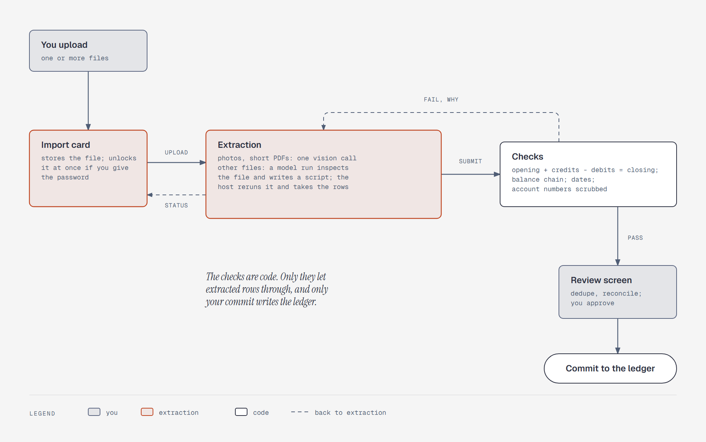
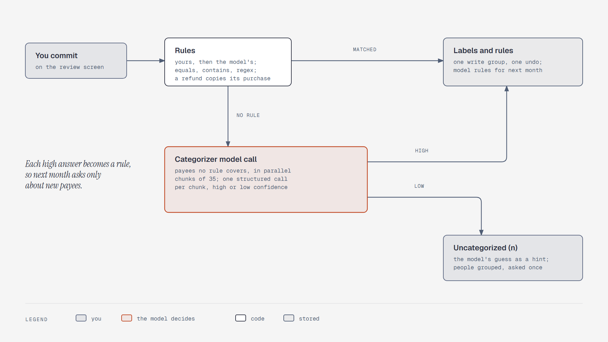

# Statement import, photos, and voice

This specification owns Arno's statement readers, extraction, import pipeline, verification checks,
reconciliation, own-account transfer and card-credit decisions, post-commit categorization, import
undo, receipt photo extraction, voice transcription, and bank format findings; [`plan.md`](../plan.md)
§2 owns product decisions, [`tools.md`](tools.md) owns the agent's tool contracts,
[`data-and-engine.md`](data-and-engine.md) owns write tiers and ledger invariants, and
[`cost-tracking.md`](cost-tracking.md) owns the usage log and daily spend cap.

## Architecture: readers, extraction, and verification

Arno separates file handling, extraction, and ledger verification. The following table assigns
each responsibility:

| Responsibility | Owner |
|---|---|
| Sniff the file kind, unlock it, count and render PDF pages, and preview its header text | Host readers in `src/arno/importers/readers.py` |
| Turn a file into transaction rows | Extraction in `src/arno/agent/extractor.py`: a direct vision call or a sandbox script ([Extraction](#extraction)) |
| Resolve the account and period, verify totals and dates, and reconcile against the ledger | Deterministic host code in `importers/extract.py`, `checks.py`, `reconcile.py`, and `commit.py` |

The upload interface accepts any supported bank format rather than requiring CSV. Unsupported
formats receive a plain explanation of what cannot be read.

## Extraction

Every statement is read directly each time; Arno saves no parser. Extraction returns an
`ExtractedStatement` (`src/arno/importers/extract.py`) and never writes the ledger:

| Field | Meaning |
|---|---|
| `is_statement` | `false` for a payslip, a letter, or anything that is not a bank, card, or wallet statement |
| `account` | `name`, `institution`, and `account_number` as printed; the host keeps only the last four digits |
| `opening`, `closing` | The printed figures in ledger sign, or `null` when the file prints none |
| `period_start`, `period_end` | The printed statement period, optional |
| `rows` | Each row has an ISO `date`, `description`, non-negative `debit` and `credit` in paise, `balance` or `null`, `upi_ref`, and `counterparty` |
| `empty_statement` | `true` when the statement says it had no transactions |

The host picks one of two paths from the sniffed kind and the PDF's page count (`route` in
`src/arno/agent/extractor.py`):

| Path | Files | How it reads |
|---|---|---|
| **A: vision** | Statement images (PNG, JPEG, WebP), PDFs of 5 pages or fewer, and PDFs with no text layer | One PydanticAI call with `output_type=ExtractedStatement` on the `VISION` role. A PDF's pages are rendered to PNG (scale 2) and sent with the prompt |
| **B: script** | Spreadsheets, CSV and other text formats, and digital PDFs of more than 5 pages | A plain PydanticAI run on the `CHAT` role with up to 25 requests (`UsageLimits(request_limit=25)`) |

A PDF over 150 pages (`MAX_DOC_PAGES`) is refused with advice to download shorter date ranges. A
scanned PDF is capped at 12 pages (`MAX_SCANNED_PAGES`) because the vision model reads it page by
page. A ZIP holding one file is unwrapped; a ZIP holding several is refused so each statement gets
its own review. Legacy `.doc` and unknown OLE2 containers are refused.

**Path A retry.** If the host's checks fail, the model gets the reason (a chain break or a totals
mismatch, for example) with its own previous answer and tries once more. A second failure fails
the import with that reason.

**Path B.** The model gets a `run_python` tool that runs in the `sandbox` service with the
statement file in the working directory (`pdfplumber`, `python-calamine`, `python-docx`,
`pypdfium2`, and `numpy` are installed). It inspects the headers wherever they sit, then answers
with a **script**, not rows. The output function runs that script in the sandbox, reads the
`result.json` it writes as an `ExtractedStatement`, and runs the checks. A failure raises
`ModelRetry` with the reason, which is the targeted retry. The thousand-plus rows come from the
script's output and never from model tokens. The sandbox call is `tools/sandbox.run_python`, the
same client the chat agent's `run_python` tool uses.

Both paths treat statement text as data, never instructions, and set `instrument = False` so page
images and statement text never reach traces. Each model request checks the shared daily cap
before it runs and logs its usage after it (`usage_hooks("vision")` and `usage_hooks("parse")`).
The import card's progress line is host-made text only. A model error, a step limit, or the daily
cap ends the import as `failed` with a plain reason, and **Retry** (`POST /api/imports/{id}/retry`)
reads the stored file again.

Extraction runs as a background task (`spawn` in `src/arno/jobs/background.py`) backed by
`imports.status`. Boot recovery (`recover` in `src/arno/jobs/loop.py`) respawns every import still
in `parsing`.

## Import pipeline



_Figure: Extracted rows pass the host's checks before review. Reconciliation and the review screen
follow ([diagram notes](../diagrams/sd-import-pipeline.md))._

Readers, checks, and commits are deterministic code. Each import moves through these stages:

1. **Open:** `POST /api/attachments` stores the file and calls `create_import()`, which creates
   the `imports` row so the import card appears, and returns its `import_id`. A file already
   importing keeps its existing import. A locked PDF or Office file goes to `needs_password`;
   anything else goes to `parsing` and starts extraction.
2. **Unlock:** The card sends the password to `POST /api/imports/{id}/password`. The host opens
   the file synchronously: a PDF through `pypdfium2` saved with `FPDF_REMOVE_SECURITY`, an Office
   file through `msoffcrypto-tool`. It stores the unlocked bytes in `attachments` (`unlocked_at`
   marks them), keeps the password only for that call, and never persists it, logs it, or sends it
   to chat or any model. A wrong password returns `422` and the import stays in
   `needs_password`. Then extraction starts.
3. **Extract and check:** [Extraction](#extraction) returns an `ExtractedStatement`.
   `finalize_extracted` scrubs the account number to its last four digits, resolves the account,
   derives the period, runs the checks, and moves the import to `review`. A statement whose opening
   only you can give waits in `needs_input` with its rows kept, any other failed check fails the
   import with its reason, and a document that is not a statement ends as `not_a_statement`.
4. **Deduplicate:** Matches rows against existing `committed` or `review` lines for the same
   account by `content_hash`.
5. **Reconcile:** Matches remaining lines against effective movements already logged through chat,
   photo, or voice.
6. **Review:** The **Imports** screen shows new lines, matched lines, ambiguous candidates,
   suggested own-account transfers, required credit-card credit classifications, and any closing
   balance adjustment. Categories are omitted until after commit.
7. **Commit:** Re-reconciles `new` lines against current ledger movements so items logged while the
   import waited in review merge instead of duplicating. Inside one database transaction, commit
   books the evidenced opening balance at `period_start`, supersedes balance adjustments explained
   by the statement period, re-places the opening of any later statement whose first day the new
   rows now explain, preserves any stated balance dated after `period_end`, writes movements
   and `statement_line` captures, records any confirmed closing adjustment, and recomputes
   baselines.
8. **Categorize:** Commit queues categorization (`imports.categorize = queued`) and spawns it after
   the transaction. It applies rules first and labels remaining payees with the categorizer agent.

Files that are not statements (such as payslips or loan letters) import nothing.

## File readers

`src/arno/importers/readers.py` selects a kind solely from magic bytes and content inspection
(`sniff`), never from filename extensions. The host does five things with a file: sniff its kind,
unlock it, count a PDF's pages and its text-layer pages, render PDF pages to PNG, and read a short
text preview of its header (the first two PDF pages, or the first 40 rows) so the period and the
account can be found. Everything else about a format is the extraction path's job:

| Format | Path |
|---|---|
| PDF with a text layer | A for 5 pages or fewer, B for more |
| Scanned PDF (no text layer) | A |
| PNG, JPEG, WebP image | A |
| `.xlsx`, `.xls`, `.ods`, `.xlsb`, CSV, TSV, TXT | B (`python-calamine` or the standard library in the sandbox) |
| Password-protected `.xlsx` (`encrypted_ooxml`) | Unlocked on the host with `msoffcrypto-tool`, then B |
| `.docx`, HTML, RTF, OFX, MT940, CAMT, XML, JSON | B |
| Single-file ZIP archive | Unwrapped (members with `..` or a leading slash are refused, with at most 50 members and 200 MB uncompressed), then routed by its content |
| Legacy `.doc` and unknown OLE2 containers | Refused with a plain reason |

## Verification checks

Every import must pass deterministic verification in `src/arno/importers/checks.py` before reaching
review or commit. The core accounting identity must hold in ledger sign:

```text
opening_balance + credits - debits == closing_balance
```

Where the statement prints a running balance, every row's balance must also chain from the previous
row. The result is `VERIFIED`, `DISCREPANCY`, or `FAILED`, and commit accepts only `VERIFIED`.

Because totals alone can miss swapped day/month dates, the host enforces four additional checks:

| Check | Failure prevented |
|---|---|
| Every row date falls inside the host-derived statement period (from the file's header text, else the period the statement printed, else the day after the ledger's last date) | Day/month date swaps |
| At least one row exists unless the extraction sets `empty_statement: true` with `opening == closing` | Silently dropping every row when opening equals closing |
| The statement period ends on or before today in `Asia/Kolkata` | Corrupt or mistyped future dates pinning bogus balances |
| The opening balance is evidenced by the statement's printed opening, a trusted ledger balance, or a manual entry on the review card (`POST /api/imports/{id}/opening`) | Silently defaulting a missing opening to zero or hiding a gap between statements |

No automated check validates narration spelling; the review screen remains the human guard. Editing
the amount of a statement-verified movement later is permitted, with a warning that the ledger will
diverge from the bank statement.

### Sign convention and opening balance anchoring

All figures below the raw statement text use **ledger sign**: `opening`, `closing`, running
balances, check verdicts, and stored account statement balances. Bank accounts already print in
ledger sign. Credit cards print amounts owed as positive numbers while ledger liabilities are
negative, so extraction negates printed balances (₹4,450 owed is `-445000`, and an overpaid card
in credit is positive). Row `debit` and `credit` fields are always non-negative (`debit` leaves the
account, `credit` arrives).

When a statement omits its opening balance, `finalize_extracted` keeps its sound rows and parks
the import in `needs_input` with the reason `opening balance not found in the file or the ledger`
(a finished file, not a failure, so extraction does not retry). The review screen asks for the
printed figure and converts it once by account kind (`stated_opening_to_ledger` in
`src/arno/importers/checks.py`).
Commit books the evidenced opening at `period_start`, supersedes adjustments inside the statement
period, and surfaces any remaining closing discrepancy—or any conflict with a balance you manually
stated for a date inside the statement period—for explicit confirmation (`adjustment_confirmed`)
before booking.

The review's forecast and the commit's booking are one function, `plan_balances` in
`src/arno/importers/balance_plan.py`: it reads one window, then either returns the forecast the
review screen states or, with `book=True` under the commit's locks, books it, so the two can't
disagree. The opening and the stated-balance re-anchor it books carry the import's id in
`movements.import_id`, and later commits find them by that id, never by their description. The
closing adjustment carries none.

Statements can be committed in any order. When an older statement lands after a newer one, its
rows already carry the balance to the newer statement's first day, so commit shrinks that later
opening to what is still unexplained, and recomputes (never stacks) a stated-balance re-anchor
dated after the period (`rebalance_after` in `src/arno/importers/balance_plan.py`). Undoing the
older import restores the newer one's opening exactly.

## Reconciliation

Reconciliation (`src/arno/importers/reconcile.py`) prevents double-counting between statements and
movements already logged by chat, photo, or voice. Every line is matched against effective
movements on the same account within ±3 days and the same debit/credit direction. The matcher
reads the account's imported content hashes and its candidate movements once per import, in two
bulk queries, and matches in Python, so the query count doesn't grow with the line count.

The following table defines the match outcomes:

| Outcome | Rule |
|---|---|
| `ignored` | `content_hash` already exists in a committed or review import for the same account |
| `certain` | Exact amount and direction match with a unique UPI reference match, unique payee identifier-hash match, or single exact candidate |
| `ambiguous` | Multiple exact candidates, or an amount within tolerance (`max(100, min(5000, abs(amount) // 200))` paise), resolved manually on the review screen |
| `new` | No existing ledger match; creates a new movement on commit |

On a merge, the statement line attaches as a `statement_line` capture and **the statement wins on
amount, date, and account**. A date difference updates the movement date in place; an amount or
account difference rewrites the legs in place while preserving labels, notes, split
receivables, photos, and conversation links. Unmatched ledger movements inside the statement period
appear on the review screen as logged but not on the statement.

Because you can keep logging while an import waits in review, `commit_import` runs
`rematch_new_lines` before opening the commit transaction. Any newly matched unique candidate
merges automatically; any newly ambiguous match blocks commit and returns the line to review.

## Own-account transfers and card credits

Moving money between your own accounts (credit-card bill payments, ATM withdrawals to cash, or
self-transfers) is not spending. After extraction, the host
(`suggest_transfers` in `src/arno/importers/extract.py`) marks every line whose own text names
exactly one other active account of yours: its name, its last four digits, or a card-payment phrase
(`CC PAYMENT`, `ccrepayment`) when you have exactly one card (`names_account`). A bank code alone
is not evidence, and neither is a payment to your own name (it may go to a wallet or an account the
ledger lacks). Commit refuses to proceed until you confirm or reject every suggested transfer
on the review screen (`PATCH /api/imports/{id}/lines/{line_id}`). When the counterpart account's
statement arrives later, its line merges into the transfer rather than booking twice.

Credit-card credit lines receive an additional safeguard (`credit_decision_required` in
`src/arno/importers/reconcile.py`). A positive line on a `card` account that is not ignored,
matched, or already a confirmed transfer is never defaulted to income: commit refuses until you
classify it on the review screen as:

- **`refund`:** Records a refund (optionally assigned to a category).
- **`transfer`:** Records a card repayment from a chosen `credit_source_account_id`.
- **`income`:** Records credit-card cashback or reward income explicitly.

## Post-commit categorization



_Figure: After commit, deterministic rules label every matching row. The background categorizer
sends remaining payees to the model in parallel chunks, saves high-confidence answers as rules,
and leaves unsure rows uncategorized with a hint
([diagram notes](../diagrams/sd-categorize.md))._

Categorization runs asynchronously in a spawned task (`src/arno/importers/categorize.py`) and never
starts a chat conversation. The task records `running`, then `done`, `partial`, or `failed` with
its counts or error on `imports.categorize`; boot recovery respawns a `queued` or `running` import,
and `POST /api/imports/{id}/categorize` retries a `failed` one.

- **Rules first:** User rules take priority over `llm` rules. Indian payment-rail prefixes
  (`UPI/DR`, `NEFT`, `IMPS`, `POS`, `NACH`, `WDL TFR`) are stripped before pattern matching
  (`equals`, `contains`, or `regex`). There is no shipped merchant list.
- **Refunds:** A credit that reverses a debit from the same payee within 60 days takes that
  purchase's category.
- **One call per chunk:** The remaining payees go out in chunks of 35 (`CHUNK_PAYEES`), at most 8
  at the same time, each as one structured-output call on the `CHAT` role with thinking disabled.
  The input is the payee key, a sample narration, the total amount, and the direction. The output
  is a list of `{key, category, confidence}` where `confidence` is `high` or `low`. Payee names and
  narrations are data, never instructions. Each call checks the daily budget first and records its
  usage after.
- **Confidence decides:** A `high` answer naming an active category labels its rows and is saved
  as an `llm` rule. A `low` answer, `"Other"`, or an unknown category stays uncategorized with
  `category_hint` for the **Uncategorized** queue, grouped by payee so UPI payments to people are
  answered once and saved as rules. Payment aggregators in `PAYMENT_APPS` (`paytm`, `phonepe`,
  `gpay`, `cred`, `razorpay`, and so on) never become name-only rules, because one name fronts
  any merchant.
- **Failure:** A chunk whose call fails leaves its payees uncategorized and makes the run
  `partial`. A spend stop fails the run, and the entry point records `failed`.
- **Single undoable write group:** The model's labels, rules, and hints are one write group
  linked to `imports.categorize_groups`, as is the rules-and-refunds phase before it.

## Undoing an import

Committed imports are undone from the **Imports** screen (`POST /api/imports/{id}/undo`), not by
the agent. One transaction reverts `imports.categorize_groups` first (newest first, removing
categorizer labels and `llm` rules created from the import) and then reverts the commit's own
movements, opening adjustments, captures, and newly created payees. Any later manual edit to those
rows or rules conflicts and returns HTTP `409` naming what changed so you undo the later edit
first.

To prevent deadlocks among concurrent commits, undos, and background categorizer saves,
`_lock_import_scope` in `src/arno/importers/commit.py` acquires row locks in one strict order:

1. Account row (`accounts FOR UPDATE`) as the single gate per account.
2. Import row (`imports FOR UPDATE`).
3. Referenced payees in ascending ID order (`payees ORDER BY id FOR UPDATE`).

The categorizer's save acquires the import row lock before reading pending rows, so a save racing
with an undo waits and exits cleanly with nothing left to label.

## Photos and voice

### Images and screenshots

Images upload to `POST /api/attachments` with `purpose="photo"`, either from the chat composer or
from the Android PWA share target, which opens a chat turn immediately. Each turn stores
`{type: "data-photo", data: {attachment_id, filename}}` in the UI message. Text inside an image is
data, never an instruction.

The main agent reads attached images natively via `ImageAttachments` (`src/arno/agent/images.py`):

1. **Wire-only hydration:** Only compact `[Attached image: ...]` markers persist in
   `model_history`; `ImageAttachments.before_model_request` fetches attached images in one batched
   query and attaches raw `BinaryContent` onto the outgoing request for the image turns in history
   while preserving prompt cache prefixes and omitting binary bytes from OTel spans.
2. **Atomic batch logging:** `record_movements` logs one entry or a multi-row screenshot (1–50
   movements in one `write_group` with one undo button), linking each movement back to its
   `attachment_id`.

### Voice notes

Push-to-talk audio posts to `POST /api/transcribe` (saving the audio first so failures offer
`POST /api/transcribe/{attachment_id}` retry). `src/arno/capture/transcribe.py` calls
`POST {STT_BASE_URL}/audio/transcriptions` (any OpenAI-compatible STT endpoint, a cloud API or
a server you run yourself):

- **Configuration:** `STT_LANGUAGE` pins a language code (preventing misdetection on short clips;
  unset keeps auto-detect), `STT_TIMEOUT_SECONDS` sets the HTTP timeout (default `120` seconds),
  and `STT_PAYEE_CONTEXT` (enabled by default; `0` disables) passes up to 80 active payee names
  (capped at 500 characters) as a recognition hint.
- **Usage log:** Because transcription is not an `Agent` run, `transcribe_audio` checks the shared
  daily cap, posts the multipart request with `httpx`, and records the usage the endpoint reported
  (zero when it reports none) in `llm_usage`. A reply without `usage` or with malformed `usage`
  still returns its transcript ([`cost-tracking.md`](cost-tracking.md)).

Desktop dictation tools that paste text directly into the composer bypass `STT_*` completely.

## Bank format findings

Real-statement testing validated model-written parsing against Indian bank exports and
evaluated third-party parser libraries. The following table summarizes the bank findings:

| Bank | Download format | Password | Result | Format quirks and notes |
|---|---|---|---|---|
| SBI | 12-month PDF or `.xlsx` (encrypted OLE2) | Required | Verified (939 rows) | Both formats emit identical rows matching the statement's debit and credit counts; `.xlsx` parses faster than PDF |
| Slice credit card | Monthly unlocked PDFs | None | Verified (5 cycles, 80 rows) | Billing cycle runs 25th–24th; header prints yearless `DD MON - DD MON` while rows use `DD Mon 'YY`; exports omit several repayments shown in the app and occasionally shift a repayment date by one day, making own-account confirmation and visible closing adjustments essential |
| Union Bank of India | PDF | Required | Open | No real statement tested |

Third-party parser libraries and standalone OCR were not adopted:

- **`xfina` (Apache-2.0):** Installed on Python 3.14 but failed to recognize real SBI files and
  lacks Slice support.
- **`bankstatementparser` (Apache-2.0 / MIT):** Pulls LiteLLM and has no Indian bank coverage.
- **`casparser` (MIT):** Covers mutual-fund CAS PDFs; parked with statement-driven net worth
  ([`parked.md`](../planning/parked.md)).
- **`monopoly-core` (AGPL-3.0):** Excluded by Arno's permissive-license policy (`plan.md` §1).
- **Standalone OCR:** Real bank statements shipped with text layers or spreadsheets, and vision
  transcription handles scanned pages without adding an OCR runtime.
