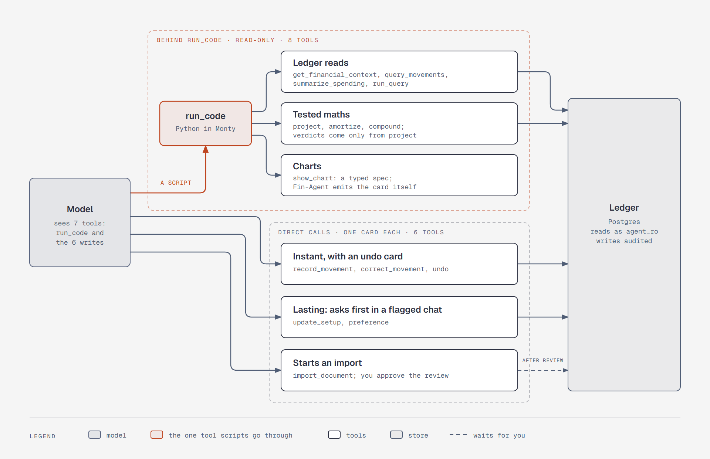

# Tool contracts

This specification defines the contracts for the agent's tools: three read tools, four write tools,
and web search. For data-model conventions, write tiers, and engine math see
[data-and-engine.md](data-and-engine.md).

Tool summaries here track the live docstrings in `src/arno/agent/toolset.py`, which is the source of
truth for exact model-facing wording. Each tool is a thin adapter over a plain function in
`src/arno/tools/`; the adapters wrap them for PydanticAI and nothing else does. Tool names and field
names are part of the persisted contract because stored conversations replay historical tool calls.



_Figure: The tool surface. The model calls three read tools and four write tools directly, plus web
search. Two writes ask for a confirm tap in specific cases
([diagram note](../diagrams/sd-tool-surface.md))._

---

## Shared rules

| Rule | Behavior |
|---|---|
| Money out | `Money = {"paise": 300000, "text": "₹3,000"}`. Unknown amounts are `null`, never `0` |
| Money in | Field names carry units: `project` accepts `*_paise`, and write tools accept `*_rupees` (except `emi_fee_paise` and `min_due_floor_paise` in `update_setup`). Amounts are bounded by `MAX_PAISE` (`9,223,372,036,854,775,807`) |
| Name resolution | Accounts, payees, and categories resolve by case-insensitive name; movements take IDs. Matching an archived account refuses with that account's name and the active spendable accounts |
| Validation errors | Unknown or ambiguous names and invalid inputs raise `ModelRetry` listing valid candidates |
| Unexpected errors | `ToolErrorsToModel` turns an unexpected tool exception into a structured result (`{"status": "error", "tool", "message"}`) the model can explain; daily-cap stops still halt the run. Read tools carry a 60-second timeout |
| Uncertain commit | When a commit's outcome is unknown (`CommitOutcomeUnknownError`), the write returns `{"status": "outcome_unknown", "committed": "unknown", "message": "..."}` telling the model to ask the user to verify the ledger and never repeat the write |
| Streamed results | Native tool parts carry computed results. `ToolReturn` metadata carries UI-only payloads such as the daily projection curve and web source previews. |
| Coverage | `coverage()` inspects committed, non-undone statements; gaps are reported rather than summed as zero |
| Write groups | `write_group()` wraps each write in one audited transaction returning `undo_id`; `message_id` and `ctx.tool_call_id` come from `RunContext`, never tool inputs |
| Confirm gate | `_ask_first()` raises PydanticAI's `ApprovalRequired` when the call needs a tap and `ctx.tool_call_approved` is false. Approval resumes the call from the top and applies once per `tool_call_id` |
| Stale IDs | Tools never depend on earlier IDs staying in chat history; `undo` reads `audit_log` directly and raises `ModelRetry` on unknown IDs |

---

## Read tools

### `run_query`

**Purpose:** Read-only PostgreSQL (2-second statement timeout, 1,000-row cap) and the way the agent
reads the ledger: balances, spending, movements, schedules, goals, who owes what, memories,
imports, and conversation search (`messages.search`). The docstring lists the exact columns of the
`agent_ro` views (`v_legs`, `v_spending`, `v_accounts`, `v_balances`, `v_owed`,
`v_movement_state`), names the readable domain tables, and tells the model to read a table's
columns from `information_schema.columns` instead of guessing.

**Input:** `run_query(sql: str)`

**Output:** `{"columns": [...], "rows": [[...]], "row_count": int, "truncated": bool, "sql": str}`.
The widget can use `label` and `metric_paise` for a headline figure or `label` and `amount_paise`
for a chart. A ledger citation uses `[movement:<id>]` and requires a returned `movement_id`,
`payee_name` or `description`, `amount_paise`, and `date` in the same message.

**Logic:** Connects as `agent_ro` ([data-and-engine.md](data-and-engine.md#database-roles)) inside
a read-only transaction, sets `LOCAL statement_timeout = '2s'`, prepares the single statement
(rejecting multi-statement strings), fetches up to 1,001 rows (returning 1,000 and setting
`truncated`), and always rolls back. Whole `Decimal` values become `int`; timeouts and SQL errors
become `ModelRetry`.

### `project`

**Purpose:** Forecasts liquid cash against the floor, computes `safe_to_spend`, evaluates 1 to 12
non-persistent dated what-if `changes`, and judges a `hypothetical` purchase (`yes`, `yes-but`, or
`no`) with verified tradeoffs. Verdicts come exclusively from the engine; when no liquid account
has a known balance, the model states what is missing instead of quoting balances or probabilities.

**Input:** Pydantic models in `src/arno/tools/projection.py`:

```python
project(
    horizon_days: int | None = None,             # 1 to 3,650 (minimum; engine extends as needed)
    hypothetical: ProjectHypothetical | None = None,
    changes: list[ProjectChange] | None = None,  # 1 to 12 dated what-if changes
)

class ProjectHypothetical:                       # extra="forbid"
    amount_paise: int
    date: str                                    # YYYY-MM-DD
    method: Literal["account", "card", "emi"] = "account"
    emi_months: int | None = None                # 2 to 48; defaults to 3
    account: str | None = None                   # card name; best card if omitted
    emi_rate_percent: float | None = None        # annual rate in percent
    emi_fee_paise: int | None = None
    no_cost: bool = False
```

Each item in `changes` is discriminated by `kind` (`stop_income`, `pause_schedule`,
`change_amount`, `add_recurring`, `one_time`) with `YYYY-MM-DD` dates, an optional inclusive
`until`, and a positive integer `amount_paise`.

**Output:**

```python
{
  "as_of": str, "horizon_days": int,
  "floor": Money, "floor_set": bool,
  "floor_probability": float, "floor_threshold": float,
  "median_low": {"date": str, "amount": Money} | None,
  "p10_low": Money, "first_floor_crossing": str | None,
  "goals": [{"id", "name", "target": Money, "saved": Money, "remaining_after_plan": Money,
             "deadline", "completes_on", "slips_days", "reached", ...}],
  "obligations_met": bool,
  "safe_to_spend": {"amount": Money, "binding": "floor" | "obligation",
                    "binding_date": str} | None,
  "data_quality": {"balance_ages", "baseline_sources", "gaps", "setup_gaps", "simulation", ...},
  "source_ids": {"accounts", "cards", "schedules", "payees", "goals", "categories"},
  "optimistic": {...} | None,
  # Present when hypothetical is passed:
  "verdict": "yes" | "yes-but" | "no", "verdict_reason": str,
  "tradeoffs": [...], "goal_slips": [...], "hypothetical": {...}, "baseline": {...} | None,
  # Present when changes is passed:
  "scenario": {"changes": [...], "assumptions": [...], "runway_days": int | None,
               "holds": bool, "reason": str, "baseline": {...}},
}
```

**Logic:** Validates the inputs, loads a `REPEATABLE READ` ledger snapshot, resolves schedule,
detected-series, and goal names, and runs the pure engine off the event loop. Emits a projection
`data-card` carrying the daily curve, full sources, and the request's own arguments so the card can
download a workbook of the same request. For simulation mechanics and scenario rules, see
[data-and-engine.md](data-and-engine.md#projection-engine) and
[data-and-engine.md](data-and-engine.md#affordability).

### `run_python`

**Purpose:** Arithmetic the ledger cannot do: amortization, compound growth, tax or what-if math,
and reading an uploaded file. The model reads the data first with `run_query` and pastes what it
needs into the script.

**Input:** `run_python(code: str, attachment_ids: list[str] | None = None)`

**Output:** `{"ok": bool, "stdout": str, "stderr": str, "result_json": Any | None}`, with `stdout`
and `stderr` capped at 20,000 characters. A script prints what it wants to see and writes a
JSON-serializable value to `result.json` to get it back as `result_json`.

**Logic:** Posts `{code, files, timeout_seconds: 30}` to `{ARNO_SANDBOX_URL}/exec`. Each
`attachment_id` is read from `attachments` and placed in the script's working directory under its
own filename. The `sandbox` service runs the script in a fresh directory with no database, no
network, no clock, and no secrets ([platform.md](platform.md#security-and-threat-model)). A sandbox outage or
refusal returns `ok: false` with a plain message rather than raising. Any figure the agent states
must come from this output.

### `web_search`

**Purpose:** Current facts the ledger cannot hold, such as rates, rules, and prices. Search is
optional: the model's own native search runs when the model supports it. Otherwise, with
`BRAVE_API_KEY` set, a local Brave Search tool runs. With neither, the agent has no web search.

**Input:** `web_search(query: str)` for the Brave tool. The prompt forbids putting balances,
account numbers, payees, or other personal details in a query.

**Output:** `[{"id": "1", "title", "url", "snippet", "published_at"}]`, up to five results, with
`id` counting up across the turn. The tool also emits a Vercel AI SDK `source-url` part with the
title, URL, and snippet, so the reply cites each claim as `[n]`. A Brave outage returns
`{"error": "..."}`.

---

## Write tools

The four write tools are direct model calls. Every write returns a card with an `undo_id`.

### `record_movements`

**Tier:** Always instant, with one inline `movements_batch` undo card covering the whole call.

**Purpose:** Atomically logs 1 to 50 movements of money that already moved, from one message or a
multi-row screenshot, inside one `write_group` so one Undo reverses every movement and any newly
created payee. Future dates raise `ModelRetry` directing the model to schedules. Placeholders such
as `"Unknown shop"` and category names are never stored as payees.

**Input:**

```python
record_movements(
    movements: list[Movement],        # 1 to 50
    attachment_id: str | None = None, # the uploaded image the rows came from
    not_duplicate: bool = False,
)
# Movement is discriminated by `kind`. Shared optional fields: date, note, description, upi_id,
# upi_ref, attachment_id
# Expense:     amount_rupees, payee=None, account=None, category=None, category_guess=None
# Income:      amount_rupees, payee=None, account=None
# Transfer:    amount_rupees, from_account, to_account
# Split:       total_rupees, my_share_rupees, people=[{name, amount_rupees, expected_date=None}],
#              payee=None, account=None, category=None, category_guess=None
# LoanPayment: amount_rupees, loan, account=None
# Refund:      amount_rupees, payee, account=None, category=None
# Settlement:  amount_rupees, person, direction="they_paid"|"i_paid", account=None,
#              expected_date=None
```

**Output:**

```python
{"status": "recorded", "count": int, "undo_id": str,
 "total_outflow": Money | None, "total_inflow": Money | None, "movements": [...]}
# Or on a suspected duplicate against an earlier ledger row (nothing is written):
{"status": "possible_duplicate",
 "duplicates": [{"index": int, "existing": {"movement_id", "date", "summary"}}]}
```

**Logic:** Derives an idempotency key from `message_id` and `ctx.tool_call_id` (a retry returns the
existing transfers). Pre-checks each entry against existing effective movements inside the
transaction, so two identical small transactions inside one batch are both kept. Per entry:
resolves the account (stated, then the payee's usual, then the sole liquid, then the busiest
everyday liquid), applies category precedence (stated, user rule, llm rule, `category_guess` saved
as an llm rule, none), splits loan EMIs via `loan_payment_parts`, and writes balanced transfers and
the capture (including a redacted `upi_ref` and any validated `attachment_id` link). Queues a risk
check.

### `correct_movement`

**Tier:** Instant with an undo card for `scope="this"`. `scope="future"` and `scope="all"` ask for
a confirm tap through `ApprovalRequired`.

**Purpose:** Fixes an existing movement's category, payee, note, expected date, business date,
`one_off` flag, amount, split shares, or account, or deletes it by appending a reversal. `scope`
sets how far a category or payee change reaches: `this`, `future` (upserts a user rule), or `all`
(upserts a user rule and relabels past movements for that payee). Passing only `schedule_payment`
matches the movement to a schedule occurrence, or removes that match, without recording money.

**Input:**

```python
correct_movement(
    movement_id: str,
    changes: MovementChanges,
    scope: Literal["this", "future", "all"] = "this",
)

class MovementChanges:              # extra="forbid"; every field optional
    category, payee, note: str
    expected_date, date: date
    one_off: bool
    amount_rupees, my_share_rupees: Decimal
    shares: list[{"name": str, "amount_rupees": Decimal}]
    account: str
    delete: bool = False
    schedule_payment: {"schedule": str, "due_date": date, "action": "link" | "unlink",
                       "amount_rupees": Decimal | None}
```

**Output:** `{"status": "corrected" | "deleted", "undo_id": str | None, "summary": str,
"rule": str | None, "rows_changed": int, "movement": dict}`. The UI receives a `correction` card.

**Logic:** Rejects already-reversed movements. Label edits update `movement_legs` without touching
pgledger; `date` and `one_off` update `movements`; amount, account, or delete operations append a
reversal (and replacement transfers when editing) in one atomic batch. Equal splits re-split
automatically; unequal splits need explicit shares. Recomputes loan principal and interest, and
warns on the card when an amount edit changes a statement-verified movement. A schedule match
requires `due_date` within 31 days after the movement date, checks capacity and account direction,
and is idempotent ([data-and-engine.md](data-and-engine.md#planning-and-schedule-payment-evidence)).

### `update_setup`

**Tier:** Instant with undo, except two cases that ask for a confirm tap through
`ApprovalRequired`: `action="archive"` and `entity="settings"`.

**Purpose:** Adds, updates, or archives setup entities and never past money movements. Balances are
signed from the owner's perspective: a card or loan balance is the amount owed (positive when owed,
negative when a card is in credit). Adding a card requires a positive `credit_limit_rupees`,
`statement_day`, and `due_day`. Card EMI and finance terms are recorded only when the issuer
states them.

**Input:** `update_setup(entity, action: Literal["add", "update", "archive"], data: SetupData)`.

| Entity | Model fields |
|---|---|
| `account` | `name`, `new_name`, `kind` (`bank`, `card`, `cash`, `wallet`, `loan`, `asset`), `institution`, `last4`, `opening_balance_rupees`, `as_of`, `liquid`, `credit_limit_rupees`, `statement_day`, `due_day`, `emi_rate_percent`, `emi_fee_paise`, `finance_rate_percent` (percent per month, stored as annual bps), `min_due_percent`, `min_due_floor_paise`, `rate_percent`, `tenure_months`, `active` |
| `balance` | `account`, `balance_rupees`, `as_of` |
| `schedule` | `name`, `new_name`, `kind`, `subtype`, `amount_rupees`, `account`, `category`, `rule`, `starts`, `ends`, `confirmed`, `holiday_adjust`, `active` |
| `goal` | `name`, `new_name`, `target_rupees`, `deadline`, `priority` (1-5), `status` |
| `category` | `name`, `new_name`, `reducible` |
| `payee` | `name`, `new_name`, `kind`, `upi_id`, `default_category`, `create_person_account`, `active` |
| `settings` | `floor_rupees`, `base_currency`, `time_zone`, `default_horizon_days`, `notification_time`, `weekly_briefing_dow`, `reminder_lead_days`, `display_name` |
| `scheduled_question` | `id`, `prompt`, `rule` |
| `baseline` | `category`, `amount_per_day_rupees` |
| `preference` | `id`, `text`, `kind` (`preference`, `fact`, `rule`), `subject` |

A `preference` is a lasting memory. `add` saves one; a stable `subject` makes a contradicting fact
replace the active value for the same `(kind, subject)` while `audit_log` keeps the old one.
`update` changes `text` or `kind`; `archive` forgets it (`active = false`, still visible in
Settings and undoable). A memory never stores a number the ledger owns. Permanent deletion is
Settings-only (`delete_preference_for_good`), so every agent write stays undoable.

**Output:** `{"status": "saved", "undo_id": str | None, "summary": str, "result": dict}`; the
`scheduled_question` and `baseline` results omit `"result"`. The UI receives a `setup` card with
undo.

**Logic:** Validates entity fields and RRULE syntax, applies the write inside one `write_group`
(creating paired pgledger accounts and equity adjustments for `account`, `balance`, and `goal`;
archiving soft-deletes with `active = false`), and queues a risk check when balances or plans
change. Preference changes go through `tools/write.py::edit_preference`, the one mutation function
the REST routes use too.

### `undo`

**Tier:** Always instant.

**Purpose:** Reverts a write group by `undo_id`, or the latest non-undone write in the current
conversation when omitted.

**Input:** `undo(undo_id: str | None = None)`

**Output:** `{"status": "undone" | "already_undone" | "conflict", "summary": str, "conflicts":
[...], "undo_undo_id": str | None}` plus an `undo` card.

**Logic:** Refuses committed imports (directing the user to the Imports screen), returns
`already_undone` if `undone_at` is set, returns `conflict` without mutating rows if a later write
modified any row in the group, and otherwise reverses ledger transfers and restores non-ledger
`before` snapshots in one audited transaction. The card's **Undo** button calls this same service
over REST.

---

## Results in chat

The chat reads the SDK's native message parts. Widgets use the values in tool results and the
UI-only projection payload. Web sources use `source-url` parts, and ledger citations resolve to
specific movement rows. See [Web interface](web-interface.md#agent-and-conversation-views).
