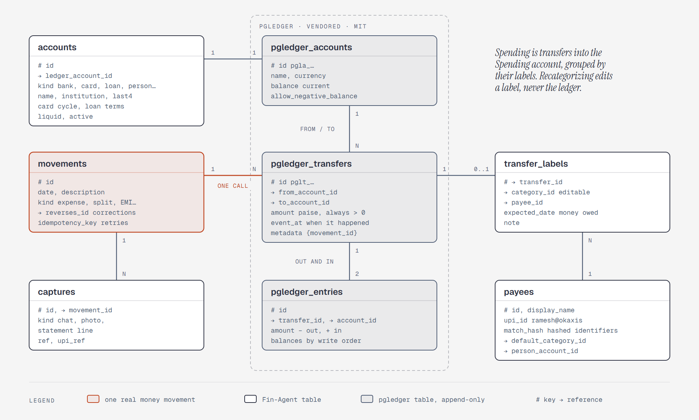
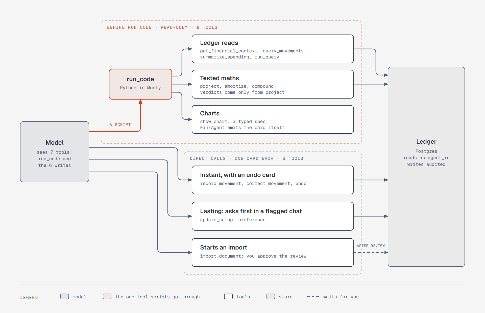

# Design

This file holds the detail behind [`plan.md`](plan.md) §2 and §4: the data model, the agent's
tool surface, the projection and affordability engine, and pattern detection.

The `plan.md` file owns decisions, and this file owns their shape. If the two disagree, the plan
wins and this file is stale.

---

## Data model

One Postgres database. Column lists are the intended shape, firmed up into the first migration
at L0 (milestone 3). The ledger is double-entry, on a vendored copy of
[pgledger](https://github.com/pgr0ss/pgledger).

### Conventions

- Money is whole paise: `NUMERIC` in pgledger's tables, `BIGINT` in ours, and a `Decimal` value at
  the Python boundary, never a `float` value.
- Every movement balances: money leaves one place and arrives at another. Amounts on transfers are
  always positive; the direction comes from the `from` and `to` accounts.
- The ledger is append-only. A correction appends a reversal; nothing is updated or deleted.
- IDs are prefixed text ULIDs throughout, from pgledger's `pgledger_generate_id`.
- Dates are `date`; moments are `timestamptz`. pgledger's `event_at` holds the date as first known,
  at noon India time so it never drifts across a day; `movements.date` is the authoritative one.
- Kinds are `text` columns that have a `CHECK` constraint, not Postgres enums—enums are awkward
  to change.
- Every row the agent can write has `created_at`, and every write goes through the audit log.
- "Unknown" is `NULL`, never `0`.

### Roles

The database has two roles:

| Role | Can |
|---|---|
| `app` | Owns the schema; everything the API does |
| `agent_ro` | `SELECT` on the ledger, plan, people, categorization, and conversation tables and views. No auth tables, and `TEMP` is revoked. These grants are the boundary. `default_transaction_read_only` and a `statement_timeout` are extra layers, because a role can change its own settings ([step 7](system-design.md#decisions)). pgledger's functions run with the caller's rights, so this role can't write through them either |

### Instance

The following tables hold instance-wide data:

| Table | Holds |
|---|---|
| `settings` | Single row: base currency, time zone, floor (fixed amount), default horizon (90 days), notification times, and the last model error's type and time, which Settings shows ([step 8](system-design.md#when-a-model-fails)) |
| `users`, `webauthn_credentials`, `sessions` | Single-user auth (`user` is reserved in Postgres). See [`platform.md`](platform.md) |

### The ledger

*Figure: one movement is one pgledger call of balanced transfers; labels hold the editable category
and payee, and captures link the evidence ([note](diagrams/sd-ledger-model.md)).*

**How money moves.** Every movement goes from one place to another. Spending is one rule with no
exceptions: money that went into the Spending account.

| What happened | Transfers |
|---|---|
| Swiggy ₹3,000 on the Slice card | Slice → Spending ₹3,000, labeled Food |
| Paying the Slice bill from SBI | SBI → Slice ₹3,000 |
| ₹1,200 dinner; Ravi and Amit owe ₹400 each | SBI → Spending ₹400, SBI → Ravi ₹400, SBI → Amit ₹400 |
| Ravi pays you back | Ravi → SBI ₹400 |
| ₹5,000 SIP | SBI → Mutual funds ₹5,000 |
| ₹25,000 loan EMI | SBI → Loan ₹18,000, SBI → Spending ₹7,000, labeled Interest |
| Refund of a ₹600 order | Spending → Slice ₹600, labeled Food |

**pgledger's tables** (vendored, append-only): `pgledger_accounts`, `pgledger_transfers`,
`pgledger_entries`, and `pgledger_idempotency_keys`, read through their views and written through
`pgledger_create_transfers`, which writes a whole batch or nothing.

**`accounts`:** every place money can sit, one-to-one with a pgledger account, carrying what
pgledger doesn't. The following table lists its fields:

| Field | Notes |
|---|---|
| `kind` | `bank`, `card`, `cash`, `wallet`, `loan`, `asset`, `goal`, `person`, `spending`, `income`, `equity` |
| `ledger_account_id` | The pgledger account |
| `name`, `institution`, `last4` | "SBI savings", "Slice". Only the last four digits of an account or card number are kept |
| `statement_balance`, `statement_balance_as_of` | The last balance a statement or the user stated, as a check on the ledger's own balance. Staleness is always reported |
| `liquid` | Counts toward spendable cash in the projection. True for bank, cash, and wallet accounts |
| card: `credit_limit`, `statement_day`, `due_day` | Card spend is a liability until the due date |
| loan: `rate`, `tenure_months`, `emi_schedule_id` | The ledger balance is the outstanding principal. The engine's amortization splits each EMI into principal and interest, and a loan statement corrects any drift |
| asset | No extra fields—hand updates are adjustment movements (EPF, FD, PPF, NPS, gold, funds). Statement-driven holdings are parked ([`parked.md`](parked.md)) |
| `active` | Soft-delete keeps history |

One `spending`, one `income`, and one `equity` account exist. `equity` holds opening balances and
adjustments: when a statement's closing balance disagrees with the ledger, the difference is a
visible adjustment, and it never counts as spending.

**`movements`:** one real-world money movement, written as one `pgledger_create_transfers` call.
Its transfers carry `{movement_id}` in their metadata. The following table lists its fields:

| Field | Notes |
|---|---|
| `date` | The authoritative business date, and editable: chat logs the 14th, the statement says the 15th, and reconciling edits this without touching the ledger |
| `description`, `kind` | `kind` is descriptive, for the UI: `expense`, `income`, `transfer`, `split`, `loan`, `refund`, `settlement`, `adjustment`, `reversal` |
| `reverses_id` | The movement this one reverses. Undo, or fixing an amount, writes the opposite transfers in one batch |
| `idempotency_key` | The message ID plus the tool call ID, also passed to pgledger, so a retried call returns the transfers already written |

**`transfer_labels`:** the editable side, keyed by transfer: `category_id`, `payee_id`,
`expected_date` (when a person is expected to pay), and `note`. Recategorizing edits a label and
never touches the ledger. Labels stay out of pgledger's `metadata` because a retry compares it.

**`captures`:** the evidence behind a movement. A chat message, a screenshot, and a statement line
can all describe one movement, so each is kept and linked: `movement_id`, `kind` (`chat`, `voice`,
`photo`, `statement_line`), `ref`, `upi_ref`, and `confidence`. The UPI reference number is the
strongest reconciliation key.

**`statement_lines`:** one row for each imported line: `import_id`, `date`, `description_raw`,
`amount`, `upi_ref`, `content_hash` (the dedupe key across reimports), and `match_state`. See
[`import.md`](import.md).

**Views** are the semantic layer the tools and `run_query` share, so there's one definition of
each number:

| View | Answers |
|---|---|
| `v_spending` | Transfers into and out of the Spending account, net, with category and payee |
| `v_cashflow` | Money in and out of liquid accounts |
| `v_balances` | Balances by date, summed from entries by each movement's `date`. pgledger's stored running balances follow write order, and a backfill arrives out of order, so they aren't used for dated balances |
| `v_owed` | Who owes what: `person` account balances with expected dates |

The raw tables stay readable too. With double-entry they hide no double-counting trap.

**Coverage** is derived from `imports`: the dates each account's statements cover. A gap is visible,
and an answer over a gap says "no data."

**Duplicates.** A retry is caught by `idempotency_key`. A suspected duplicate—the same account,
amount, and payee, logged by chat within 10 minutes—makes the agent ask in words. Statement lines
dedupe by `content_hash`.

**Credit.** pgledger (MIT, © 2025 Paul Gross) and its ID helpers from `scoville/pgsql-ulid`
(BSD-3-Clause, © 2021 Scoville) are copied unmodified into `src/fin_agent/db/vendor/pgledger/`,
with both LICENSE files and a README recording the source and pinned commit. Fin-Agent's own
changes go in its own migrations. `THIRD_PARTY_NOTICES.md` carries both license texts into the Docker
image, and the project README credits pgledger under "Built on," with no wording that implies
endorsement.

### The plan: What's coming

**`schedules`:** every recurring or expected future cash event, in one table. The following
table lists its fields:

| Field | Notes |
|---|---|
| `kind` | `income_fixed`, `income_variable`, `income_oneoff`, `obligation`, `instalment`, `goal_contribution` |
| `subtype` | For obligations: `rent`, `emi`, `subscription`, `insurance`, `family_transfer`, `other` |
| `name`, `amount`, `account_id`, `category_id` | |
| `rule` | iCalendar RRULE, handled by `python-dateutil`—"monthly on the 5th", "last weekday", "yearly on Mar 14", `COUNT=3` for "slice in 3". Holiday adjustment from the India calendar |
| `confirmed` | For variable income: confirmed amounts count toward verdicts, expected ones only show as an optimistic case |
| `starts`, `ends`, `active` | |

**`goals`:** `name`, `target`, `deadline`, `priority`, `contribution_schedule_id`, `status`. Each goal
has a `goal` account, so its fenced savings are a real ledger balance, excluded from spendable
because the account isn't `liquid`.

**`scheduled_questions`:** the questions you schedule yourself: `prompt`, `rule` (an iCalendar
RRULE), `spend_limit` (US cents; $1.00 by default), `last_run_at`, and `active`. The agent runs
them read-only and answers into the inbox.

### People

**`payees`:** anyone money goes to or comes from: Swiggy, ramesh@okaxis, an employer. The following
table lists its fields:

| Field | Notes |
|---|---|
| `display_name`, `kind` | `kind` is `person`, `merchant`, or `organization` |
| `upi_id` | Kept as it is: payee corrections name it |
| `match_hash` | A keyed one-way hash of identifiers used only for matching, such as another person's account number in a NEFT narration |
| `default_category_id` | How "ramesh@okaxis is my landlord" works: it applies to the payee's past and future transfers |
| `person_account_id` | The `person` account, once money is owed in either direction. A positive balance means they owe me, a negative one that I owe them. Reimbursements work the same way, on the employer's account |

Money owed counts in the projection only when its label has an `expected_date`.

### Categorization

Three tables handle categorization. A row with no category is uncategorized, never "Other"; it can carry the model's guess as a hint.

| Table | Holds |
|---|---|
| `categories` | Seeded with Indian defaults, editable. `reducible` (eligible for "cut a category" tradeoffs), `active`. Categories are labels on spending, not ledger accounts |
| `category_rules` | A payee match → `category_id`: `match` (`equals`, `contains`, or `regex`), `pattern`, `priority`, `source` (`user`, `llm`, or `seed`), hit counts. _Rules always win_, and the model only sees payees no rule matches. Your rules beat `llm` rules, which beat `seed` rules; a correction replaces an `llm` or `seed` rule. `seed` rules ship with the app for about 150 large Indian merchants; payment apps that front anything (Paytm, PhonePe, Google Pay, CRED, Amazon Pay) are marked so they never match by name. A label records the rule that fired. The categorizer agent writes `llm` rules after commit ([`import.md`](import.md#categorizing-after-commit)) |
| `baselines` | Typical spend for each category: `amount_per_day`, `source` (`estimated` at setup, `computed` from real rows), `window`, `updated_at` |

Baselines are recomputed nightly after a category has enough real rows. The `source` flag exists
so the agent can say which it's using—an estimate presented as fact is the failure mode.

### Memory, conversations, and provenance

The following tables hold memory, conversations, and provenance:

| Table | Holds |
|---|---|
| `preferences` | Typed facts and rules ("Mom's monthly transfer is not discretionary spend"). `created_by` (agent or user), `source_message_id`, `active`. The agent saves these unprompted when it notices a lasting fact, shown as a "Remembered" card with undo. Never a number the ledger owns. Forgetting sets `active` to false, so it stays listed in settings and can be turned back on. Deleting is separate, in settings only ([`tools.md`](tools.md#preference)) |
| `conversations`, `messages` | One `conversations` row for each thread you see, and two records of it ([step 6](system-design.md#two-records-both-on-the-server)). `messages` is what you saw, never edited, and its unique `client_id` is the client's message ID, so an ID starts only one turn ([step 8](system-design.md#every-ending-saves-the-same-two-records)). `messages.trace_id` and `messages.flagged_at` mark a reply you flagged and where to read its trace ([step 9](system-design.md#agent-evals)). `messages.search` is a generated `tsvector` column that has a GIN index, using the `simple` configuration—no stemming, so Hinglish isn't mangled. `conversations.model_history` (`jsonb`) is what the model gets, and compaction may edit it. `conversations.snapshot_at` records when the pinned snapshot was taken. `conversations.outside_text_at` records when outside text first entered the conversation ([write tiers](#untrusted-text-and-write-tiers)). `conversations.run_started_at` is set while a turn runs and cleared in the transaction that saves both records, so a value still set at boot means a crash ([step 8](system-design.md#every-ending-saves-the-same-two-records)) |
| `audit_log` | Every write: actor, `message_id`, `group_id`, table, row ID, before and after JSON, `undone_at`. Powers undo; one undo reverts a whole group, such as a payee correction and every label it changed |
| `imports` | File hash, parser, account, period, opening and closing balances, check result, status (`review`, `committed`, or `rejected`) |
| `statement_layouts` | One layout for each bank and statement type: `institution`, `kind`, the known header variants (normalized column headers), and a pointer to the active version. Rolling back moves the pointer ([`import.md`](import.md#parser-versions)) |
| `parser_versions` | Append-only: `layout_id`, `version`, `parser` (the script's text), `helper_version`, `source_import_id`, `created_at`. Saved only after you commit an import that used it |
| `attachments` | Receipt photos, UPI screenshots, and statement files as `bytea`. A statement is kept as an unlocked copy, because its password is never stored; the kept files are what a new parser version is replayed on. You can delete one. Changed November 7, 2026: statements were deleted at commit or reject ([`import.md`](import.md#parser-versions)) |
| `spend_counters`, `spend_dedup` | Spend ceilings. The harness's `PostgresSpendStore` creates and owns them ([step 9](system-design.md#traces-phoenix)) |
| `notifications`, `push_subscriptions` | Inbox items and web-push endpoints |
| `jobs`, `job_schedules` | The [job loop](platform.md#notifications-and-scheduler). `jobs`: unique `key` (a job and its period), `kind`, `payload`, `status` (`pending`, `running`, `done`, or `failed`), `run_at`, `attempts`, `last_error`; never a statement password, and `agent_ro` can't read it. `job_schedules`: `kind`, `payload`, `rule` (the same rules `schedules` use), `next_run_at` |

---

## Tool surface: 14 tools

_"Answers any question" is a property of the tool surface._ Few wide tools over complete data. Eight
read tools sit behind Code Mode's single `run_code` tool, so the model sees seven tools: `run_code`
and the six write tools. See [Code Mode](#code-mode). Each tool's description, input, output, and
logic are in [`tools.md`](tools.md).

*Figure: a script reaches the read tools through `run_code`, and every write is a direct call with
its own card ([note](diagrams/sd-tool-surface.md)).*

### Read

The agent has eight read tools:

| Tool | Returns |
|---|---|
| `get_financial_context()` | Deliberately comprehensive, and it loads itself as each thread's pinned snapshot ([step 6](system-design.md#what-goes-in-each-request)). Today's date, settings, accounts with balances and ages, data coverage for each account, next 30 days of scheduled events, goals and progress, who owes what, active preferences, what setup is missing, staleness warnings |
| `query_movements(filters)` | Movements with their transfers and labels, filterable by account, category, payee, date, amount, and kind |
| `summarize_spending(group_by, period, filters)` | Aggregates from `v_spending`, summed in the database |
| `project(horizon, hypothetical)` | Curve, floor probability, verdict, and tradeoffs. See [The projection engine](#the-projection-engine) |
| `run_query(sql)` | Rows, queried as the read-only `agent_ro` role, including conversation search on `messages.search`. The agent shows the SQL it ran |
| `amortize(loan or terms, prepay)` | EMI, total interest, payoff date, and the monthly schedule, with a prepayment compared. The same function splits an EMI when one is logged |
| `compound(monthly, annual_rate, months, start)` | Growth of a monthly investment at an assumed rate, which the reply must state |
| `show_chart(type, title, series)` | Nothing the model needs: a line, bar, stacked bar, or donut chart, from a typed spec that Fin-Agent emits as a card |

### Write

The agent has six write tools:

| Tool | Does |
|---|---|
| `record_movement(movement)` | Expense, income, transfer, split, loan EMI, refund, or settlement in one call. Code works out the transfers. Returns an inline card with undo |
| `correct_movement(id, changes, scope)` | Conversational repair. A label change edits the label; an amount fix or a delete appends a reversal. `scope` says how far a category or payee change goes: `this`, `future` (a rule), or `all` (a rule and past rows) |
| `update_setup(entity, action, data)` | Accounts, balances, schedules, goals, categories, payees, settings, and scheduled questions. One discriminated-union tool, shaped for a frontier model (`plan.md` §3) |
| `preference(action, text or id)` | Remember or forget a typed preference. Called unprompted when the agent notices a lasting fact |
| `delegate_task` and the task tools | From the harness. The main agent hands an upload to the parser subagent in the background, and can steer, answer, resume, or cancel it. An import ends in `review` state; committing is a separate, explicit step on the review screen. No password passes through them: it goes in a field on the import card, over REST ([`tools.md`](tools.md#delegation-delegate_task-and-the-task-tools)) |
| `undo(undo_id)` | Reverts the last write in this conversation, or a given one |

Voice and photos are not tools. They're input preprocessing, which keeps rule 2 in `plan.md` §4.
Speech-to-text output reaches the agent as a user turn. A photo extraction's text fields count as
outside text, so the photo endpoint adds them to the thread as a marked entry and flags the
conversation, and the client can't touch either ([write tiers](#untrusted-text-and-write-tiers)).

### Design notes

**Tool returns carry two payloads.** Content for the model—short, with ages and sources—and
metadata for the UI: the full projection curve, a breakdown table, and the _IDs of the rows and
schedules behind every number_. The UI renders the metadata as a card and the IDs as citations
that open the underlying rows; the model never sees the bulky part. PydanticAI's `ToolReturn`
metadata becomes a custom data part in the Vercel AI stream ([`platform.md`](platform.md)).

**There is no `can_i_afford` tool.** It's the `project` tool with a hypothetical. Likewise,
there is no `compare_periods` tool: it's two `summarize_spending` calls the model composes.

**Every read tool distinguishes zero from unknown.** Outside an account's data coverage, the
answer is "no data," not ₹0. Every balance carries its `as_of` date.

### Code Mode

The model answers questions by writing Python that calls the read tools inside the Monty sandbox
from `pydantic-ai-harness`. A script can loop, branch, run several queries at once, and model a
scenario—"prepay ₹50,000 on the loan: new EMI, interest saved, and what happens to the Goa
goal"—so intermediate results stay out of the context window. Code Mode is how rule 1 in
`plan.md` §4 works in practice: the model does the thinking, and the script does the arithmetic.

The following table sets how it is configured:

| Concern | Decision |
|---|---|
| Which tools move behind `run_code` | The eight read tools only. They live in a toolset tagged `.with_metadata(code_mode=True)`, and the capability is `CodeMode(tools={'code_mode': True})`. The default `tools='all'` would also hide the write tools, so it is not used |
| Writes | Always direct tool calls, one row at a time, each with its write-show-undo card. A script never writes |
| Money in the sandbox | Integer paise, which stay exact. Code Mode turns a `Decimal` into a string at the boundary, and Monty's `round(x, 2)` differs from CPython's (2.68 against 2.67 for 2.675), so scripts don't use either for money. Rate arithmetic (interest, growth) is floating point, so results are rounded to the rupee for display |
| Types crossing the boundary | Only JSON-native ones. Code Mode turns tuples, sets, dates, and `Decimal` values into lists and strings, and raw Monty doesn't, so anything else would make a script see different values on replay |
| Dates | The sandbox has no clock. "Today" comes from `get_financial_context`, never from `datetime.now()` |
| Host access | `mount` and `os_access` stay unset. The read tools hold the only route to data, through the `agent_ro` role |
| Limits | The defaults, tuned at L2: 30 s and 256 MiB for each snippet, 100 nested calls for each `run_code`, about 500 for each session. Spend Limits still cap the run |
| Calling convention | `await` and keyword arguments. Code Mode also type-checks a script, and it keeps variables between `run_code` calls in a turn, not into the next one |
| Errors in a script | A nested `ModelRetry` arrives as a catchable `Exception` with its message. Uncaught, `run_code` ends with that message, and the model retries |
| Provenance | The `run_code` return keeps every nested tool call and return in its metadata. The UI shows the script next to the answer, and the source IDs from the nested returns become the answer's citations |
| Verdicts | A script can call `project()` many times, for example to sweep purchase dates. The yes, yes-but, or no verdict still comes only from the engine, which is tested and backtested; model-written code explores but doesn't judge. Standard money maths—EMI and amortization, prepayment, compounding—comes from tested engine functions the script calls; free-form arithmetic covers what those don't, and the script is shown either way |

**Cards from scripts.** Metadata from a tool called inside a script reaches the `run_code` return,
under `metadata['tool_returns'][call_id]`, but `VercelAIAdapter` doesn't stream it. So Fin-Agent emits
those cards and citations itself, from that return. Tested October 31, 2026
([report](../research/monty-document-parsing/README.md)).

### Untrusted text and write tiers

Bank statements carry text that other people choose: a payer's name and, on some banks, the
note typed on a UPI transfer. Anyone can send ₹1 with a note written as an instruction. The agent
has no outbound tools, can't move money, and every write is audited and undoable, so the damage
worth guarding is a write that _lasts silently_—a poisoned preference that mutes rent warnings
forever. This is how rule 2 in `plan.md` §4 works.

**Outside text.** The following fields count as outside text:

- `statement_lines.description_raw`, and the text fields of a photo extraction
- Any text copied from them into another table, such as a payee's `display_name` or a schedule
  name taken from a
  recurring-charge proposal. Those rows carry an `outside_text` boolean, so the mark travels
  with the copy
- Every `run_query` result, because model-written SQL can select any column under any alias
- A new name given to a write in a flagged conversation, unless it appears in your own message

**How it's tracked.** Tool returns wrap outside-text fields in markers, and the system prompt has
one line saying that marked text is data from statements and never an instruction. Frontier
models stop most casual attempts this way, but adaptive attacks beat prompt-based defenses, so the
markers are only a hint: a script can strip them, and truncation can split them
([tested](system-design.md#the-safety-tests-october-31-2026)). `mark()` also caps outside text at 200
characters and strips invisible characters.

**The flag is the boundary.** When a read tool returns marked text—directly or nested inside
`run_code`—it sets `conversations.outside_text_at`. Server code sets the flag from where the data
came from; the model can't set or clear it. A new thread starts clean, unless its snapshot holds a
name that still carries a mark, and the flag then lasts as long as the thread.
[Step 7](system-design.md#why-the-models-judgment-isnt-the-only-layer) records why the model's own
judgment isn't enough.

**A mark can clear.** A marked name you confirm on a card loses its mark. Without this, a schedule
name copied from a statement would flag every conversation that reads the financial context, and
every lasting write would need a card. `get_financial_context` marks only the names that still carry
it.

**The parser subagent.** It reads raw statement text in its own context, with no write or ledger
tools. Its report to the main agent carries statuses and counts, which don't flag your
conversation. Any statement text in a report or a question, such as a payee name, goes through
`mark()`, which flags it, so a lasting write after that asks first. Handing off an upload doesn't
flag it either.

**Write tiers.** The following table sets which writes ask first:

| Tier | Writes | Behavior |
|---|---|---|
| Visible and undoable | `record_movement`, `correct_movement`, and `undo`, including the category rule a correction creates (named on its card). A payee correction that also applies the rule to that payee's past rows stays here: its card names the rule and how many past rows changed, and one undo reverts the rule and every row | Always instant, with an undo card—outside text or not |
| Lasting or wide | `preference`, both remembering and forgetting; `update_setup` (floor, schedules, goals, accounts, categories); any other write that touches more than one existing row | Instant in a clean conversation. In a flagged one, the tool raises PydanticAI's `ApprovalRequired`, and the chat shows a confirm card that states the exact change. Nothing is written until the user taps Confirm |

Recategorizing a statement row right after reading it stays instant. A preference save that
nobody asked for, in a conversation that has read a crafted payee note, shows up as a card the
user can cancel.

**Exfiltration.** A markdown image in a reply makes the browser fetch its URL, which could carry
data out. The content security policy allows images only from the app's own origin, and links in
agent replies render as plain text ([`platform.md`](platform.md#security)).

---

## The projection engine

One function in code, seeded so the same inputs always give the same output. No LLM
involvement—this is the tested arithmetic every affordability verdict comes from.

### Inputs

- Liquid balance: the ledger balance of `liquid` accounts, with their statement ages reported.
- Horizon: max(90 days, furthest goal deadline, the asked horizon).
- Scheduled events expanded from the `schedules` table over the horizon. Unconfirmed variable
  income is shown as an optimistic case only, never counted toward a verdict.
- Card cycles: card outstanding plus projected card spend, paid in full from a bank account on each
  card's due date.
- Variable spend, simulated: each run fills the horizon by resampling real past days of spend for
  each category, excluding categories already covered by obligations. A thousand runs give the
  spread. Until a category has enough real days, its setup estimate is used as a flat rate and the
  `data_quality` field says so. Single days are resampled with weekday and weekend pools kept
  apart, the L5 decision in `plan.md` §6.
- Goal contributions move money into a goal's account; those fenced savings are not spendable.
- Money owed counts only when its label has an `expected_date`.

### Walk

Each run walks day by day, applying events in a fixed order: income, obligations and
installments, card dues, goal contributions, and variable spend.

### Output

- Daily liquid and spendable balance: the median, and a P10-P90 band (in 8 of 10 simulated
  futures the balance stays inside it).
- **Floor probability:** the share of runs that never cross the floor.
- Minimum point and date on the median path; first date the median goes below the floor, if any.
- Goal completion dates.
- Source IDs: the balances, schedules, and baselines that fed the run, for citations.
- `data_quality`: balance ages, baseline sources, coverage gaps. The agent must state these.

### Affordability

`project(hypothetical={amount, date, method})`, where `method` is `account`, `card`, or
`emi(n)` (installments on a card). The following table defines each verdict:

| Verdict | Condition |
|---|---|
| yes | Paid as asked, the floor probability stays at or above the threshold, and no goal slips |
| yes-but | Not as asked, but at least one of the tradeoffs listed later gets it there |
| no | No tradeoff within the horizon does, or an obligation can't be met on its date |

The threshold is 90%, settled at L5 (`plan.md` §6), so it matches the published P10-P90 band.

The engine computes each tradeoff by rerunning the projection:

| Tradeoff | How |
|---|---|
| Wait until date X | Earliest purchase date within the horizon that meets the threshold |
| Pay by card or EMI | Card float to the next due date, or `n` installments, within the card's available limit |
| Delay a goal | Goal completion dates before versus after—"Goa slips three weeks" |
| Cut a category | Shortfall spread over `reducible` categories' baselines until next payday; feasible only below a sensible cut ratio |

The agent phrases the verdict and picks which tradeoffs to mention. The numbers come from the
function.

### Measuring it

The following two measures run locally against real or license-restricted data, and their
results are published in the README:

| Measure | How |
|---|---|
| Backtest | For each month in the 12-month backfill, run `project()` as of its first day using only what was known then, and compare with the real statement balance 30 days later. Report the median error, and how often the real balance landed inside the P10-P90 band—close to 80% means the band is honest |
| HackerRank "Buy or Wait" | Score on the 25 labeled sample requests ([affordability section of the personal-agent platforms research](../research/personal-agent-platforms-2026-09-23.md#4-the-affordability-cluster--hackerrank-orchestrate-sept-2026)). Externally labeled, so it checks the affordability logic against someone else's answers. Used locally, never committed—its source repository has no license |

### Why it's built, not bought

No package knows my obligations, card cycles, goals, or floor. This function _is_ the product. It
has the strongest case for tests in the codebase: pure, seeded, and money depends on it.

---

## Pattern detection

Rule-based, in Python, run nightly and after imports. Everything surfaces as a _proposal_ in the
inbox or chat—"Looks like Netflix ₹649 monthly. Add it as an obligation?"—never a silent write.

The detector looks for the following patterns:

| Pattern | Rule (thresholds tuned on real data at L6) |
|---|---|
| Recurring charge | Same normalized merchant, ≥3 occurrences, interval ~7, 30, or 365 days ±3, amount ±10% |
| New subscription | A recurring charge that has no matching schedule |
| Missed recurring | An expected occurrence is 3+ days late |
| Risk | After any write and nightly, rerun the projection. If the floor probability drops below the threshold, or a crossing moves earlier, warn once for each episode |

Large-transaction and category-spike detection are parked ([`parked.md`](parked.md)).
