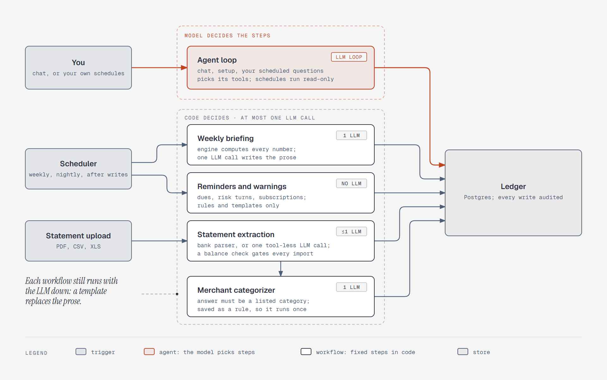

# The agent loop runs only for you

**What it shows:** Fin-Agent's paths by trigger. Your chat, and the questions you schedule
yourself, go to the one agent loop, where the model picks the steps; scheduled runs are
read-only. Built-in scheduled jobs and statement imports run as code workflows with at most one
LLM call each, and they still work when the LLM is down. Every path works on the ledger.

**Diagram type:** Architecture, with two dashed zones for "model decides" and "code decides". No
semantic pattern matched.

**What the budget forced out:** Photo extraction is left out. A photo's typed fields go to the
chat agent as a user turn ([`../design.md`](../design.md)), which would add another trigger path.
Your chat and your own schedules share one trigger node. Reads and writes share one arrow to the
ledger. 9 nodes, 10 arrows; the accent marks the agent loop and its two arrows.

**Source:** `sd-agent-vs-workflow.html` (diagram-design skill, default skin, minimal light,
doc-inline preset).

**Illustrates:** [`../system-design.md`](../system-design.md), step 2.
