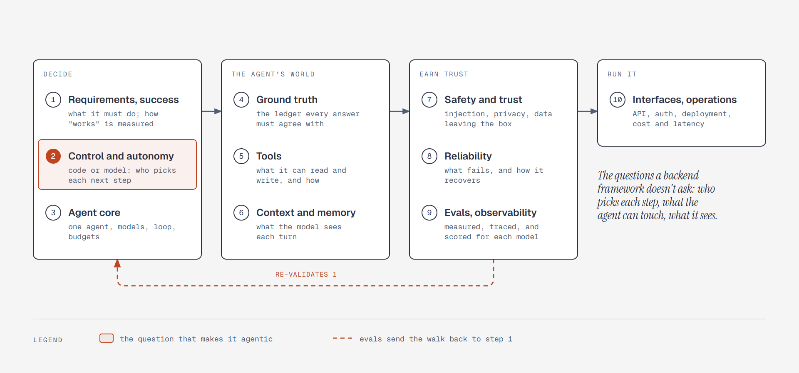

# Agentic system design in ten steps

**What it shows:** Fin-Agent's design walk as ten steps in four groups: decide (requirements,
control and autonomy, agent core), the agent's world (ground truth, tools, context and memory),
earn trust (safety, reliability, evals), and run it (interfaces and operations). Evals send the
walk back to the requirements.

**Diagram type:** Process, with each group as one box holding its steps as rows. No semantic
pattern matched.

**What the budget forced out:** Ten steps exceed the nine-node budget, so the four groups are the
nodes and the steps are rows inside them. Status isn't drawn—it changes every step, and the walk
table in [`../system-design.md`](../system-design.md) holds it. The accent marks step 2, the
question that makes the design agentic, and the evals loop back to step 1.

**Source:** `sd-framework.html` (diagram-design skill, default skin, minimal light, doc-inline
preset).

**Illustrates:** [`../system-design.md`](../system-design.md), the framework.
