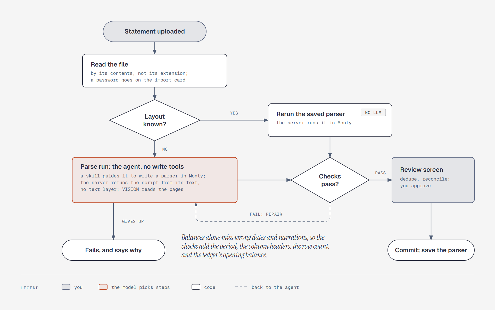

# The agent learns each statement layout once

**What it shows:** How a statement becomes ledger rows. Code reads the file by its contents. A
known layout reruns its saved parser with no LLM call. A new layout starts a parse run: the agent,
with no write tools, writes a parser in Monty, and the server reruns it from its text. Checks gate
both paths, you approve the review screen, and the parser is saved only after you commit.

**Diagram type:** Flowchart. No semantic pattern matched.

**What the budget forced out:** The readers for each file type, the host functions, and rejecting
an import on the review screen are in [`../import.md`](../import.md) and
[`../tools.md`](../tools.md). The dashed repair path covers two cases: a saved parser that fails
goes to a parse run, and a new parser that fails goes back for repair. 9 nodes, 10 arrows; the
accent marks the parse run.

**Source:** `sd-import-pipeline.html` (diagram-design skill, default skin, minimal light,
doc-inline preset).

**Illustrates:** [`../system-design.md`](../system-design.md), step 5.
