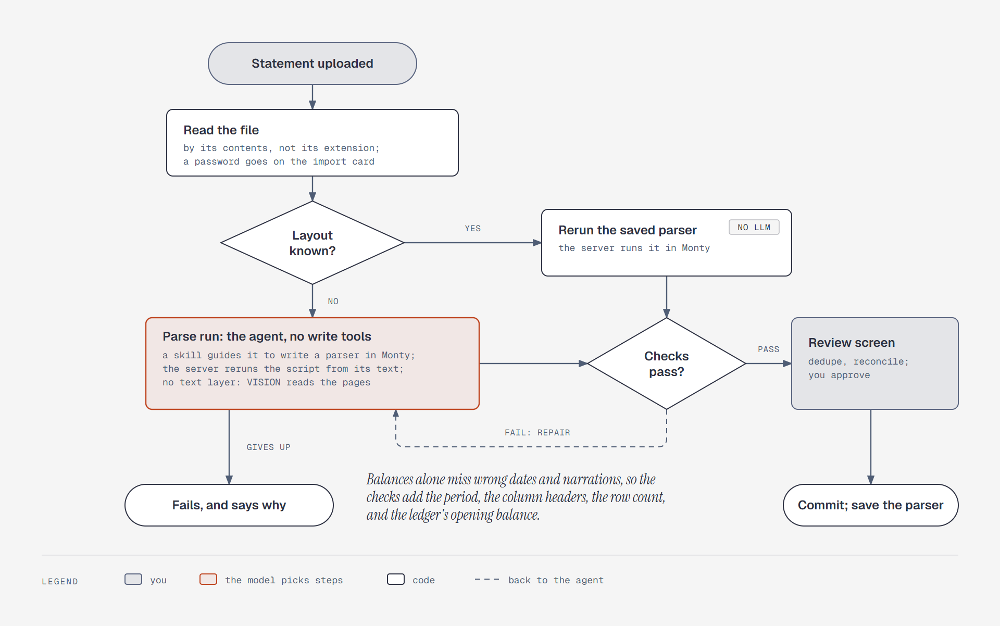
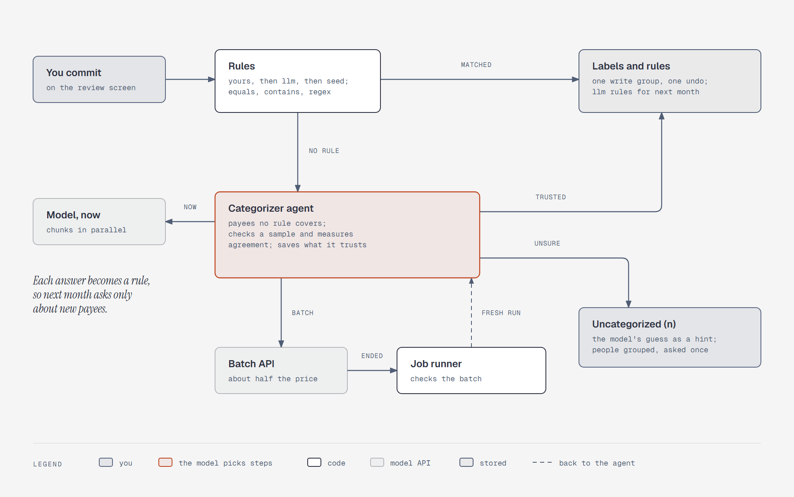

# Import

This file holds the detail behind [`plan.md`](plan.md) §2: how statements, photos, and voice
notes become ledger rows—and how imported rows reconcile with what was already logged by chat,
voice, or photo.

The `plan.md` file owns decisions, and this file owns their shape. If the two disagree, the plan
wins and this file is stale.

---

## The split: Readers once, a parser for each layout

The following table shows who does each half of an import:

| Half | Who does it |
|---|---|
| Turn any file into cells or positioned words | Fin-Agent's readers, on the host, written once |
| Turn those into rows, for one bank's layout | A script the parser subagent writes in Monty, saved as a version, and replayed or repaired on later statements |
| Check them and reconcile them | Fin-Agent's own code. No library knows its data model |

**The interface is generic.** "We only accept CSV" is never a thing the user is told. An
unsupported file gets a straight answer about what isn't wired up—and the model tries it if it
accepts that type.

---

## The pipeline



*Figure: the main agent hands the upload to a parser subagent in the background. The subagent
replays or repairs the bank's saved parser, a code gate checks it against the statement and every
stored statement from that bank, and your commit saves it as a new version
([note](diagrams/sd-import-pipeline.md)).*

An import is agent work, not a workflow with a model inside it. Reading an unfamiliar statement,
noticing that a column moved, and fixing a parser are judgment. Code keeps the parts that must not
bend: the readers, the checks, the gate, and the commit. Agreed November 7, 2026; it replaces the
job that ran a parse run as one step.

Each stage works as follows:

1. **Hand off.** You upload one or more files. The main agent calls `delegate_task` for the
   `parser` subagent with `background=True`, and your turn ends. No model copies an attachment
   ID: the parser's first tool reads the turn's files from the host. One upload is one task, so 12 monthly PDFs from a new bank get one parser, written once
   and replayed on the rest, with no two runs racing to save it.
2. **Open.** The subagent's first tool creates the import rows, so the card appears within seconds.
   The reader finds each file's type from its contents. A PDF with more than 150 pages isn't read:
   the card asks you to download it in shorter date ranges, one quarter at a time, and upload each
   one. If a file is locked, the import card shows a password field, and the subagent calls
   `wait_for_password`, a host tool that waits on the vault.
   The password goes over REST into the vault, stays in memory, is never stored, and never reaches
   either model or the chat. It doesn't go through `ask_parent`: a question there can reach the main
   agent while you're chatting, and the password must never be asked for in chat.
3. **Replay or repair.** Layouts are grouped by bank and statement type, and each set of column
   headers is a variant of that layout. A file whose headers can't be read before a parser
   runs, such as an SBI PDF, finds its layout by bank and type, and the script's printed
   headers name its variant. The subagent replays the latest version first. If it
   passes, the import is ready in a few model calls. If it fails, the subagent gets that version
   and the failing check's reason, and repairs it. A bank it has never seen gets a parser written
   from a sample. It works in Monty with the host functions, keeps a plan, and can run the checks
   itself as often as it likes ([`tools.md`](tools.md#parser-subagent-functions)). A page with no
   text layer goes to the `VISION` model.
4. **The gate** (described later). `submit_parser` reruns the script from its text in a fresh
   sandbox. That sandbox holds the same host functions and nothing else—no `files`, no `imports`,
   no document already open—so the script reads its pages itself and ends with the result. The gate
   runs the checks and replays the script on every stored statement from that bank. A failure
   returns the reason to the subagent as the tool result, and it repairs; the card stays in
   `parsing` meanwhile, because the end of the run sets the terminal status. Only a pass moves the
   import to review.
5. **Ask or report.** A fact the file can't give—which account, an opening balance that isn't
   printed—goes up through `ask_parent`. The main agent answers from the ledger when it can and asks
   you only when it can't. Doubts about single rows never block; they show on the review screen.
   The subagent ends with a report: status, reason, counts, and what's blocking. The main agent
   either resumes it with a fix or tells you the import is ready.
6. **Dedupe.** Match against earlier imports by `content_hash`.
7. **Reconcile.** Match against rows logged by chat, voice, or photo (described later).
8. **Review.** The web app shows new rows, merged rows, ambiguous matches, and the subagent's
   suggested moves between your own accounts (described later). Categories aren't on it; they
   arrive after commit. The user commits, edits, or rejects.
9. **Commit.** Write the movements through pgledger, link each statement line as a capture, and
   record the closing balance on the account. A suggested own-account line is written as a
   transfer only after the user confirms it on the review screen. If the closing disagrees with
   the ledger, the difference is a visible adjustment. Then recompute baselines, and save the
   parser as a new version.
10. **Categorize, after commit.** The commit queues the categorizer agent, which labels the new
    rows in the background (described later).

A parser version is saved only after you commit. One that failed the gate, or came from an import
you rejected, isn't saved. A committed import is undone from the Imports screen, not by the agent.

A file that isn't a statement, such as a salary slip or a loan letter, gets a plain "this isn't a
statement," and nothing is imported.

### The subagent's run

The task runs in the API process, owned by one `DelegationTasks` opened at startup. The owner's
folder, on a Docker volume, holds each task's record. The owner's `step_store` is a
`PostgresStepStore`, so every step of the subagent's run is saved as it happens; without it, the
folder saves a task's history only when the task settles or asks, and a crash mid-parse would lose
the run. So a restart loses nothing the subagent learned. After a restart the task shows as cancelled in that conversation, and you ask the
main agent to continue; it resumes the same task with its history. Resuming is safe because the
subagent writes nothing to the ledger. There is no job retry loop and no server-started turn:
reports and questions wait for the conversation's next turn, and the import card shows progress
from the database meanwhile.

The subagent has no write or ledger tools, so a crafted payee note can't reach a write. Its report
does reach the main agent, which has write tools, so the report carries counts and statuses, and
any statement text in it goes through `mark()`. The usual rule then applies: in a conversation that
has read outside text, a lasting write asks first ([`design.md`](design.md#untrusted-text-and-write-tiers)).

A file can't be parsed forever. An unreadable file, a file that isn't a statement, or a spend
ceiling ends the run with a report. You and the main agent decide what happens next.

### The import card

The card follows assistant-ui's [multi-agent pattern](https://www.assistant-ui.com/docs/tools/multi-agent):
a subagent's conversation belongs on the delegation tool call as nested `messages`, and the bound
[Task card](https://www.assistant-ui.com/elements/task-card) renders it as one card with a state
icon, a label, elapsed time, the transcript on demand, and the result below. So the main agent's
background `delegate_task` call *is* the card: a toolkit renderer for `delegate_task` reads the
task id from the harness's acceptance receipt and places the bound card itself ("Place a card
yourself" in the docs).

The AI SDK runtime never fills a tool call's `messages`, and once the chat turn has ended there is
no stream to carry the subagent's events, so the card polls `GET /api/tasks/{id}` every two
seconds while the task runs. That returns the task's state, the files and their statuses, the
pending question, and the subagent's transcript built from its live history. The parser's plan
shows inside the transcript: its `write_plan` calls render as the Agent plan element.

Two small props on our copy of the bound card carry what it has no slot for. `actions`, under the
header, holds what the task waits on: the password field for a locked file, or your accounts to
pick for "which account" (the server writes the answer from that account). Any other question
shows as plain text and is answered in chat. `result` lists each file with its status and an
"Open review" link. A run that stops before its files settle says so and asks you to continue.

### Parser versions

A layout's versions are append-only. The layout points to its active version, and rolling back
moves the pointer. Statement files are kept: an unlocked copy is stored once the file opens,
because a password is never stored. You can delete a file, which takes it out of the replay set.

The replay set is every stored statement from that bank whose import was committed and not undone.
A new version must reproduce each one's saved rows (`statement_lines`) exactly: the same dates,
amounts, balances, and descriptions. Those rows are what you approved, so they are the expected
answer. This catches a script that fits only this month. Ledger edits don't affect it; the replay
compares against the parser's saved output, not the ledger.

---

## Readers

The following table lists a reader for each kind of file, with the Monty test's result on synthetic
files ([report](../research/monty-document-parsing/README.md)):

| File | Reader | Tested |
|---|---|---|
| PDF with a text layer, password or not | `pypdfium2` (BSD-3-Clause or Apache-2.0). It gave the same words as `pdfplumber` about 10× faster | All 9 layouts |
| Scanned PDF, photo of a statement | The `VISION` model | Not tested. RapidOCR handled clean scans and a moderate photo, and returned nothing on a harsh one ([parked](parked.md#ocr-for-scanned-statements)) |
| `.xlsx`, `.xls`, `.ods`, `.xlsb` | `python-calamine` (MIT) | `.xlsb` read only, with no statement tested |
| Password-protected `.xlsx` | `msoffcrypto-tool` (MIT), then `python-calamine` | Yes |
| `.xls` that is really HTML or tab-separated text, and saved HTML | The host's `html.parser` or `csv` | Yes |
| CSV, TSV, TXT | The host's `csv`. The host decodes the file, because Monty has no cp1252 codec | Yes |
| `.docx` | `python-docx` (MIT) | Yes |
| RTF | `striprtf` (BSD-3-Clause) | Yes |
| OFX, MT940, JSON | The host's text lines | Yes, including public MT940 and OFX samples |
| CAMT.053 and other XML | The host parses it, because Monty has no XML library | Flat files only; prefixed namespaces not tested |
| ZIP of statements | The host's `zipfile`, refusing bombs and `../` paths, then each file on its own | Yes |
| `.doc`, anything else | No reader. The model tries it if it accepts that type; otherwise a straight answer | Not tested |

The readers and the helper block total about 500 lines. The helper block holds shared money, date,
and line-grouping functions, and each saved parser records the helper version it ran with.

### Parser libraries: optional

The following table lists the libraries checked against PyPI on October 7, 2026. None is required;
the spike keeps one only if it beats a written parser on real statements.

| Package | Version | License | What it covers |
|---|---|---|---|
| `xfina` | 0.10.0 | Apache-2.0 | Written in Rust (PyO3). Indian: SBI (PDF, password), HDFC, ICICI, Axis, Bank of Baroda (XLS); HDFC, ICICI, Axis cards; CAMS. ReBIT-shaped output. Three GitHub stars. Installs on Python 3.14, but recognized neither SBI file and has no Slice support |
| `bankstatementparser` | 0.0.20 (Sep 25, 2026) | Apache-2.0 OR MIT | CSV, OFX and QFX, MT940, CAMT, PDF with an LLM and vision fallback, Golden Rule check built in. No Indian banks named. Pulls LiteLLM |
| `casparser` | 1.4.1 | MIT | CAMS, KFintech, NSDL, and CDSL _Consolidated Account Statement_ (_CAS_) PDFs. Built on `pypdfium2`, no GPL dependencies. Parked with statement-driven net worth ([`parked.md`](parked.md)) |
| `monopoly-core` | Not recorded | AGPL-3.0 | Excluded by the license decision in `plan.md` §1 |

My banks: SBI (PDF or `.xlsx`, password protected), Union Bank of India (PDF, password protected),
and the Slice credit card (unlocked monthly PDFs).

---

## The spike: Milestone 21 in the plan

Timeboxed to one or two evenings. _The output is a decision for each bank, not code._ This is the
real test of the import design: the Monty test used synthetic files, with fixtures and parsers from
the same author.

To run the spike, follow these steps:

1. Download 12 months of real statements for SBI, Union Bank, and Slice.
2. Give the first statement for each bank to a fresh model in a parse run. Record the repairs, time,
   and cost, and whether the rows are right.
3. Rerun each saved parser on that bank's other 11 months, using
   [`check_real.py`](../research/monty-document-parsing/check_real.py) with `--parser`, `--period`, and
   `--ledger-opening` where needed. It prints only pass or fail and counts.
4. Run the SBI statements through `xfina`, and compare.
5. Score Tesseract, PaddleOCR, and the `VISION` model on a phone photo of a statement, using the
   checks.
6. For each bank, record the format to download, the password pattern, and any quirks—including
   which payer text (names, UPI notes) the narration carries. That's the outside text the agent will
   see ([`design.md`](design.md#untrusted-text-and-write-tiers)).

If a real statement can't be parsed in Monty, the fallback is a separate sandbox
([parked](parked.md#a-separate-code-sandbox)).

Real statements never enter the repository. Parser tests use synthetic fixtures; a git-ignored
local folder holds real files for manual runs.

**Result.** A fresh model in a parse run wrote a parser for the real SBI statement and another for
the real Slice statement; both are saved. Union Bank was not provided, so its decision is open.
Every real file had a text layer or was a spreadsheet, so OCR was not needed and the phone-photo
scoring was not run. `xfina` was not added.

| Bank | Format to download | Password | Parser result | Decision | Quirks |
|---|---|---|---|---|---|
| SBI | 12 months in one download (Nov 3, 2025 – Nov 3, 2026), PDF or `.xlsx` | Yes, both | PDF: 939 rows, `VERIFIED`, 1 repair, 321 s. `.xlsx`: 939 rows, `VERIFIED`, 0 repairs, 85 s | Saved parser (Monty). Either format works; the `.xlsx` is faster to parse | Both formats print the same rows, and the statement's own debit plus credit count equals the 939 rows. The `.xlsx` is an encrypted OLE2 file |
| Slice | One unlocked PDF for each monthly cycle; 5 cycles (May 25 – Oct 24, 2026) | No | 5/5 `VERIFIED`, 80 rows, 0 repairs, 297 s | Saved parser (Monty) | The cycle runs from the 25th to the 24th. The header prints it as a yearless `DD MON - DD MON` and the rows as `DD Mon 'YY`, so no 4-digit year appears; the period finder takes the year from the `'YY` date (commit 626e421). The exports are incomplete: the PDFs omit several repayments that the app shows (for example ₹200 on 27 Jun and ₹1,823 on 7 Jul), and one ₹4,969.91 repayment is dated 10 Sep in the PDF and 9 Sep in the app. The card's review screen asks the user to confirm an own-account transfer before commit |
| Union Bank | Unknown | Unknown | Not run | Open | Not provided |

The synthetic fixtures still pass through the readers, Monty, and `check_statement` (3/3
`VERIFIED`), and a known layout replays with no model call.

The generated counts and status words are in [`import-spike-results.md`](import-spike-results.md).
Milestone 24 (the backfill) is tracked in the completion checklist.

---

## The checks: Non-negotiable

Extraction can be wrong, especially anything model-assisted. Every import is checked _before a
single row is committed_:

```
opening_balance + credits − debits == closing_balance
```

Plus, where the statement has a running balance, every row's balance must follow from the previous
one. The result is `VERIFIED`, `DISCREPANCY`, or `FAILED`. Only a `VERIFIED` import can be committed.

A wrong balance the user trusts is worse than no answer: a mis-parsed statement silently corrupts
the ledger, and every projection downstream is wrong with no signal.

**Balances aren't enough.** In the Monty test, a day/month swap came out verified with 17 of 18
dates wrong, and a new column came out verified with 0 of 22 narrations right. A card statement
often has no running balance, so only its total is checked. So the following checks are added:

| Check | Catches |
|---|---|
| Every date falls inside the period, taken from outside the parser: a month name in the header, or the day after the ledger's last row. If the parser supplied it, a swapped format would flip both | A day/month swap |
| The normalized column headers match a known variant of the bank's layout; otherwise the subagent repairs the parser for the new variant | A new column dirtying the narrations |
| A new parser version reproduces the saved rows of every stored statement from that bank | A script that fits only this month |
| At least one row, unless the statement says there were none | A parser that drops every row when opening equals closing |
| The opening is evidenced by a user manual entry, a trusted prior/ledger balance, or the statement's printed opening. A parser fallback zero is never labeled printed. On a first card import with no prior or manual opening, the review card asks before commit | A missing opening silently defaulted to zero, or a gap between statements |

No check covers the text of a narration. A misread payee shows up on the review screen, which stays
the last guard. After commit, you fix it with a ledger edit, and you can tell the main agent so the
next version of the parser gets it right. Committed imports aren't re-parsed: their numbers are
already proven. Editing the amount of a row a statement verified is allowed, but the edit card warns
that the ledger will no longer match the bank, and the next import's opening check will fail.

The subagent can call the checks itself as tools, and does so while it works. The gate runs the same
checks again in code, so the model can't skip them or claim they passed.

### Signs

Balances are ledger-signed everywhere below the statement text: `opening`, `closing`, a row's
running balance, the check's verdict, and the account's stored statement balance. A bank's statement
prints that already. A credit card prints the amount owed as a positive number while its ledger
balance is negative, so a parser returns a card's printed balances negated: ₹4,450 owed is
`-445000`, and a card in credit is positive. `debit` is money leaving the account (a card purchase)
and `credit` is money arriving (a repayment or refund), so a row's own sign never flips.

The one place a printed figure arrives from the user is the review screen's opening answer for a
statement that prints none. That box asks for the amount owed, and the server converts it to the
ledger sign once, by account kind (`stated_opening_to_ledger` in `importers/checks.py`), before it
is stored in the review or checked. A negative amount owed is a card in credit, which is how an
overpaid card is entered. The closing adjustment then measures only what the ledger is missing: it
is zero on a statement whose rows balance against an opening the ledger already holds.

---

## Reconciliation: Logged rows versus statement rows

Logging "spent 450 on swiggy" by chat, or sharing its UPI screenshot, and later importing the
statement must not double-count.

The following table shows the three match outcomes for a statement row:

| Match | Rule |
|---|---|
| Certain | Same UPI reference number. Otherwise: same account (or the logged row had none), same amount, date within ±3 days, one candidate |
| Ambiguous | Several candidates, or amount within a small tolerance—shown on the review screen |
| None | New row from the statement |

On a merge, the statement line becomes a capture of the logged movement, and the _statement wins on
amount, date, and account_: a different date edits the movement's date, and a different amount or
account appends a reversal and the corrected transfers. The movement keeps its labels, notes,
money owed by people, photo, and link to the conversation. Logged rows still unmatched
after a statement covering their date appear on the review screen as "logged but not on the
statement"—wrong account, cash, or a mistake.

---

## Own-account moves need a human yes

A card bill, a SIP, an ATM withdrawal, or a transfer to another account you own is not spending.
It decides which accounts the money moves between, so it needs your yes before commit; a category
is only a label, so it can arrive after. The parser subagent makes these suggestions while it
reads the statement. It gets your own accounts (id, name, kind, institution, last four), and it
uses the statement's own clues: your last four digits in a narration, words such as `CC PAYMENT`
or `ATM WDL`, or a transfer to your own name. An ATM withdrawal is a move to your cash account.
The review screen shows each line as a suggested transfer, with the other account's name, and asks
you to confirm or reject it. Commit refuses to run while a suggestion is unconfirmed, so the model
cannot move money between accounts on its own. Agreed November 7, 2026; the categorizer made these
suggestions before.

When the other account's statement is imported later, its matching line (same account, same
amount, within ±3 days) merges into the transfer, so nothing counts twice.

The confirmation matters because the other statement is not always complete. Slice's monthly PDFs
for 2026 omit several repayments that its app shows, and one repayment is a day off. A confirmed
SBI line is therefore still booked when the card's PDF never printed the matching credit. The
resulting difference surfaces as the usual visible closing adjustment rather than as a silent
change to spending. The alternative, treating the line as spend, would overstate consumption.

---

## Categorizing, after commit



*Figure: after commit, rules label every row they match. The categorizer agent sends the rest to
the model, at once or as a batch, saves the answers it trusts, and leaves the rest uncategorized
with the model's guess as a hint ([note](diagrams/sd-categorize.md)).*

Categorizing is agent work in the background, and it never asks about a single row. Agreed November
7, 2026, after the old one-call-per-import categorizer took 13 sequential calls and 13 minutes on a
year of SBI, and lost its last chunks to timeouts.

**Rules first.** A rule matches a payee by `equals`, `contains`, or a regex, and has a priority.
Your rules beat the model's, and the model's beat the seed list. Each labeled row records the rule
that fired. Indian payment rails (`UPI/DR`, `NEFT`, `IMPS`, `POS`, `NACH`, `WDL TFR`) are stripped
before matching. A refund takes the category of the purchase it reverses.

**A seed list for a first import.** About 150 large Indian merchants (Swiggy, Zomato, Rapido, IRCTC,
and so on), shipped with the app and matched with `contains` or a regex, so `Zomato87` and
`SWIGGY PVT LTD E COM1 BENGALURU` both hit. Payment apps that front anything—Paytm (`ONE97`),
PhonePe, Google Pay, CRED, Amazon Pay—are marked "don't categorize by name" and go to the model
with the amount and context.

**The categorizer agent.** The commit queues a job, and the job runs the agent. It sees the payees
no rule covers, and it picks how to ask:

- `categorize_now` for a normal month: chunks sent at the same time, not one after another.
- `submit_batch` for a big backfill, when a model with a batch API is configured: about half the
  price, with results within a day. The job runner checks the batch; when it ends, it starts a fresh
  categorizer run with the results.

Either way, the agent checks a sample of the answers before it saves. Answers it trusts are saved as
`llm` rules, so next month's statement only asks about new payees. The save is one write group, so
one undo reverts it.

**Accuracy is measured, not self-reported.** A model's own confidence score is poorly calibrated.
Instead, some payees the seed list or your rules already cover are sent to the model without their
category, and its agreement rate is recorded with the run. A low rate makes the agent save less and
leave more uncategorized.

**Unsure rows stay uncategorized, never "Other."** "Other" is a real spending bucket, and guesses
in it would distort your totals. An uncategorized row keeps the model's guess as a hint and sits in
an "Uncategorized (n)" list, sorted by how often the payee appears, for whenever you want to go
through it.

**People you pay by UPI are asked about once each.** Most UPI debits go to people, and no rule or
model can tell rent from a friend's dinner share by name. The Uncategorized list groups them by
person, with the total: "₹18,400 to RAMESH K across 12 payments—who is this?" One answer becomes a
rule for that person. Nothing interrupts you; the agent never starts a conversation.

## Photos and voice

**Photos.** A receipt photo or a UPI payment screenshot (GPay, PhonePe, Paytm) → isolated vision
call (the `VISION_*` endpoint) → typed `{merchant, amount, date, method, upi_ref}` → one
transaction, logged at once, image kept as an attachment. The undo card shows the screenshot beside
the extracted fields, so a misread digit is easy to spot and undo. On Android, the installed app is a share
target, so a screenshot goes straight from the UPI app to Fin-Agent. The UPI reference number is
what later matches the row to its statement line. Line items are not extracted.

The photo endpoint runs this call, so the server adds the extracted fields to the thread's
`model_history` as a marked entry and sets the outside-text flag. The client can't touch either
([step 7](system-design.md#decisions)). The photo is saved first, so a failed vision call leaves a
retry card rather than a lost photo.

**Voice.** Push-to-talk audio → the `STT_*` endpoint (a local `speaches` server or a cloud API)
→ text → the normal chat path, sent at once with the transcript shown. A transcript is your own
words, so it doesn't flag the thread. The audio is saved first, so a failed transcription leaves a
retry card.
The `STT_*` call can carry the active payee names as a context prompt, because those are the words a
Hinglish note is most likely to mishear. It is on by default; `STT_PAYEE_CONTEXT=0` turns it off.
With a cloud endpoint, those names reach that provider as well.
Hinglish accuracy is an eval category ([L7](plan.md#6-open-questions)).

A dictation app such as [Hex](https://github.com/anomalyco/hex) needs no code from us: it pastes into
the chat box as typed text, skipping the `STT_*` endpoint, and its transcription stays on your machine.
A phone keyboard's voice typing should work the same way, but it isn't tested, and where its audio
goes isn't checked.

---

## Investments

Parked. Asset accounts take hand-updated balances; CAS import and _net asset value_ (_NAV_)
refresh come back with statement-driven net worth ([`parked.md`](parked.md)).
