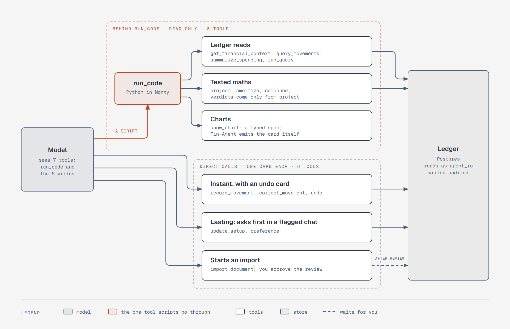

# Tools

This file holds the detail behind [system design, step 5](system-design.md#step-5-tools): each
tool's name, description, input, output, and logic. Each description is the literal text the model
reads, tuned later by evals. Field names and tool names are part of the contract, because stored
conversations replay old tool calls.

The `plan.md` file owns decisions, and this file owns their shape. If the two disagree, the plan
wins and this file is stale.



*Figure: the model sees seven tools. A script reaches the eight read tools through `run_code`, and
every write is a direct call with its own card ([note](diagrams/sd-tool-surface.md)).*

---

## Rules every tool shares

| Rule | Detail |
|---|---|
| Money out | `Money = {"paise": 300000, "text": "₹3,000"}`. Unknown is `null`, never `0` |
| Money in | The field name carries the unit. Read tools take `*_paise`, because scripts compute in paise. Write tools take `*_rupees`, as you said it, and code converts, so the model never multiplies by 100 |
| Names | Accounts, payees, and categories go in by name, and `resolve()` finds them. Movements go in by ID |
| Errors teach | An unknown or ambiguous name raises `ModelRetry`, listing the candidates. Inside a script it arrives as a catchable `Exception` with the same message; uncaught, the model gets the message and retries |
| Two payloads | Short content for the model; cards, curves, and source IDs for the UI, as `ToolReturn` metadata. Metadata from a tool called inside a script isn't streamed, so Fin-Agent emits those cards itself from the `run_code` return |
| Read returns | Only JSON-native types: `dict`, `list`, `str`, `int`, `float`, `bool`, `None`. Dates are ISO strings, and every balance has an `as_of` |
| Calling from a script | `await` and keyword arguments only: `await amortize(loan="Home loan")` |
| Coverage | `coverage()` reports which dates have statements. A gap is reported, never summed as zero |
| Outside text | `mark()` wraps the text in markers, strips any closing marker and invisible character inside it, caps it at 200 characters, and sets `conversations.outside_text_at`. The model can't set or clear this. The flag is the boundary, and the markers are only a hint ([write tiers](design.md#untrusted-text-and-write-tiers)) |
| Lists | 50 rows by default, with a cursor |
| Writes | `write_group()` is one short transaction whose audit rows share a group, returned as `undo_id`. The message ID and `ctx.tool_call_id` come from context, so they're never inputs |
| Confirm | `gate(change)`: if the conversation is flagged and `ctx.tool_call_approved` is false, raise `ApprovalRequired`. Approval ends the run and the tool runs again from the top, so it validates again. Stored history binds the answer: it counts once, only for a pending call, with the stored arguments ([step 7](system-design.md#decisions)) |
| Tier | Each tool declares its [write tier](design.md#untrusted-text-and-write-tiers) in its tool metadata |
| Old returns | Compaction can remove an old return, so no tool relies on an ID staying in the chat. `undo` reads `audit_log`, and an unknown ID raises `ModelRetry` ([step 6](system-design.md#compaction)) |

**`run_code`** comes from the harness, so Fin-Agent configures it rather than builds it. The model
writes Python that calls the read tools inside Monty. See [Code Mode](design.md#code-mode).

---

## Read tools: called from scripts

### `get_financial_context`

**Description:** "The user's whole picture: today's date, settings, accounts with balances and
ages, the next 30 days of scheduled events, goals, who owes what, remembered preferences, what setup
is missing, and data warnings. The sandbox has no clock, so get today's date here."

**Input:** none

**Output**

```python
{
  "today": "2026-10-31",
  "settings": {"currency": "INR", "floor": Money, "default_horizon_days": 90},
  "accounts": [{"name", "kind", "liquid", "balance": Money, "as_of",
                "statement_age_days", "covered": {"from", "to"}, "gaps": [...]}],
  "liquid_total": Money,
  "upcoming": [{"date", "name", "kind", "amount": Money}],
  "goals": [{"name", "target": Money, "saved": Money, "deadline", "priority"}],
  "owed": [{"person", "amount": Money, "expected_date"}],  # positive: they owe you
  "preferences": [{"id", "text"}],                         # active ones only
  "setup_gaps": ["no income schedule"],
  "warnings": ["SBI balance is 23 days old"]
}
```

UI: source IDs for citations.

**Logic**

```
settings   = read settings
accounts   = active accounts joined to v_balances as of today
for each account: coverage from imports, statement age
upcoming   = expand schedule rules over 30 days, adjust for holidays, add card due dates
goals      = goals plus the balance of each goal account
owed       = v_owed
setup_gaps = no income schedule? no floor? an account with no balance?
warnings   = stale balances + coverage gaps
mark() only the names whose row still has outside_text = true
```

The server also runs this function when a thread starts, and pins the result as the thread's snapshot
([step 6](system-design.md#what-goes-in-each-request)). A script calls it to re-read.

### `query_movements`

**Description:** "List individual movements with their transfers, category, payee, and evidence. Use
it to find a row or see what's behind a number. For totals, use summarize_spending."

**Input**

```python
query_movements(filters: MovementFilters | None = None, limit: int = 50, cursor: str | None = None)

class MovementFilters:
    period: str | None          # "this_month", "last_month", "2026-09", "2026-09-01..2026-09-15"
    account: str | None
    category: str | None
    payee: str | None
    kind: str | None
    min_paise: int | None
    max_paise: int | None
    text: str | None            # searches descriptions and notes
    include_reversed: bool = False
```

**Output**

```python
{"rows": [{"id", "date", "kind", "description", "payee", "category", "amount": Money,
           "transfers": [{"from", "to", "amount": Money}], "evidence": ["chat", "statement_line"]}],
 "total_count": int, "next_cursor": str | None,
 "coverage": {"complete": bool, "gaps": [...]}}
```

UI: row IDs for citations.

**Logic**

```
period = resolve_period(filters.period, today)     # on the host, which has a clock
names  = resolve() to IDs
rows   = movements + transfers (by movement_id in metadata) + labels + captures,
         filtered, newest first, paged
hide reversed pairs unless include_reversed
mark() the description and payee on outside rows
return rows, total_count, next_cursor, coverage(account, period)
```

### `summarize_spending`

**Description:** "Totals of money spent, net of refunds, grouped however you need. Loan principal,
card bills, investments, and money others owe never count as spending. To compare periods, call it
twice."

**Input**

```python
summarize_spending(group_by: Literal["category", "payee", "account", "month", "week", "none"],
                   period: str, filters: MovementFilters | None = None)
```

**Output**

```python
{"period": {"from", "to"}, "groups": [{"key", "amount": Money, "count": int}],
 "total": Money | None, "coverage": {"complete": bool, "gaps": [...]}}
```

UI: breakdown card and source row IDs.

**Logic**

```
period = resolve_period(period, today)
cov    = coverage(filters.account, period)
if nothing logged and no statement covers the period: return total = null with the gaps
groups = SELECT key, SUM(amount), COUNT(*) FROM v_spending ... GROUP BY key   # the database sums
if group_by == payee: mark() outside names         # grouping by category flags nothing
return groups, total, cov                          # complete = false when part has no statement
```

### `project`

**Description:** "Forecast the user's cash against their floor (the minimum balance they want to
keep). With a hypothetical purchase, also returns the yes, yes-but, or no verdict and the tradeoffs.
Never give your own verdict. State the data_quality notes in your answer."

**Input**

```python
project(horizon_days: int | None = None, hypothetical: Hypothetical | None = None)

class Hypothetical:
    amount_paise: int
    date: str
    method: Literal["account", "card", "emi"]
    emi_months: int | None = None
    account: str | None = None
```

**Output**

```python
{"floor_probability": 0.93, "median_low": {"amount": Money, "date"},
 "first_floor_crossing": str | None,
 "goals": [{"name", "completes_on", "slips_days"}],
 "verdict": "yes" | "yes-but" | "no" | None,
 "tradeoffs": [{"kind", "detail"}],
 "data_quality": {"balance_ages", "baseline_sources", "gaps", "setup_gaps"}}
```

UI: daily curve (median and P10-P90), source IDs, projection card.

**Logic**

```
horizon = max(90 days, furthest goal deadline, asked horizon)
inputs  = liquid balances, expanded schedules, card cycles, goal contributions,
          money owed with an expected date, baselines
runs    = 1,000 seeded walks; each day apply income, obligations, card dues,
          goal contributions, resampled variable spend
curve   = median and P10-P90 for each day
floor_probability = share of runs that never cross the floor
if hypothetical:
    rerun with it
    if threshold met, no goal slips, no obligation missed: verdict = yes
    else:
        tradeoffs = rerun for: wait until date X, card or EMI, delay a goal, cut a category
        verdict   = yes-but if any works, otherwise no
```

"Wait until date X" is already a tradeoff, so a script doesn't need to sweep dates. The engine is
detailed in [The projection engine](design.md#the-projection-engine).

### `run_query`

**Description:** "Read-only SQL for questions the typed tools can't answer, including conversation
search. Try query_movements and summarize_spending first. Prefer the views v_spending, v_cashflow,
v_balances, and v_owed. Schema: …"

**Input:** `run_query(sql: str)`

**Output**

```python
{"columns": [...], "rows": [[...]], "row_count": int, "truncated": bool, "sql": str}
```

UI: the SQL, shown next to the answer.

**Logic**

```
connect as agent_ro                    # SELECT only, no auth tables
in a read-only transaction, under a client-side deadline:
    SET LOCAL statement_timeout = '2s'
    run the SQL with prepare=True      # the extended protocol rejects a second statement
    fetch up to 1,001 rows
    always roll back                   # undoes anything the statement set
truncated = got 1,001
whole NUMERIC values → int             # Code Mode would turn a Decimal into a string
mark() every text value; always set the flag
on SQL error: ModelRetry(Postgres's message)
```

The grants are the boundary. Everything else here is an extra layer, because the role can change its
own settings ([step 7](system-design.md#decisions)). `mark()`'s cap applies here too, so a message
search returns snippets, and the model can use `substr` to read further.

### `amortize`

An EMI is the fixed monthly loan payment. Amortization is how each EMI splits into interest and
principal.

**Description:** "Loan maths: EMI, total interest, payoff date, and the monthly schedule. Pass a
loan's name or its terms. Add prepay to compare a lump-sum prepayment. Use this instead of writing
the formula."

**Input**

```python
amortize(loan: str | None = None, principal_paise: int | None = None,
         annual_rate: float | None = None, months: int | None = None,
         prepay: Prepay | None = None)

class Prepay:
    amount_paise: int
    at_emi: int = 1                                   # before which EMI, counting from the next one
    reduce: Literal["tenure", "emi"] = "tenure"       # finish sooner, or pay less each month
```

**Output**

```python
{"emi": Money, "months": int, "total_interest": Money, "payoff_date": str | None,
 "schedule": [{"n", "date", "interest_paise", "principal_paise", "balance_paise"}],
 "prepay": {"new_emi": Money, "new_months": int, "new_total_interest": Money,
            "interest_saved": Money, "months_saved": int} | None,
 "assumptions": ["8.5% as you entered it; a floating rate can change"]}
```

**Logic**

```
if loan: P = ledger balance; r = rate / 1200; emi = its EMI schedule's amount
else:    r = annual_rate / 1200; emi = P·r·(1+r)^n / ((1+r)^n − 1); if r == 0: emi = P / n
if emi <= first month's interest: ModelRetry("this EMI never repays the loan")
schedule = each month: interest = round(balance·r)
                       principal = min(emi − interest, balance)
                       balance −= principal
if prepay:
    subtract amount before EMI at_emi
    reduce = tenure: same EMI, walk to zero
    reduce = emi:    recompute EMI over the remaining months
    compare totals
```

This runs on the host with `Decimal`. `record_movement` uses the same function to split an EMI.

### `compound`

**Description:** "Growth of a monthly investment at an assumed annual rate. The rate is an
assumption, not a prediction or advice: state it in your answer."

**Input:** `compound(monthly_paise: int, annual_rate: float, months: int, start_paise: int = 0)`

**Output**

```python
{"final": Money, "contributed": Money, "growth": Money,
 "yearly": [{"year", "balance_paise"}],
 "assumptions": ["12% a year, assumed", "paid at the start of each month"]}
```

**Logic**

```
r = annual_rate / 1200
balance = start
each month: balance = (balance + monthly) · (1 + r)    # how Indian SIP calculators count it
contributed = start + monthly · months
growth = final − contributed
```

### `show_chart`

**Description:** "Show the user a chart: line, bar, stacked_bar, or donut. Take values from variables
in your script, never typed by hand. Use one when a shape says more than a sentence."

**Input**

```python
show_chart(type: Literal["line", "bar", "stacked_bar", "donut"], title: str,
           series: list[Series], unit: Literal["paise", "count", "percent"] = "paise",
           as_of: str | None = None)

class Series:
    name: str
    points: list[Point]    # Point = {"x": str, "y": int}
```

**Output:** Model: `{"chart_id", "shown": True}`. UI: the checked spec, `as_of`, and the script as
its citation.

**Logic**

```
validate: series and point limits, a donut has one series, values are numbers
attach the script that made it
after run_code returns: read the spec from its metadata and emit it as a data part,
                        stored with the message so it survives a reload
no ledger write, no audit
```

---

## Write tools: normal tool calls

### `record_movement`

**Tier:** always instant, with an undo card.

**Description:** "Log money that moved: expense, income, transfer (card bill, SIP, saving to a goal),
split, loan EMI, refund, or settling money owed. Say what happened; code works out the transfers.
Ask first if the amount is missing or a split isn't clear. Pass category only if the user named one;
otherwise pass category_guess."

**Input**

```python
record_movement(movement: Expense | Income | Transfer | Split | LoanPayment | Refund | Settlement,
                not_duplicate: bool = False)

# All kinds also take: date=None, note=None, attachment_id=None
Expense:     amount_rupees, payee, account=None, category=None, category_guess=None
Income:      amount_rupees, payee, account=None
Transfer:    amount_rupees, from_account, to_account
Split:       total_rupees, my_share_rupees, people=[{name, amount_rupees, expected_date=None}],
             payee, account=None, category=None, category_guess=None
LoanPayment: amount_rupees, loan, account=None
Refund:      amount_rupees, payee, account=None, category=None
Settlement:  amount_rupees, person, direction=Literal["they_paid", "i_paid"], account=None
```

**Output**

```python
{"status": "recorded", "movement_id", "undo_id", "date",
 "summary": "₹450 to Swiggy from SBI savings, Food",
 "transfers": [...], "account_source": "stated" | "usual",
 "category_source": "stated" | "rule" | "guess" | "none"}
# or
{"status": "possible_duplicate", "existing": {"movement_id", "date", "summary"}}
```

UI: undo card, with the screenshot beside the fields if it came from a photo.

**Logic**

```
key = message_id + ctx.tool_call_id
if a movement has this key: return it                    # a retry
if date > today: ModelRetry("use a schedule for future payments")
if a split's parts don't add up to the total: ModelRetry(...)

account  = stated, else this payee's usual account, else the only liquid account,
           else ModelRetry("which account?")
payee    = find or create
           outside_text = came from a photo, or (flagged and name not in your message)
category = stated, else your rule, else llm rule, else guess (saved as an llm rule), else none

if same account, amount, payee logged by chat within 10 min and not not_duplicate:
    return possible_duplicate                            # writes nothing; the model asks

transfers = by kind:
    expense     account → Spending, labeled
    income      Income → account
    transfer    from → to
    split       account → Spending (your share); account → each person
    loan        account → Loan (principal); account → Spending (interest), split by amortize
    refund      Spending → account, labeled
    settlement  they_paid: person → account; i_paid: account → person

write_group:
    pgledger_create_transfers(transfers, key, event_at = noon India time)
    insert movement, labels, capture (upi_ref from the server's extraction, never typed by the model)
queue the risk check
```

### `correct_movement`

**Tier:** always instant, with an undo card, including `scope="all"`
([decided in step 1](system-design.md#retroactive-payee-corrections)).

**Description:** "Fix a logged movement: category, payee, note, expected date, date, amount, account,
or delete it. For a category or payee, scope sets how far it goes: this row, this row and future
ones, or all rows past and future ('ramesh@okaxis is my landlord')."

**Input**

```python
correct_movement(movement_id: str, changes: Changes,
                 scope: Literal["this", "future", "all"] = "this")

class Changes:
    category: str | None
    payee: str | None
    note: str | None
    expected_date: str | None
    date: str | None
    amount_rupees: Decimal | None
    account: str | None
    delete: bool = False
```

**Output:** `{"status", "undo_id", "summary", "rule": "Swiggy → Groceries" | None, "rows_changed":
int}`. UI: undo card naming the rule and the row count.

**Logic**

```
m = load(id), else ModelRetry
if m is already reversed: ModelRetry
write_group:
    category, payee, note, expected date → edit transfer_labels   # ledger untouched
    date → edit movements.date                                    # ledger untouched
    amount or account → new movement, reverses_id = m:
                        opposite transfers + corrected transfers, one batch
    delete → new movement, reverses_id = m: opposite transfers only
    if scope != "this":
        upsert rule (payee → category, source = user), replacing any llm rule
        set the payee's default category
    if scope == "all":
        relabel the payee's past transfers; rows_changed = count
queue the risk check if amount, account, date, or delete changed
```

### `update_setup`

**Tier:** lasting. Instant in a clean conversation, confirm card in a flagged one.

**Description:** "Change the user's setup: accounts, stated balances, schedules (income, EMIs, rent,
subscriptions), goals, categories, payees, settings such as the floor, and scheduled questions. Not
for logging money that moved."

**Input**

```python
update_setup(entity: Literal["account", "balance", "schedule", "goal", "category",
                             "payee", "settings", "scheduled_question"],
             action: Literal["add", "update", "archive"],
             data: ...)  # a typed model for each entity, for example:

# balance:  {account, balance_rupees, as_of}
# schedule: {name, kind, subtype, amount_rupees, account, category, rule, starts, ends, confirmed}
# goal:     {name, target_rupees, deadline, priority}
# scheduled_question: {prompt, rule, spend_limit_usd}
```

**Output:** `{"status": "saved", "undo_id", "summary", "before", "after"}`. UI: undo card, or the
confirm card first.

**Logic**

```
validate data for this entity; resolve names; parse the schedule rule
change = the exact before and after
gate(change)
write_group:
    account: create the pgledger account and accounts row; opening balance from equity
    balance: diff = stated − ledger; if diff: adjustment movement against equity
             set statement_balance and as_of
    goal:    create the goal account and goals row
    other:   insert or update; archive sets active = false, never deletes
    if approved: clear outside_text on the names shown on the card
queue the risk check if the money picture changed
```

### `preference`

**Tier:** lasting.

**Description:** "Remember a lasting fact or rule about the user, or forget one. Call it unprompted
when you notice one, such as 'Mom's monthly transfer isn't discretionary.' Never store a number the
ledger owns."

**Input:** `preference(action: Literal["remember", "forget"], text: str | None = None, id: str |
None = None)`

**Output:** `{"status": "remembered" | "forgotten", "id", "undo_id", "text"}`. UI: "Remembered" card
with undo, or the confirm card first.

**Logic**

```
gate(the exact text)                  # both actions: forgetting a rule lasts too
remember:
    same text already active: return it
    insert(created_by = agent, source_message_id, active = true)
forget:
    find by id, else ModelRetry listing active preferences
    set active = false                # stays listed in Settings, and can be turned back on
```

**Delete is not in this tool.** Settings can delete a preference for good, with a confirm. That also
blanks its text in the audit rows, or it wouldn't really be deleted, and it can't be undone. Keeping
it out of the tool means every write the agent makes stays undoable, and a tool with a mode undo
can't reverse would fire the [Guardrails trigger](harness.md#later-with-triggers). In chat, the agent
turns the preference off and points you to Settings.

### `import_document`

**Tier:** writes only an import in review state. The ledger is untouched.

**Description:** "Start importing an uploaded statement. Returns a status and a review link; the user
approves on the review screen, and you can't commit an import. If the file needs a password, tell
the user to enter it on the import card. Never ask for it in chat."

**Input:** `import_document(attachment_id: str)`

**Output**

```python
{"import_id", "status": "parsing" | "needs_password" | "needs_input" | "review"
                        | "not_a_statement" | "failed",
 "account", "period",
 "counts": {"new", "merged", "ambiguous", "logged_not_on_statement"},
 "check": "VERIFIED" | "DISCREPANCY" | "FAILED" | None,
 "reason": str | None}
```

No statement text is in this return, so calling it doesn't flag the conversation. UI: import card
with the password field and the review link.

**Logic**

```
if this file's hash is already imported: return that import
create the import (status = parsing); run off the chat path (how: step 8)
    open the file by its contents; if locked: status = needs_password and stop
        the password arrives over REST on the card, stays in memory,
        is never stored and never reaches the model
    fingerprint = the column headers, normalized
    if a saved layout matches: rerun its parser in Monty; if the checks pass: go to review
    otherwise: start a parse run (below)
        it ends with a submitted parser, not_a_statement, needs_input, or gave up
review: dedupe by content_hash; reconcile against logged rows; status = review
committing is a REST endpoint on the review screen; no tool does it
commit: write the movements, then save the parser in statement_layouts
```

### `undo`

**Tier:** always instant.

**Description:** "Undo a write. With no ID, it undoes the last write in this conversation. Use the
undo_id from a write's result for an earlier one."

**Input:** `undo(undo_id: str | None = None)`

**Output:** `{"status": "undone" | "already_undone" | "conflict", "summary", "conflicts": [...]}`.
UI: a card saying what was reverted.

**Logic**

```
group = undo_id, or the last un-undone group in this conversation, else ModelRetry
if group is a committed import: ModelRetry("undo imports from the Imports screen")
if group.undone_at: return already_undone
if a later write changed any of its rows: return conflict, naming them   # changes nothing
write_group:
    ledger rows: a reversal movement with opposite transfers
    other rows:  restore the before JSON
    set undone_at
queue the risk check
```

The undo button on a card calls this same function over REST, so undo works without the LLM.

---

## Parse run functions: new statement layouts only

A parse run is the same agent and model with a different toolset: `run_code` and `load_capability`,
for the `parse-statement` skill. It has no write tools and no ledger tools, the way scheduled
questions have no write tools. A script reaches the functions below. Rows stay on the host, and
`run_code` returns counts, status, and a sample, so a statement's text doesn't fill the context.

The run's output is one of the following: `parser_submitted`, `not_a_statement` with the kind it
found, `needs_input` with a question for the import card, or `gave_up` with the reason.

| Function | Description | Input | Output |
|---|---|---|---|
| `doc_info` | What the file is | none | `{"kind", "pages", "text_layer_pages", "sheets", "delimiter", "encoding"}` |
| `doc_words` | One page's words with positions | `page` | `[{"text", "x0", "x1", "top", "bottom"}]` |
| `doc_words_range` | Many pages at once; use this past a few pages | `first`, `last` | The same words, for each page |
| `doc_cells` | A sheet's rows. Text formats arrive as one-line cells | `sheet=0` | `[[cell, ...], ...]` |
| `ledger_opening` | The account's ledger balance before this statement, for statements that print none | `account` | `{"paise", "as_of"}` or `null` on a first import |
| `check_statement` | The checks, on rows a script produced | `rows`, `opening`, `closing` | `{"status", "reason", "computed_closing", "chain_breaks", ...}` |
| `transcribe_page` | An isolated, tool-less `VISION` call, for a page with no text layer | `page` | Typed rows |
| `submit_parser` | Submit a script. The model never submits rows | `code` | `{"status", "counts", "sample", "reason"}` |

**`check_statement`**

```
FAILED if an amount isn't a non-negative integer, a date isn't ISO, or opening or closing is missing
FAILED if zero rows, unless the statement says there were none
DISCREPANCY if opening + credits − debits != closing
DISCREPANCY if a printed running balance doesn't follow from the row before it
DISCREPANCY if a date falls outside the period
    # the period comes from outside the parser: a month name in the header,
    # or the day after the ledger's last row for this account
DISCREPANCY if the printed opening differs from ledger_opening
VERIFIED otherwise
```

**`submit_parser`**

```
rerun the script's text in a fresh AsyncMonty           # only this proves it stands alone
    prepend the helper block at its current version
    os_policy blocks the clock and random; sleep limit set
run check_statement on what it returned
keep the rows on the host; return counts and a five-row sample
if VERIFIED: the import moves to review, holding the script and its fingerprint
```

Details of the readers and the checks are in [`import.md`](import.md).
