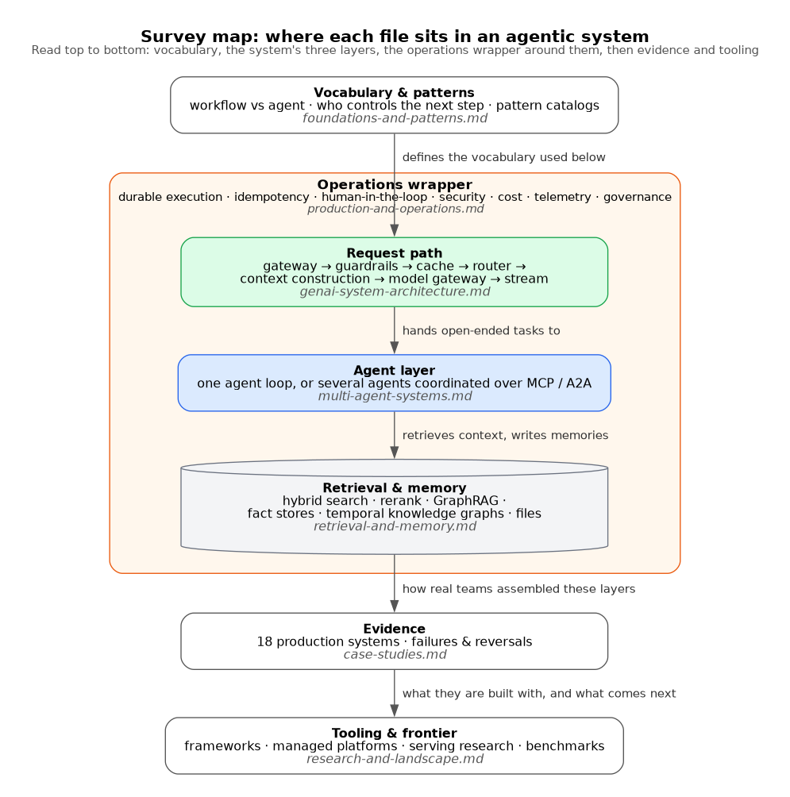

# Research: Agentic & GenAI System Design

Independent survey of **GenAI / agentic system design** as a field, conducted **2026-10-18**.

**This is deliberately unfiltered by any project's requirements.** It records what exists — the
architectures, patterns, evidence, tooling and failures in public view — not what any particular
system should adopt. Applying it to a specific build is a separate exercise; do not read these
files as recommendations.

It is a companion to [`../agent-harness-engineering/`](../agent-harness-engineering/), which
covers what goes on *inside* one agent (the loop, context engineering, tool design, sandboxing).
This survey sits one level up: how whole systems are composed around models and agents — the
request path, pattern selection, multi-agent topology, retrieval and memory, serving, durability,
governance — and what named companies actually shipped.

Thirteen starting sources (System Design Handbook, genaisystemdesign.com, DesignGurus, MongoDB,
`alirezadir/Agentic-AI-Systems`, Gerred Dillon's series, Anthropic, Google Cloud,
`gtzheng/Awesome-Agentic-System-Design`, Exabeam, Databricks, IBM) were all read in full; the
survey then went outward to roughly 340 further vendor, academic and practitioner sources.

## Index

*Figure: the three topic files in the middle describe the layers of one system; operations wraps all
of them, and the case studies and landscape files sit outside as evidence and tooling.*

| File | Covers |
|---|---|
| [`foundations-and-patterns.md`](foundations-and-patterns.md) | Workflow vs agent, autonomy spectra, core components, and a **cross-vendor pattern-name mapping** (Anthropic, Google, Microsoft, AWS, OpenAI, LangGraph, IBM, Ng, 12-Factor) |
| [`genai-system-architecture.md`](genai-system-architecture.md) | The canonical **request-path reference architecture**, component table, model serving (vLLM/TGI/TRT-LLM), capacity/latency/cost estimation, interview frameworks and 11 classic interview problems |
| [`multi-agent-systems.md`](multi-agent-systems.md) | 10 topologies compared, the Anthropic-vs-Cognition debate, independent evidence (MAST, Google/MIT scaling study), shared state vs messages, MCP / A2A protocol state |
| [`retrieval-and-memory.md`](retrieval-and-memory.md) | Naive → agentic RAG, the hybrid + rerank stack, long-context vs RAG, GraphRAG, vector-store trade-offs, agent memory architectures and their contested benchmarks, text-to-SQL |
| [`production-and-operations.md`](production-and-operations.md) | Durable execution, idempotency, human-in-the-loop, guardrails, system-level security, cost/latency engineering, OTel GenAI telemetry, eval drift, EU AI Act / NIST timelines |
| [`case-studies.md`](case-studies.md) | **18 production systems** (Anthropic, Uber ×2, Shopify, LinkedIn ×2, DoorDash, Klarna, Replit, Cursor, Cognition, Notion, Harvey, Intercom, Amazon, Morgan Stanley, Manus…), recurring patterns, and a failures-and-reversals section |
| [`research-and-landscape.md`](research-and-landscape.md) | Serving research for agent workloads, automated agent design (ADAS, AFlow, DSPy/GEPA), benchmarks and METR time horizons, and a comparison of 11 frameworks + 5 managed platforms |
| [`sources.md`](sources.md) | How the starting sources were used, tagging scheme, and where each file's full bibliography lives |
| [`diagrams/`](diagrams/) | Every figure as PNG + SVG + editable source (Graphviz / Mermaid / PlantUML), each with a short `.md` note on what it shows and why that diagram type. Rendered via [Kroki](https://kroki.io); one shared colour key: blue = model, green = deterministic code, orange = human/oversight, red = risk, grey = data, purple = external |

## Executive summary

1. **Every serious source draws the same line: who decides the next step — code or model.**
   *Workflows* (prompt chaining, routing, parallelisation, orchestrator-workers,
   evaluator-optimizer) keep control in code; *agents* hand it to the model. Vendors use different
   names for the same shapes — "prompt chaining" = Google's "sequential" = Microsoft's
   "sequential orchestration"; "orchestrator-workers" ≈ OpenAI "manager" ≈ Google "coordinator".
   [`foundations-and-patterns.md`](foundations-and-patterns.md) §3 maps them side by side.

2. **The unanimous advice is "the simplest thing that works, single agent first."** Anthropic,
   OpenAI, Google, Microsoft, MongoDB and Hugging Face all say it. The sharpest version is
   12-Factor Agents: the "loop until done" agent is *not* what most production systems run;
   they run deterministic code with LLM steps embedded. The case studies bear this out — Uber,
   LinkedIn and DoorDash all shipped **narrow, individually-scorable stages orchestrated by code**.

3. **The reference architecture has stabilised.** Across Chip Huyen, a16z, the System Design
   Handbook and interview guides, one request path recurs: gateway → stateless orchestrator →
   input guardrails → cache → router → context construction (retrieve, rerank, assemble) → model
   gateway → optional agent loop with read/write-split tools → output guardrails → stream,
   wrapped in observability, evals and a feedback flywheel. Huyen's build order is incremental —
   add each box only when needed. [`genai-system-architecture.md`](genai-system-architecture.md) §2
   draws it as a two-part [reference architecture](diagrams/arch-reference-architecture.png).

4. **Multi-agent is the field's main live argument, and it has narrowed to one rule:
   fan out reads, keep writes single-threaded.** Anthropic reports +90.2% from orchestrator-worker
   research at ~15× chat tokens, but its own analysis attributes ~80% of variance to token spend.
   A Google/MIT study of 180 configurations found +80.9% on parallelisable tasks and **−39% to
   −70% on sequential ones**; Tran & Kiela (2026) found single agents match multi-agent at equal
   thinking budgets. Cognition went from "Don't Build Multi-Agents" (2025) to bounded hierarchies
   with serialised writes (2026). Justify each extra agent by context isolation, real parallelism
   or independent review.

5. **Cost scales by an order of magnitude per step up the autonomy ladder.** Anthropic's figures
   — agents ~4× chat tokens, multi-agent ~15× — recur in four of the seven files. The dominant
   cost lever in practice is **prompt caching** (cache reads at 0.05–0.1× input price); Manus
   designs its entire context layout around KV-cache hit rate at ~100:1 input:output. Routing to
   cheaper models is the first lever in every architecture guide.

6. **RAG has moved from a pipeline to a tool the agent calls.** The best-quantified recipe is
   still contextualised chunks + BM25/dense fusion + reranking (Anthropic: top-20 retrieval
   failure 5.7% → 1.9%). "RAG is dead" is half right: small corpora go in the prompt and coding
   agents moved to grep-style search, but long-context accuracy decays (NoLiMa: 11 of 13 models
   below half their short-context score at 32K). Consensus: **route, don't pick**. GraphRAG wins
   only on corpus-wide sensemaking questions, at heavy indexing cost.

7. **Agent memory has no settled architecture and its benchmarks are not trustworthy.** Four
   families coexist — extracted fact stores (Mem0), temporal knowledge graphs (Zep/Graphiti),
   self-editing OS-style tiers (Letta), and plain files. Vendors publish conflicting LoCoMo
   numbers; in Mem0's own paper, full context beats every memory layer on accuracy; an
   independent reproduction found published LongMemEval claims off by −28 to +3 points.

8. **Durability and idempotency are the production substrate, not an add-on.** Temporal,
   Restate, DBOS, Inngest and LangGraph checkpointers all converge on journaling every
   non-deterministic step. But the journal does not make side effects safe — **idempotency keys
   do**. LangGraph re-executes the interrupted node from its start on resume.

9. **Guardrail classifiers are not a security boundary.** A 14-author paper from OpenAI,
   Anthropic and DeepMind researchers broke 12 published prompt-injection defences with >90%
   adaptive-attack success. Security thinking has moved to *architectural constraint*: Simon
   Willison's lethal trifecta, Meta's Rule of Two, the six injection-resistant design patterns,
   CaMeL (provable security at a ~7-point utility cost). Probabilistic filters sit behind
   deterministic limits on what an agent can reach.

10. **Evaluation is calibrated, tiered and starts small — and benchmarks rot.** Shopify raised
    LLM-judge agreement with humans from κ 0.02 to 0.61 (human ceiling 0.69) before trusting it;
    Notion runs regression, launch (80–90% gate) and headroom (~30%) suites. OpenAI dropped
    SWE-bench Verified in Feb 2026 over flawed tests and contamination. OpenTelemetry's GenAI
    conventions are the only cross-vendor telemetry standard and are still "Development".

11. **Harnesses get rebuilt, and removing structure helps as often as adding it.** Notion rewrote
    its agent harness 4–5 times; Cursor's multi-agent coordination went locks → optimistic
    concurrency → planner/worker, then deleted a role that had become a bottleneck. Frameworks
    churn too: AutoGen folded into Microsoft Agent Framework (1.0, Apr 2026), ADK 2.0 broke 1.x,
    OpenAI's Agent Builder shuts down 2026-11-30. Anthropic's "start with raw APIs" advice targets
    thin orchestration frameworks, not full harnesses.

12. **The failures are instructive and mostly about scope, not model quality.** Klarna reversed
    its "700 agents" automation after quality fell; Air Canada was held liable for its bot's
    invented policy; Cursor's support bot invented a device policy; Replit's agent deleted a
    production database during a code freeze. The common thread: **ungrounded agents invent
    policy, and privilege separation must be infrastructure, not instruction.** Gartner forecasts
    over 40% of agentic projects cancelled by end of 2027.

## Cross-cutting themes

Ideas that surfaced independently in several files, which is the strongest signal this survey
offers.

| Theme | Where it appears |
|---|---|
| **Control belongs in code until the model has earned it** | 12-Factor Agents and workflow-first guidance (foundations); narrow stages at Uber/LinkedIn (case studies); interview guides put orchestration in a stateless service (architecture) |
| **Read/write asymmetry** | Parallel reads, serialised writes (multi-agent); read vs write tools with approval on writes (architecture); idempotency on side effects (production); Replit's prod-DB incident (case studies) |
| **Context is the scarce resource** | Context isolation as multi-agent's real benefit; long-context decay vs retrieval; KV-cache-shaped prompts (Manus); progressive tool disclosure past 100 tools (Notion) |
| **Token spend explains much of the "architecture" gain** | Anthropic BrowseComp 80% variance; Tran & Kiela equal-budget result; Terminal-Bench harness spread (landscape) |
| **Vendor numbers dominate and often conflict** | Memory benchmarks; vector-DB head-to-heads (all vendor-authored); serving speedups; case-study outcomes almost entirely self-reported |
| **Deterministic boundaries outrank probabilistic ones** | Guardrails vs adaptive attacks; Rule of Two / CaMeL; semantic layers vs raw text-to-SQL; durable journals vs retry-and-hope |
| **Human gates should be few and high-value** | Approval-fatigue evidence; Rule of Two; DoorDash/LinkedIn human fallback; EU AI Act Art. 14 oversight |

## Where the evidence is thin

- **No head-to-head benchmarks of the vendor pattern catalogs.** Pattern selection advice is
  qualitative everywhere.
- **Failure taxonomies predate current models.** MAST (14 failure modes, 41–86.7% failure rates)
  used 2023–2024 models; no comparable 2026 trace study was found.
- **Saga / compensation for agent side effects** is described only in vendor blogs.
- **Self-hosting break-even, semantic caching value, and speculative-decoding gains at high
  batch** are asserted by interview guides with unaudited or vendor-only numbers.
- **genaisystemdesign.com's "case studies" are design walkthroughs** of hypothetical companies,
  not deployments; Gerred Dillon's series reports success metrics without sources.

## Reading note

Numbers are quoted as reported by their sources and are overwhelmingly **self-reported by
vendors or the companies involved** — treat them as directional. Each file tags every source
`[read]` / `[summary]` / `[indexed]` and marks secondhand or unverified claims inline. Leaderboard
and pricing figures move fast; re-check against the owner's page before relying on one. Claims
each file flags as unverified include the EU Digital Omnibus adoption dates (secondary sources
only), some 2026 arXiv IDs in the awesome list, Cognition's April 2026 follow-up post (seen only
via a ZenML summary), and a System Design Handbook cost example that does not reconcile with
published list prices.
