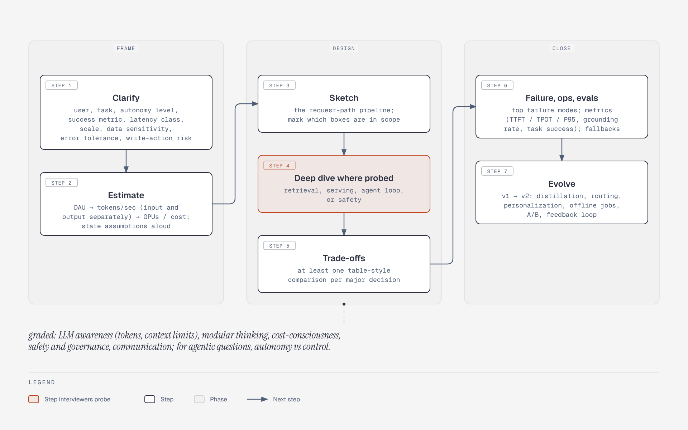

# Merged GenAI interview template

**What it shows.** The seven steps of the merged template grouped into frame (clarify, estimate), design (sketch, deep dive, trade-offs) and close (failure/ops/evals, evolve); the interviewer-grading criteria appear as a callout.

**Diagram type.** Process (a flat sequence of steps in three phase zones; the lane grammar of the full Process type was not needed).

**What the budget forced out or split.** The five short transition phrases on arrows ('requirements fix the load', and so on) were dropped: they are not in the topic file's step list and would exceed the arrow-label limit.

**Assumptions.** Deep dive is the single accent because the interviewer picks which box to probe.

**Source.** `arch-interview-framework.html` (diagram-design skill, default skin, minimal light, doc-inline width 960; height extended where content needs it). Content comes from the topic file genai-system-architecture.md; no claims or numbers added.
