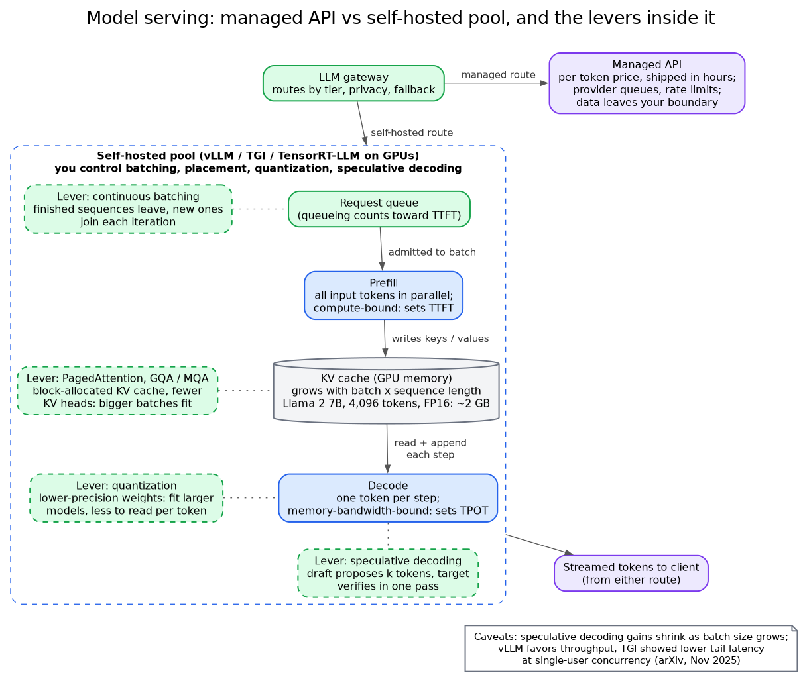

# Model serving: managed API vs self-hosted pool, and the levers inside it

**What it shows.** The LLM gateway's two routes, and inside the self-hosted pool the queue, prefill, KV cache and decode path with the four levers (continuous batching, PagedAttention / GQA, quantization, speculative decoding) attached to the part each one acts on.

**Why this diagram type.** Graphviz: a flow with attached annotations; a table (already in the text) would not show where each lever acts.

**Design decisions.** Blue = model compute, grey cylinder = KV cache, dashed green = levers. The KV example figure is NVIDIA's from section 4.1; no new numbers.

**Assumptions and source.** From section 4.1 and 4.2. Source caveats on engine comparisons are repeated in the figure note. Illustrates section 4.
