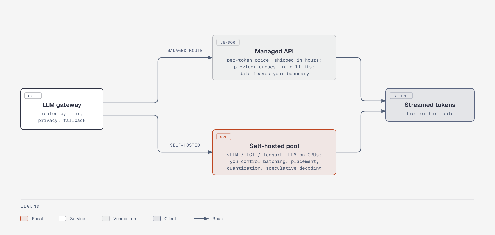

# Model serving: managed API vs self-hosted pool

**What it shows.** The LLM gateway routes to a managed API or a self-hosted GPU pool; both return streamed tokens to the client.

**Diagram type.** Architecture (two parallel routes).

**What the budget forced out or split.** New split-off figure holding the first half of the old serving figure; the pool internals are in `arch-model-serving-levers`.

**Assumptions.** Small specialist models are not drawn (they appear in the reference architecture).

**Source.** `arch-model-serving-routes.html` (diagram-design skill, default skin, minimal light, doc-inline width 960; height extended where content needs it). Content comes from the topic file genai-system-architecture.md; no claims or numbers added.
