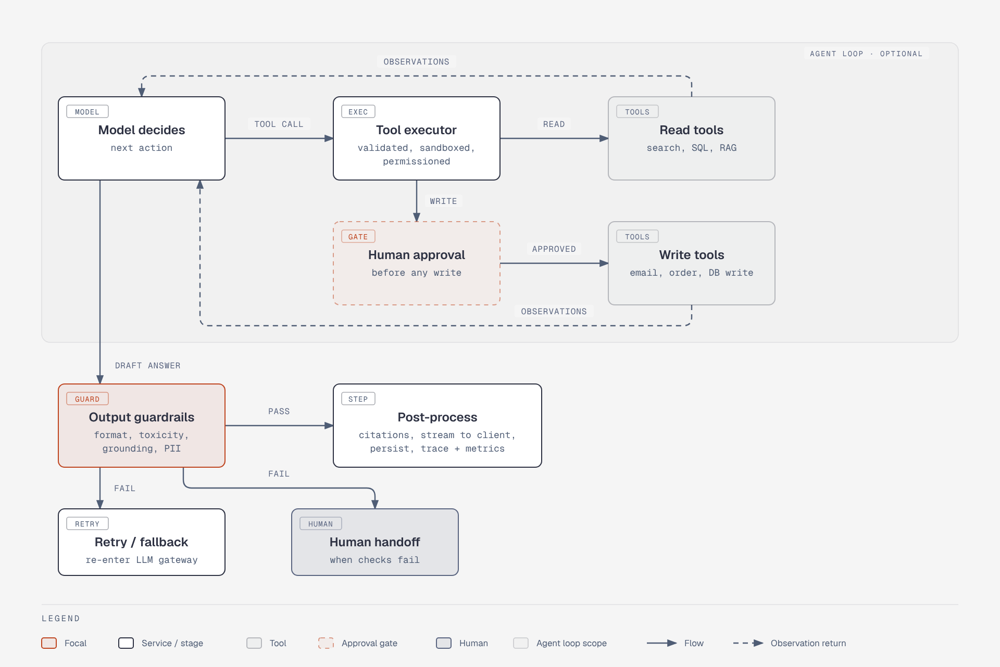

# Agent loop and output guardrails

**What it shows.** After the model call: the optional agent loop (write tools gated by human approval, observations returned to the model), then output guardrails with pass, retry/fallback and human-handoff paths.

**Diagram type.** Architecture (one zone for the agent loop).

**What the budget forced out or split.** The data flywheel and client stream moved to the overview. Two observation returns (read tools, write tools) are kept as separate dashed connectors.

**Assumptions.** The draft-answer path leaves the model node directly, as in the original. Retry / fallback re-enters the LLM gateway (stated in its sublabel, not drawn as a loop-back arrow).

**Source.** `arch-reference-architecture-agent-output.html` (diagram-design skill, default skin, minimal light, doc-inline width 960; height extended where content needs it). Content comes from the topic file genai-system-architecture.md; no claims or numbers added.
