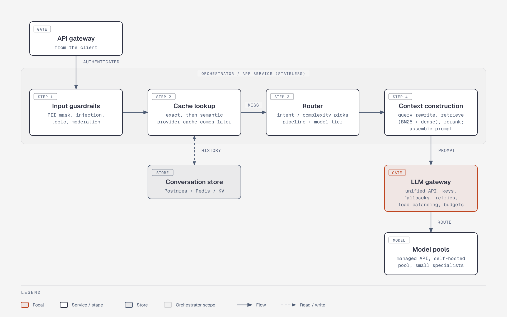

# Request path: orchestrator to model pools

**What it shows.** The four orchestrator stages (input guardrails, cache lookup, router, context construction), the conversation store, the LLM gateway and the model pools.

**Diagram type.** Architecture (one zone for the stateless orchestrator).

**What the budget forced out or split.** Split off from the old part 1 of 2. The client is dropped (in the overview), the three model pools are merged into one node (their routes are in `arch-model-serving-routes`), and the cross-cutting box is left to the overview.

**Assumptions.** The conversation store attaches to the cache-lookup stage as in the original graph; the read/write link is a single dashed double-headed connector.

**Source.** `arch-reference-architecture-request-path.html` (diagram-design skill, default skin, minimal light, doc-inline width 960; height extended where content needs it). Content comes from the topic file genai-system-architecture.md; no claims or numbers added.
