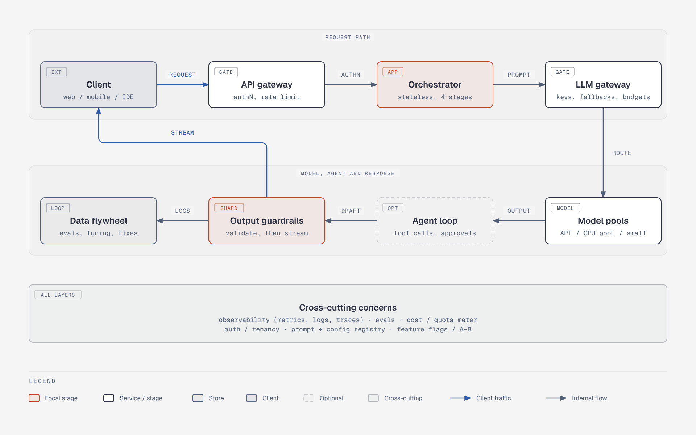

# Reference GenAI architecture, layer view

**What it shows.** The whole request path at layer level: client, API gateway, orchestrator, LLM gateway, model pools, optional agent loop, output guardrails, client stream and data flywheel, with cross-cutting concerns underneath.

**Diagram type.** Architecture (two flat zones). The headline figure is a components-and-connections snapshot.

**What the budget forced out or split.** The old single graph was far over the 9-node budget. This overview keeps 9 nodes; the orchestrator's four stages, conversation store and the three model pools are detailed in `arch-reference-architecture-request-path`, and the agent loop and fail paths in `arch-reference-architecture-agent-output`. The data flywheel's downstream (eval sets, fine-tuning, prompt fixes) is folded into its sublabel.

**Assumptions.** Cross-cutting concerns drawn as one band node instead of arrows to every layer. The agent loop is drawn on the path although it is optional (dashed node). Audience: mixed.

**Source.** `arch-reference-architecture.html` (diagram-design skill, default skin, minimal light, doc-inline width 960; height extended where content needs it). Content comes from the topic file genai-system-architecture.md; no claims or numbers added.
