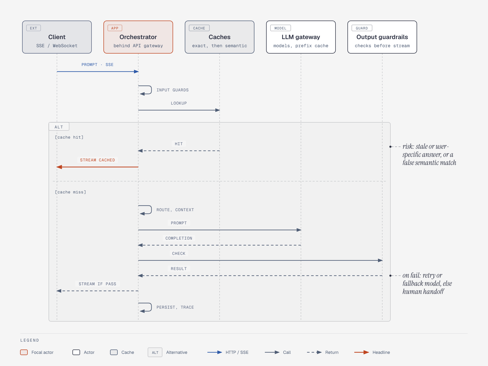

# Lifecycle of one request

**What it shows.** A cache hit short-circuits generation; a miss runs router, context construction and the model call; output checks gate the stream, and a failed check retries on a fallback model or hands off to a human.

**Diagram type.** Sequence with one `alt` fragment (hit / miss).

**What the budget forced out or split.** Sequence budget is 5 lifelines and no nested fragments: the API gateway is folded into the orchestrator lifeline, and the inner pass/fail branch is a RESULT message plus a callout instead of a nested `alt`. The note about the agent loop and write-tool approval was dropped (covered in the agent-output figure); the provider prefix cache is a sublabel on the LLM gateway.

**Assumptions.** Persist + trace is drawn as a self-message after streaming.

**Source.** `arch-request-lifecycle.html` (diagram-design skill, default skin, minimal light, doc-inline width 960; height extended where content needs it). Content comes from the topic file genai-system-architecture.md; no claims or numbers added.
