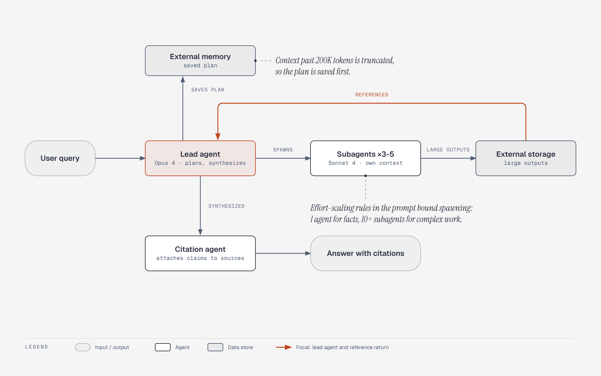

# Anthropic multi-agent Research system

**What it shows:** The orchestrator-worker topology: a lead agent saves its plan to external memory, spawns parallel subagents, receives lightweight references back via external storage, and hands its synthesis to a citation agent.

**Diagram type:** Architecture (no semantic pattern routed). Components, stores and a headline return path in one snapshot.

**What the budget forced out or merged:** The three subagent boxes collapsed to one "Subagents x3-5" node. The effort-scaling rules box became an italic callout on the subagents; the 200K-token truncation note became a callout on external memory. Accent: lead agent and the reference-return arrow.

**Assumptions:** Doc-inline preset, mixed audience, balanced detail. Content only from the "Anthropic - multi-agent Research" section; no new facts. Illustrates the matching entry in [`../case-studies.md`](../case-studies.md).

Source: `cs-anthropic-research-system.html` (diagram-design skill, default skin, minimal light variant).
