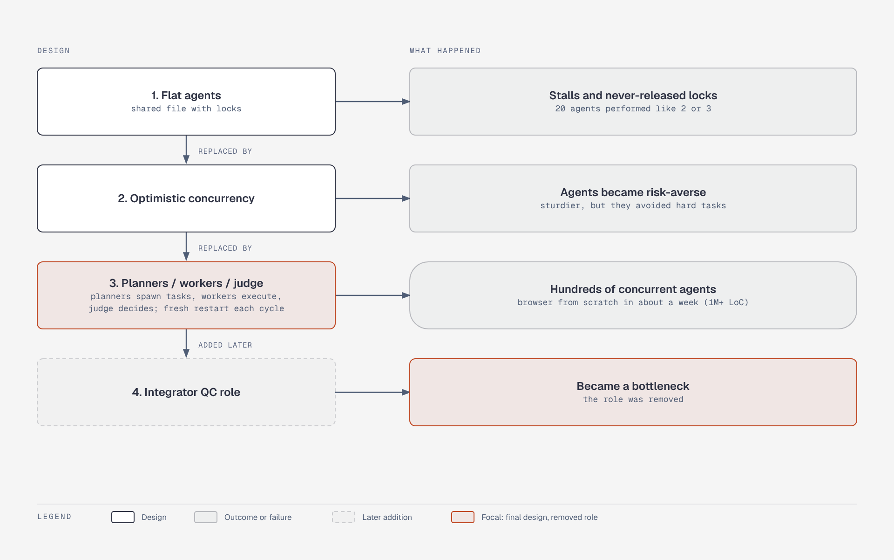

# Cursor - evolution of multi-agent coordination

**What it shows:** Four design stages, each with the problem that ended it, ending in planners/workers/judge with the integrator role removed.

**Why this diagram type:** A vertical flowchart reads as a timeline of design iterations.

**Design decisions:** Problems are red; the final planner/worker/judge cycle is expanded with its fresh-restart loop. Colours follow the shared set: blue for model calls, green for deterministic code, orange for humans, red for failure causes, grey for data stores, purple for external inputs. Top-to-bottom layout keeps it narrow.

**Assumptions / source:** Every element comes from the text of the section named below; no new facts. Illustrates the "Cursor — scaling long-running multi-agent runs" entry in [`../case-studies.md`](../case-studies.md).

Source script: `cs-cursor-coordination-evolution.mmd` (Mermaid, rendered via Kroki).
