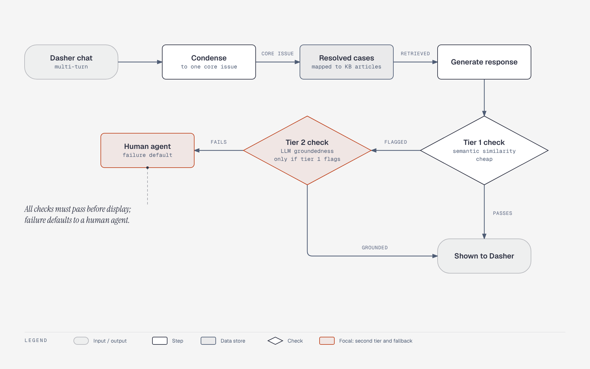

# DoorDash Dasher support RAG with two-tier guardrail

**What it shows:** The online path: condense, retrieve, generate, tier-1 similarity check, tier-2 LLM groundedness check only when flagged, and the human-agent fallback.

**Diagram type:** Flowchart (no semantic pattern routed): the two guardrail tiers are decisions and the default-to-human path is the point.

**What the budget forced out or merged:** The offline monitoring subgraph (LLM judge, Promptfoo regression suites, human calibration) was dropped to stay inside the 9-node budget; it stays in the prose, and the caption only describes the online path. Accent: tier-2 check and human agent.

**Assumptions:** Doc-inline preset, mixed audience, balanced detail. Source is a secondary summary, as noted in the topic file. Illustrates the matching entry in [`../case-studies.md`](../case-studies.md).

Source: `cs-doordash-support-guardrail.html` (diagram-design skill, default skin, minimal light variant).
